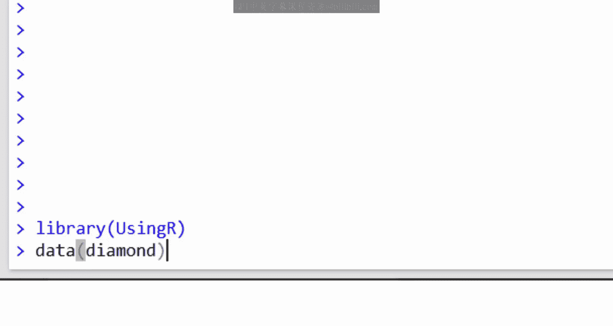
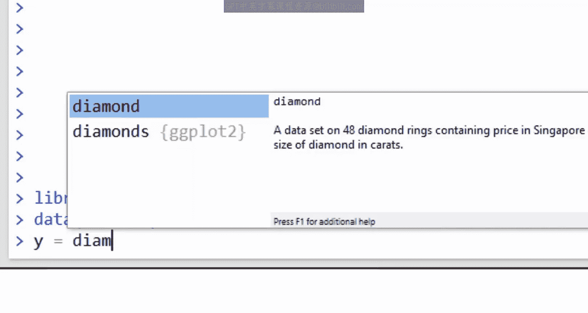
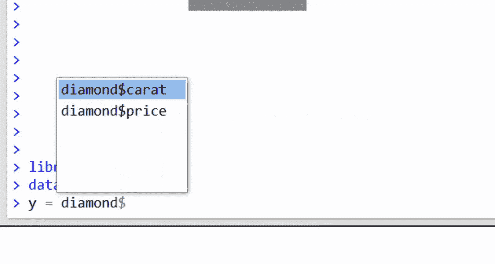
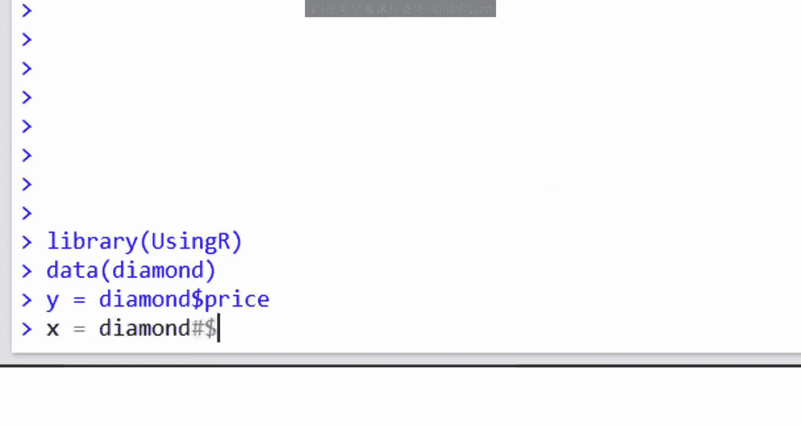
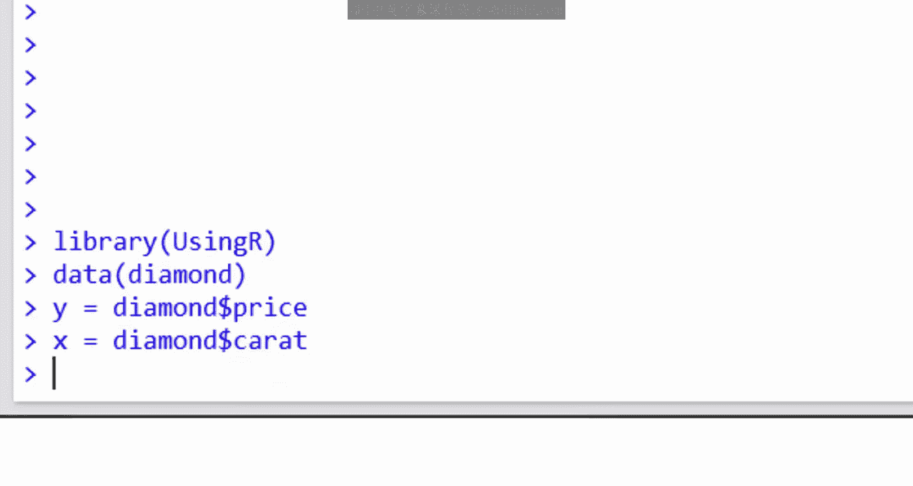
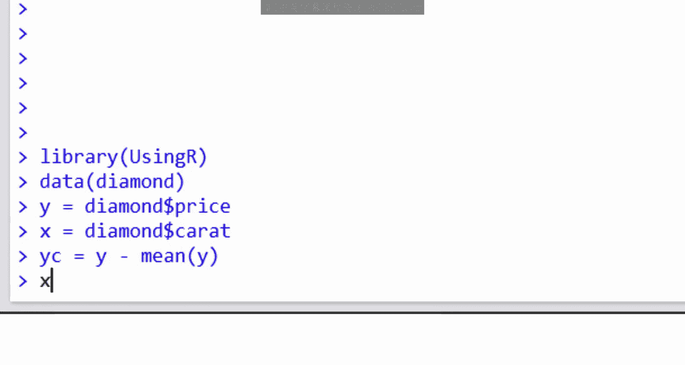
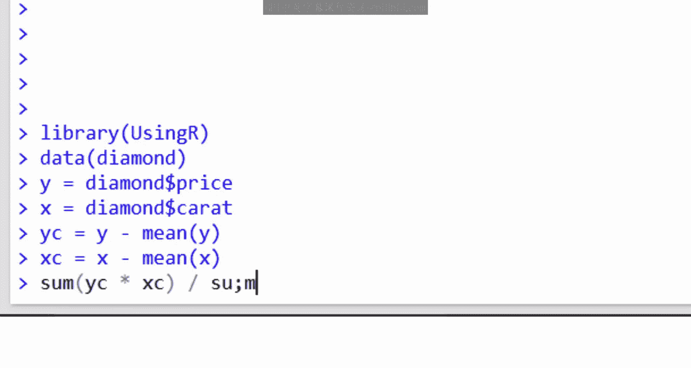
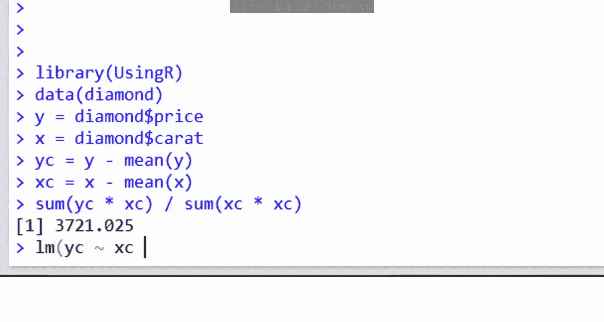
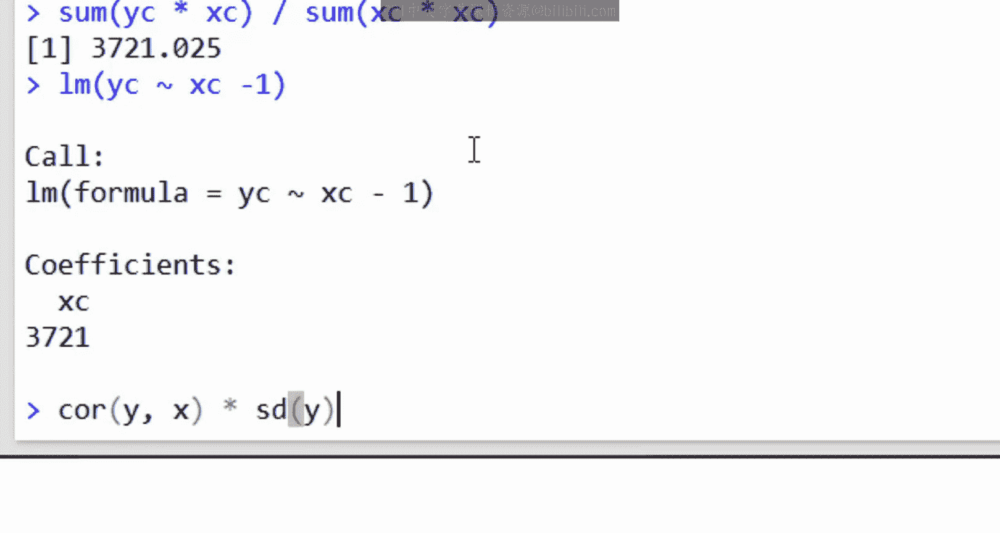
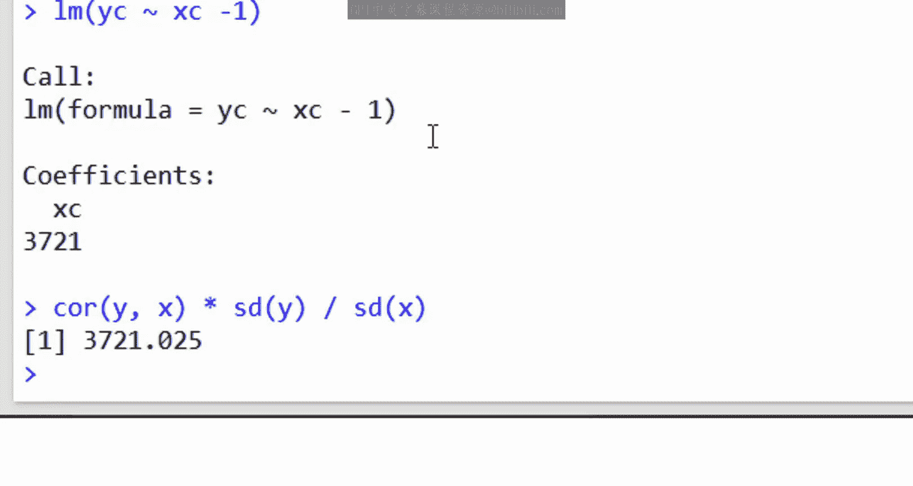

# 约翰霍普金斯大学《数据科学的高级统计｜Advanced Statistics for Data Science》中英字幕（deepseek p83 9_编程示例.zh_en -BV1htPjeYEFH_p83-

Okay， so we're going to use the library。Using R。And then we're gonna do data diamond。

Data set。And then let's define Y is equal to diamond。

Price。

And x equal to。Diamond。

对。Wait。Carrot。

So I'm going to define the centered version of y as y minus its mean。

 and I'm going to define the centered version of x as x minus its mean。

Okay， so the slope， I said， the slope。Of the regression to the origin is going to be the。嗯。

Inner product， divided by the。

Product of the x， the inner product of the X with itself。 So we get that quantity right there， 3721。

 If I do L M， Y。Tilda， Y C， Tilde X 6 C， right， That's the that's the linear model if we。

Of YC is an outcome with Xc is the predictor， if we subtract off the intercept。

 then you see that we get the same number 3721， so LM comes up with the same thing。

And then if we take the original data set， we take the correlation between Y and x。

And multiply at times the standard deviation of y divided by the standard deviation of x。

 You see that we get the same exact thing。 Okay， so our math checks out when we work it through with a data example。

 the。

Regression through the origin of the centered y and the centered deck is exactly equal to the correlation of the original y in the original x times the ratio of the standard deviations。

