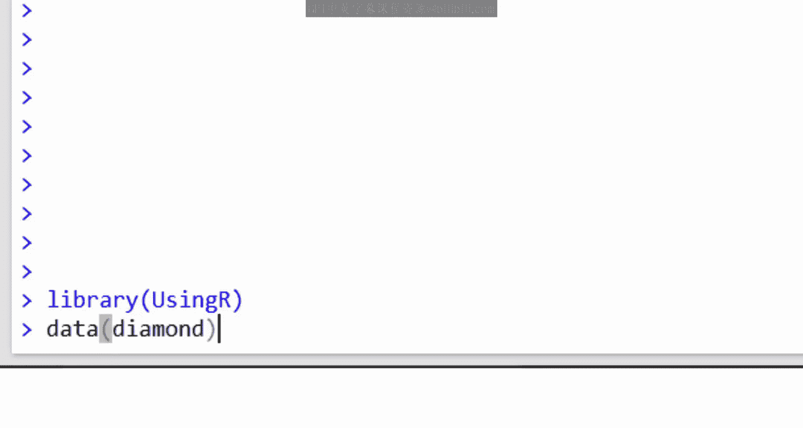
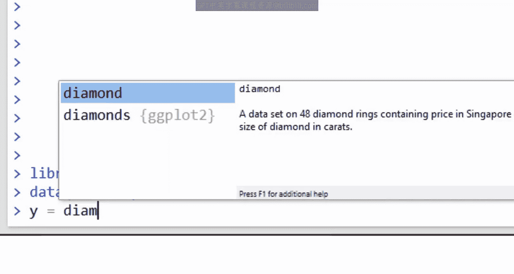
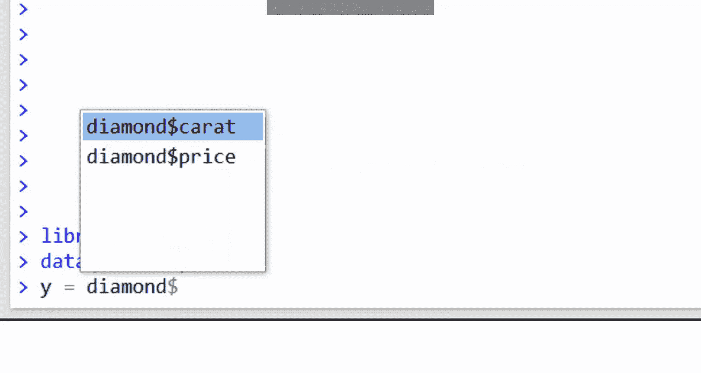
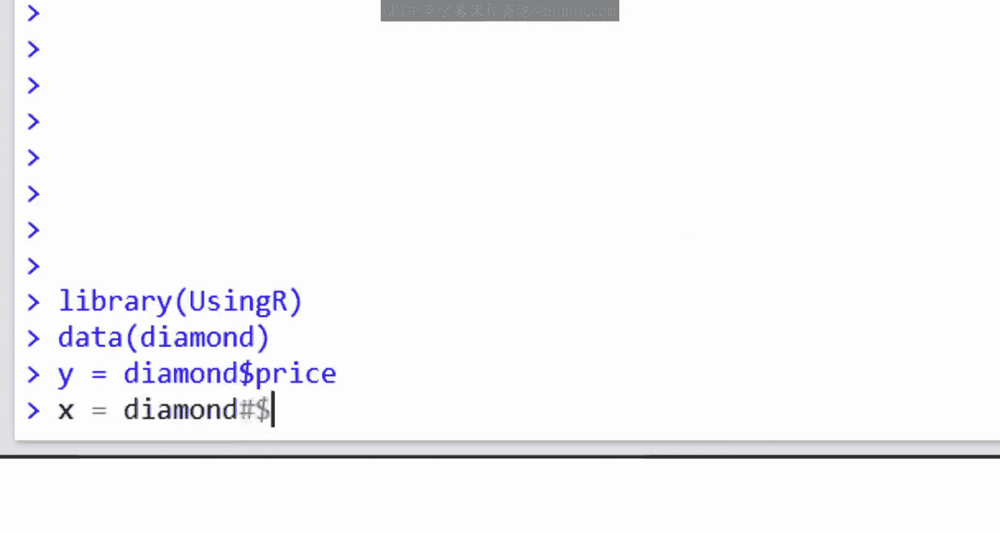
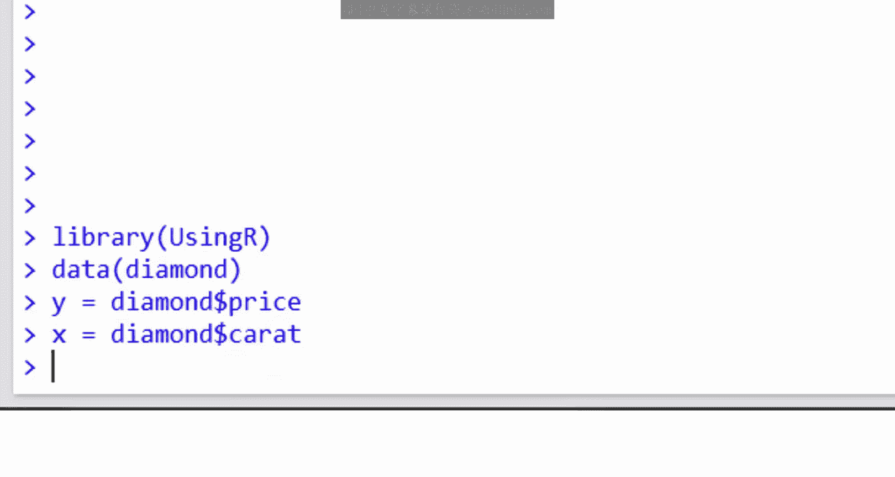
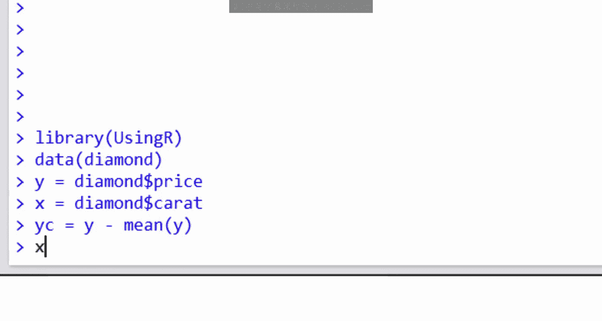
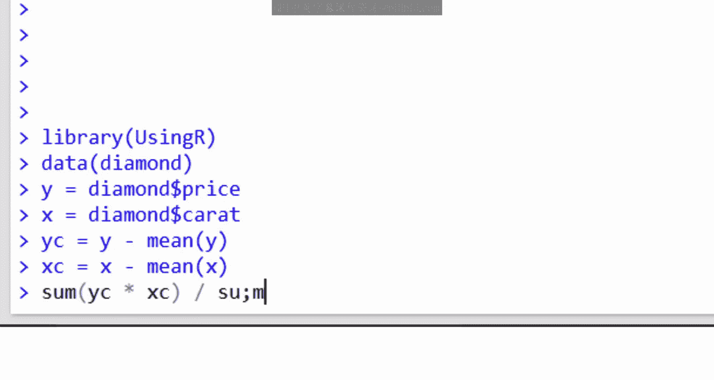
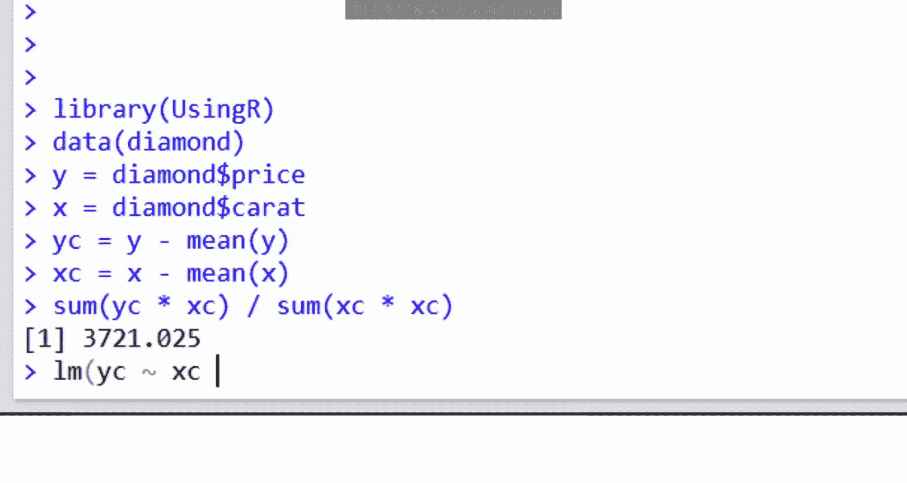
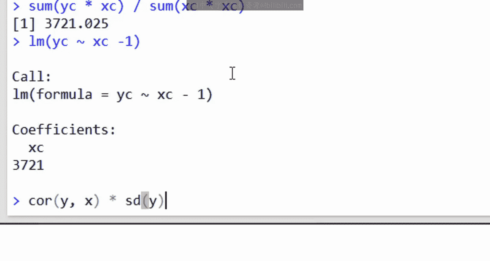
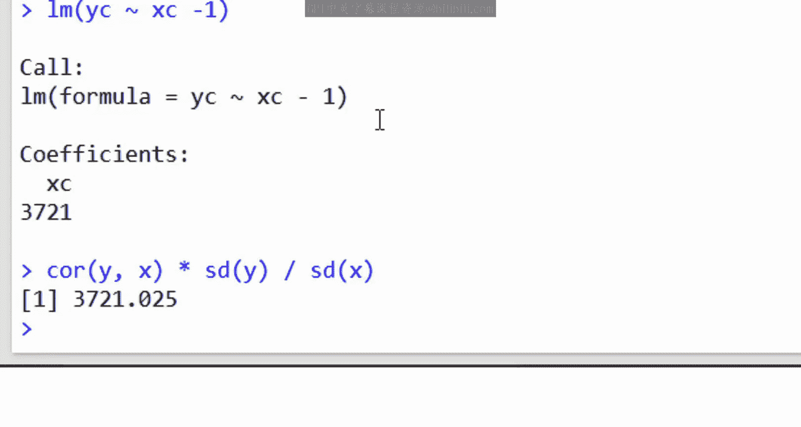

# 数据科学的高级统计：9：回归斜率公式的编程验证 🧮

在本节课中，我们将通过一个具体的R语言编程示例，验证回归分析中斜率的不同计算公式。我们将使用钻石数据集，演示如何通过中心化数据和相关系数两种方法计算回归斜率，并验证它们的结果是否一致。

## 概述



我们将加载R语言中的`UsingR`库，并使用其中的`diamond`数据集。我们的目标是计算钻石价格（`y`）与克拉重量（`x`）之间线性关系的斜率。我们将通过两种数学上等价的方法进行计算并比较结果。

## 数据准备与中心化



首先，我们需要加载数据并定义变量。



```r
library(UsingR)
data(diamond)
```



接下来，我们定义响应变量`y`为钻石价格，预测变量`x`为钻石克拉数。



```r
y <- diamond$price
x <- diamond$carat
```

为了使计算更清晰，我们创建中心化版本的数据。中心化是指将每个数据点减去该变量的平均值，从而使数据的均值为零。

```r
y_c <- y - mean(y)
x_c <- x - mean(x)
```

中心化后的变量`y_c`和`x_c`现在均值为零，这有助于简化后续的回归计算，特别是当我们考虑通过原点的回归时。



## 计算回归斜率

上一节我们准备好了中心化数据，本节中我们来看看如何计算回归直线的斜率。根据最小二乘法原理，对于通过原点的回归，斜率（β）的计算公式为：

**β = (x_c 和 y_c 的内积) / (x_c 和其自身的内积)**



在R中，我们可以用以下代码实现这个计算：

```r
slope_origin <- sum(x_c * y_c) / sum(x_c * x_c)
```

执行这段代码后，我们得到的斜率值约为 **3721**。这个数字表示，在中心化的尺度上，克拉数每增加一个单位，价格平均增加3721个单位。

## 使用线性模型验证

为了验证我们手动计算的结果是否正确，我们可以使用R内置的`lm()`函数来拟合一个线性模型。如果我们用中心化的`y_c`对中心化的`x_c`做回归，并强制截距为零（即通过原点的回归），理论上应该得到相同的斜率。

```r
model <- lm(y_c ~ x_c - 1)
coef(model)
```

运行`lm(y_c ~ x_c - 1)`后，查看模型系数，你会发现它同样给出了 **3721** 这个值。这证实了我们手动计算的斜率是正确的。`lm()`函数是回归分析的标准工具，它的结果与我们根据公式推导的结果一致，增强了我们计算的可靠性。



## 通过相关系数计算斜率

除了直接计算和线性模型，还有一种常见的方法是通过变量的相关系数和标准差来计算斜率。这种方法建立了相关性度量与回归斜率之间的桥梁。

原始变量`y`和`x`的回归斜率（β）的另一个计算公式是：

**β = cor(y, x) * (sd(y) / sd(x))**

其中，`cor(y, x)`是`y`和`x`的相关系数，`sd()`函数计算标准差。让我们在R中计算一下：

```r
slope_cor <- cor(y, x) * (sd(y) / sd(x))
```



执行这段代码后，你会发现`slope_cor`的值同样精确地等于 **3721**。

这个结果完美地验证了我们的理论：对于中心化数据通过原点的回归斜率，与利用原始数据的相关系数和标准差计算出的斜率，在数学上是完全等价的。

## 总结

本节课中我们一起学习了回归斜率的不同计算方法及其在R语言中的实现验证。

我们首先加载并中心化了钻石数据集。然后，我们通过三种方式计算了价格对克拉数的回归斜率：
1.  使用中心化数据的公式手动计算。
2.  使用`lm()`函数拟合线性模型进行验证。
3.  利用原始数据的相关系数和标准差进行计算。



所有方法都得出了相同的结果（3721），这有力地证明了这些数学公式的等价性。理解这些计算的内在联系，对于深入掌握回归分析的核心原理至关重要。