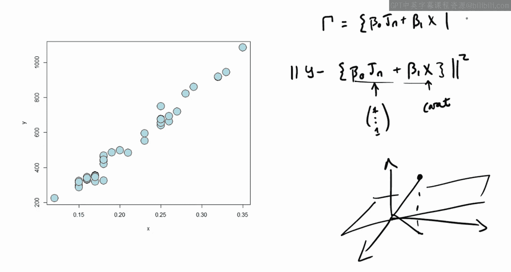
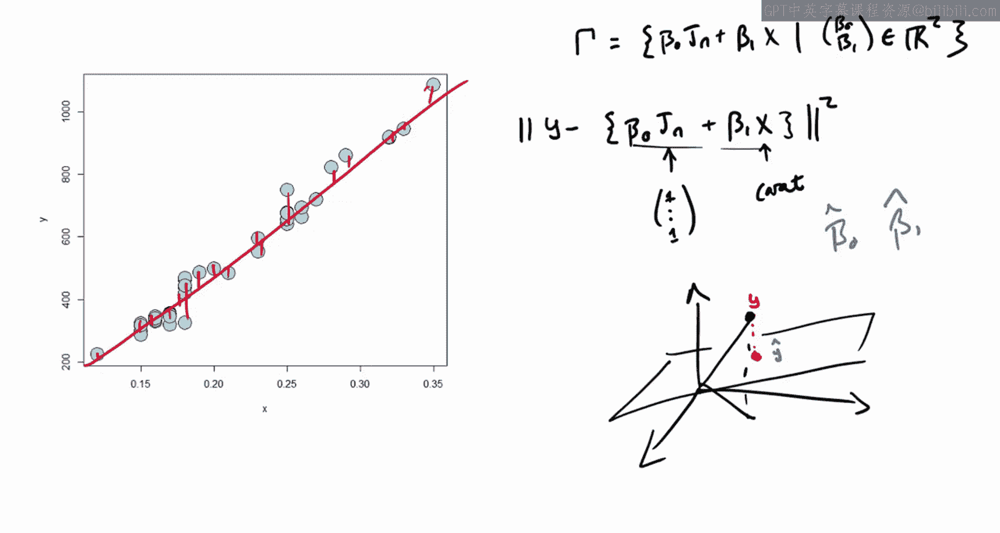
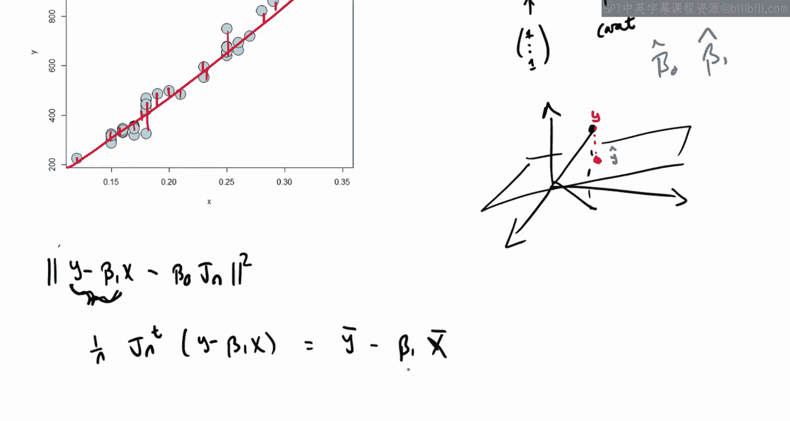
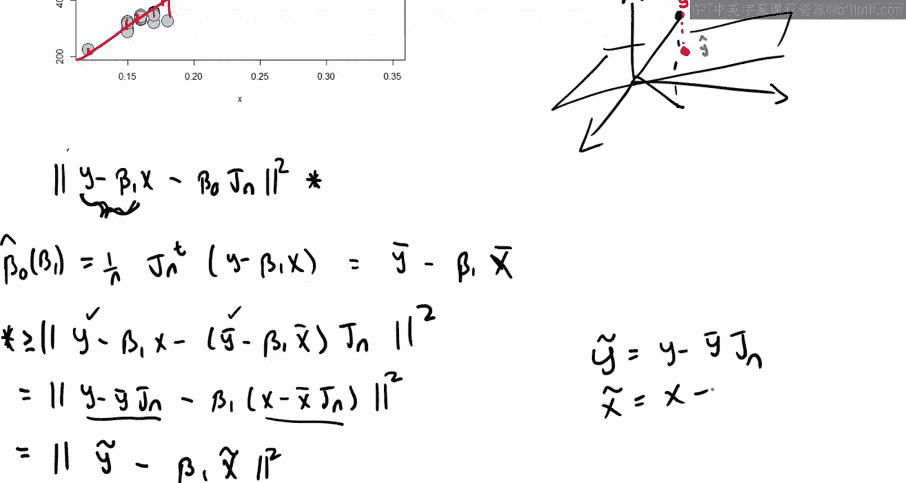
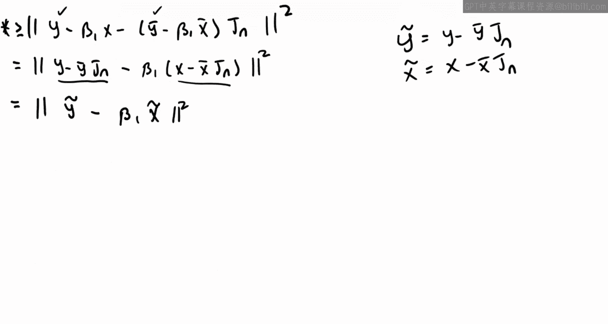
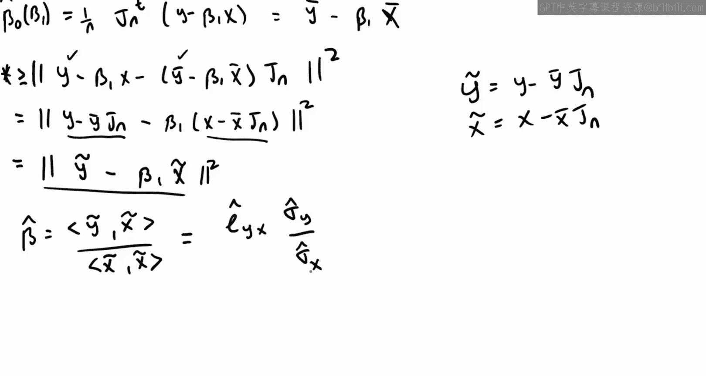
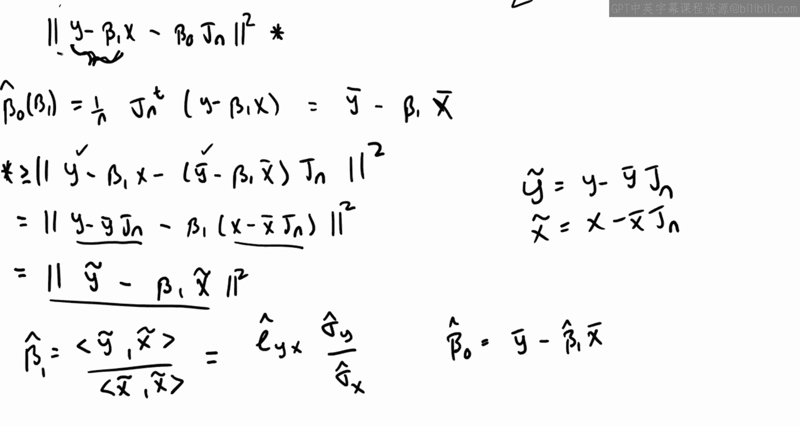

# 约翰霍普金斯大学《数据科学的高级统计｜Advanced Statistics for Data Science》中英字幕（deepseek p84 10_与线性回归的关联.zh_en -BV1htPjeYEFH_p84-

So recall our diamond data set from before here。 Y was the price in X was the carrot。

Consider now trying to fit a line through this data where we have both an intercept in a slope。

 So a two parameter progression setting。And of course。

 we wouldn't want to fit a line through the intercept in this case because look。

 it should go somewhere around 200 for the y Y point。

 So we definitely don't want a line through the intercept。

 We simply want to find the best fitting line through the data like that。

 So we want to minimize y minus。Beta not。Times J N plus beta 1 times x where。

JN is the vector of ones。That's just one。An X is。Carrot。The weight of the diamond basically。So。

How can we do this so far and we've actually derived a matrix version of this in a previous lecture。

 but let's go through it as a two parameter problem here。But first。

 before we before we discuss the two parameter problem。

 let's talk about what we're doing relative to projections。 So imagine in this case。

 y isn't three dimensional。 Y is， however many points that is dimensional 20 or something like that。

But imagine if y was three dimensional， we only have three data points。What will we be doing， Well。

 our vector Y， our outcome would be a point in three dimensional space， right。

And so our two we our surface would be all the points that we want to project on would be all the points that are of this form as beta n and beta 1 vary。

 So that's a plane in three dimensions， right， because it's inherently two dimensional， right。

 It only only two parameters are varying linearly in that space。

 the space that looks like that's the space gamma， which is the collection of beta n times Jn plus beta1 times x for beta beta 1。

In R 2， that space is， of course， two dimensional。 So it looks like a， and it's linear。

 So it looks like a plane in three dimensions。 So what we're trying to do is given our outcome Y。

 which is right here。 we want to project it。Onto this two dimensional plane and find the point。

 let's say， let's call that Y hat。The point that lives in that two dimensional plane。That is closest。

That is closest to the observed beta Y。 the specific values of beta that multiplied times J and an x to give us that point Y hat are going to be we'll call those beta not hat and beta 1 hat。

 So in this lecture， we're going to talk about how do you find beta not hat and beta 1 hat。

 Another way to think about this problem is to think in terms of the scatter plot where we have y and x。

 Here we have a line of the form y equal beta n plus beta 1 x。

 And our least squares criteria is taking the vertical distances between the points and the line。

And finding。The line that minimizes the sum of the squared vertical distances。

 So that's another way to think about it。 So there's two ways to think about it。

 One is to think about it as minimizing the vertical squared distances from the scatter plot and another is to think about it as a projection in n dimensional space。

 Of course， we can't visualize the n dimensional projection。 We have to think of it。

 pretend like it's a three dimensional。

Projection just for the illustration。So let's go ahead and do this。

 and I think there's a pretty easy way to do this with the tools that we've already built up。

So consider y minus beta 1 x minus beta n times Jn。Squared， imagine if beta 1 was fixed。

 So let's just think of that as a single vector。Okay， imagine if beta1 was fixed。

 then the minimum of this equation over beta n is just going to be the average because this is just regression with a constant。

 Okay it's going to be the average of this vector here。Okay。

 so the average of that vector there is just。J N transpose1 over n J N transpose times y minus beta 1 x。

Okay， but because of transitivity， this works out to be1 over Nj and transpose times y。

 which is y bar。And minus beta 1， which is scalar times 1 over Njn transpose times x， which is x bar。

So we know that the minimizer has to go through the point Y bar minus beta 1 x bar。

 So that's our intercept beta not hat as it depends on beta 1。

Has to be equal to that。 So let's plug that back into our equation。

 So y minus beta 1 x minus beta not hat of beta 1。 So we're going to plug in y bar minus beta 1 x bar。

Times JN。Okay， squared。 So we know that this quantity right here， asterisks， that asterisks。

Has to be greater than or equal to that thing。Okay， so let's just do some reorganization。 Okay。

 so this works out to be y minus y bar times J N minus。So that takes care of that term。

Then the y bar times Jn， and then we need a minus。Beta1。X minus x bar。嗯。Forgot my JN。X bar times Jn。

Quantalityity squared。Okay， now， before whenever we centered our random variables。

 we are calling them Y tilde or x tilde。 So notice this is just the centered version of y。

 and this is just the centered version of x。 So this is now equal to y tilde。

Minus beta 1 x tilde squared where y tilde is simply y minus y bar times Jn。

 and x tilde is equal to x minus x bar times Jn。

Now。

This， this equation is exactly regression to the origin with the centered variables。

 which we talked about in a couple lectures ago。 So we know that beta 1 hat has to be equal to the inner product of y tilde and X tilde over。

X tilde。Inter product of x tilde by itself。 And we also argued that that worked out to be the correlation between Y and x。

 the estimated correlation between y and x times the estimated standard deviation of the y divided by the estimated standard deviation of the x。

 So the regression。The best regression slope works out to be exactly the same slope as if we centered the variables first and then did regression to the origin。

And the intercept， if we need an intercept， right， so that's beta 1 hat。

 and if we needed an intercept， beta not hat is just y bar minus beta 1 hat。X bar。

 And so we've proven by plugging these in that we've gotten as small as you possibly can in terms of the set of inequalities。

 So these must be the minimizer of the least squares equation。

