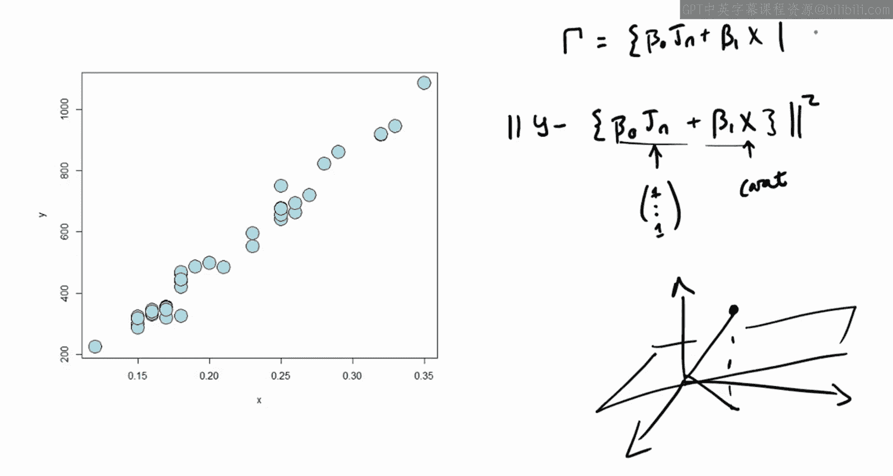
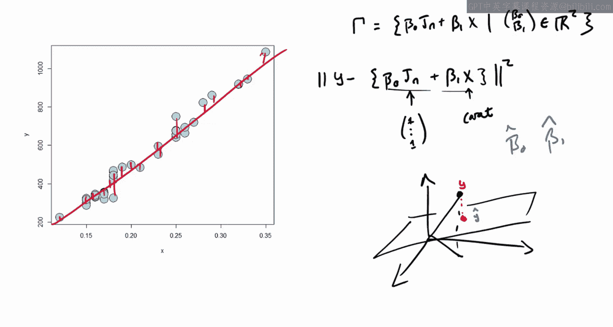
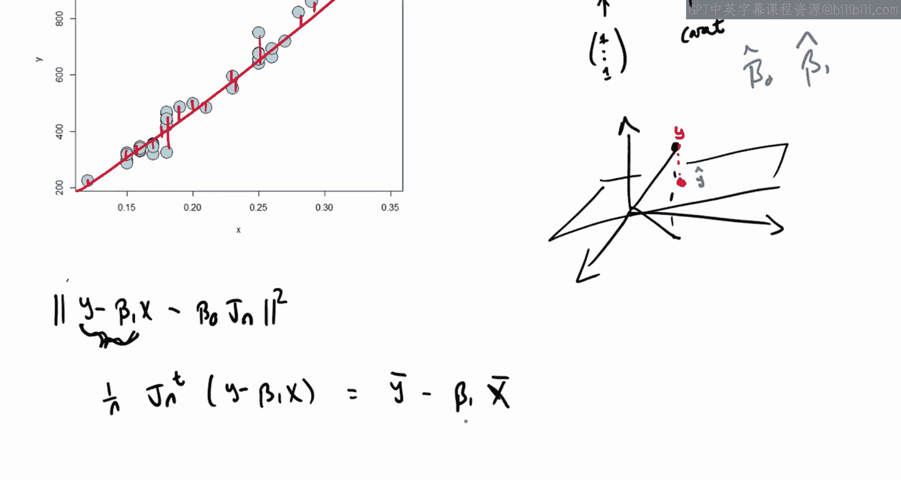
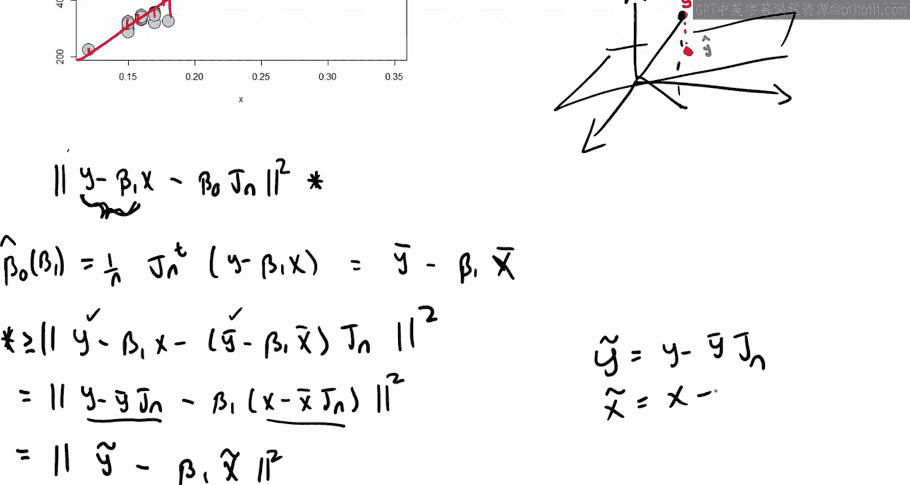
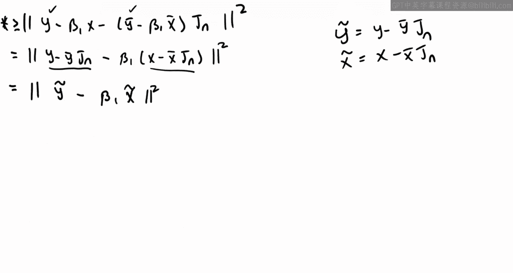
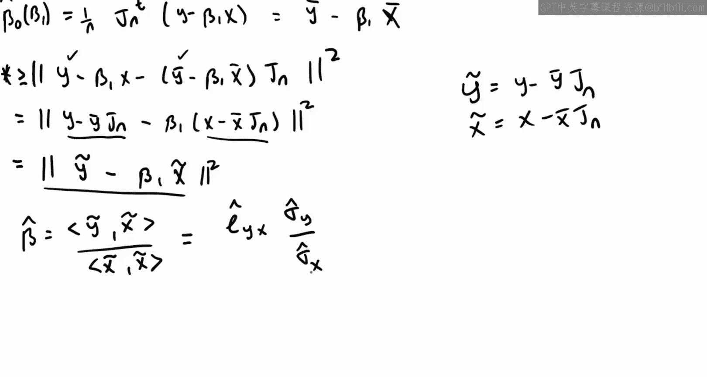
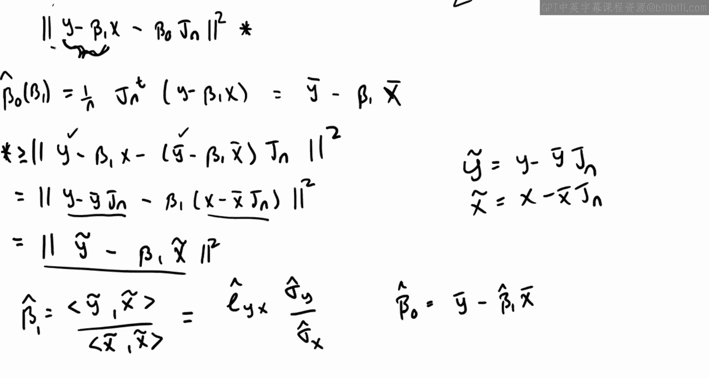

# 数据科学的高级统计：10：与线性回归的关联 🔗

在本节课中，我们将学习如何将线性回归问题与投影的概念联系起来。我们将通过一个具体的钻石数据集例子，推导出包含截距和斜率两个参数的线性回归模型的解。我们会看到，这个问题既可以从最小化垂直距离的角度来理解，也可以从高维空间投影的角度来理解。

---

## 回顾数据集与问题设定

回忆我们之前的钻石数据集。其中，`Y` 代表价格，`X` 代表克拉数。

现在考虑尝试用一条直线来拟合这些数据，这条直线包含一个截距和一个斜率。这是一个双参数的回归设定。

我们显然不希望拟合一条通过原点的直线，因为当 `X` 为0时，`Y` 的起点应该在200左右。因此，我们只想找到一条能最佳拟合数据的直线。

我们的目标是最小化以下表达式：
`y - (β₀ * Jₙ + β₁ * x)`
其中，`Jₙ` 是全1向量，`x` 是钻石的重量（克拉数）。

---

## 从投影的角度理解

在之前的课程中，我们实际上已经推导过这个问题的矩阵版本。但在讨论双参数问题之前，我们先从投影的角度来理解我们在做什么。

假设 `y` 是三维的（尽管实际数据点维度更高，例如20维，但我们可以用三维来类比）。那么，我们的结果向量 `Y` 就是三维空间中的一个点。

我们想要投影到的曲面，是所有形如 `β₀ * Jₙ + β₁ * x` 的点的集合，其中 `β₀` 和 `β₁` 是变化的参数。由于只有两个参数线性变化，这个集合在三维空间中构成了一个平面。

我们试图做的是：给定观测到的结果 `Y`，将其投影到这个二维平面上，找到平面上离 `Y` 最近的点，我们称之为 `Ŷ`。而给出这个 `Ŷ` 点的特定 `β₀` 和 `β₁` 值，就是我们要求的 `β₀_hat` 和 `β₁_hat`。

---

## 从散点图的角度理解

另一种思考方式是考虑散点图。我们有一条形式为 `y = β₀ + β₁ * x` 的直线。最小二乘法的准则是取各数据点到直线的垂直距离，并找到能使这些垂直距离的平方和最小的直线。

因此，有两种思考方式：一种是从散点图最小化垂直平方距离的角度，另一种是从n维空间投影的角度（尽管我们无法可视化n维投影，但可以借助三维投影来理解）。

---

## 推导回归系数

现在，让我们开始推导。利用我们已经构建的工具，有一个相当简单的方法。

考虑最小化以下表达式：
`|| y - β₁ * x - β₀ * Jₙ ||²`

首先，假设 `β₁` 是固定的。那么，这个表达式关于 `β₀` 的最小化问题就变成了一个带常数的回归问题，其解就是向量的平均值。

具体来说，`β₀` 的最小值将是以下向量的平均值：
`(1/n) * Jₙᵀ * (y - β₁ * x)`
这可以推导为 `ȳ - β₁ * x̄`，其中 `ȳ` 是 `y` 的均值，`x̄` 是 `x` 的均值。

因此，我们知道最小化点必须经过 `(ȳ - β₁ * x̄)`。所以，截距 `β₀_hat`（作为 `β₁` 的函数）必须等于这个值。

---

## 代入并简化

现在，我们将这个表达式代回原方程：
`|| y - β₁ * x - (ȳ - β₁ * x̄) * Jₙ ||²`

经过整理，这个表达式可以重写为：
`|| (y - ȳ*Jₙ) - β₁ * (x - x̄*Jₙ) ||²`

我们定义中心化的变量：
`ỹ = y - ȳ * Jₙ`
`x̃ = x - x̄ * Jₙ`

于是，原问题简化为：
`|| ỹ - β₁ * x̃ ||²`

---

## 求解斜率

这个方程正是我们几节课前讨论过的、针对中心化变量的过原点回归问题。

我们知道，`β₁_hat` 必须等于：
`β₁_hat = (ỹ · x̃) / (x̃ · x̃)`
其中 `·` 表示内积。

我们也曾论证过，这等价于 `Y` 和 `X` 的样本相关系数乘以 `Y` 的样本标准差与 `X` 的样本标准差之比。

因此，最佳回归斜率与我们先对变量进行中心化、再进行过原点回归所得到的斜率完全相同。

---

## 最终解

所以，我们得到了回归系数的解：

*   **斜率** `β₁_hat` 由上述公式给出。
*   **截距** `β₀_hat` 则为：
    `β₀_hat = ȳ - β₁_hat * x̄`

通过将这些解代入原不等式，我们已经证明了它们能使最小二乘方程的值尽可能小，因此它们必定是该方程的最小化解。

---

## 总结

本节课中，我们一起学习了如何将带截距的线性回归问题与几何投影联系起来。我们通过固定一个参数、简化问题的方式，推导出了回归系数 `β₀_hat` 和 `β₁_hat` 的解析解。关键步骤在于将原始数据中心化，将问题转化为熟悉的过原点回归，从而优雅地得出了最终公式。这展示了投影思想在解决经典统计问题中的强大力量。