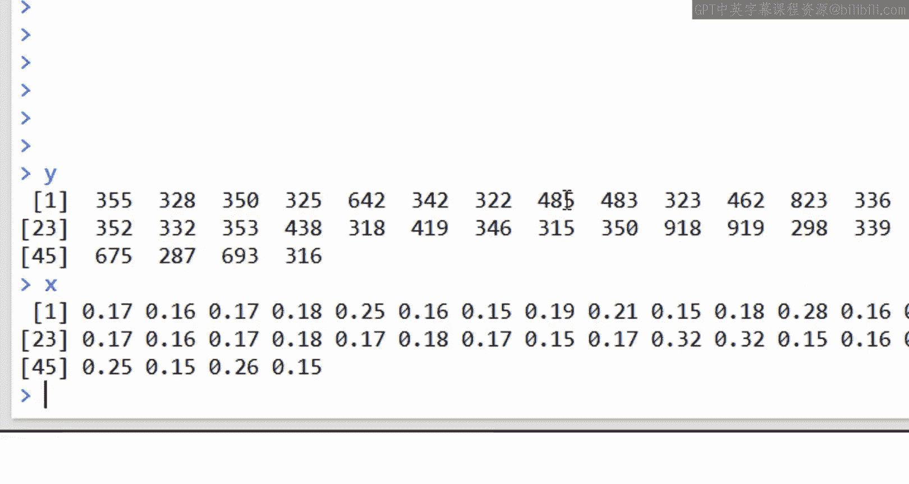
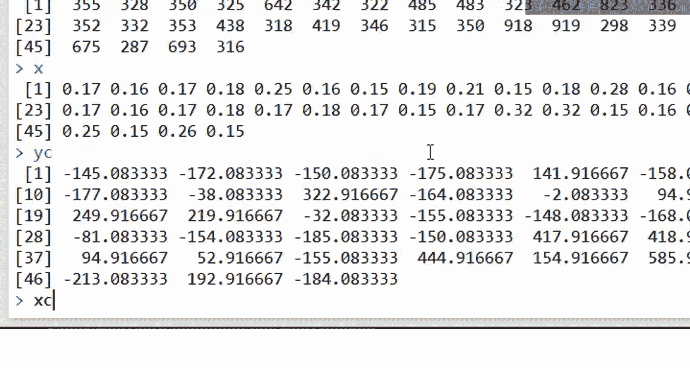
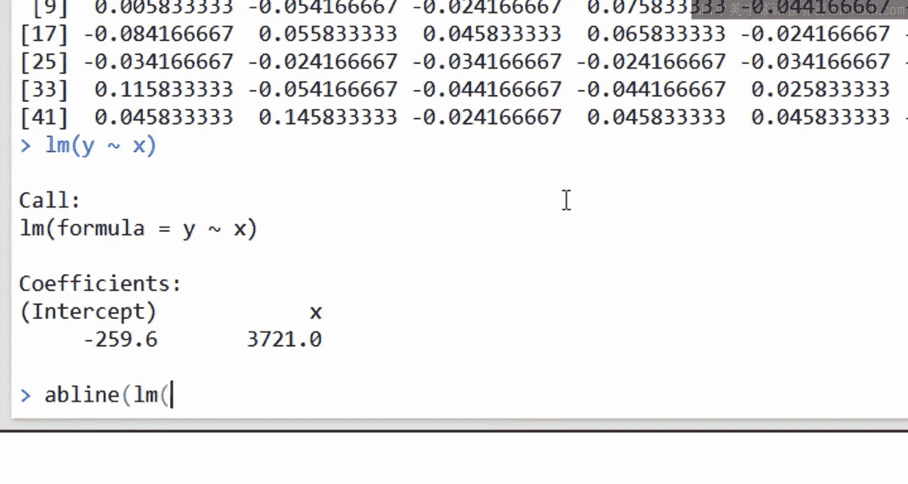
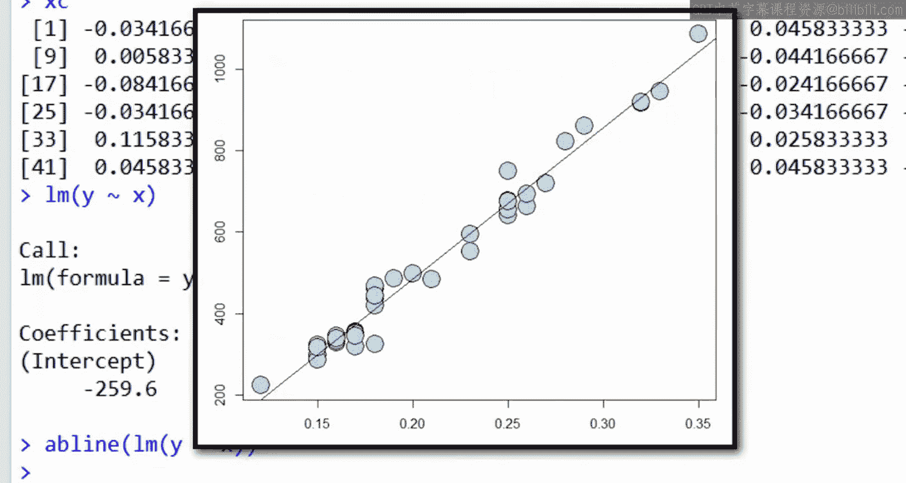
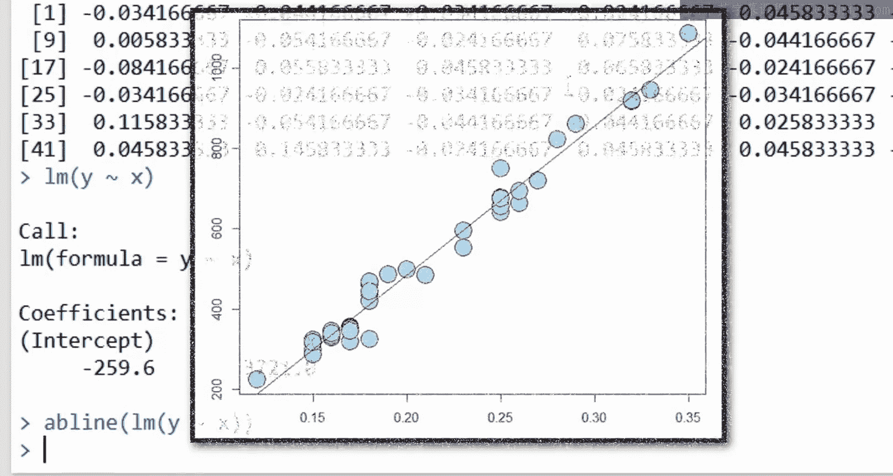
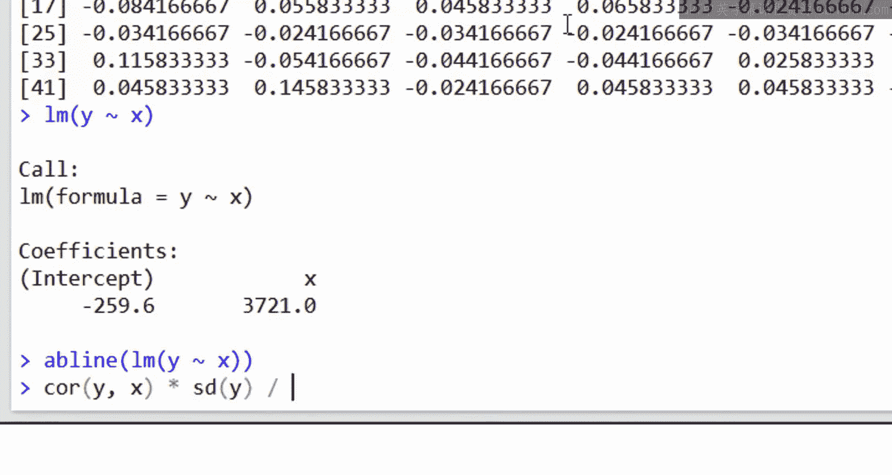
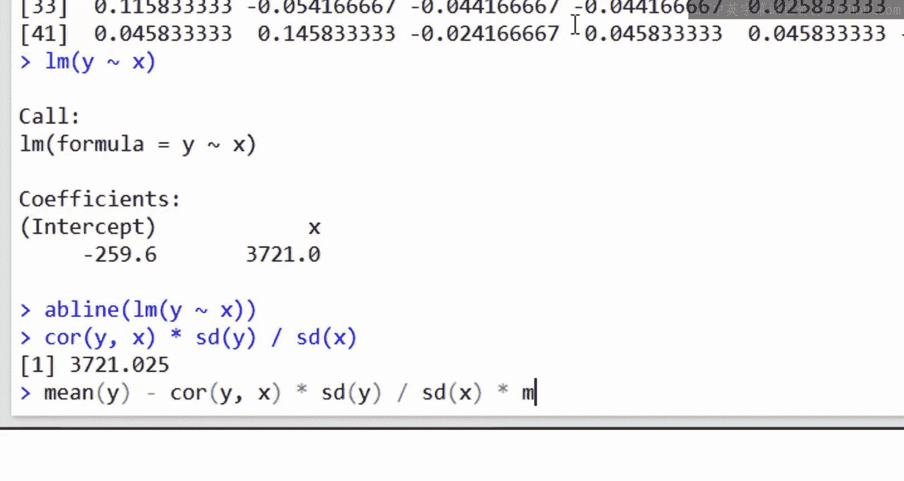
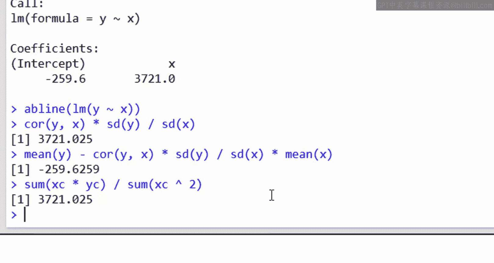

# 约翰霍普金斯大学《数据科学的高级统计｜Advanced Statistics for Data Science》中英字幕（deepseek p85 11_编程示例.zh_en -BV1htPjeYEFH_p85-

So let's just go through some computer examples of fitting a linear regression。

 so remember y was the price X was the carrot value from using our diamond data set。

Then y sub C was the centered version and x sub C was the centered version of the axis。

We could fit。Why。As an outcome， it acts as a predictor。With a linear regression with that。

 we could also， by the way， add it to our plot A B line， LM， Y t that X will add the line。

To our existing scatter plot， and then we can see over in our plot picture here that it fits the data pretty well。

So our results said that the slope should just exactly be the correlation between y and x。

Times the standard deviation of the y divided by the standard deviation of the x。

 and we see that it is exactly that。

And that the。Intercept should just be the mean of the y minus beta。Times the mean of the x。

And we see that it is exactly that negative 259。6， negative 259。6。

We also remember that if we were to take the inner product sum of the centered x's and the times the centered Y。

Dviided by the。X is inner product of the x' is with themselves。

 that's the sum of them squared that we get the same， of course， the same answer。Okay。

 so that's behind the scenes what Elm is doing when it's fitting a linear regression。

