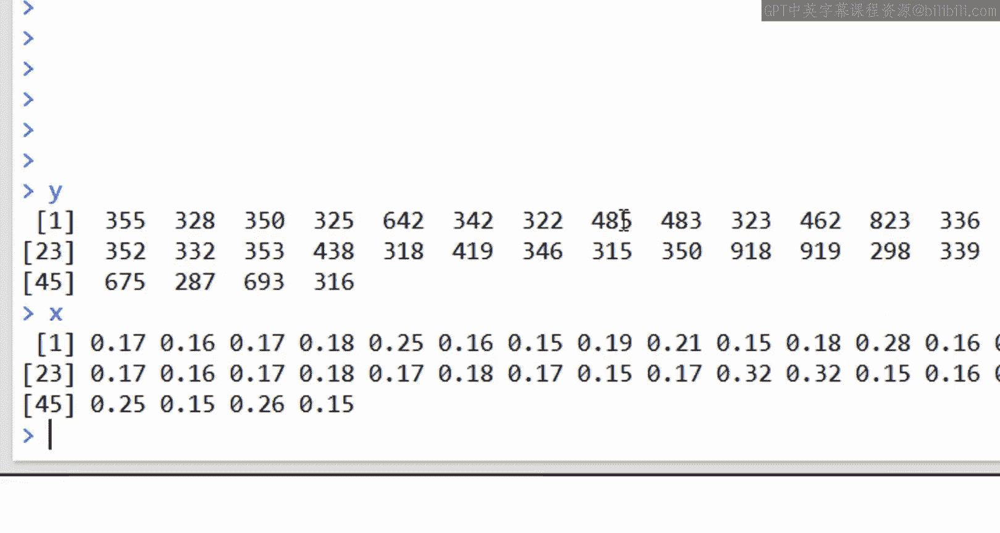
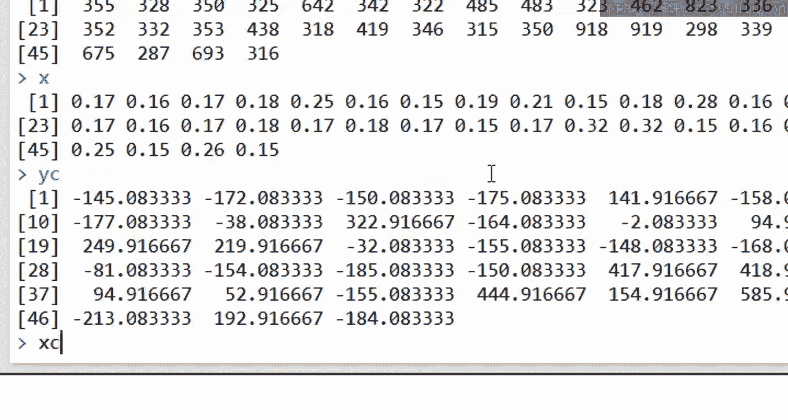
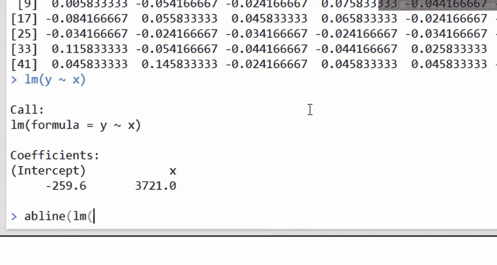
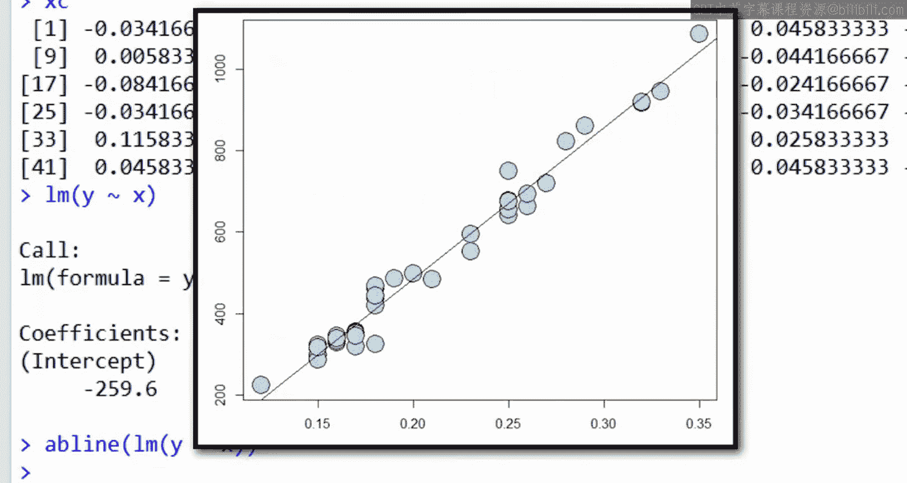
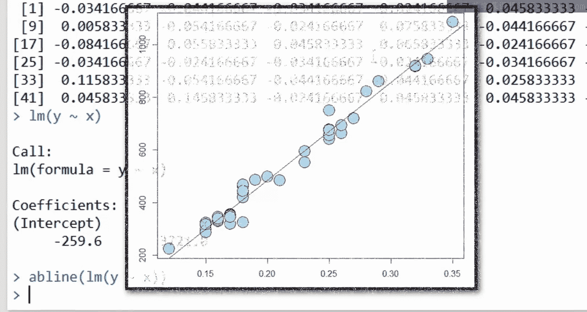
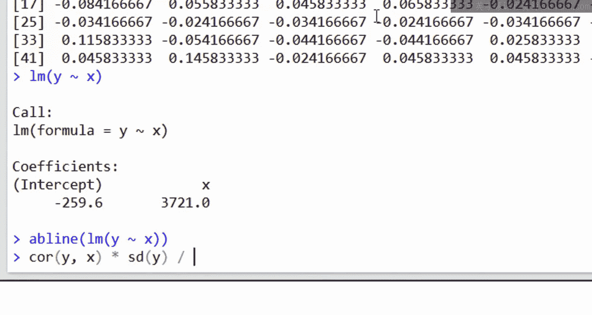
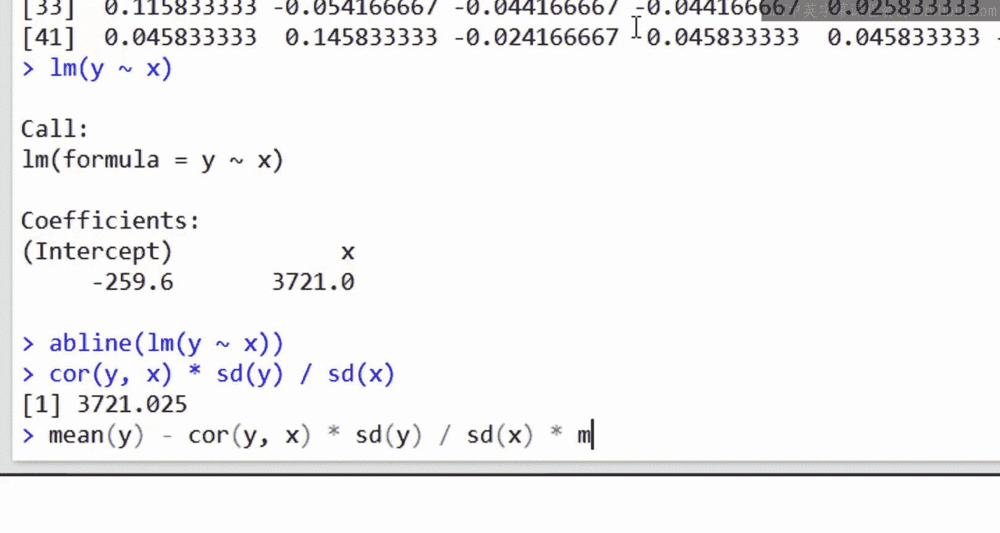
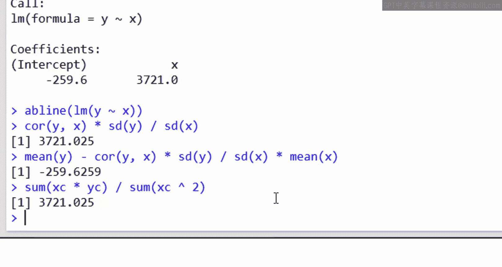

# 数据科学的高级统计：编程示例：线性回归拟合的计算机实现

在本节课中，我们将通过计算机编程示例，学习如何拟合一个线性回归模型。我们将使用钻石数据集，其中价格作为因变量，克拉值作为自变量，并演示如何计算回归系数、绘制拟合线以及验证理论公式。

---

## 数据准备与模型拟合

首先，我们使用钻石数据集。设 `y` 为价格，`x` 为克拉值。



```r
# 假设数据已加载
y <- diamonds$price
x <- diamonds$carat
```

接着，我们创建中心化后的变量 `y_c` 和 `x_c`，即每个变量减去其自身的均值。

```r
y_c <- y - mean(y)
x_c <- x - mean(x)
```



现在，我们可以拟合一个以 `y` 为结果变量、`x` 为预测变量的线性回归模型。

```r
fit <- lm(y ~ x)
```

此外，我们可以将这个回归线添加到已有的散点图上，以直观地查看拟合效果。

```r
plot(x, y)
abline(fit, col = "red")
```

从生成的散点图可以看到，回归线很好地拟合了数据点。



---

## 验证回归系数公式

上一节我们拟合了模型并绘制了回归线。本节中，我们来验证回归系数的理论计算公式。



根据理论，斜率 `beta` 的计算公式为：



**beta = cor(y, x) * (sd(y) / sd(x))**

我们可以通过R代码计算并验证：

```r
beta_calculated <- cor(y, x) * (sd(y) / sd(x))
beta_from_model <- coef(fit)[2] # 提取模型中的斜率系数
```

比较两者，我们会发现它们完全相等。

同样，截距 `alpha` 的计算公式为：



**alpha = mean(y) - beta * mean(x)**

我们可以进行如下验证：

```r
alpha_calculated <- mean(y) - beta_calculated * mean(x)
alpha_from_model <- coef(fit)[1] # 提取模型中的截距系数
```



例如，计算结果可能显示截距约为 -259.6，这与模型输出的结果一致。

---

## 使用中心化数据的计算方法

我们还记得，回归系数也可以通过中心化后的数据来计算。具体公式是，斜率等于中心化 `x` 与中心化 `y` 的内积，除以中心化 `x` 自身的内积。

**beta = sum(x_c * y_c) / sum(x_c^2)**

以下是计算代码：

```r
beta_centered <- sum(x_c * y_c) / sum(x_c^2)
```

运行此代码，我们会得到与之前方法完全相同的斜率估计值。这揭示了 `lm()` 函数在拟合线性回归时，在幕后所执行的计算本质。

---

## 总结



本节课中，我们一起学习了线性回归模型的编程实现。我们演示了如何准备数据、拟合模型、绘制回归线，并重点验证了回归系数（斜率和截距）的理论计算公式。通过比较直接计算、模型输出以及使用中心化数据的计算，我们确认了这些方法的一致性，并加深了对线性回归底层数学原理的理解。