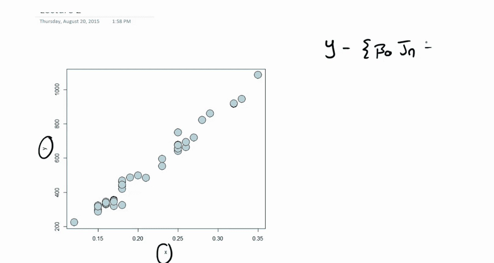
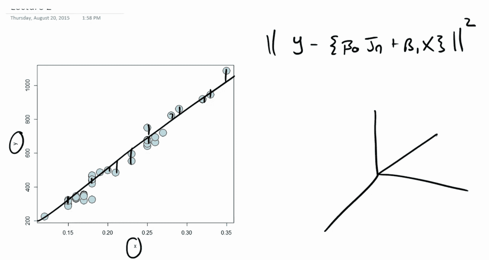
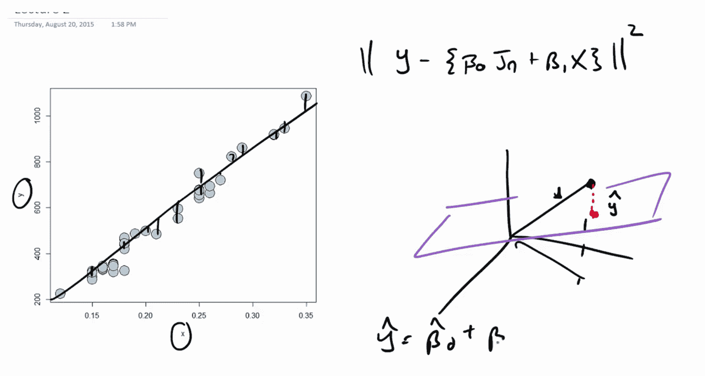
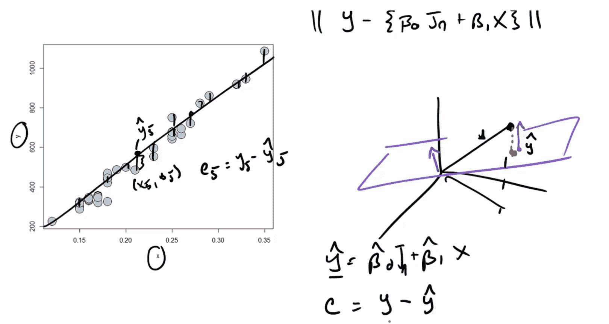
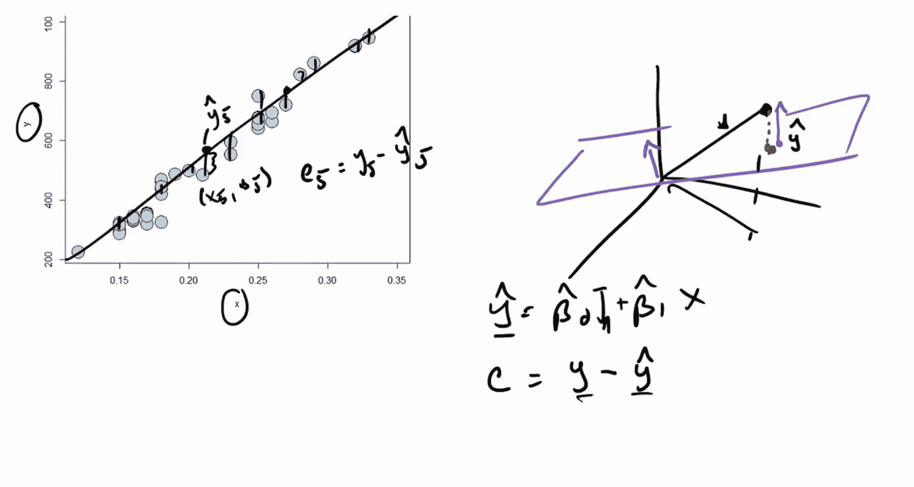
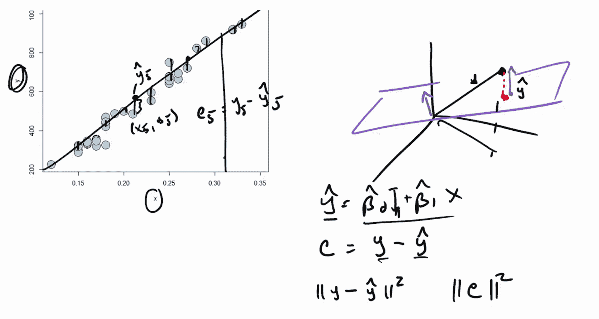

# 约翰霍普金斯大学《数据科学的高级统计｜Advanced Statistics for Data Science》中英字幕（deepseek p86 12_拟合值与残差.zh_en -BV1htPjeYEFH_p86-

Recall our diamond data set that we are looking at， where our X was carrot。And our why was price。

We fit a model Y or we fit the least squares equation， minimizing y minus beta n plus beta1 x。

We minimize that least squares equation。We discussed how there was two。

 at least two ways to think about this。 One was to find this best line that fits the data。

 minimizing the sum of the squared vertical distances。Between the data points and the line。

The second was to think about why as a point in anydial space， which in this case。

 we're just going to visualize it with R3。

Y is a point in n dimensional space and the plane。Beta not Jn plus beta 1 x was the two dimensional plane cutting through y dimensional the n dimensional space。

And the beta hat was the specific combination of points， Jn and x that led to the point right here。

 the projection of y onto that plane， which we'll call Y hat。So hat is。

 so y hat is equal to beta not hat。Plus， beta 1 hat x。

So in this case it's this whole vector and then if we're visualizing it in this left hand case。

 the Y hat each component is just the projections or is not the projections is the straight line。Bng。

The straight line distance， minimum distance points on to this line right here。

 So of this point is this combination is x 5， Y 5。Then this point right here is Y hat sub 5 and Y hat is the vector of Y hats。

So Y hat is defined as beta well， if I'm being technically correct。Which is the best kind of correct。

 it should be why not beta not。Times Jn plus beta 1 times x。Okay， so Y hat are the fitted values。

 It is the projection of the data point Y， the n dimensional data point y onto the two dimensional space defined by x and the constant vector。

And another vector of interest is E， the residual， which is y minus y hat。So every element of E。

 for example， is this distance， so E5 would be the distance between Y5 and Y hat 5。E。

 visualized in this left hand picture。Is the vector right here。

Is the vector that is orthogonal to the plane that points up to the data point Y。

 So it's probably best visualized if we drew it from the origin。 It's over there。So E。

 it makes sense， by the way， and this will come up later on。

 that the vector E is orthogonal to every point in this purple plane that I've drawn here。 Okay。

 so E are called E， the vector of differences between Y and Y hat is the vector of so called residuals。

If you can think about our least squareest criteria is actually， well。

 we could think about it as minimizing y minus y hat。

Squared where y hat takes on this specific form with the beta hat finding the best beta not hat and beta1 hat。

 Or we can also think about our least squares equation as minimizing the sum of the squared residuals。

 Okay， so these are two important concepts。 The fitted values， Y hat and the residuals E。

 So let's go through a computing example where we just compute each of these quantities。

 We'll revisit these。Very frequently throughout the class they're essential to regression。

 one last comment on why hat， if we wanted to predict a。Price for a given carrot value。

 that would be Y hat。 And notice we don't have to only predict at where we observed x values。

 If we wanted， for example， to predict right here， we could plug in an x value。

That we didn't observe and get a predictive y value out now that wouldn't be a y hat value because y hat is specifically the vector predictive values at the observed x's。

 but this illustrates how we would get predictions at x's we didn't observe。

 just plugging straight into the line that we fit。

