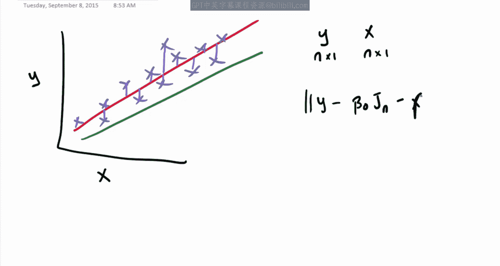
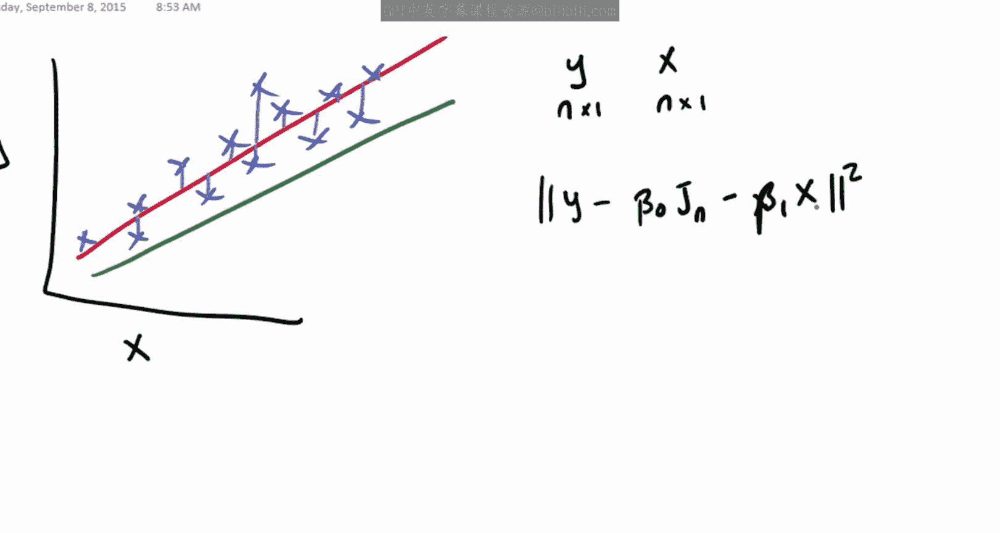
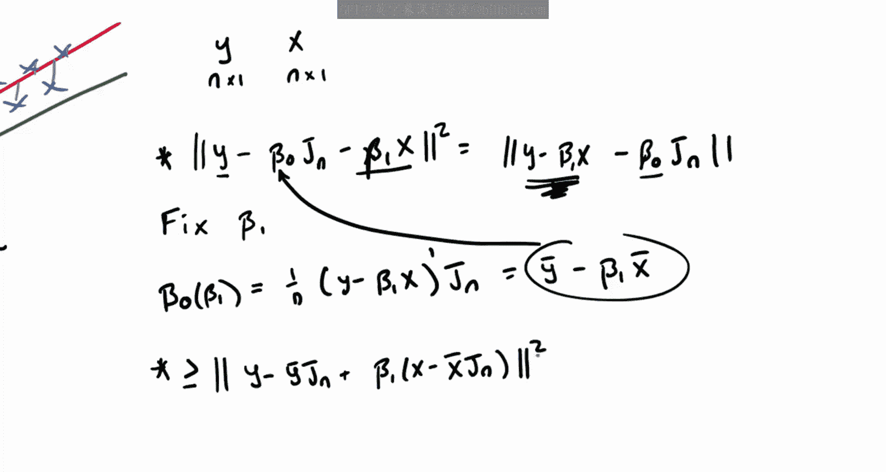
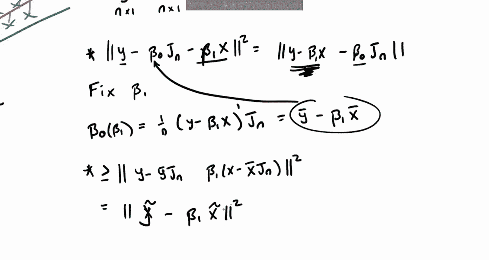
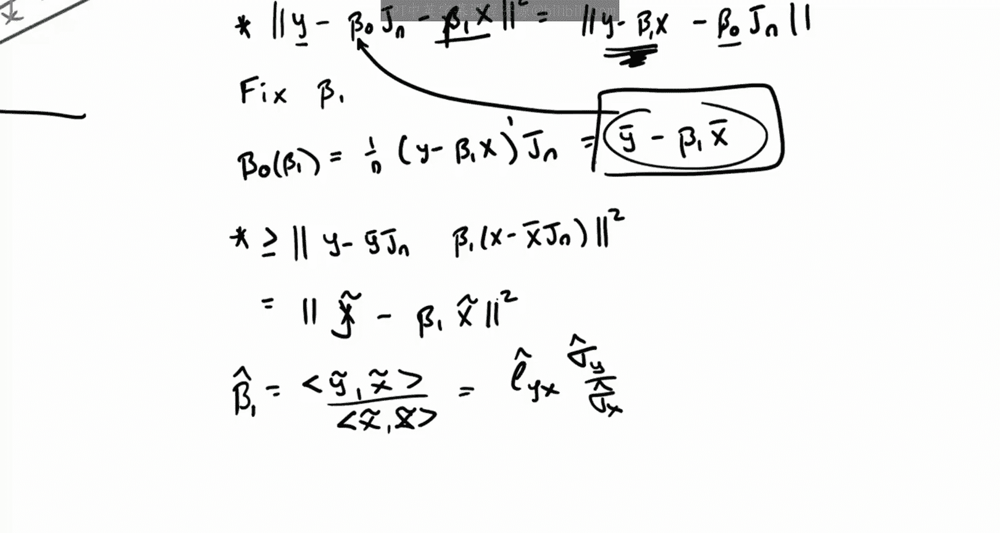
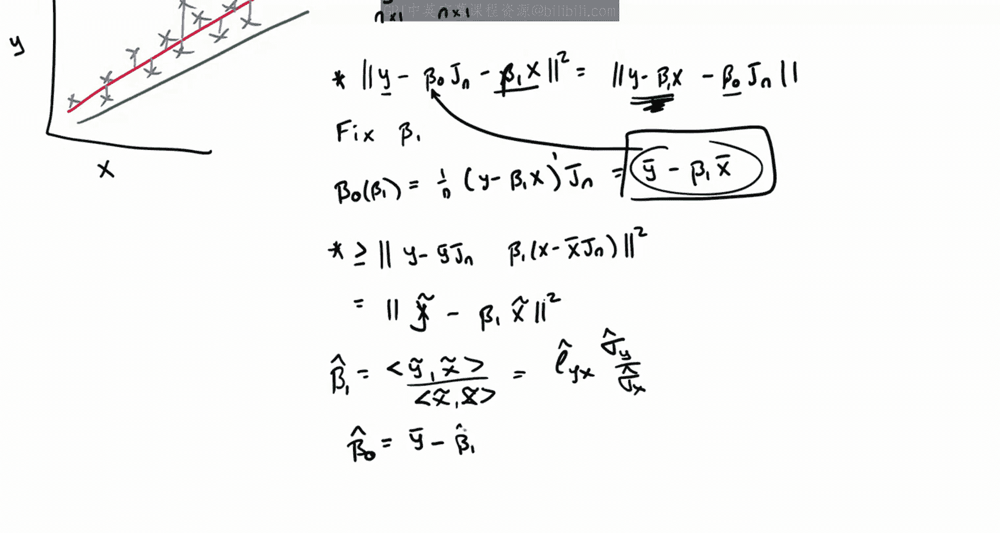
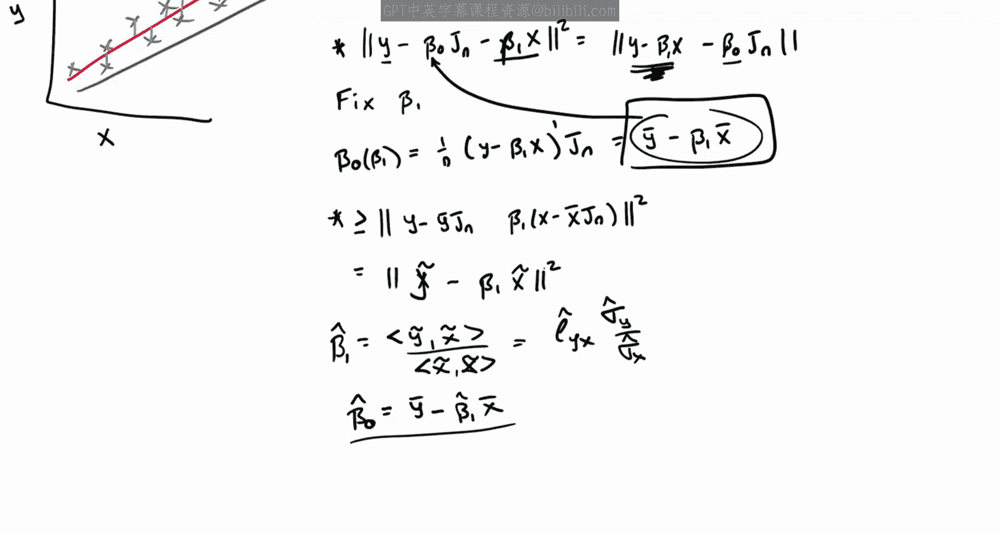
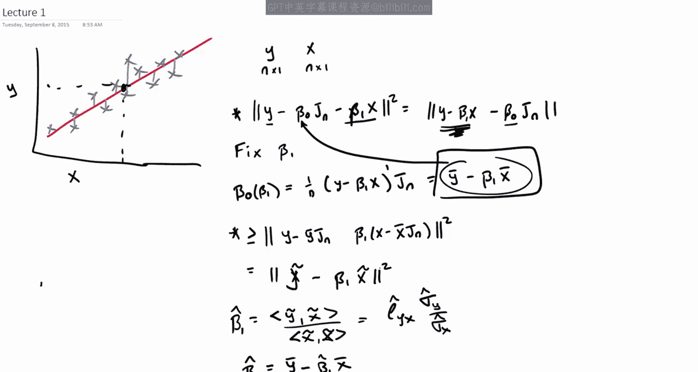

# 约翰霍普金斯大学《数据科学的高级统计｜Advanced Statistics for Data Science》中英字幕（deepseek p87 13_最小二乘法.zh_en -BV1htPjeYEFH_p87-

Now that we've considered single parameter regression， let's consider linear regression。

 So the setting is something like this。 We have some Y values and x values， and they're paired。

This say。And we want to fit。To line。That best goes， well， that's not a very good lie。

The line that best goes through the data。 say， for example， that line。 and we're going to do it。

 the way we're going to define best is to take the。Values like this。 The residuals。

And add them up squared。 So the sum of the squared residuals。

 and we're going to try and minimize them。 So see that line is going to have a lower sum of the squared residuals。

Then say， for example， that line。Okay， so let's set up the problem。

 So we have our y is an n by one vector， and our x is an n by one vector， and we want to minimize。

Norm y minus beta n times J N minus beta 1 times x。

Imscribe。Now I'd like that you can do this by taking derivatives of course。

 and in this case because there's just two parameters。 you you can do it very easily。 However。

 I want to show how to do this using just by referring back to。

Regression to the origin。 So let's imagine that we fix。

 And this is a technique that we can use a lot。 So fix beta 1。 So assume， assume that it's known。

 then this。These two values right there together， y minus beta 1 x。 consider them a single vector。

Okay， so we can just write this， I know I haven't done anything， y minus beta 1 x minus beta not JN。

If I think of that as a single vector。Then this is just mean only regression。

 And we know that the solution for beta n has to be。The average of this vector right here。 Okay。

 so what we know is that beta n， as it depends on beta 1。

 If we fix beta as it depends on beta 1 has to go through the point1 over n。Y minus beta 1。

X times J and transpose， which works out to be y bar minus beta 1。X bar。Okay。

 now if we take that beta knot and plug it back。Into this equation， let me write。 This is star。

Let me write， star has to be greater than or equal to if we plug that beta not back in。

 and I'm going to rearrange some terms a little bit。 So we get y minus y bar Jn。Plus。Beta1。

X minus x bar。Times J N。Okay， so I just did some rearranging some terms so you can do that on your own if you don't see it immediately。

So now I can rewrite this as say， X， Y Tilde。Ups andences a minus sign minus beta 1 x tilde where y tilde is the centered version of y and x tilde is the centered version of x。

 Now， this equation is merely regression through the origin。 Okay， with the new vectors。

 Y tilde and x tilde。 And so we know that the solution has to be beta1 hat equal to norm。

Inner product of y tilde and x tilde over the inner product of x tilde by itself。

And we know from the last lecture that that is the。Covariance。

 the estimated covariance between x and Y times the。Standard deviation of the Y。

Over the standard deviation of the X。So it turns out that if we do linear regression。

That our estimate is identical。To as if we did regression through the origin。

 having centered the data first。Okay， now another we have to solve for the intercept。

 but we have the equation for the intercept right here。

And so we know that as the intercept depends on beta 1， it has to take that form。

 so we get beta not hat is equal to y bar minus beta 1 hat。

X bar。And this。Intercept saying the intercept is this is basically， if I go back up to my。

Picture right here。 This basically says that if you take the average。

Of the Y's and the average of the x' is that the linear regression model has to go through。

Specifically， that point。Okay， so every time you fit a linear regression model。

 it has to go to the point Y bar X bar。Okay， well， that's a fitting linear regression in a nutshell。

