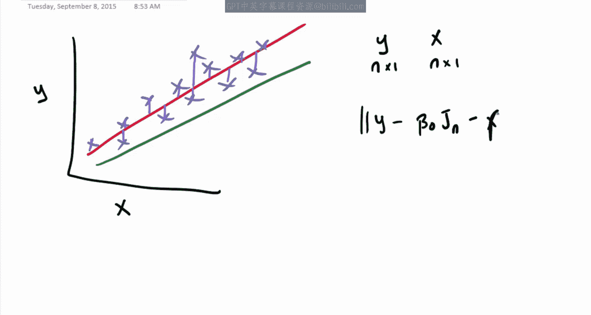
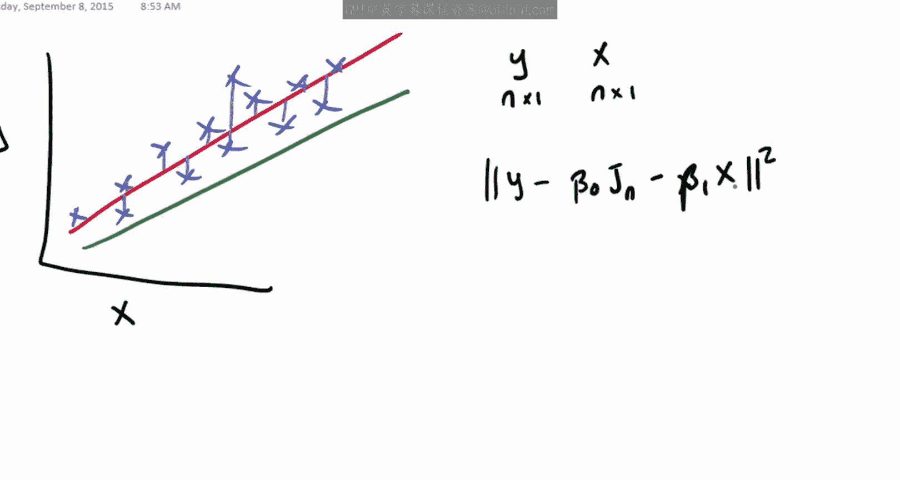
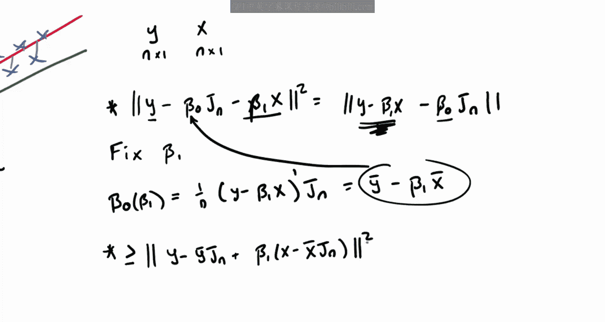
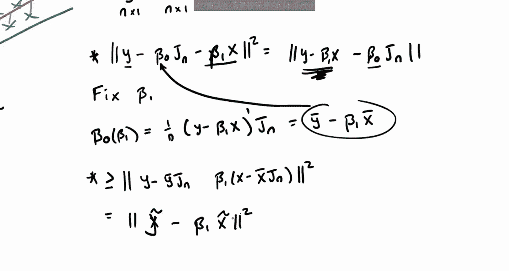
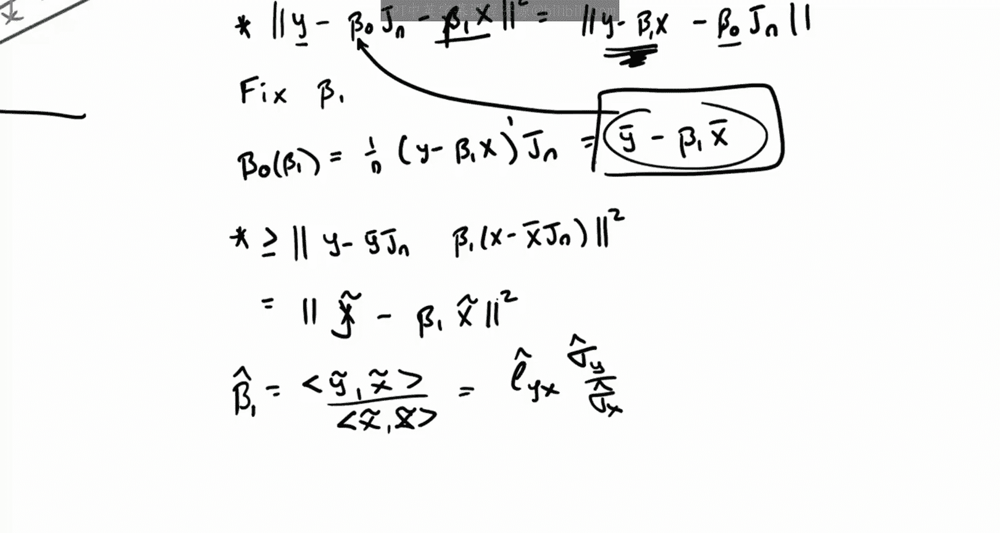
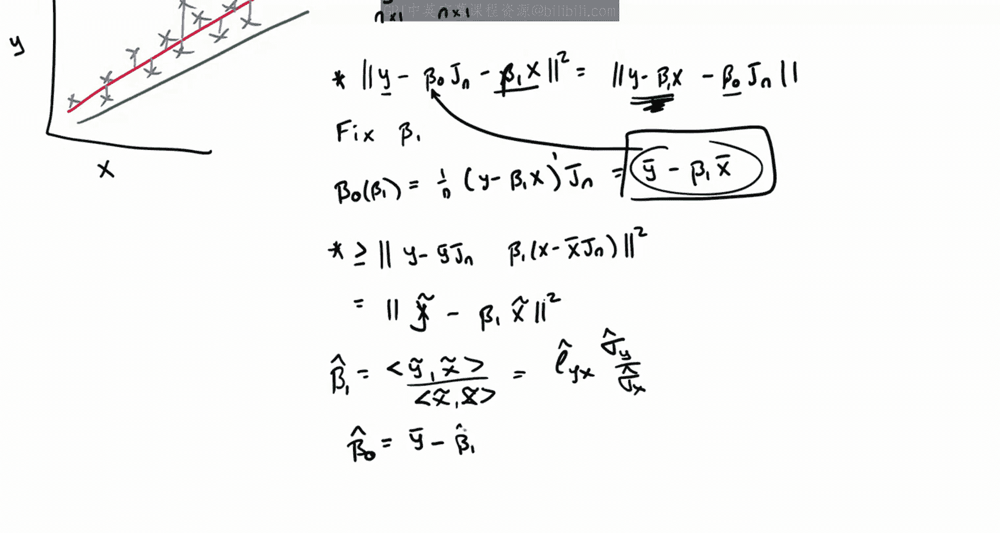
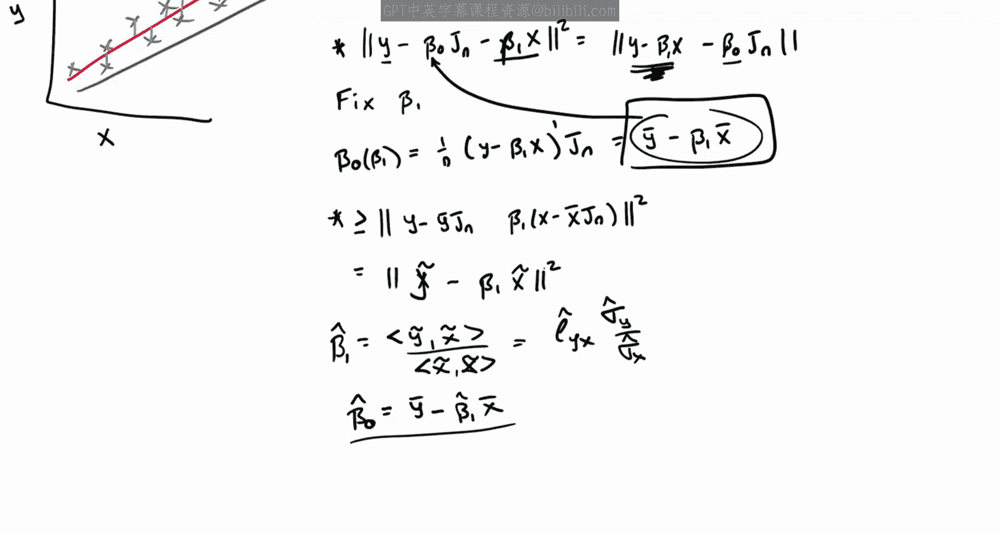
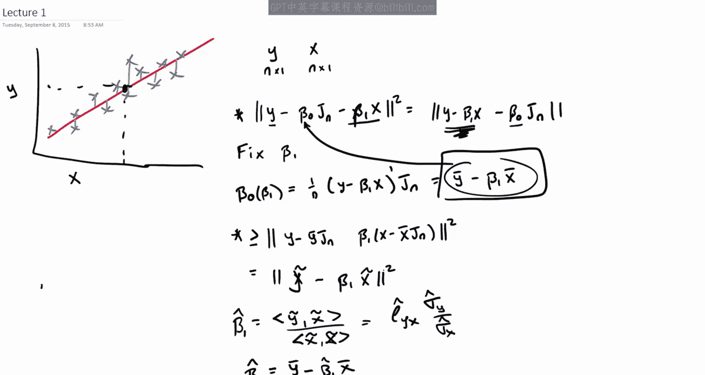

# 数据科学的高级统计：13：最小二乘法 📊

在本节课中，我们将要学习线性回归，特别是如何通过最小二乘法来拟合一条最佳直线。我们将从单参数回归出发，扩展到包含截距和斜率两个参数的线性回归模型，并推导出参数估计的公式。

---

上一节我们介绍了单参数回归，本节中我们来看看线性回归。

设定如下：我们有一些成对的 Y 值和 X 值。我们希望拟合一条能最佳穿过这些数据点的直线。我们定义“最佳”的方式是：计算每个数据点到直线的垂直距离（即残差），将它们平方后求和，并尝试最小化这个**残差平方和**。例如，某条直线的残差平方和会比另一条直线更低。

现在让我们正式建立问题。设 **y** 是一个 n×1 的向量，**x** 也是一个 n×1 的向量。我们的目标是最小化以下范数：
`|| y - β₀ * J_n - β₁ * x ||²`
其中，`J_n` 是一个所有元素为1的 n 维向量，`β₀` 是截距，`β₁` 是斜率。

虽然可以通过求导来解这个只有两个参数的问题，但这里我想展示一种技巧：通过联系到“过原点回归”来求解。

---

以下是具体的求解思路：我们首先固定斜率 `β₁`，假设它是已知的。

那么，表达式 `y - β₁ * x` 可以看作一个单一的向量。此时，最小化问题就变成了：
`|| (y - β₁ * x) - β₀ * J_n ||²`
这正是一个只包含截距 `β₀` 的均值回归问题。我们知道，其解是目标向量的平均值。因此，在给定 `β₁` 的情况下，最优的 `β₀` 必须满足：
`β₀(β₁) = (1/n) * J_n^T * (y - β₁ * x) = ȳ - β₁ * x̄`
其中，`ȳ` 和 `x̄` 分别是 y 和 x 的样本均值。

---

接下来，我们将这个依赖于 `β₁` 的 `β₀` 表达式代回最初的目标函数中。

经过一些代数重组，原最小化问题可以转化为：
`|| ỹ - β₁ * x̃ ||²`
这里，`ỹ = y - ȳ * J_n` 是中心化的 y 向量（即减去均值），`x̃ = x - x̄ * J_n` 是中心化的 x 向量。

现在，问题变成了对中心化后的数据 `(x̃, ỹ)` 进行**过原点回归**。根据上一讲的知识，其解为：
`β̂₁ = (x̃^T * ỹ) / (x̃^T * x̃)`
这个公式等价于样本协方差除以 x 的样本方差，也可以写成：
`β̂₁ = [Cov(x, y) / Var(x)] * (SD(y) / SD(x))` 的相关形式。

因此，线性回归的斜率估计，与先将数据中心化再进行过原点回归所得到的斜率估计是完全一致的。

---

求得斜率估计 `β̂₁` 后，我们可以回代来求解截距。

根据之前推导的关系式，最优截距为：
`β̂₀ = ȳ - β̂₁ * x̄`
这个结果具有清晰的几何意义：它意味着拟合的线性回归直线**必须穿过数据中心点 `(x̄, ȳ)`**。每当你拟合一个线性回归模型时，这条直线都会经过均值点。

---

本节课中我们一起学习了线性回归的最小二乘估计。我们通过固定斜率将问题转化为均值回归，进而利用中心化技巧将其简化为过原点回归，最终推导出了斜率 `β̂₁` 和截距 `β̂₀` 的估计公式。核心在于，拟合的直线最小化了残差平方和，并且必然穿过数据的中心点 `(x̄, ȳ)`。