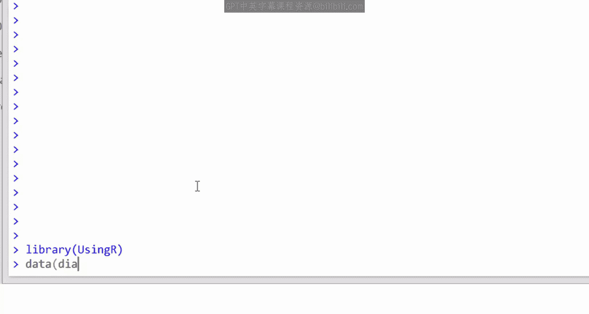
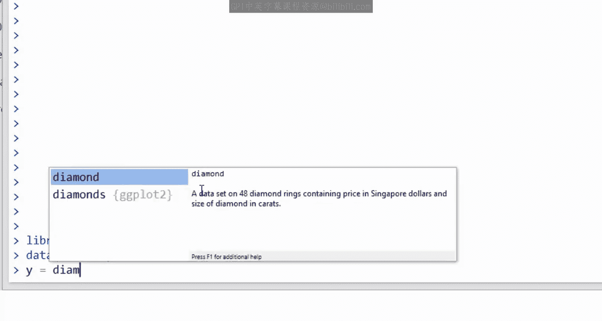
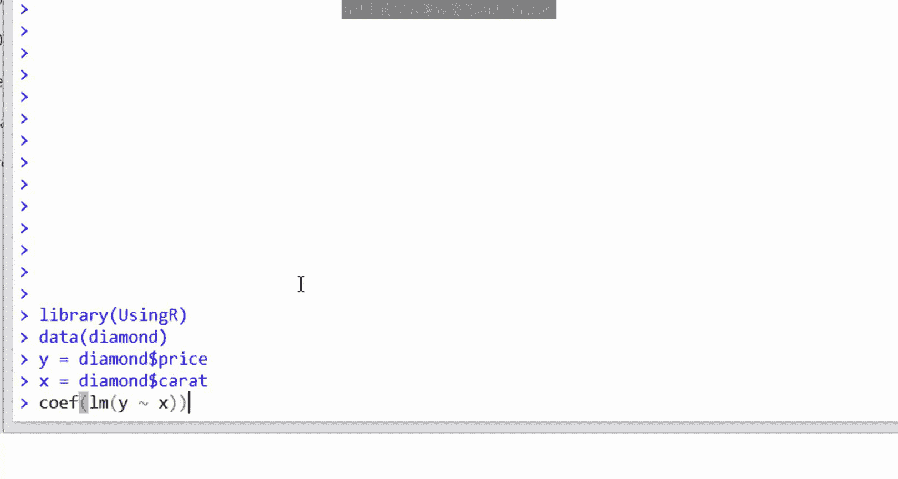
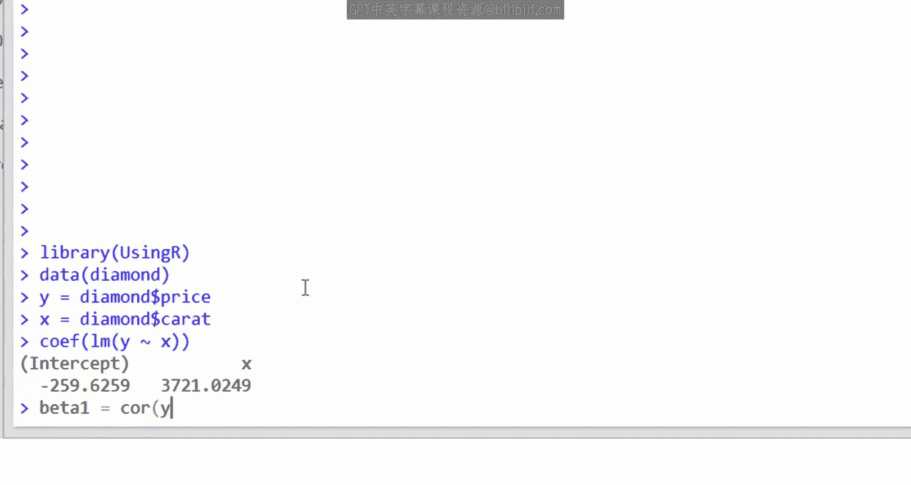
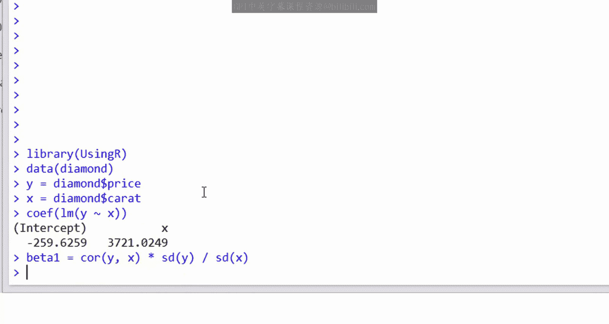
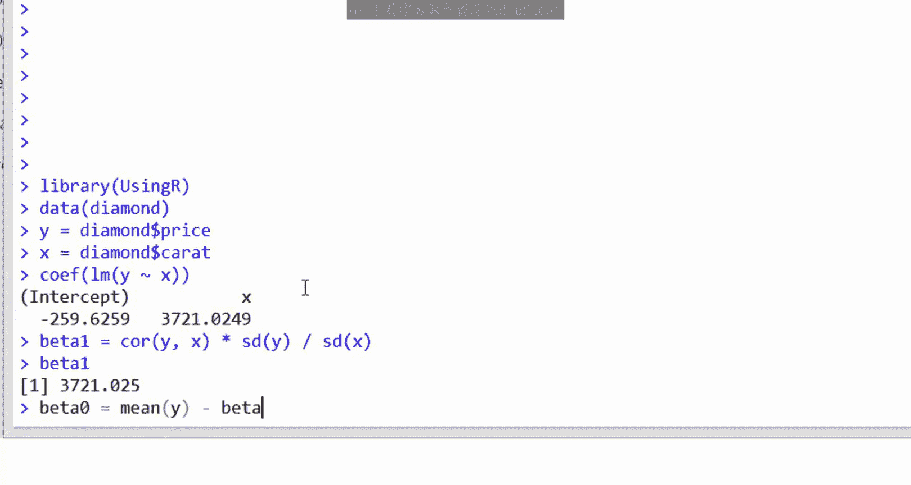
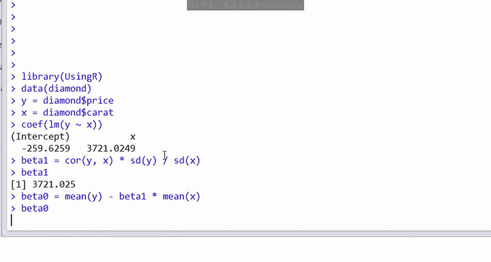
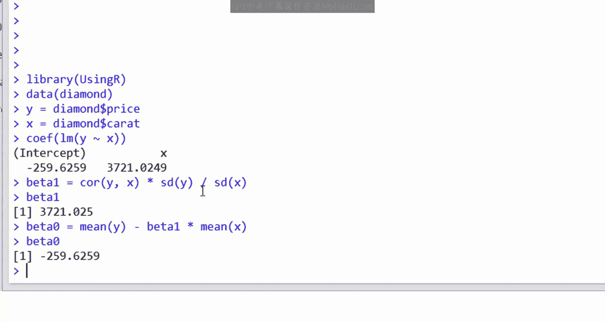

# 约翰霍普金斯大学《数据科学的高级统计｜Advanced Statistics for Data Science》中英字幕（deepseek p88 14_编程示例.zh_en -BV1htPjeYEFH_p88-

Okay， let's just do a quick computational example of linear regression。

 I'm going to do the library using R。And then， I'm going to do data。

Timemon。And I'm going to set my Y as diamond。

I want the price to be the Y and the x to be。I it carrot。

So I'd like to fit a linear regression of y is the outcome and x is the predictor。

 So if the easiest way， of course， to do this would be just。LM Y toil the X。

 And you see those are the answers。 however， notice that if I do。

Core， let's do。Beta 1 equals core， Y x times。

Standard deviation of y divided by standard deviation of x， notice。

That's， of course， the same answer。 And then if I do。Beta 0 is equal to mean y minus beta 1 star。

In X。

That， of course， gives me the same intercept answer。

 So that's exactly what El is doing in the background when it fits linear regression。 and， of course。

 you could plot your Y versus the X and overlay the fitted line on top of it。

