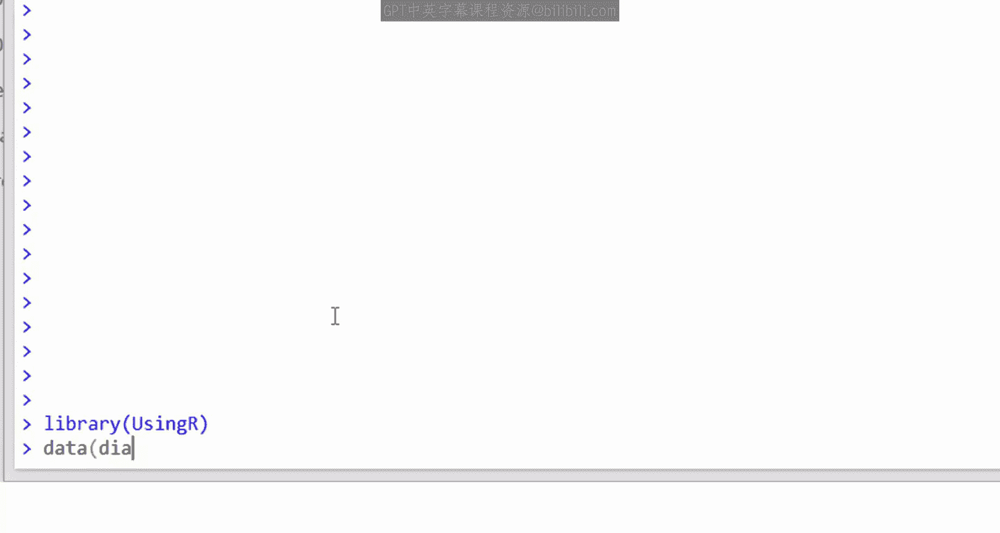
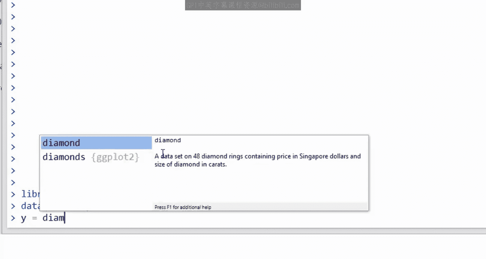
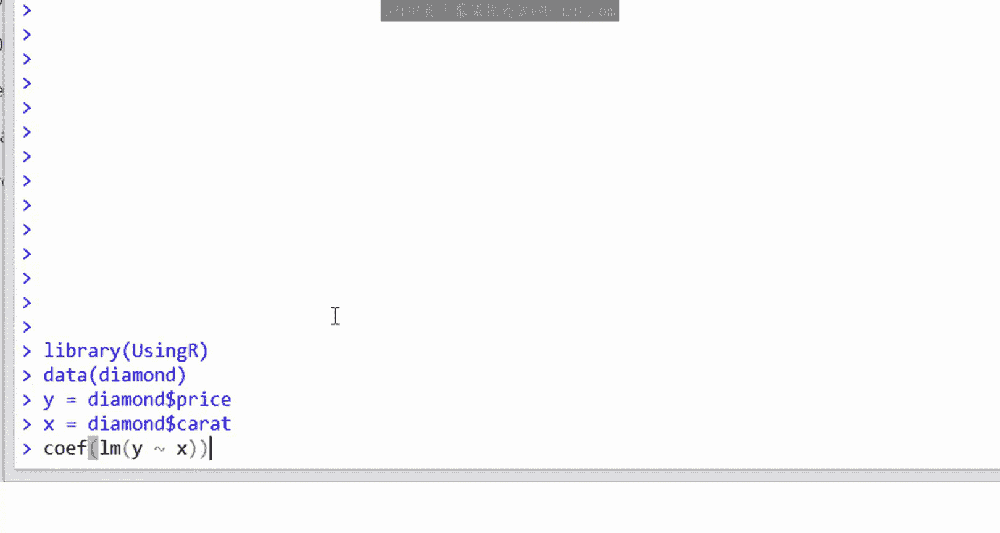
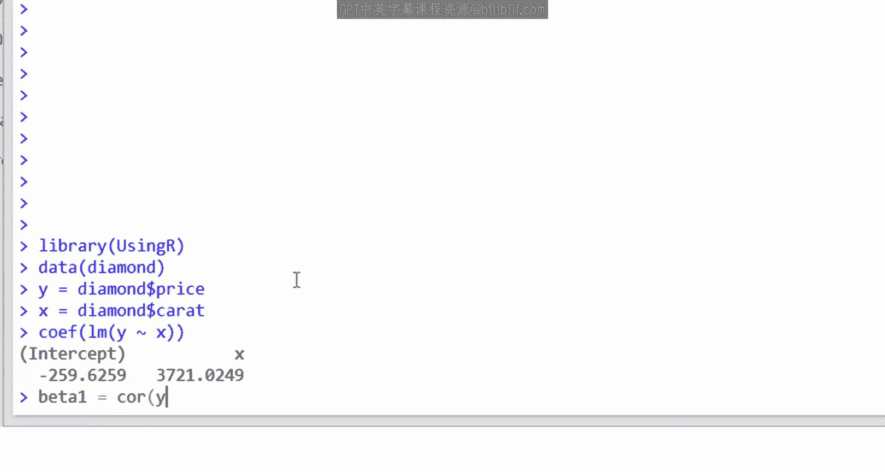
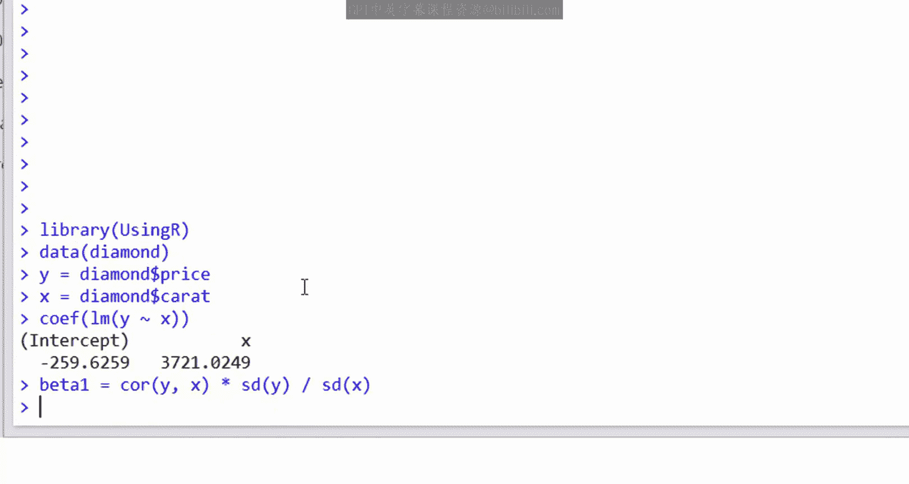
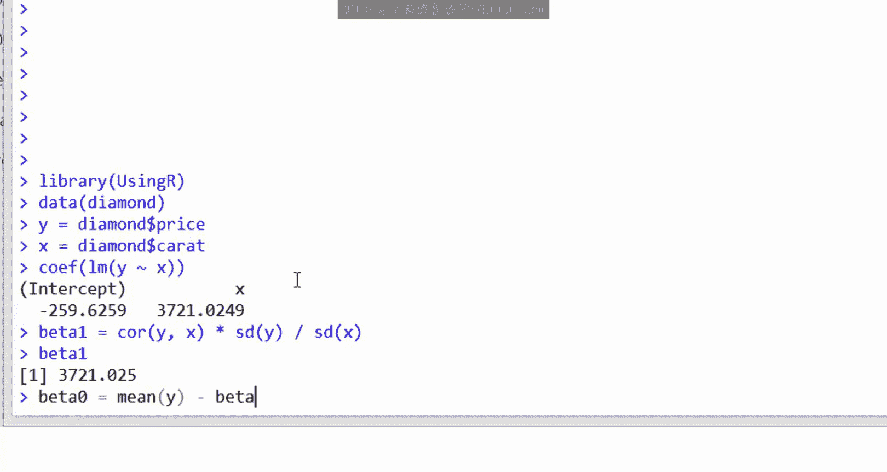
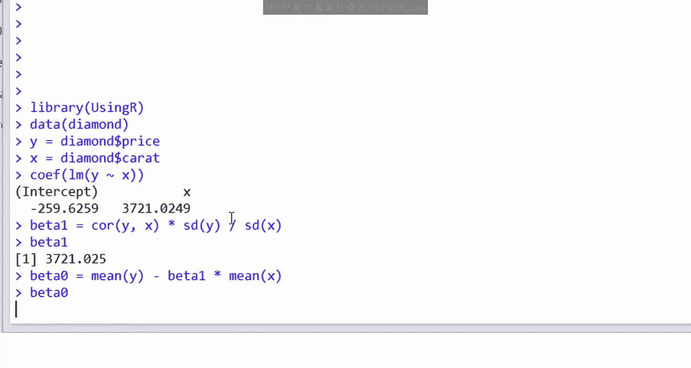
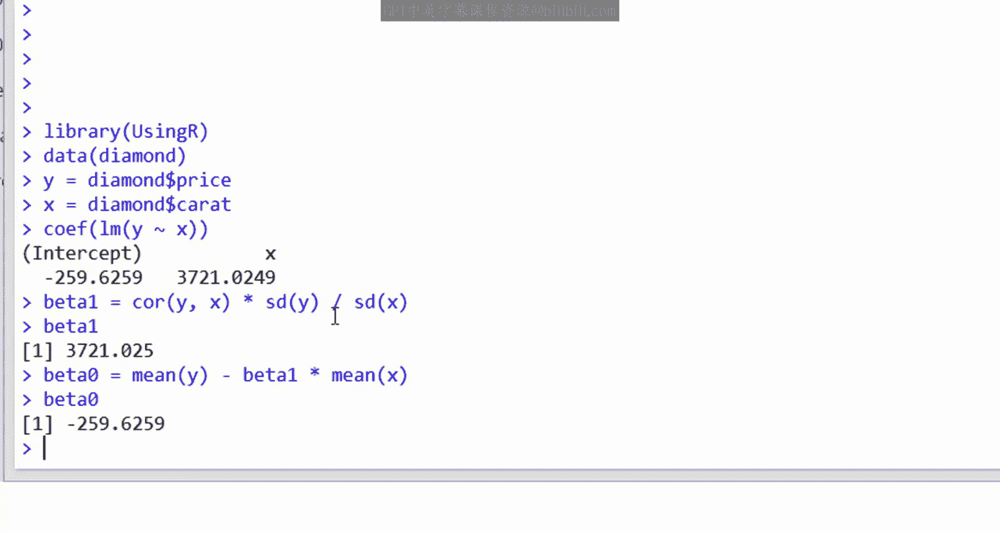

# 数据科学的高级统计：编程示例：线性回归计算示例

在本节课中，我们将通过一个简单的编程示例，演示如何使用R语言手动计算线性回归的参数，并与内置函数的结果进行比较。我们将使用钻石数据集，以钻石价格作为因变量，钻石重量作为自变量。

## 概述

线性回归是数据分析中最基础且重要的方法之一。它旨在找到一条直线，使得数据点到该直线的垂直距离（残差）的平方和最小。上一节我们介绍了线性回归的理论基础，本节中我们来看看如何通过R语言进行实际计算。



## 加载数据与库

首先，我们需要加载必要的R库并导入我们将要使用的数据集。



```r
library(UsingR)
data(diamond)
```

## 定义变量

接下来，我们定义线性回归模型中的因变量（Y）和自变量（X）。在本例中，Y代表钻石的价格，X代表钻石的重量（克拉）。

```r
y <- diamond$price
x <- diamond$carat
```

## 使用内置函数拟合模型

在R语言中，最快捷的线性回归拟合方法是使用 `lm()` 函数。该函数会直接计算出回归线的斜率和截距。



```r
lm(y ~ x)
```

运行上述代码，R会输出回归模型的系数，即截距和斜率。这是最直接的方法。



## 手动计算回归系数

为了深入理解线性回归的计算过程，我们可以手动计算这些参数。线性回归的斜率（β1）和截距（β0）可以通过以下公式得出：



**斜率公式：**
`β1 = cor(y, x) * (sd(y) / sd(x))`

**截距公式：**
`β0 = mean(y) - β1 * mean(x)`

以下是相应的R代码实现：



```r
beta1 <- cor(y, x) * (sd(y) / sd(x))
beta0 <- mean(y) - beta1 * mean(x)
```



运行这些代码后，你会发现手动计算出的 `beta1` 和 `beta0` 与之前 `lm()` 函数输出的结果完全一致。这验证了 `lm()` 函数在后台正是通过这些统计量来计算回归系数的。

## 可视化结果

理解模型后，将数据与拟合的回归线一起可视化是一个好习惯。这可以帮助我们直观地评估模型的拟合效果。

```r
plot(x, y, main = "钻石价格 vs. 重量", xlab = "重量（克拉）", ylab = "价格")
abline(beta0, beta1, col = "red")
```

上述代码会生成一个散点图，并将计算出的回归线以红色叠加在图上。

## 总结



本节课中我们一起学习了线性回归的编程实现。我们首先使用R的 `lm()` 函数快速拟合了一个模型，然后通过手动计算相关系数、标准差和均值，一步步推导出相同的回归斜率和截距。这个过程揭示了线性回归模型背后的计算原理。最后，我们通过绘图将数据点和拟合的回归线可视化，完成了从理论到实践的全过程。