# 约翰霍普金斯大学《数据科学的高级统计｜Advanced Statistics for Data Science》中英字幕（deepseek p89 15_预测.zh_en -BV1htPjeYEFH_p89-

Let's talk quickly about the fitted values。 So remember， in this case。

 our regression that we wanted or least squares equation that we wanted to minimize was y minus beta n Jn minus beta1 x。

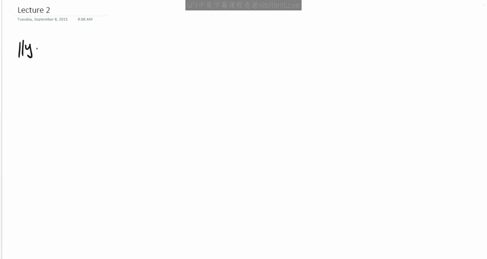

Squared， and that resulted in a fitted line。Let's say just now a conceptual y equals beta n plus beta1 times a conceptual x。

 That's the fitted line is that quantity。

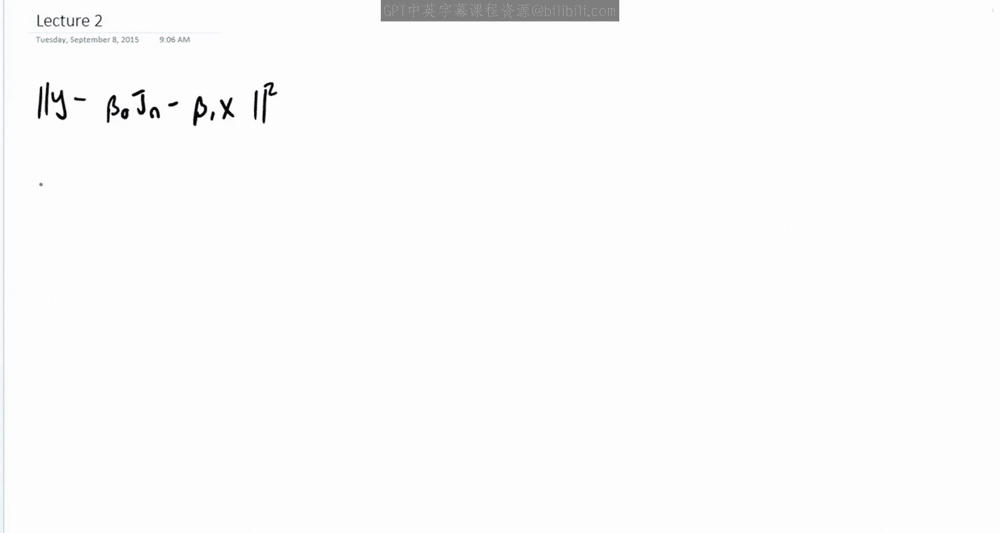

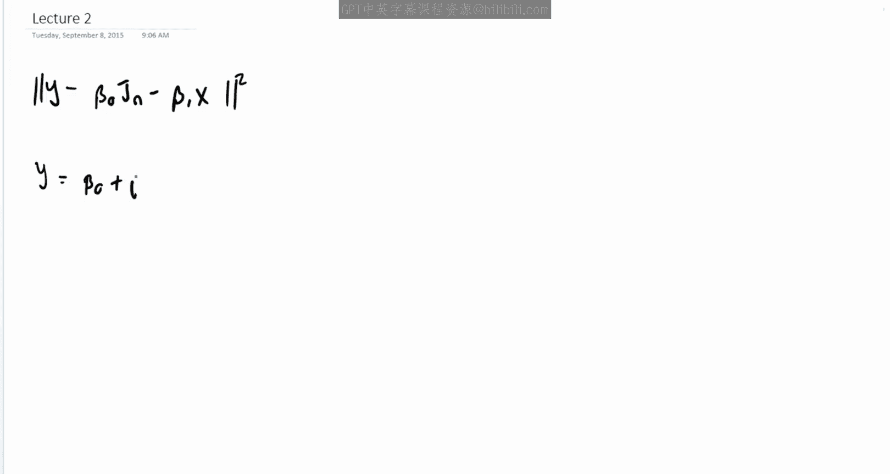

Okay， and so how do we。Predict an x at how do we predict a y and a new x value？ Well。

 the easiest way to do that is simply to plug in the new x value there， and you get the y predicted。

 Let's call Y hat predicted at that specific x value。 Now。

 some particular values of Y that we want to predict that are the most obvious ones that we would want to predict that are where we actually observe the X's。

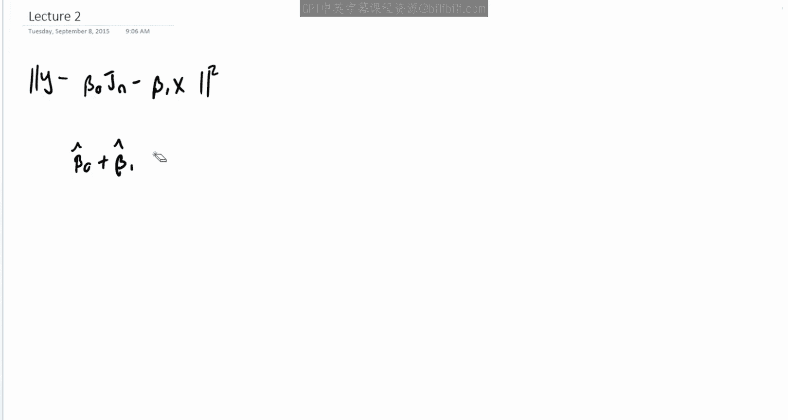

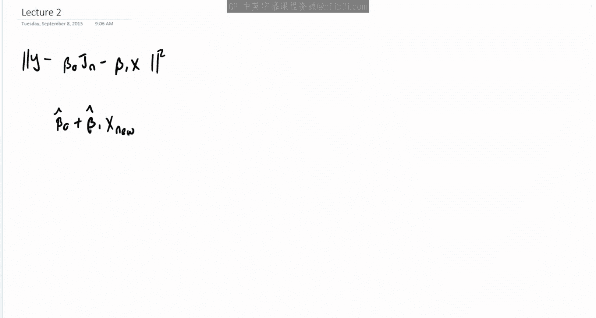

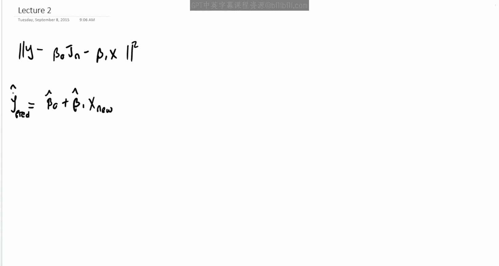

Okay， so this is the process。Here's our。

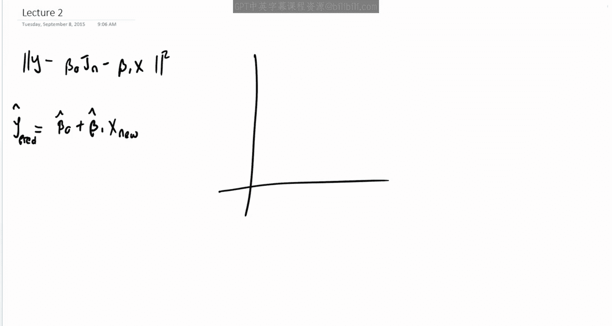

Here's our fitted data。

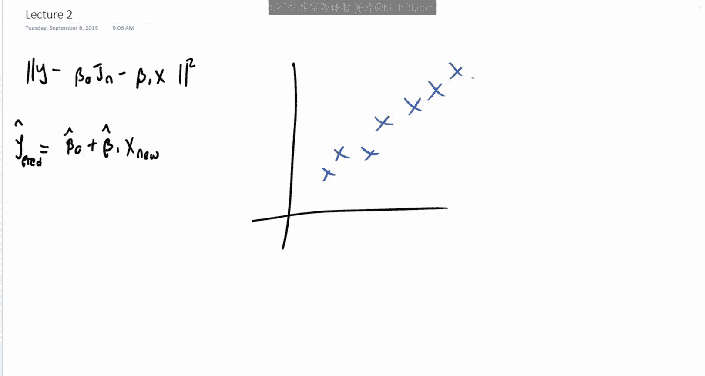

I'm sorry， here's our data。Okay。Here's our fitted line。

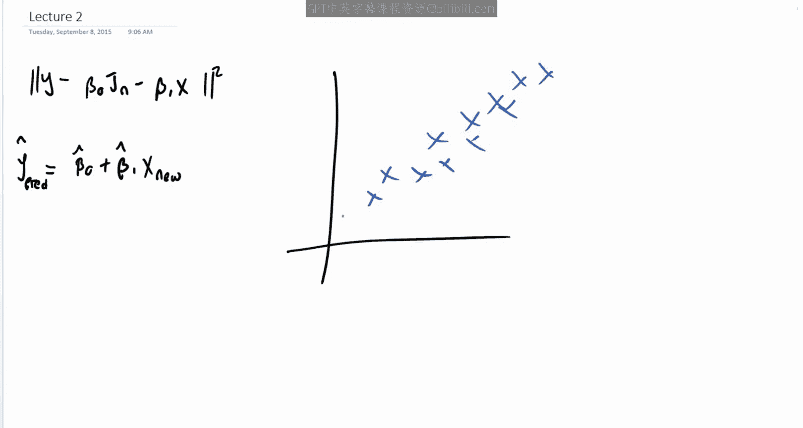

Okay， and then these values。

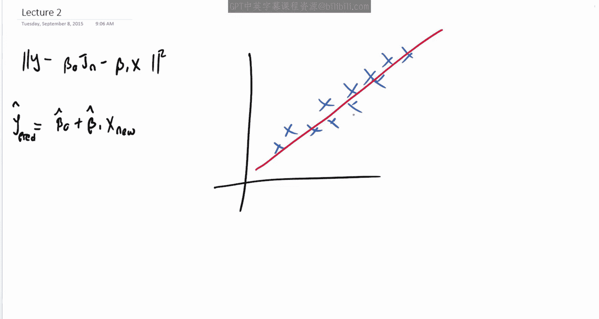

Right， these values。

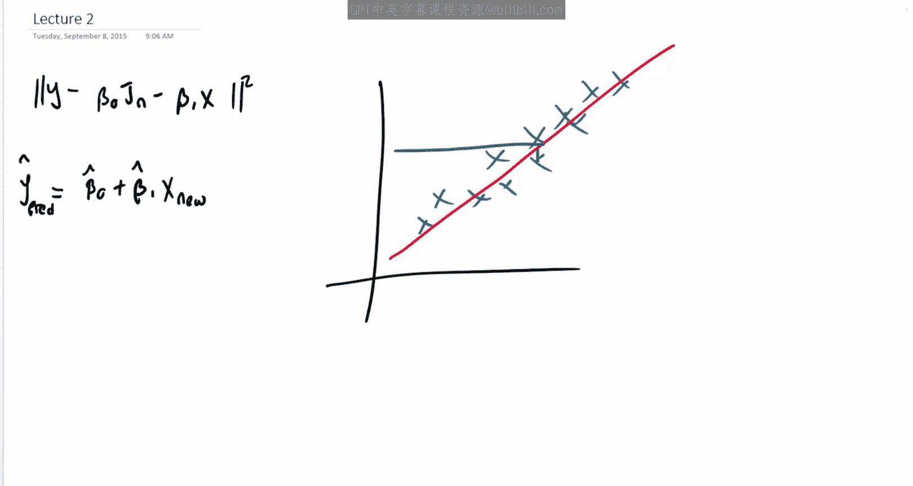

Projected on the lines are called the Y hat values。

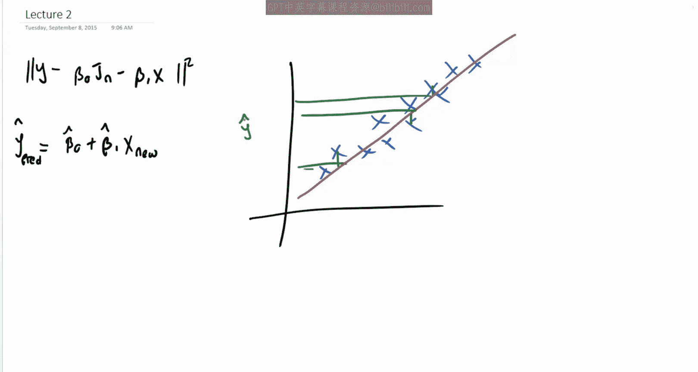

So to get our Y hat values， of course。To get the vector of y hat values。

 we would just need to take beta not hat。

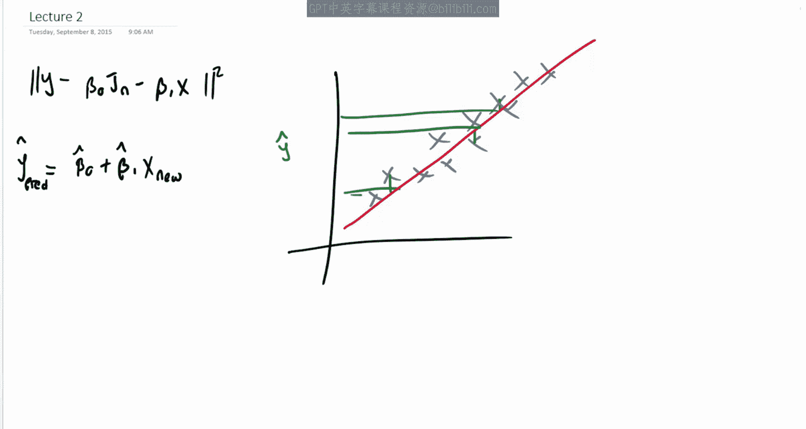

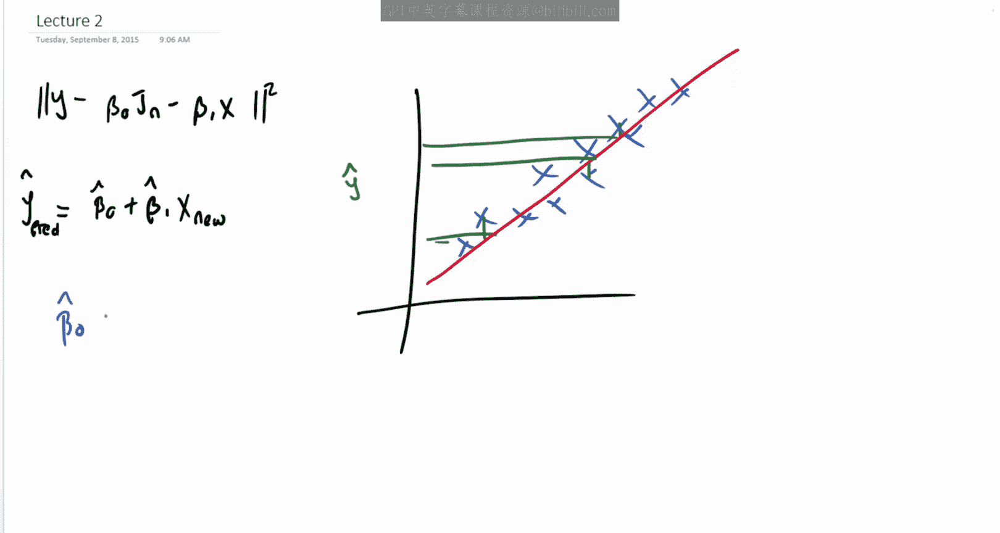

Times J N。Plus， beta1 hat。

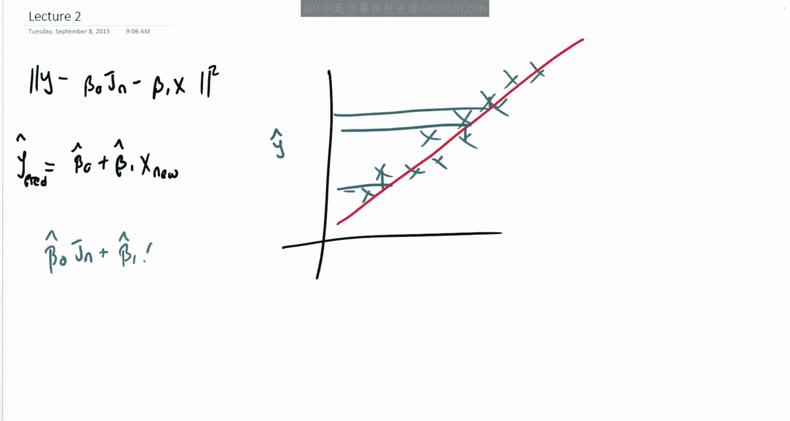

Times x。Right， remember， J N is an M by one vector。 X is an M by one vector。

 beta n and beta1 are just scalrs。 That gives us our Y hat values。

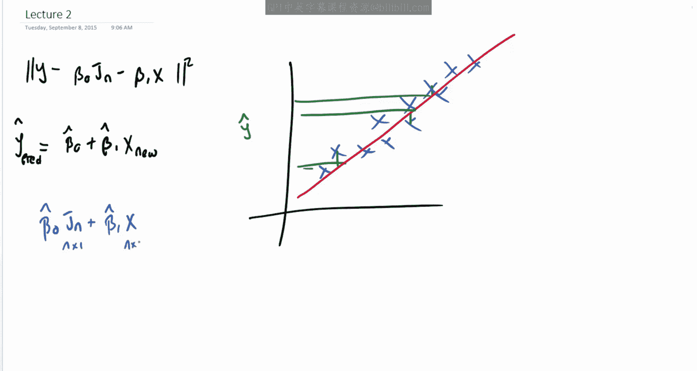

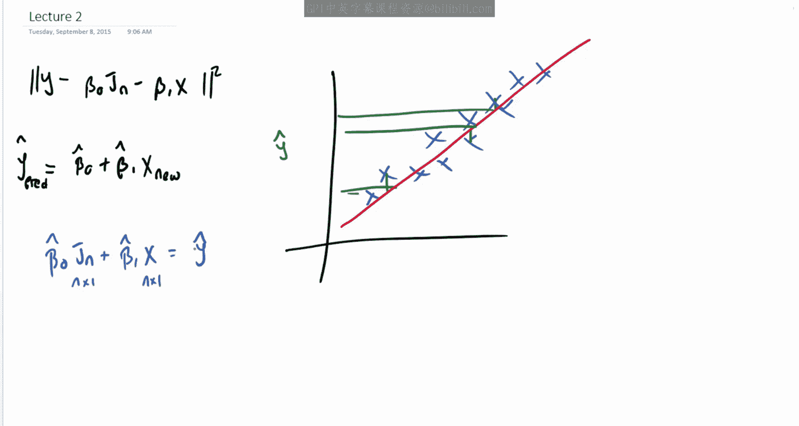

So you can think in a lot of ways， our least squares criteria is really minimizing。

The some of the squared deviations around the fitted values。

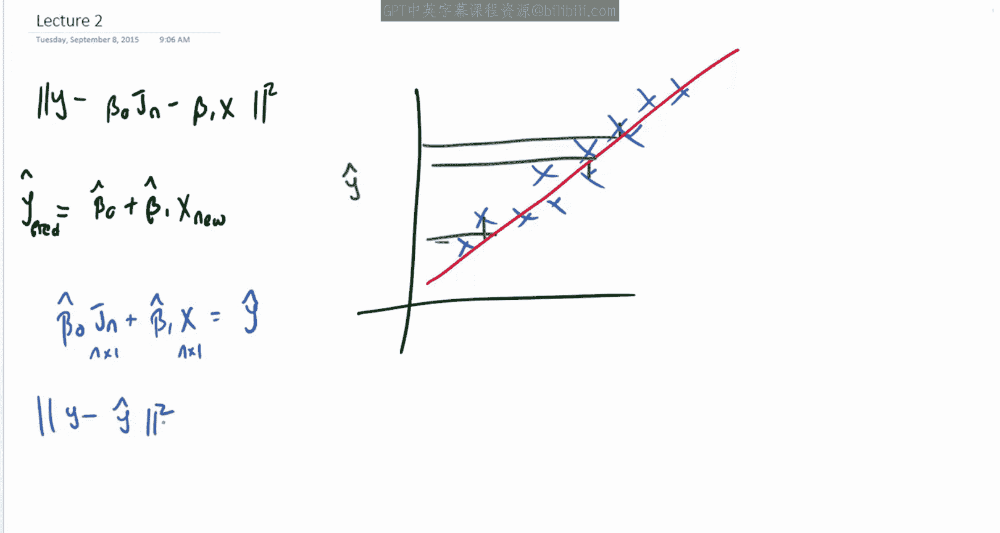

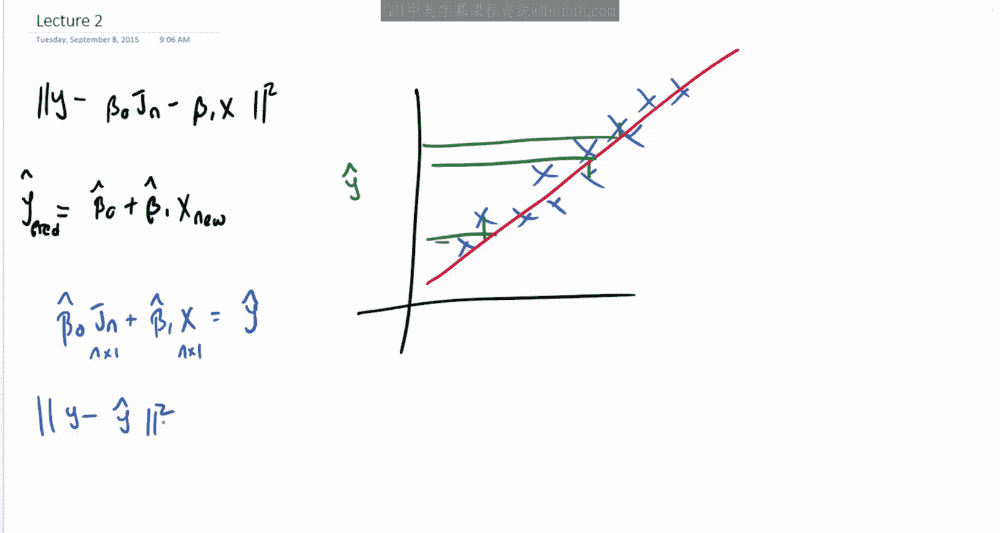