# 数据科学的高级统计：15：预测 📊

在本节课中，我们将要学习如何使用最小二乘法得到的拟合回归线进行预测。我们将介绍拟合值的概念，并详细说明如何计算预测值。

---

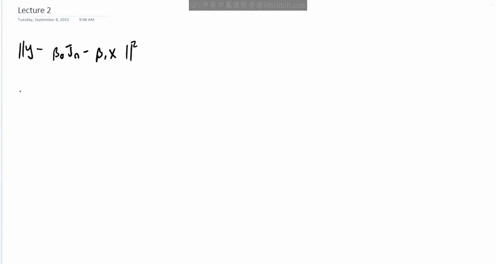

上一节我们介绍了最小二乘法的基本思想，本节中我们来看看如何利用得到的回归方程进行预测。

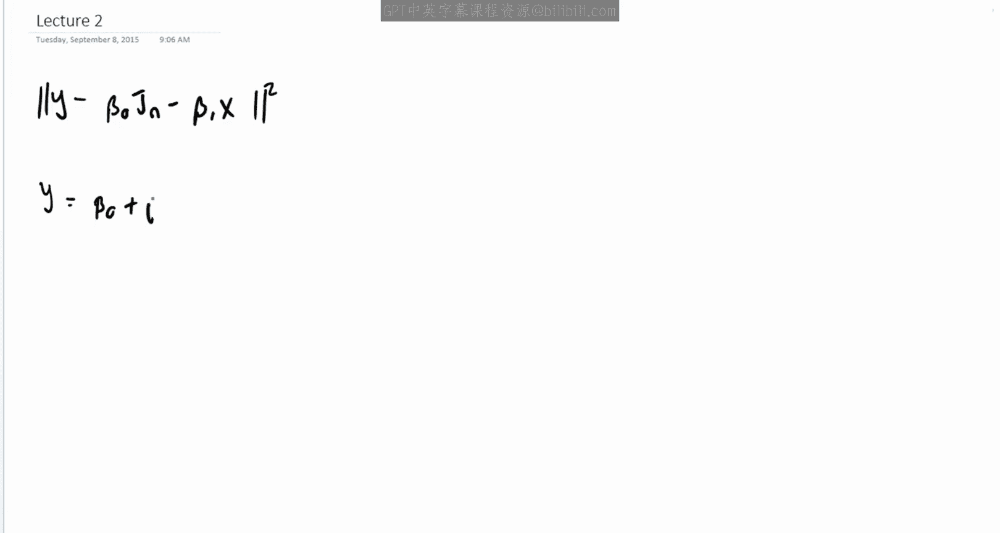

首先，回顾一下我们想要最小化的最小二乘方程：
\[
\sum (y_i - \beta_0 - \beta_1 x_i)^2
\]
这个最小化过程得到了一条拟合直线。这条拟合线可以用以下方程表示：
\[
\hat{y} = \hat{\beta}_0 + \hat{\beta}_1 x
\]
其中，\(\hat{\beta}_0\) 和 \(\hat{\beta}_1\) 是估计出的截距和斜率。

---

那么，如何在一个新的 \(x\) 值处预测 \(y\) 值呢？最简单的方法就是将新的 \(x\) 值代入上面的拟合方程，从而得到对应的预测值 \(\hat{y}\)。

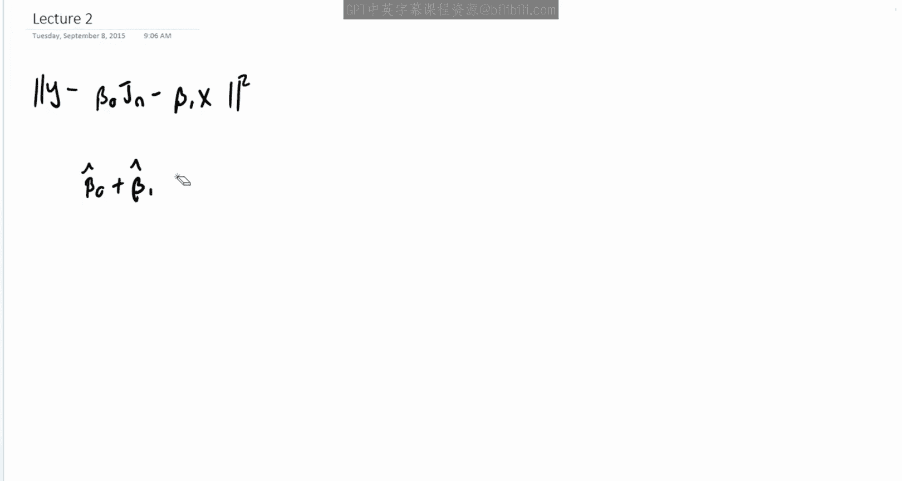

最自然、最常需要预测的 \(y\) 值，恰恰就位于我们实际观测到的那些 \(x\) 值处。

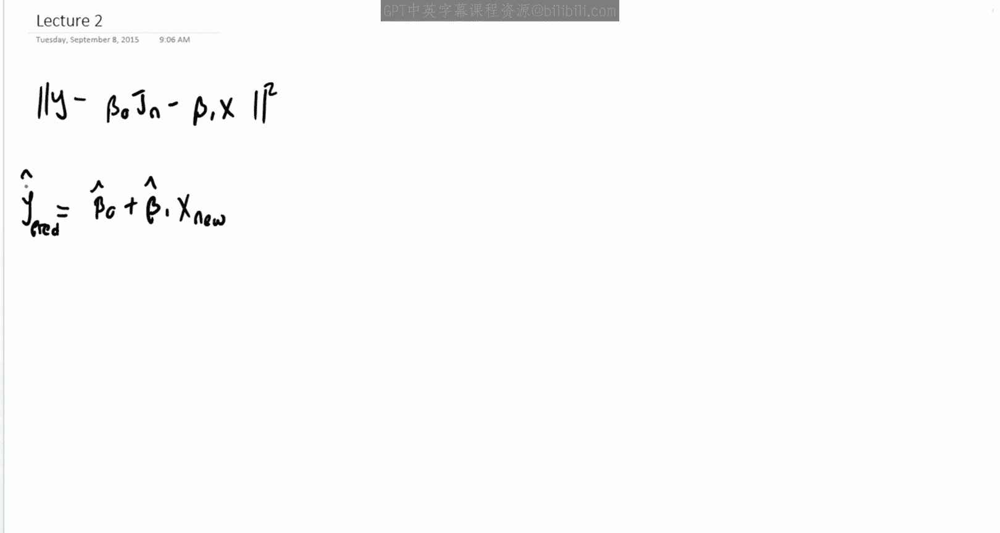

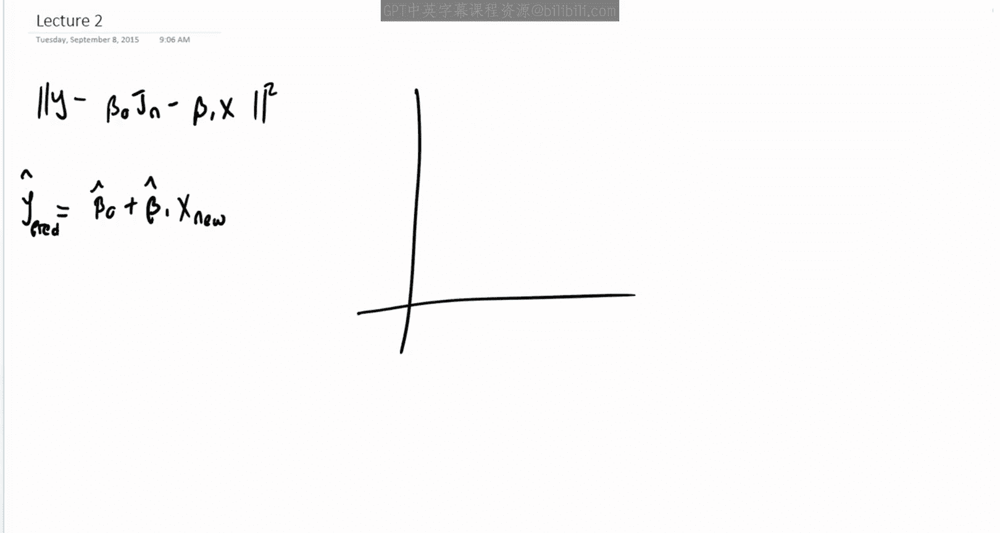

---

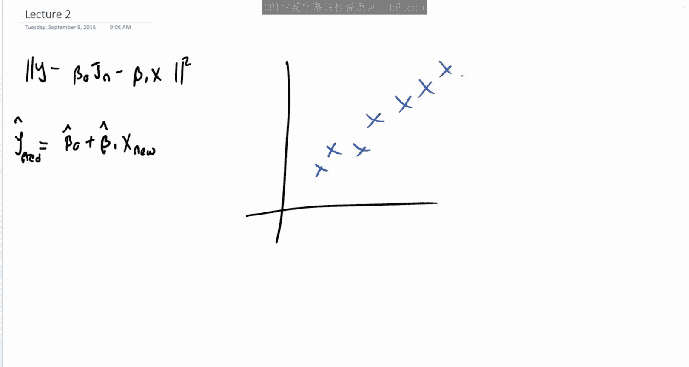

以下是预测过程的直观展示。假设这是我们的原始数据点。

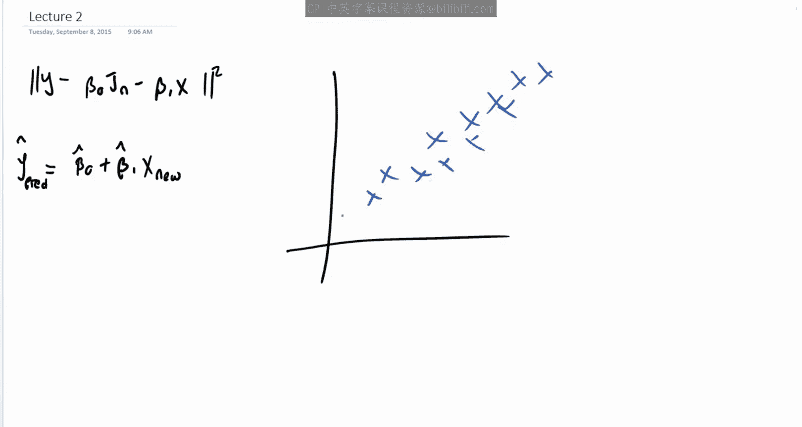

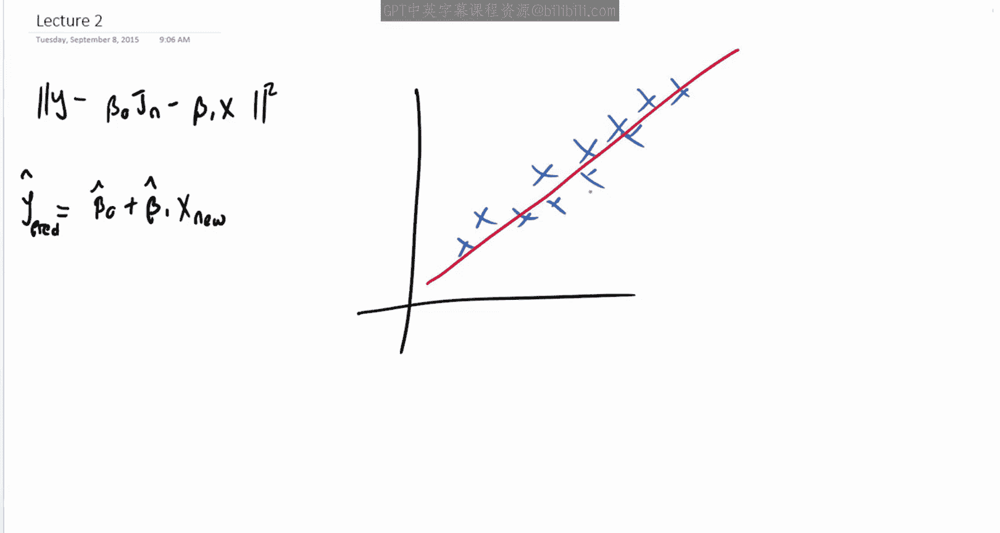

这是我们的拟合直线。

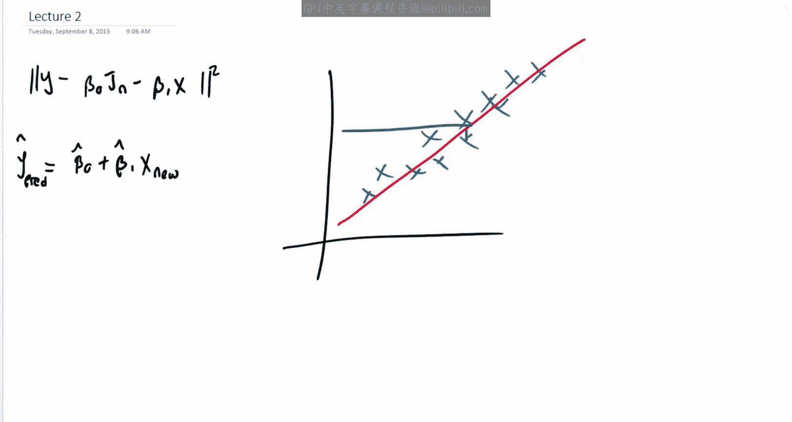

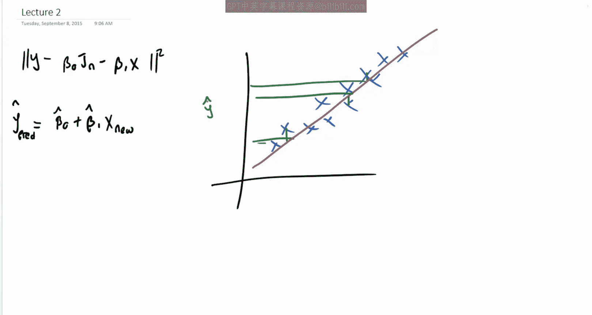

这些值，即数据点在拟合直线上的垂直投影，就被称为 \(\hat{y}\) 值，也就是拟合值。

---

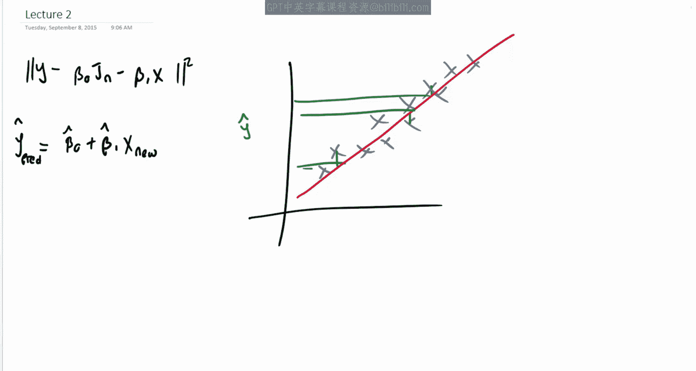

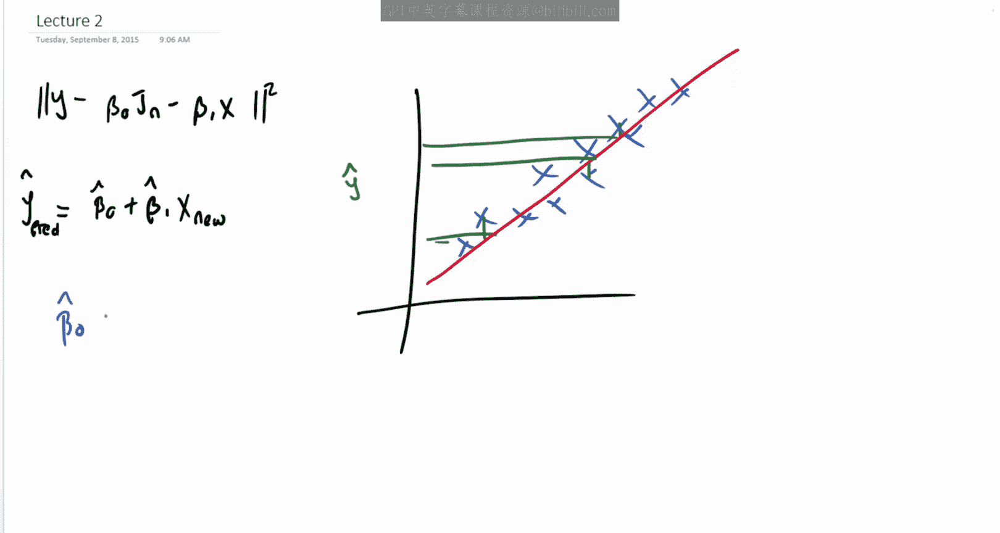

为了得到所有拟合值构成的向量 \(\hat{\mathbf{y}}\)，我们可以使用以下公式：
\[
\hat{\mathbf{y}} = \hat{\beta}_0 \mathbf{J}_n + \hat{\beta}_1 \mathbf{x}
\]
这里，\(\mathbf{J}_n\) 是一个 \(n \times 1\) 的全1向量，\(\mathbf{x}\) 是 \(n \times 1\) 的自变量观测值向量，而 \(\hat{\beta}_0\) 和 \(\hat{\beta}_1\) 是标量。这个计算给出了我们在每个观测 \(x_i\) 处的预测值 \(\hat{y}_i\)。

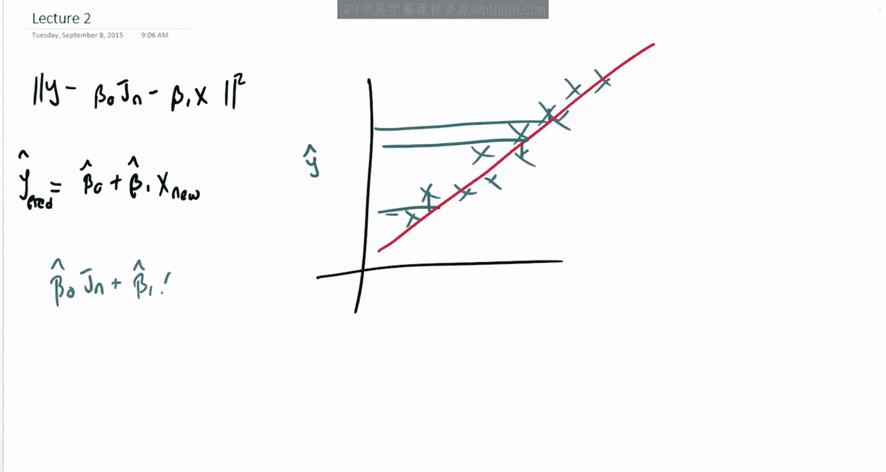

---

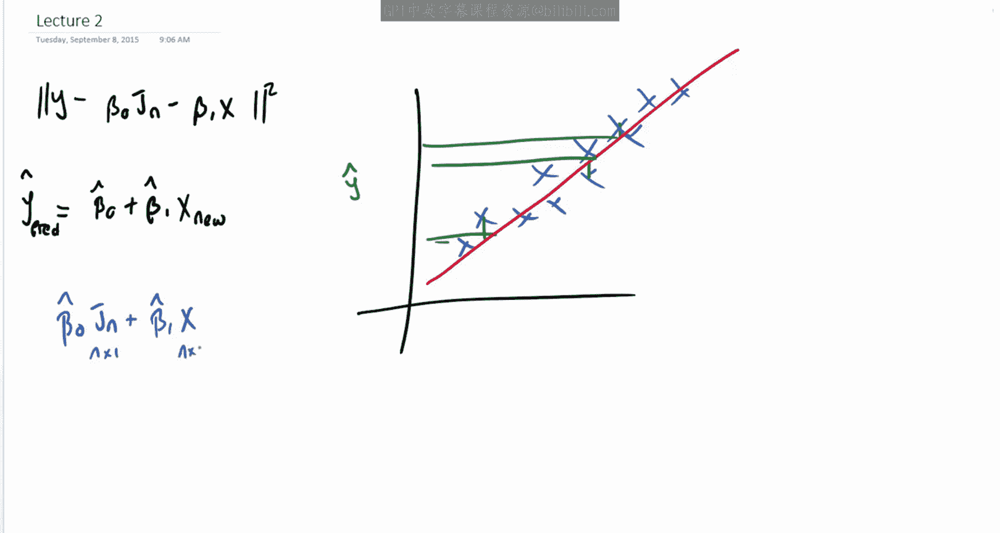

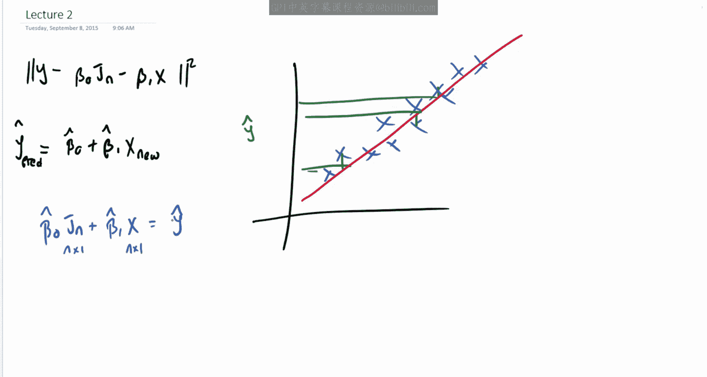

因此，从很多角度来看，最小二乘准则实际上是在最小化观测值 \(y_i\) 与拟合值 \(\hat{y}_i\) 之间的平方偏差之和：
\[
\sum (y_i - \hat{y}_i)^2
\]

---

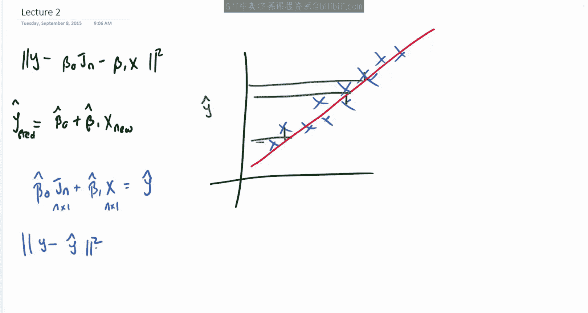

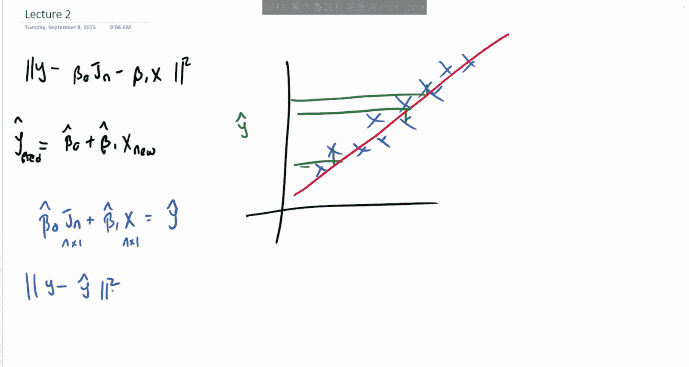

本节课中我们一起学习了线性回归预测的核心概念。我们明确了拟合值 \(\hat{y}\) 的定义，并掌握了如何利用估计的回归系数 \(\hat{\beta}_0\) 和 \(\hat{\beta}_1\) 来计算在新数据点或原有数据点上的预测值。理解预测值是理解回归模型评估和诊断的基础。