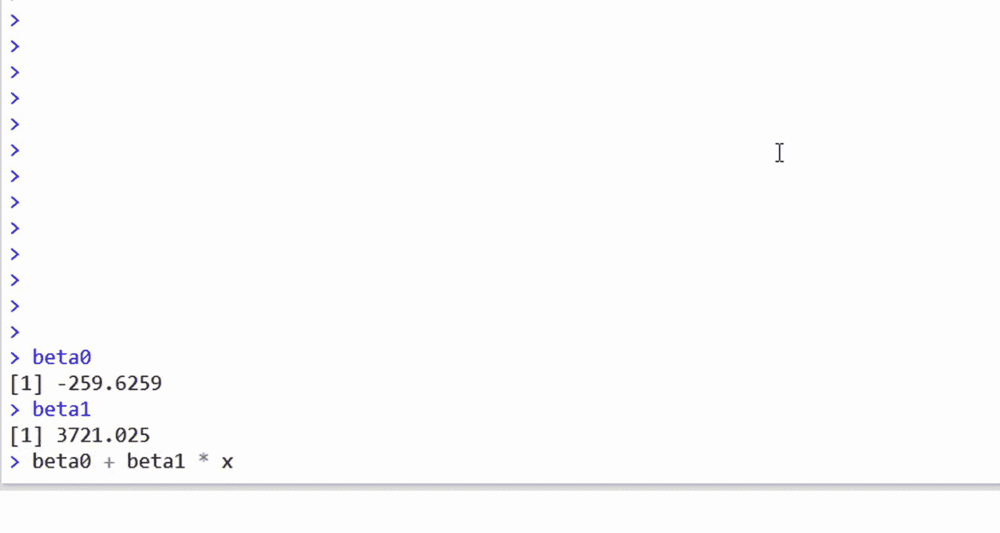
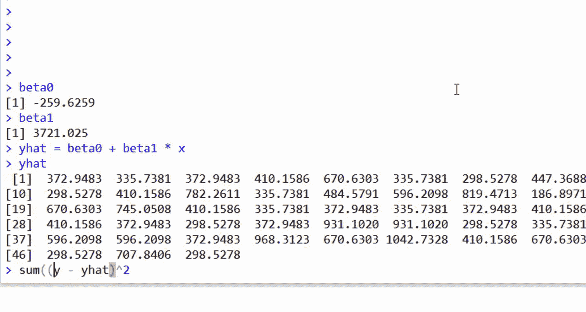
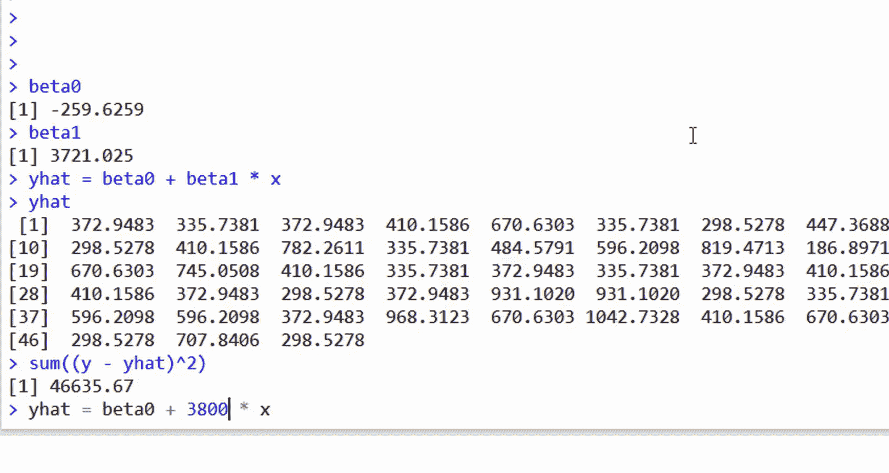
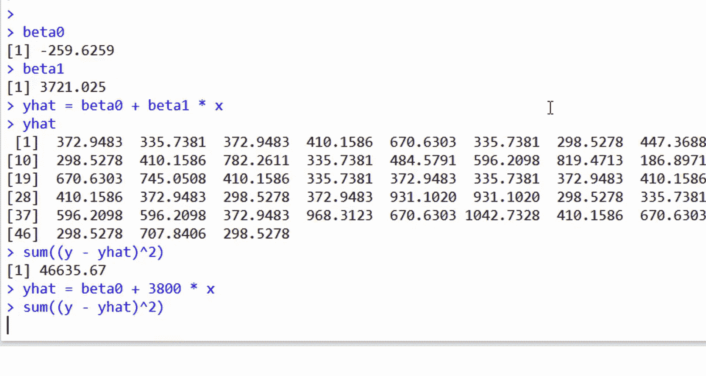
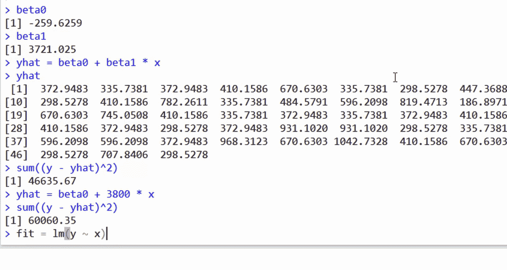
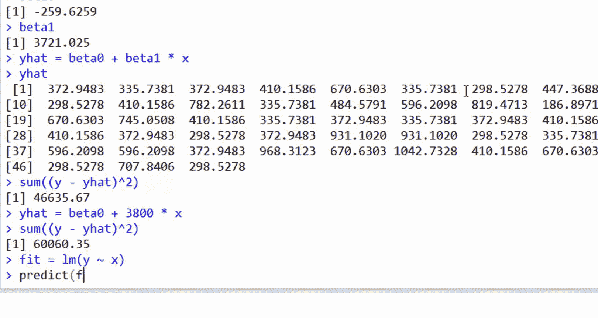
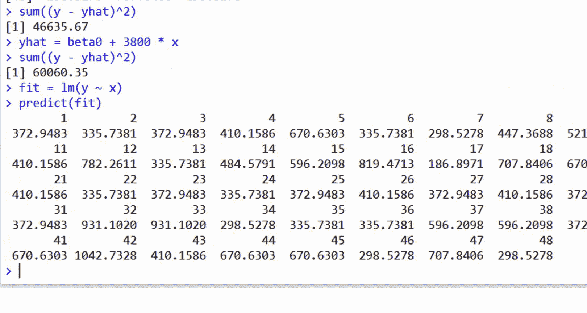
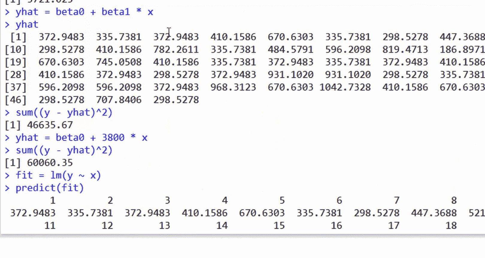
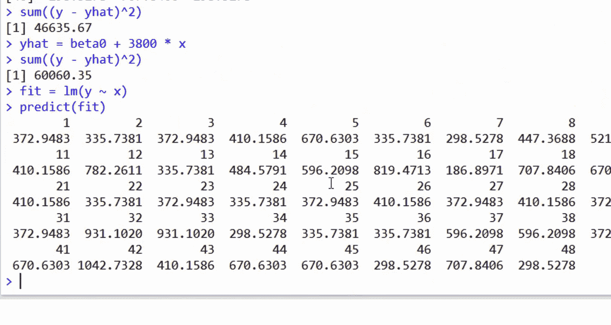

# 约翰霍普金斯大学《数据科学的高级统计｜Advanced Statistics for Data Science》中英字幕（deepseek p90 16_编程示例.zh_en -BV1htPjeYEFH_p90-

Recall in the previous example， we did the diamond data set， and we had beta 0 and beta 1 defined。

 So if we wanted to get the vector fitted values， we would just get。Beta 0。

And we don't have to multiply at times a vector of once because R automatically vectorizes the operation we as is needed。

 beta 0 plus beta 1 times x and that。That's gonna be Y hat。 So here's Y hat。

Okay， so why minus so y minus y hat was the。Those guys squared。

The sum of these squares is what we're trying to minimize。

Okay。So。Just to give you an example， if I know that if I were to try a different beta。

 a different beta 1， let's say 3800。

So 3721。And I would fit that C， it would， of course， be a different value and would be higher。

The least scores criteria minimizes that。Let me get that set right again。Well， actually。

Just in the interest of time， let me show you quickly how you can。Get the。

how you can get the predictions more automatically than using the matrix result。

 if you just type the function predict and then have the output of the fitted model and let me just say I'm kind of showing some bad practice here so usually you want to do something like assign the output of your model to a variable say called fit and then do predict。

Fit I've been skipping that step a lot because the models that we're fitting are so simple。 Okay。

 and then if you notice， look back， these are the same 372，372，335，335，372，372。 Okay。

 so that's how we get our predictive values from a linear regression model and how we extend that to multivariable regression should be pretty。

