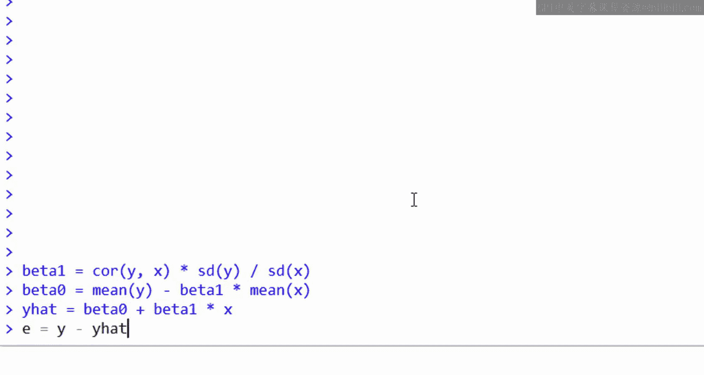
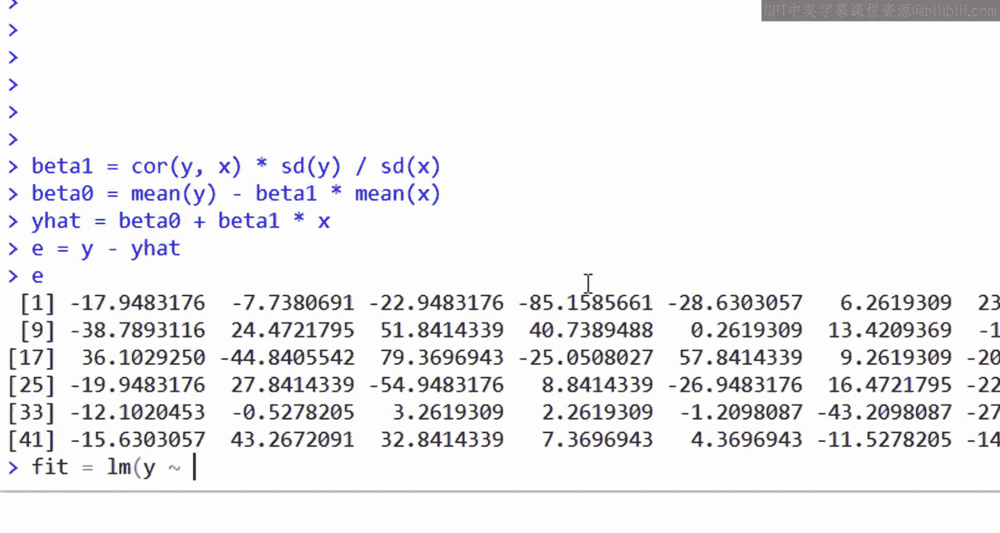
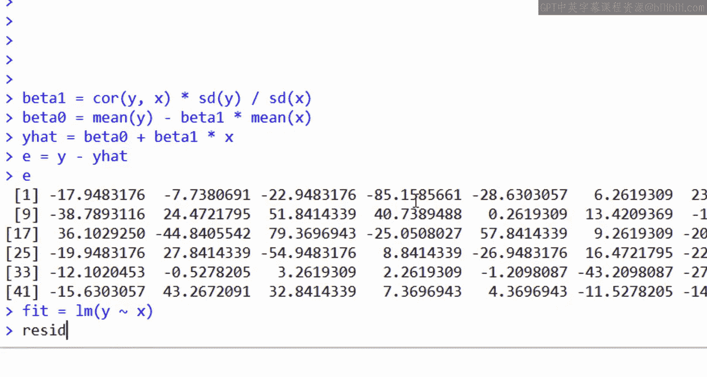
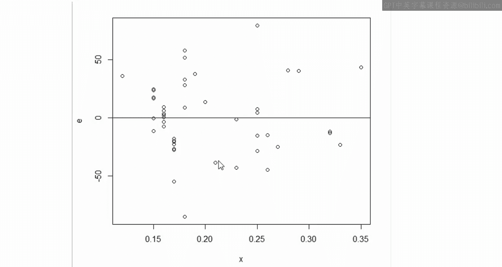

# 约翰霍普金斯大学《数据科学的高级统计｜Advanced Statistics for Data Science》中英字幕（deepseek p92 18_编程示例.zh_en -BV1htPjeYEFH_p92-

So let's go through our diamond example again， remember our y was price and our y was price in Singapore dollars and the x was carrots。

 our beta1。Was the correlation between y and x。Times the standard deviation y divided by the standard deviation of x。

Beta 0 was， mean why。Minus beta1s mean x。And our Y hat was beta 0 plus beta 1。Times x。Okay。

 so our residual E would just be y minus。Why hat。

And。Sa for example， if we show the easier way to get， recall。

 we defined as fit the output of linear model。The linear model function。

Of y t the x， the easiest way， easier way to get the residuals is just to red。

Of the assigned output， and notice， of course， it's the same thing。

A good plot to do with your residuals is to plot。The residuals。Bye。

Ploot the x values by the residuals。And add。A vertical line is zero， if you look over here。

What you see。Is that there aren't too many systematic patterns in the residuals。

 However there are some common prices that maybe weren't so apparent with the scatter plot and notice that these clusters of very similar prices at a particular carrot values。

 So there's some common I'm sorry some common carrot values that occur。

 it seems like the carrot value is a little bit more discrete at some of these lower levels。Okay。

 so remember to do a residual plot。 And whenever you're looking at a residual plot。

 you're trying to find any sort of systematic patterns。

