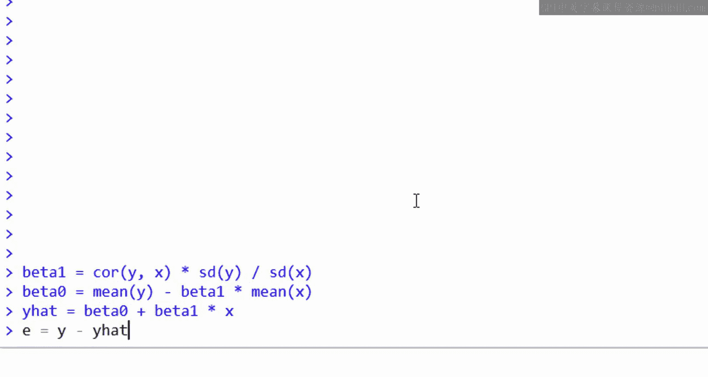
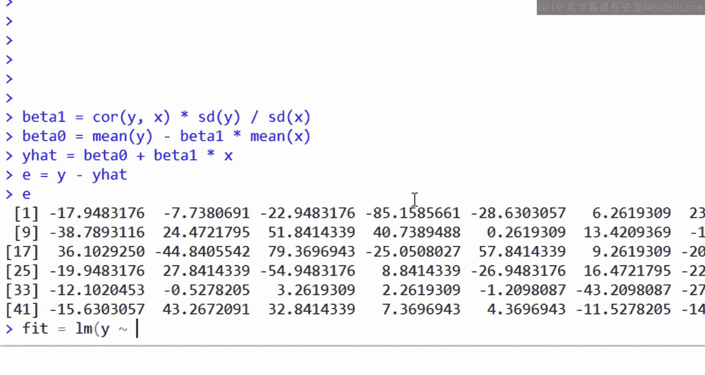
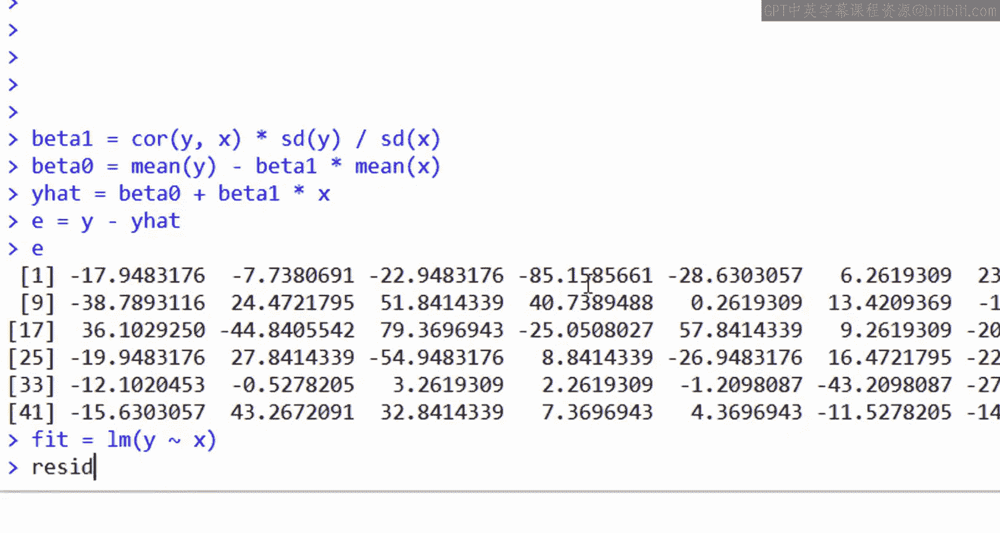
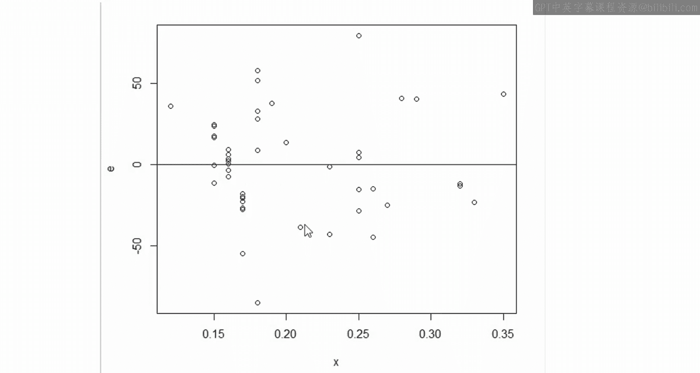

# 数据科学的高级统计：第18章：编程示例 💎

在本节课中，我们将通过一个钻石价格的例子，回顾线性回归的核心概念，并学习如何在R语言中实现它。我们将重点关注如何计算回归系数、预测值、残差，以及如何通过残差图来诊断模型。

## 概述

我们将使用一个数据集，其中响应变量 `y` 是钻石的价格（以新加坡元计），解释变量 `x` 是钻石的克拉数。我们的目标是拟合一个线性回归模型，理解其构成，并评估拟合效果。

## 回顾核心公式



上一节我们介绍了线性回归模型。本节中，我们来看看如何具体计算模型的各个部分。

线性回归模型的基本形式是：
\[
\hat{y} = \beta_0 + \beta_1 \times x
\]



其中：
*   \(\beta_1\) 是斜率。
*   \(\beta_0\) 是截距。
*   \(\hat{y}\) 是预测值。

以下是计算这些参数的公式：
1.  **斜率 (\(\beta_1\))**：它是 `y` 和 `x` 之间的相关系数，乘以 `y` 的标准差，再除以 `x` 的标准差。
    \[
    \beta_1 = \text{cor}(y, x) \times \frac{sd(y)}{sd(x)}
    \]
2.  **截距 (\(\beta_0\))**：它是 `y` 的均值减去 \(\beta_1\) 乘以 `x` 的均值。
    \[
    \beta_0 = \bar{y} - \beta_1 \times \bar{x}
    \]
3.  **预测值 (\(\hat{y}\))**：使用上述计算出的截距和斜率，根据 `x` 的值进行预测。
    \[
    \hat{y} = \beta_0 + \beta_1 \times x
    \]
4.  **残差 (\(e\))**：它是观测值 `y` 与预测值 \(\hat{y}\) 之间的差值，代表了模型未能解释的部分。
    \[
    e = y - \hat{y}
    \]



## 在R中实现模型

在R语言中，有更简便的方法来拟合线性回归模型并获取结果。

我们可以使用 `lm()` 函数来拟合模型。例如，将模型拟合结果赋值给一个变量 `fit`：
```r
fit <- lm(y ~ x)
```

获取残差的最简单方法是使用 `resid()` 函数，直接作用于模型拟合对象 `fit`：
```r
residuals <- resid(fit)
```
当然，这与你手动计算 \(y - \hat{y}\) 得到的结果是相同的。

## 模型诊断：残差图

在得到残差后，一个重要的步骤是进行模型诊断。一个常用的诊断图形是残差图。

以下是绘制残差图的步骤：
1.  以解释变量 `x` 为横轴。
2.  以对应的残差 `e` 为纵轴，绘制散点图。
3.  在纵坐标为0的位置添加一条水平参考线。

观察上面的残差图，我们可以看到残差没有表现出明显的系统性模式（比如明显的曲线趋势），这通常是一个好迹象。然而，图中揭示了一些在原始散点图中可能不明显的现象：在某些特定的克拉值处，出现了价格高度聚集的集群。这表明克拉数这个变量在较低水平时，其取值可能更具离散性，而非完全连续。

## 总结



本节课中，我们一起学习了如何通过公式手动计算线性回归的系数，并利用R语言的 `lm()` 和 `resid()` 函数更高效地实现模型拟合与残差提取。最重要的是，我们介绍了残差图这一强大的诊断工具。绘制并分析残差图时，核心目标是**寻找任何系统性的模式**，以评估线性模型的假设是否得到满足，并发现数据中可能存在的特殊结构。