# 约翰霍普金斯大学《数据科学的高级统计｜Advanced Statistics for Data Science》中英字幕（deepseek p93 19_广义化.zh_en -BV1htPjeYEFH_p93-

It's interesting to note that everything that we discussed is。Not particularly。Explit to real valued。

Outcomes and real value predictors。 So take is a possible example that y looks something like this。

 Y looks like a function over， let's say， time from time 0 to 1。An X also looks like a function。

Over time， from， say 0 to 1。So let's consider the space L201。

 which is the space of square interval functions on 01。

Where the inner product of F and G on this space is integral from 0 to 1 F of T。

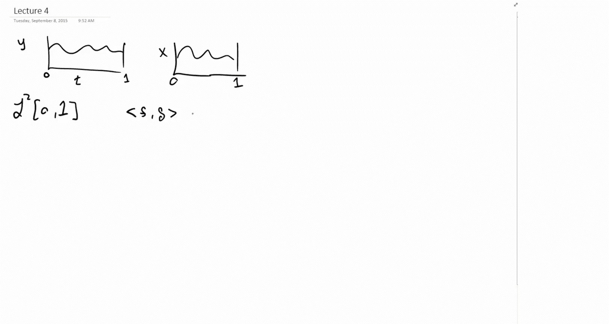

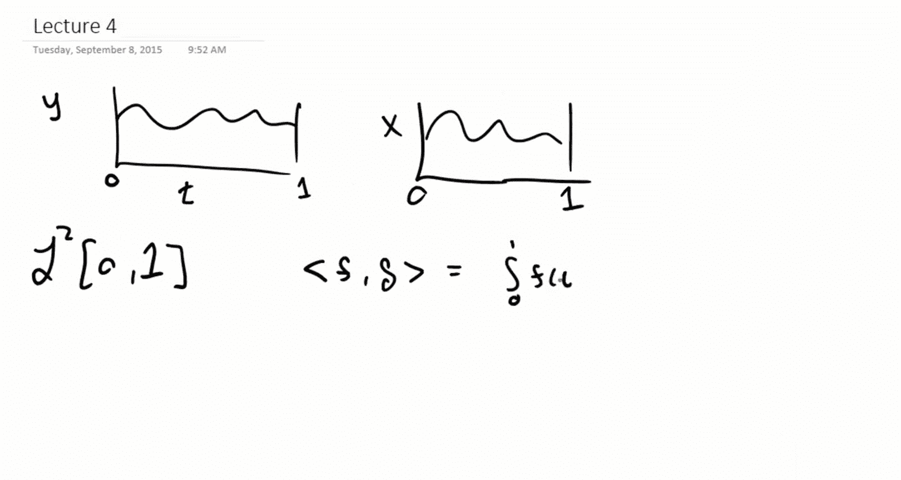

G of T。D铁。😔，So。What we want to do， consider regression to the origin。

 We want to explain why with a scalar multiple times this function X。

And find how could we prove that beta hat is kind of what we would think it would be， Well beta hat。

 we think the answer is going to be the inner product of Y and X over the inner product of x with itself。

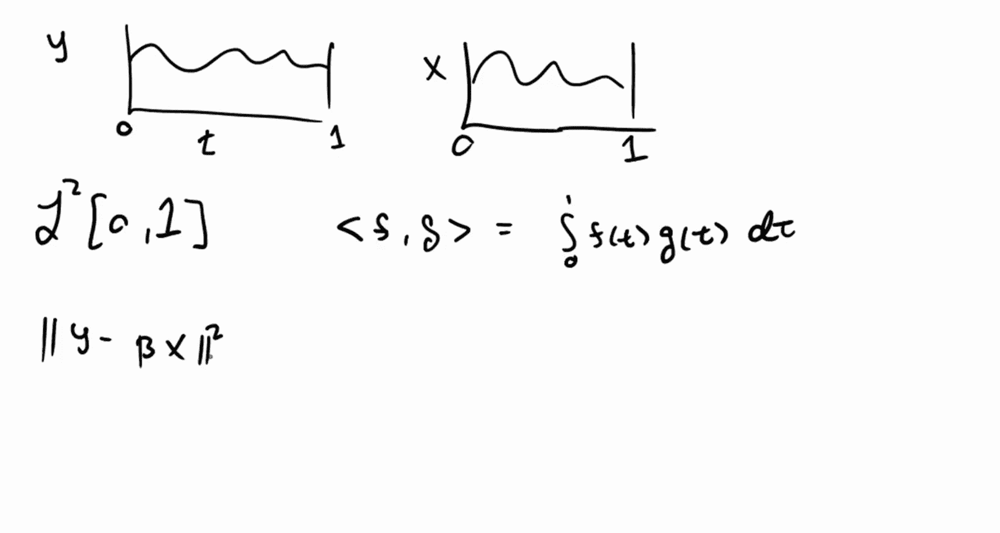

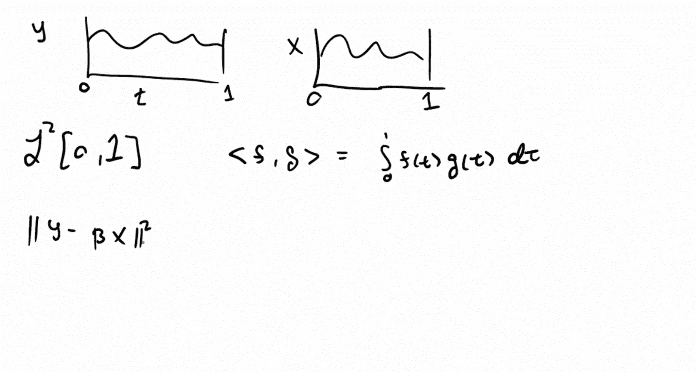

So we can just do the same thing we did before。 Y minus。Beta hat x。Plus， beta hat X。Minus。Data x。

Quinantity squared， and we can expand that out just using the standard products of squares and get y minus beta hat。

X squared plus。Inner product of y minus beta hat x。And beta。Hat x minus beta x。Plus。And twice that。

And then， plus。

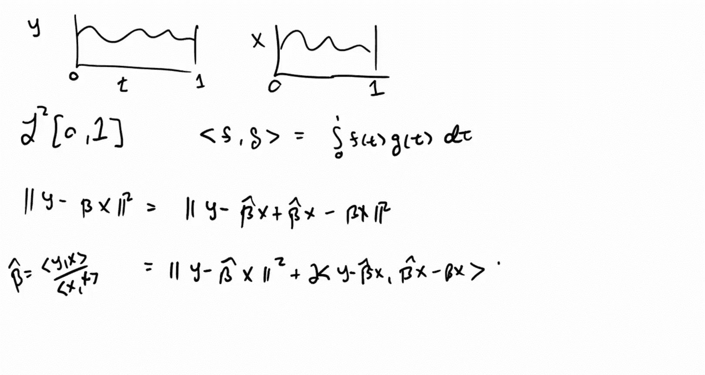

Your product。Beta had x minus beta of x。

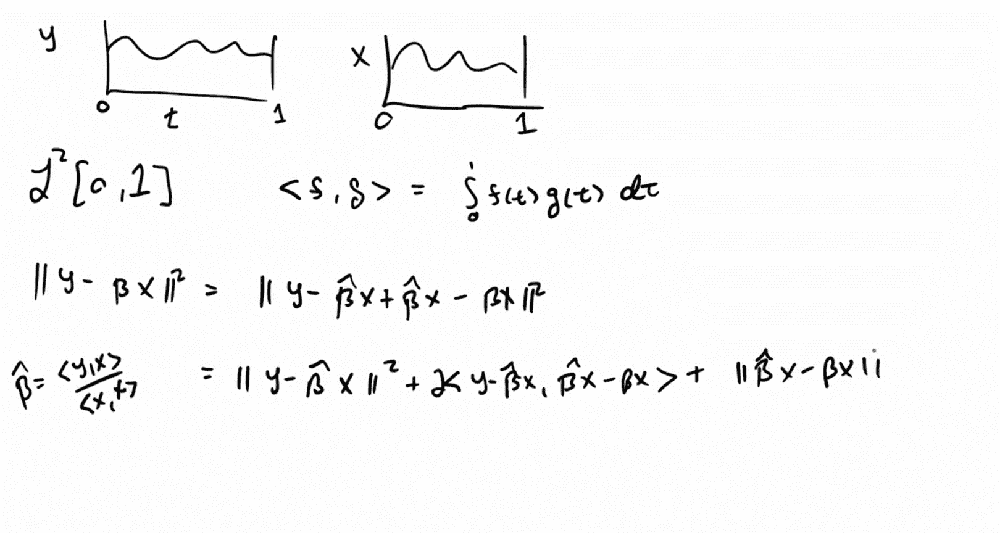

Quantity squared。 Now， this quantity is positive。 So if we get rid of it， we only get larger。

And I'd like for you to go through the notes or do it as homework to show that that quantity is 0 so that we get that are。

 if we plug in an arbitrary value of beta， we're always going to be bigger than if we plug in the specific value beta hat。

 So what we see is that the least scores equation works in this case， in this generalized space。

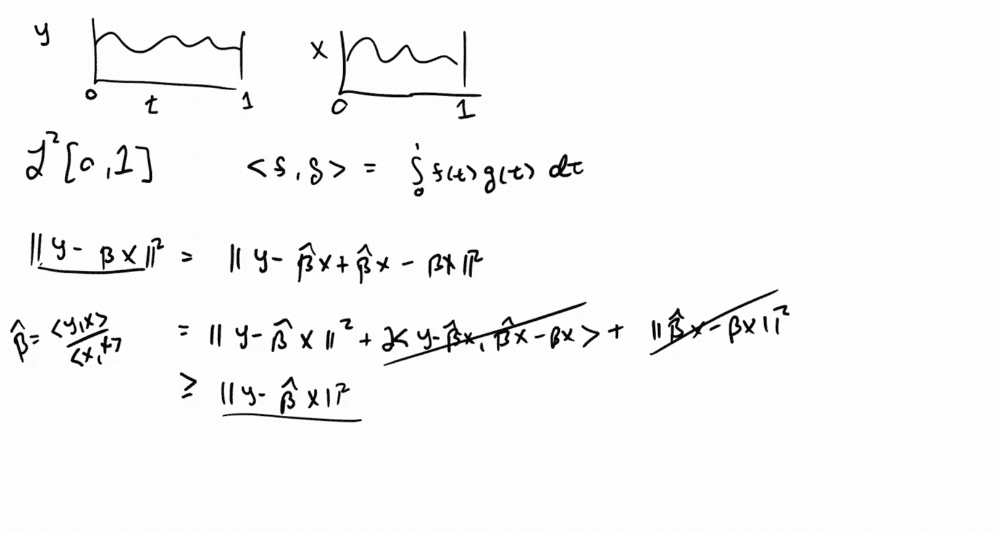

So that if we want to explain an observed outcome Y。

 we want to explain it as a function of the other function x as a scalar multiple of x。Then。

We get the same answer。Now， consider the instance where x is just the function1 on 0 to 1。

 So x just looks like this。Which is， of course。Has a finite integral on that range。

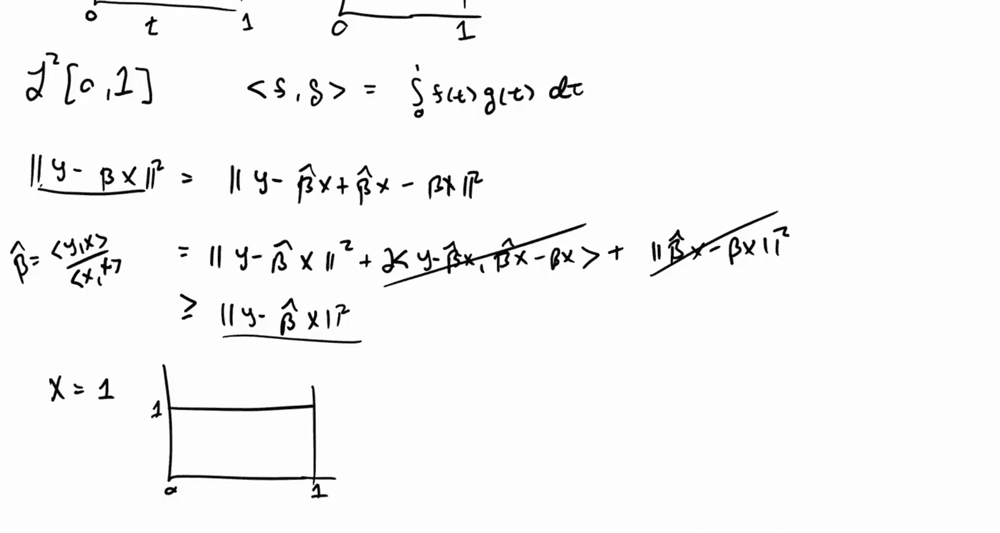

Then the beta hat。Works out to be inner product of Y and x。Over the inner product of x itself。

The denominator is just one。 The numerator is integral Y of T。Times1。

 which I'm going to oit Dt over 0 to 1。 So we could just call that。

 we call that function Y bar the average of the function over the range0 over the domain 0 to 1。

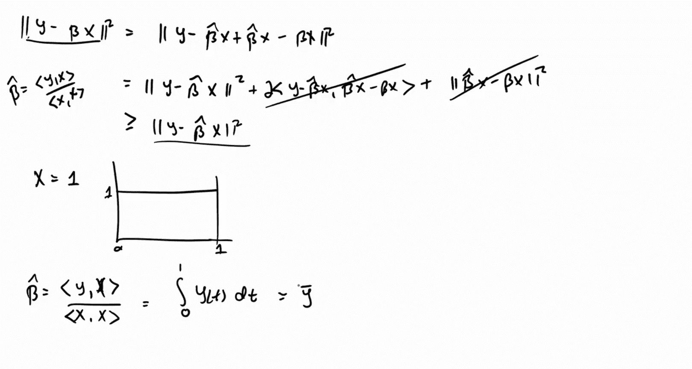

So we could define， say， y Tilde as the centered version of y， y minus。Y bar times the function。

 Let me call J the function that's constant one between 0 and 1。Now。

 let's consider linear regression， and let's let x tilde be x minus。X bar times J。

The centered versions。

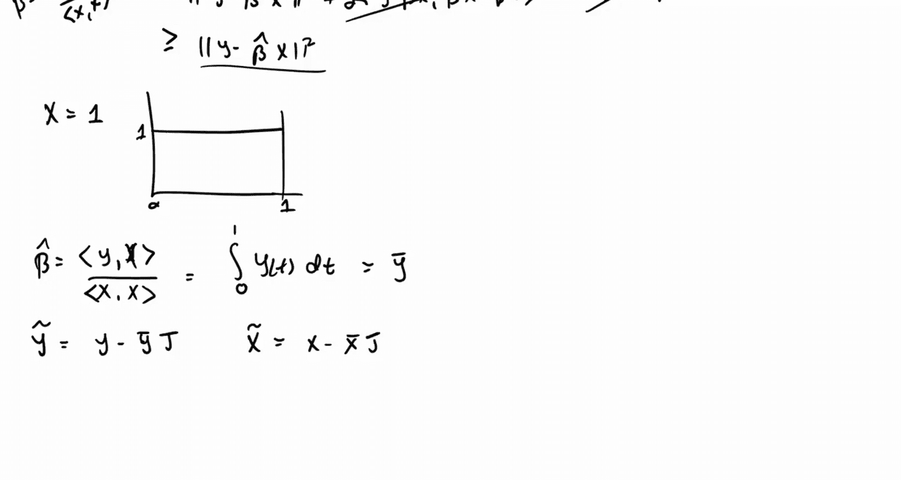

So oh， and I need just a couple other definitions。Let me define the covariance between two functions。

 Y and x as the integral from 0 to one of。Y minus y bar times J。X。inus x bar times J。

 and I'm omitting the Dt。 I'm omitting the fact that this is J of T， this is Y of T。Okay。

 I guess I'm not admitting it because I'm writing it right now。 Okay。

 so I'm going to define that as the covariance and then define the variance of， say。

 y as the covariance。A wide by itself。 So now we've just extended things like the covariance and the variance to。

 And， of course， we can then also extend the correlation。

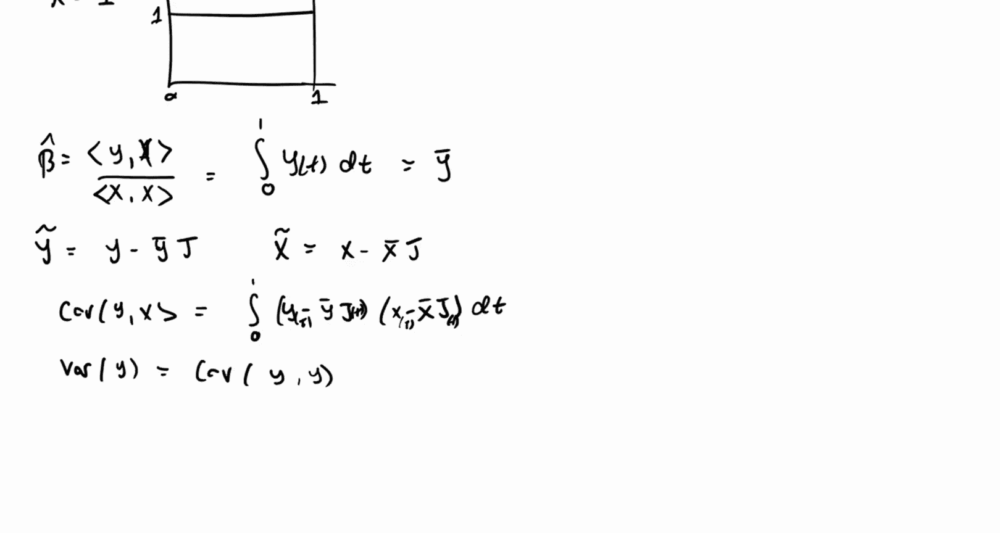

And the standard deviation to now functions on this square integral space。 Now。

 let's suppose we wanted to minimize y our function y minus beta n times j minus beta 1 times x。

 We can do our same old trick if we hold beta1 fixed。

 right and think of y minus beta 1 x as a single function。

 Then we're going to get that the solution beta n as it depends on beta 1。

 has to be equal to y bar minus beta 1 x bar plugging that back in。

 We're going to then just get a regression to the origin case again。

 and we're going to get the beta 1。

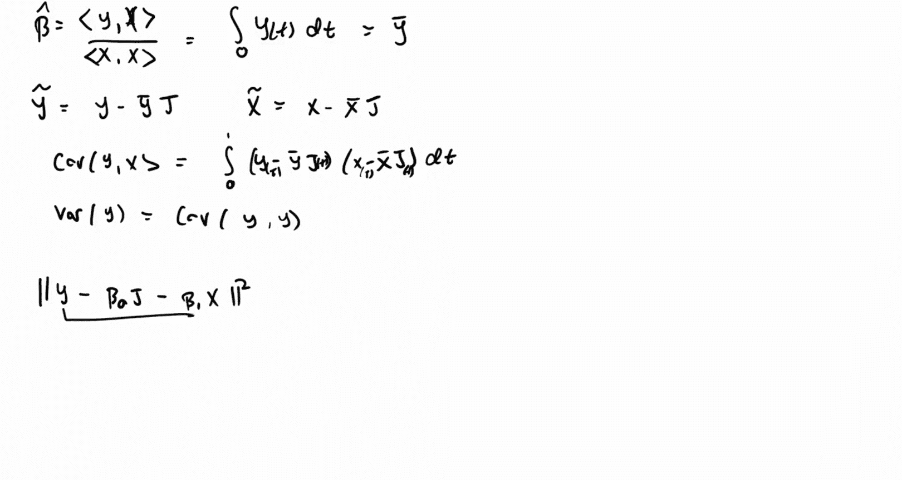

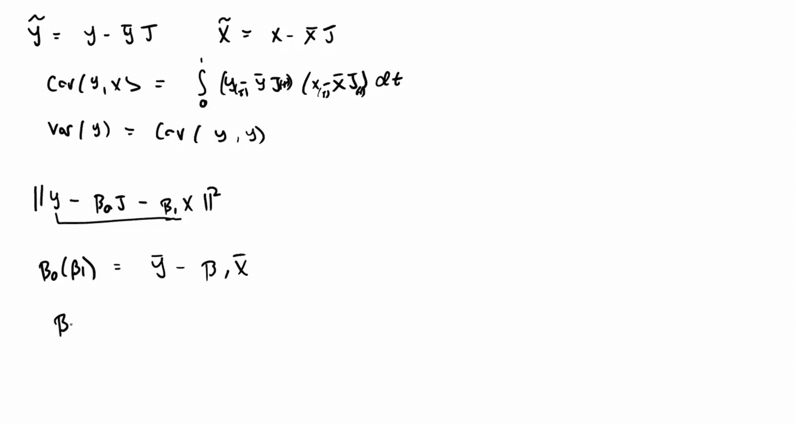

Is equal to beta 1 hat is equal2。The correlation。The correlation between the function Y and the function X times the functional standard deviation of y divided by the functional standard deviation of x。

In addition， then we're going to get the beta not hat plugging back into it is y bar minus beta 1 hat。

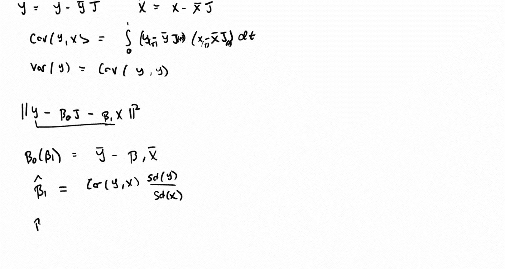

X bar。 So more than anything， what I wanted to show is that we can extend。A。

Equations that we've written out for linear regression。

 and the same thing is true for multivariable regression。

 We can extend them to these more complex spaces。 This is an example of a so called Hilbert space。

And you can just have linear regression and multivariable regression for a general Hilbert space。

 You basically just need the inner product and to define concepts like the correlation and the covariance like this。

 but all of the results basically work out to be the same。

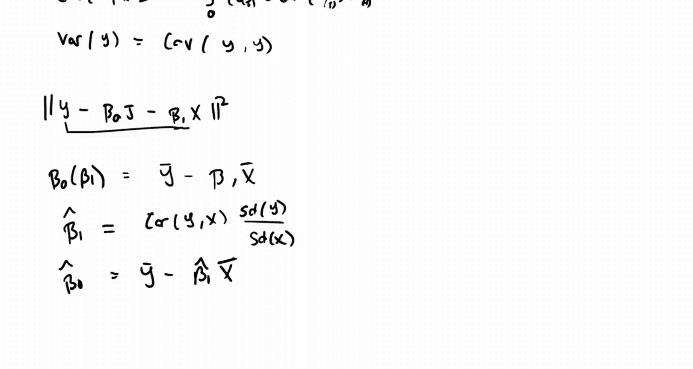