# 数据科学的高级统计：19：广义化 📈

在本节课中，我们将学习如何将线性回归的概念从简单的数值数据推广到更复杂的数学空间，特别是函数空间。我们将看到，最小二乘法的核心思想在更一般的希尔伯特空间中依然成立。

---

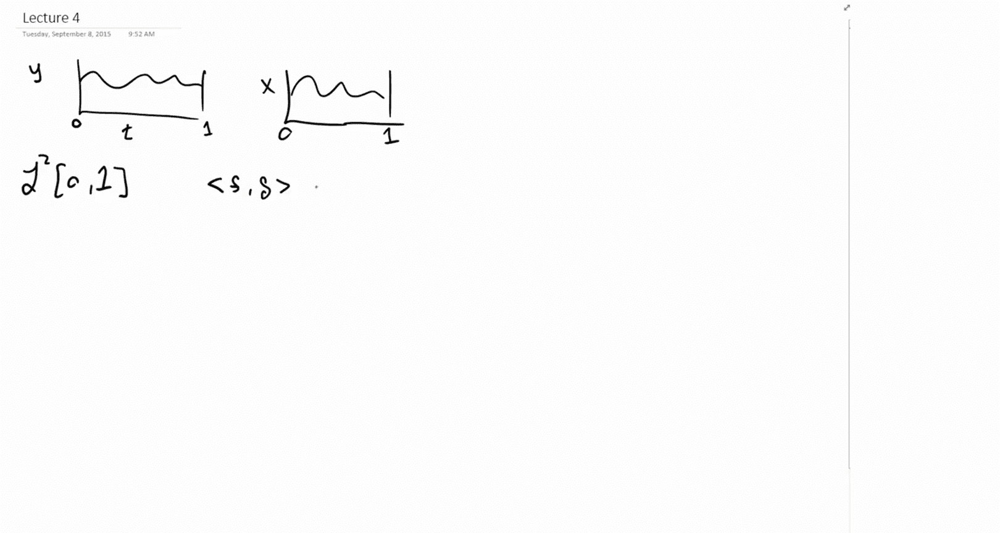

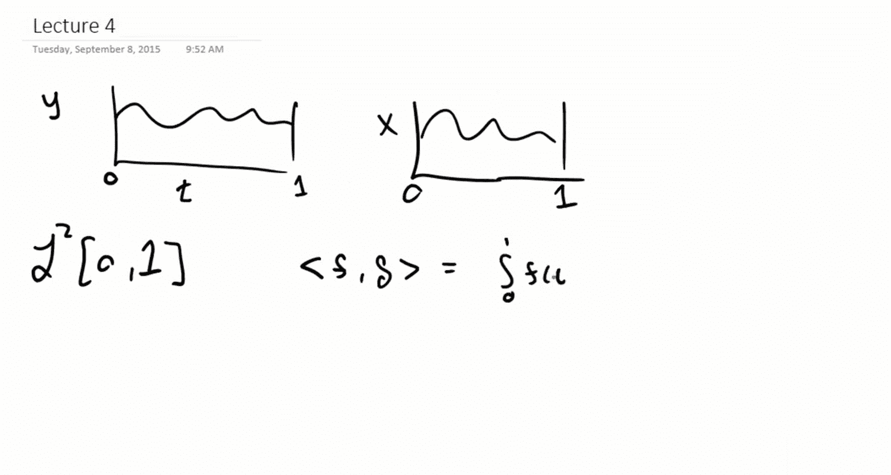

我们之前讨论的所有内容，并非专门针对实值结果和实值预测变量。考虑一个可能的例子：Y 看起来像是一个函数，例如，在时间 0 到 1 上的函数。X 看起来也是一个在时间 0 到 1 上的函数。

让我们考虑空间 **L²[0,1]**，即定义在区间 [0,1] 上的平方可积函数空间。在这个空间中，两个函数 **f** 和 **g** 的内积定义为：

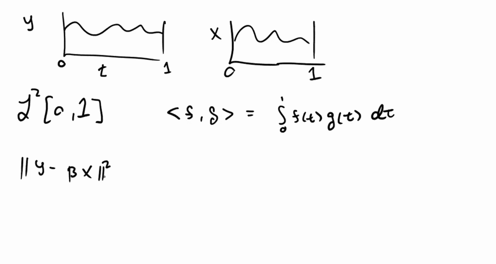

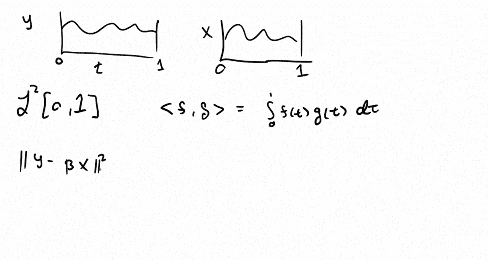

---

上一节我们定义了函数空间及其内积，本节中我们来看看如何在这个空间中进行回归。

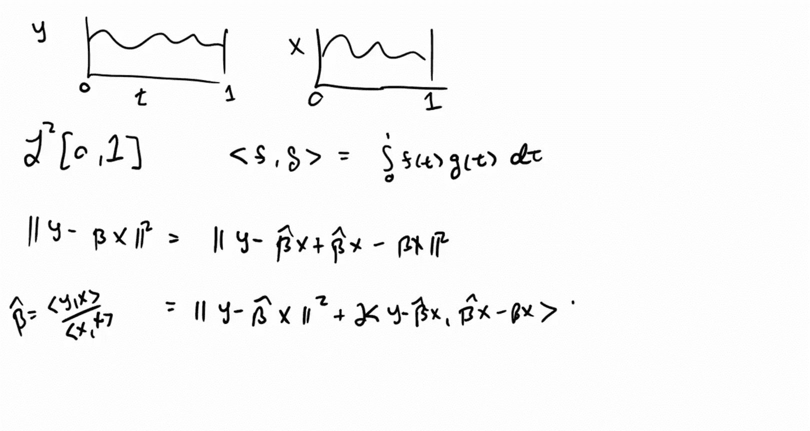

我们想要进行过原点的回归。我们希望用标量 **β** 乘以函数 **X** 来解释 **Y**。我们想证明，**β** 的估计值 **β̂** 会是我们所期望的形式。我们认为答案将是：

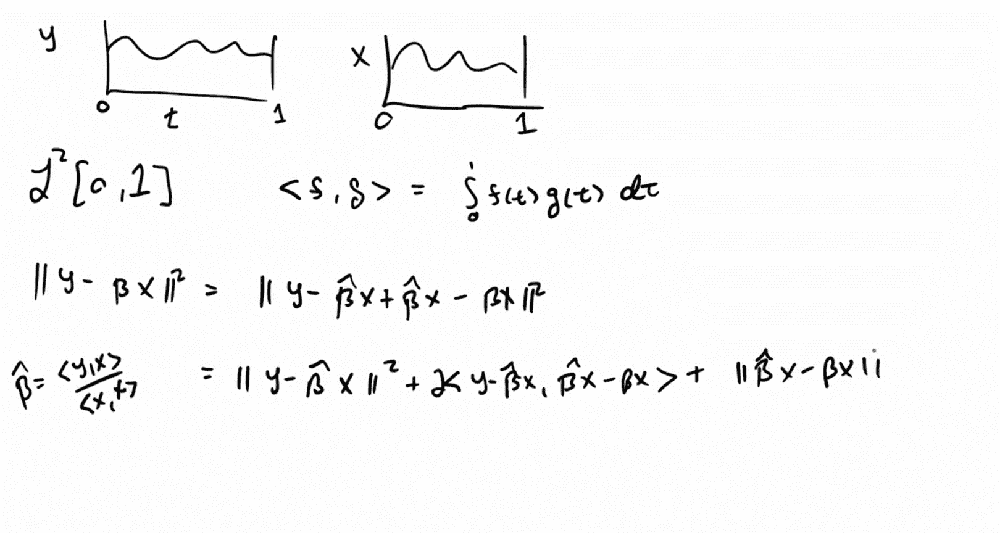

我们可以采用与之前相同的方法。考虑表达式 **Y - βX** 的平方范数，并将其分解：

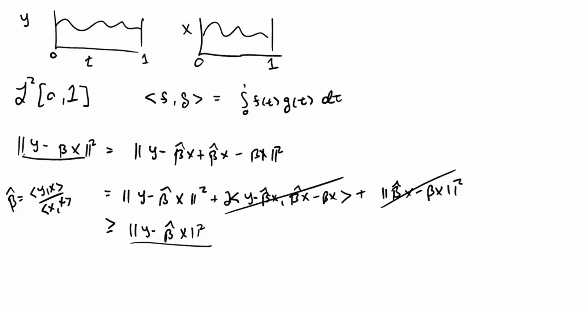

现在，最后一项 **||β̂X - βX||²** 是非负的。如果去掉它，整个表达式会变大。你可以通过笔记或作为作业来证明中间项 **<Y - β̂X, β̂X - βX>** 为零。因此，对于任意给定的 **β** 值，其对应的平方误差总是大于或等于使用特定值 **β̂** 时的误差。

这表明，最小二乘方程在这个广义空间中也适用。因此，如果我们想用一个函数 **X** 的标量倍数来解释观测结果 **Y**，我们会得到相同的答案。

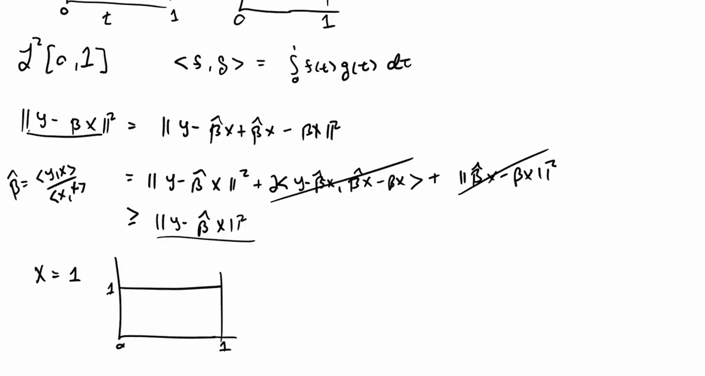

---

理解了过原点回归的推广后，现在让我们考虑一个具体实例。

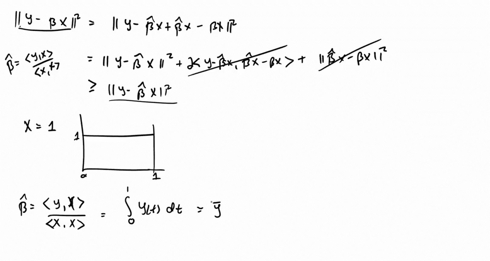

考虑 **X** 只是定义在 [0,1] 上的常数函数 **1** 的情况。那么 **β̂** 计算如下：

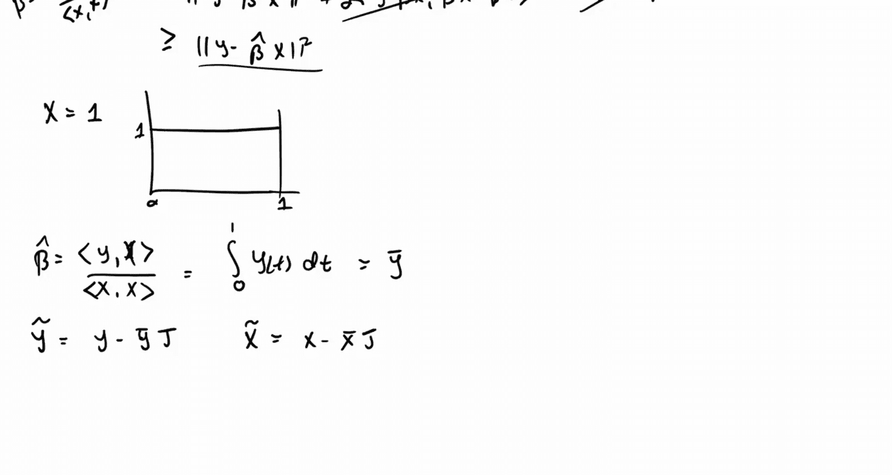

分母是 **<1, 1> = 1**。分子是 **∫₀¹ Y(t) dt**，我们称之为函数 **Y** 在定义域 [0,1] 上的平均值 **Ȳ**。

因此，我们可以定义中心化的函数。令 **J** 为 [0,1] 上的常数 1 函数。定义 **Ỹ** 为 **Y** 的中心化版本：**Ỹ = Y - Ȳ·J**。类似地，定义 **X̃ = X - X̄·J**。

---

为了将线性回归完全推广，我们需要定义函数空间中的协方差和方差。

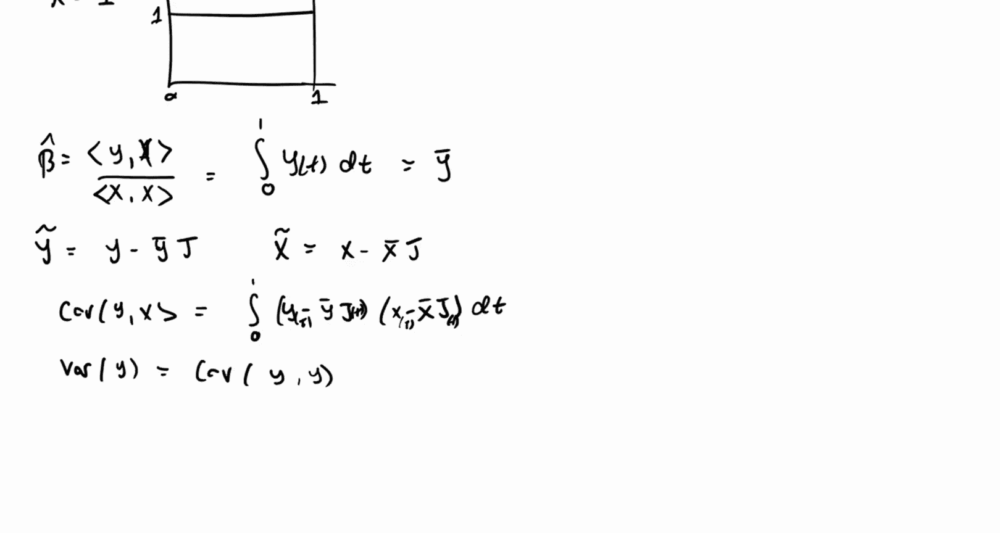

以下是相关定义：
*   两个函数 **Y** 和 **X** 的协方差定义为：**Cov(Y, X) = ∫₀¹ (Y(t) - Ȳ)(X(t) - X̄) dt**
*   函数 **Y** 的方差定义为：**Var(Y) = Cov(Y, Y)**
*   基于此，我们可以进一步定义函数的标准差和相关系数。

这样，我们就将协方差、方差等概念扩展到了这个平方可积函数空间。

---

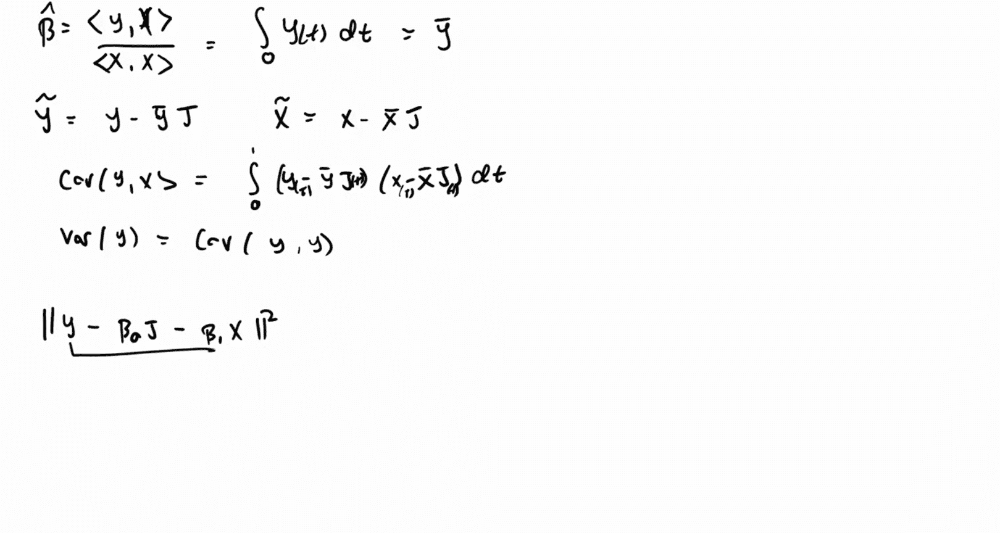

最后，我们来看完整的线性回归模型在函数空间中的形式。

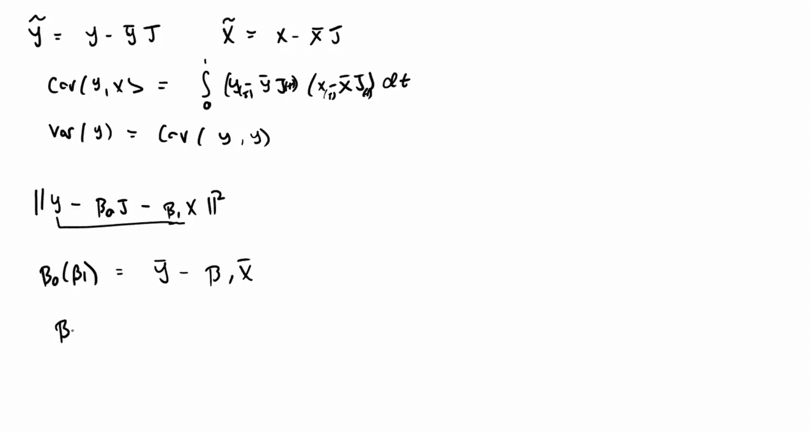

假设我们想要最小化 **||Y - β₀·J - β₁·X||²**。我们可以使用相同的技巧：如果固定 **β₁**，将 **Y - β₁X** 视为一个整体函数，那么关于 **β₀** 的解（依赖于 **β₁**）必然是 **β₀ = Ȳ - β₁X̄**。

将这个关系代回原问题，我们又得到了一个过原点的回归问题，并可以解出 **β₁**：

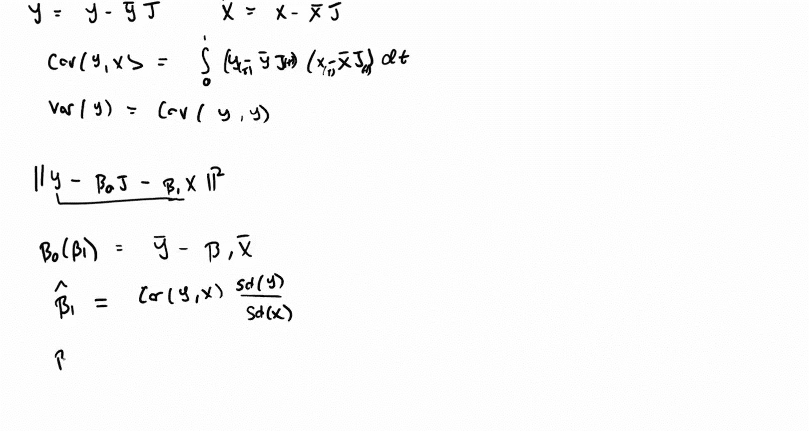

其中 **ρ** 是函数 **Y** 和 **X** 的相关系数，**σ_Y** 和 **σ_X** 分别是它们的函数标准差。然后，将 **β̂₁** 代入，得到 **β̂₀ = Ȳ - β̂₁X̄**。

---

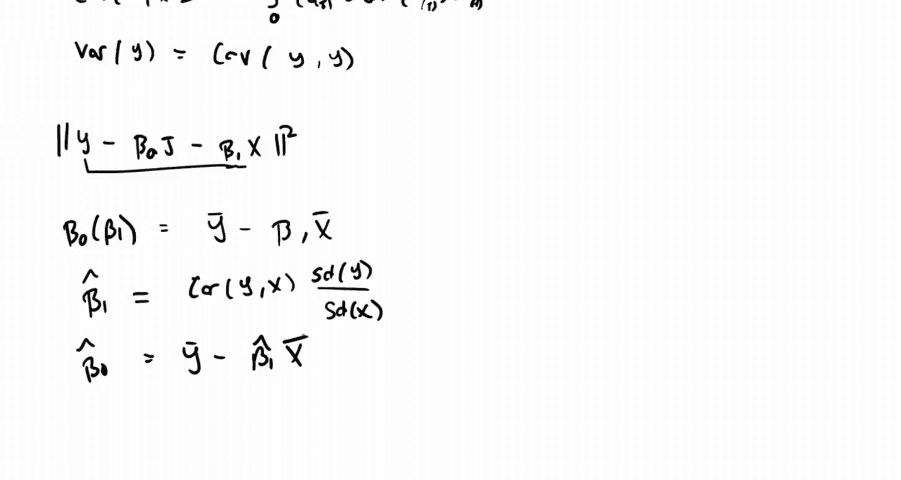

本节课中我们一起学习了线性回归向更广义空间的扩展。最重要的是，我想展示的是，我们可以将线性回归（多元回归也是如此）的方程扩展到这些更复杂的空间。这是一个所谓的希尔伯特空间的例子。对于一个一般的希尔伯特空间，你基本上只需要内积，并像这样定义相关系数和协方差等概念，那么所有的结果基本上都同样成立。