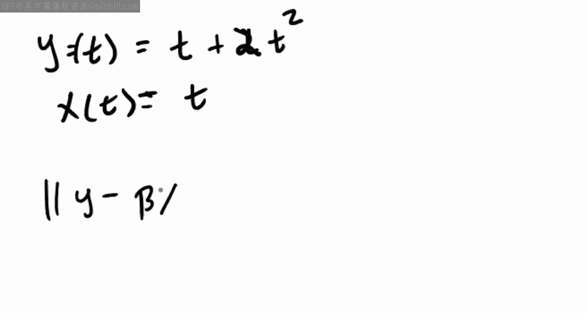
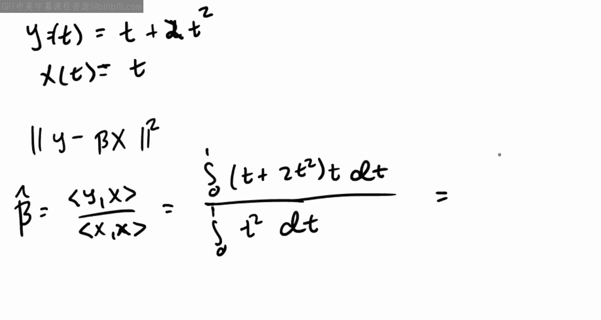
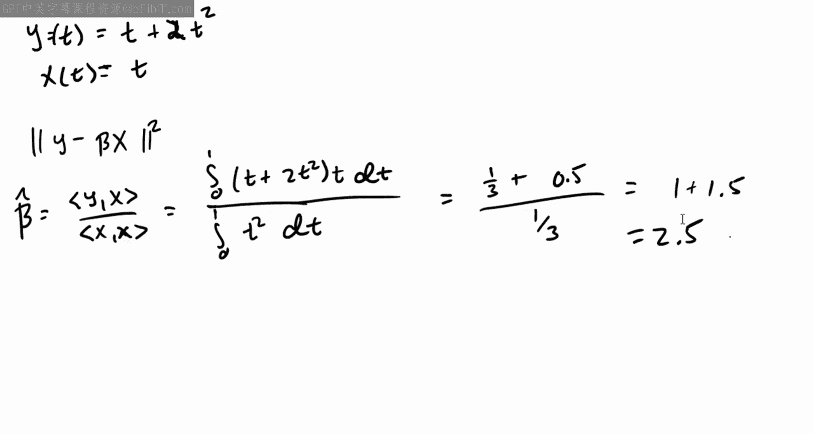
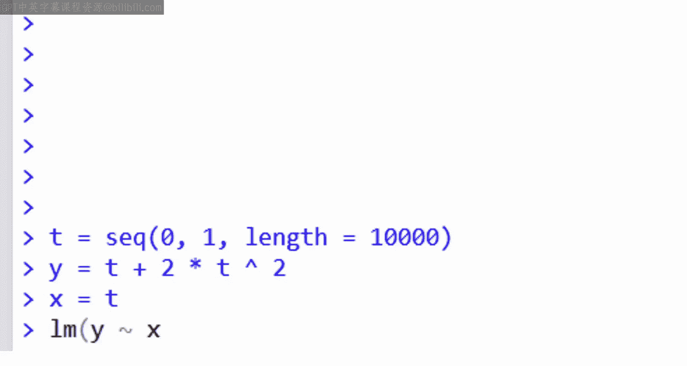
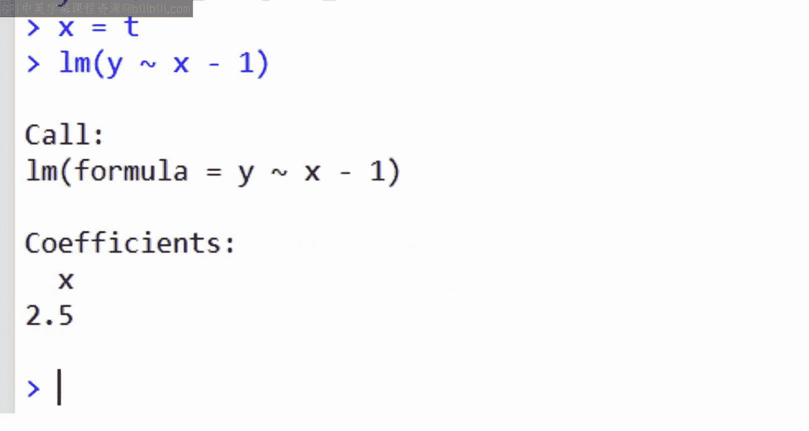

# 约翰霍普金斯大学《数据科学的高级统计｜Advanced Statistics for Data Science》中英字幕（deepseek p94 20_广义化示例.zh_en -BV1htPjeYEFH_p94-

Let's go through a quick example just so you get the j。

 So I'm just going to make up a functional example。

 So imagine if my y of T was equal to T plus 2 t squared。And then my x of T was just t。Okay。

 so I have a quadratic function。 I'd like to just approximate it with a linear function because both these goes to the origin。

 we're just going to do regression to the origin， and then you can make up and do an example of linear regression in a functional space Okay so we want to minimize that equation and we know that our beta hat。

 let me start it down here in a new line。 We know that our beta hat has to satisfy norm Y X over norm X。

Okay， I'm sorry， In product Ym x over inner product x with itself over NormX。 Okay。

 so that's the integral from 0 to 1 t plus 2 t squared times t dt and in the bottom， it's integral。

 the definite integral from 0 to 1 T squared dt。 So the numerator， let's see。 So that's t squared。

 So the integral of that will be a third when evaluated at at the endpoint of the integral and then this one will be2 t cubed。

 So that'll be2。5。

0。5。For that one， and then this one in the bottom will be a third。Okay， so that's 1 plus 1。5 or 2。

5 should be our slope。 So let's go ahead and do a computer example to test this。

Okay， here we are。 So let me just define T is sequence0 to one length equal。A lot。 Okay。

 so y is equal to。T plus。Plus，2 T。Squared and our x is equal to T。

 So now if I fit a linear model with this many data points， the sum should approximate the integral。

 and it should give me about the same answer。 Of course， we get about 2。5。

