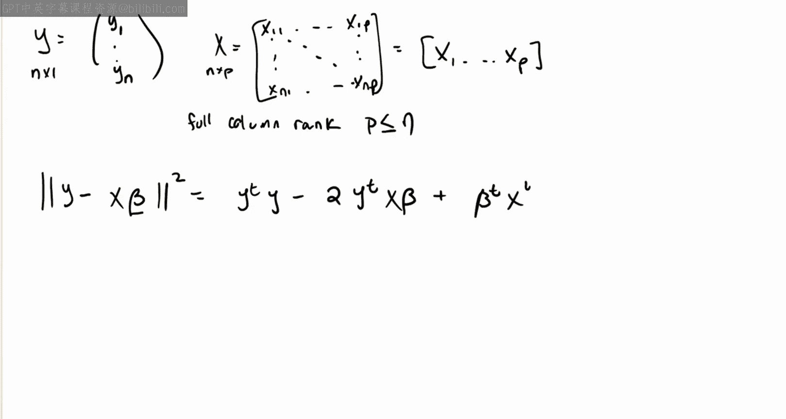
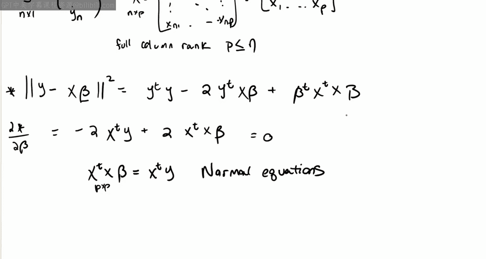
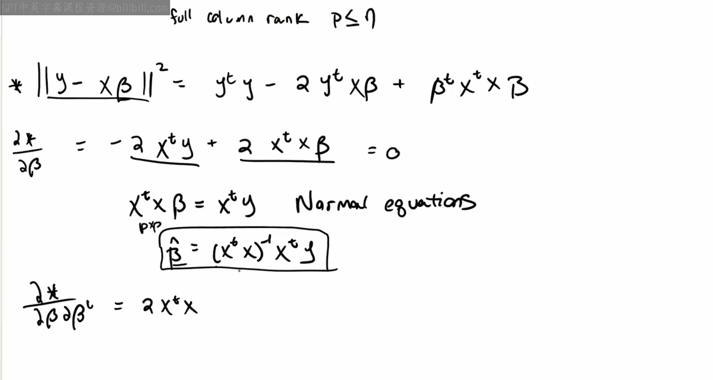

# 约翰霍普金斯大学《数据科学的高级统计｜Advanced Statistics for Data Science》中英字幕（deepseek p95 21_最小二乘法.zh_en -BV1htPjeYEFH_p95-

Now， let's consider full lease squares。So in this setting， our outcome y is an n by one vector。W1。

Up to Y n。And our X， our design matrix is we can write it in two ways， first。

 we could write it as a matrix of its element， x11。X1 P。All the way down to X N1。The X and P。

Or we could write it。As its collection of column vectors， x1。To Xp。We're going to assume。

X is a full column rank。And。That。P is less than strictly less than n， less than or equal to。

 let's say。And we'd like to explain the variation and why。With linear combinations。

Of the columns of x。And we're going to do that by finding the beta， the collection。

 the weights of the columns of x。That best describes why in the sense of minimizing the sum of the squared distances。

Okay。So。Let's figure this out。If we expand this out， we get y transpose y minus2 y transpose x beta。

Plus。Beta transpose x transpose x beta。

Now， let's call that asterisk， if we take。The derivative of asterisks with respect to beta。

We get that It's equal to negative 2 x transpose y。Plus，2 x transpose x beta。

Then if we want to solve that equal to zero。What we're going to do then is get the equations。

X transpose x beta is equal to x transpose y。 These are called the normal equations。Now。

If x is full column rank， then x transpose x is P by p， and it's of full rank。

 and so hence invertible， and if you haven't seen this before， I just found a nice resource on this。

 go to Khan Academy and in his section on linear algebra。

 he has exactly a description proof very simple proof of Y X transpose X inherits the same rank as x。

It's a very easy， easy thing。Okay， so since we can invert it， we get the beta hat。

 the estimate of beta。The best estimate works out to be x transpo x inverse。X transpose y。

 and we can then take the second derivative of asterisk。

Which works out this part doesn't involve beta。And then this part is just linear in beta。

 so it's2 x transpose x。Which is a positive， definite matrix。

So that means that beta is beta hat here is indeed the minimum of the least squares criteria。

 so that's it， so if you want to find the best linear combination of my columns of x to explain y in the sense of minimizing the norm between our predicted value and the response y。

 we get a solution of x transpose x inverse x transpose y。

