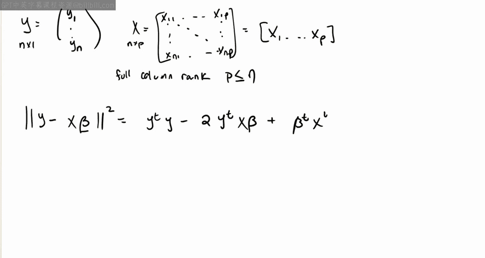
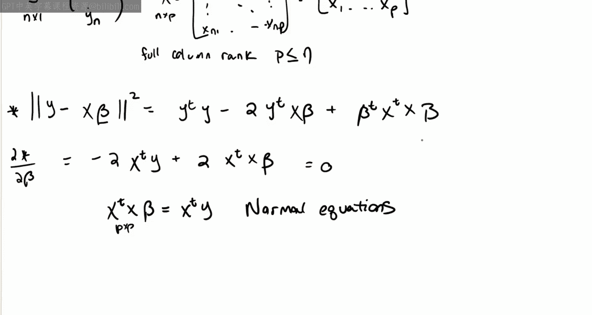
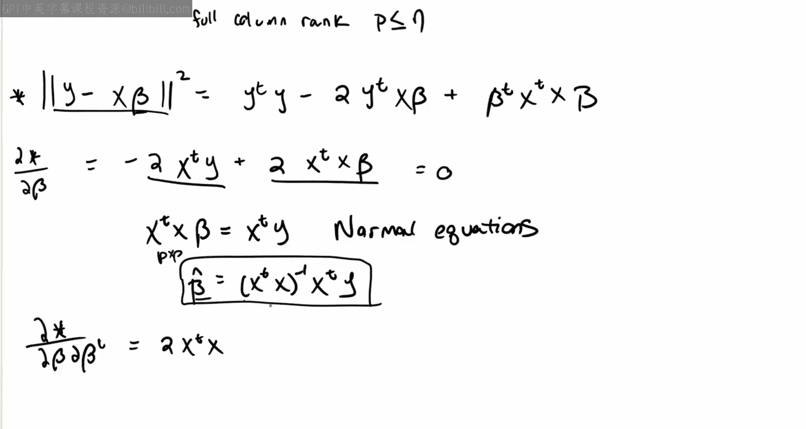

# 高级统计学：第21章：最小二乘法 📊

在本节课中，我们将学习**最小二乘法**。这是一种通过线性组合解释数据变化的核心方法。我们将从基本设定开始，逐步推导出最小二乘估计的公式，并理解其背后的数学原理。

## 模型设定与目标

现在，我们来考虑**普通最小二乘法**。在这个设定中，我们的结果变量 **y** 是一个 **n × 1** 的向量，即 `[y1, y2, ..., yn]^T`。我们的设计矩阵 **X** 有两种表示方式。

首先，我们可以将其写成一个元素矩阵：
```
X = [ x11, x12, ..., x1p;
      x21, x22, ..., x2p;
      ...;
      xn1, xn2, ..., xnp ]
```
其次，我们也可以将其视为列向量的集合：`X = [x1, x2, ..., xp]`，其中每个 `xj` 都是一个 **n × 1** 的向量。

我们假设矩阵 **X** 是**满列秩**的，并且预测变量个数 **p** 严格小于样本量 **n**（即 `p < n`）。我们的目标是，通过寻找 **X** 各列的权重系数 **β**，用 **X** 各列的线性组合来解释 **y** 的变化。这个“最佳”描述的标准是：**最小化预测值与实际响应值之间距离的平方和**。



## 推导最小二乘解

让我们来具体推导。我们的目标是最小化残差平方和，其数学表达式为：
```
S(β) = || y - Xβ ||^2
```
将其展开，我们得到：
```
S(β) = y^T y - 2 y^T X β + β^T X^T X β
```

为了找到使 `S(β)` 最小的 **β**，我们需要对 **β** 求导并令导数为零。对上述表达式求导，我们得到：
```
∂S(β)/∂β = -2 X^T y + 2 X^T X β
```
令该导数等于零，我们得到所谓的**正规方程**：
```
X^T X β = X^T y
```

## 求解与解的性质

由于我们假设 **X** 是满列秩的，那么 `X^T X` 是一个 **p × p** 的矩阵，并且也是满秩的，因此是可逆的。（如果你不熟悉这个性质，可以查阅线性代数资料，有一个简单的证明表明 `X^T X` 继承了 **X** 的秩。）



既然可以求逆，我们就能得到 **β** 的估计值 **β_hat**：
```
β_hat = (X^T X)^{-1} X^T y
```

为了确认我们找到的是最小值点而非最大值或鞍点，我们需要检查二阶导数。`S(β)` 对 **β** 的二阶导数为 `2 X^T X`。由于 `X^T X` 是一个正定矩阵，这确保了 **β_hat** 确实是**最小二乘准则下的最小值点**。

## 核心公式总结

因此，如果我们想找到 **X** 各列的最佳线性组合，以在最小化预测值与实际响应 **y** 之间欧几里得范数的意义下解释 **y**，其解由以下公式给出：
```
β_hat = (X^T X)^{-1} X^T y
```

---



本节课中，我们一起学习了最小二乘法的基本原理和推导过程。我们从模型设定出发，通过最小化残差平方和的目标，推导出了关键的正规方程，并最终得到了最小二乘估计的闭式解公式 `β_hat = (X^T X)^{-1} X^T y`。理解这个推导过程是掌握线性回归模型的基础。