# 约翰霍普金斯大学《数据科学的高级统计｜Advanced Statistics for Data Science》中英字幕（deepseek p96 22_编程示例.zh_en -BV1htPjeYEFH_p96-

Let's just go through an example of manually fitting the least squares equation。

So consider the data set Swiss， so if I do data Swiss。And then here's the data set。AndU head。

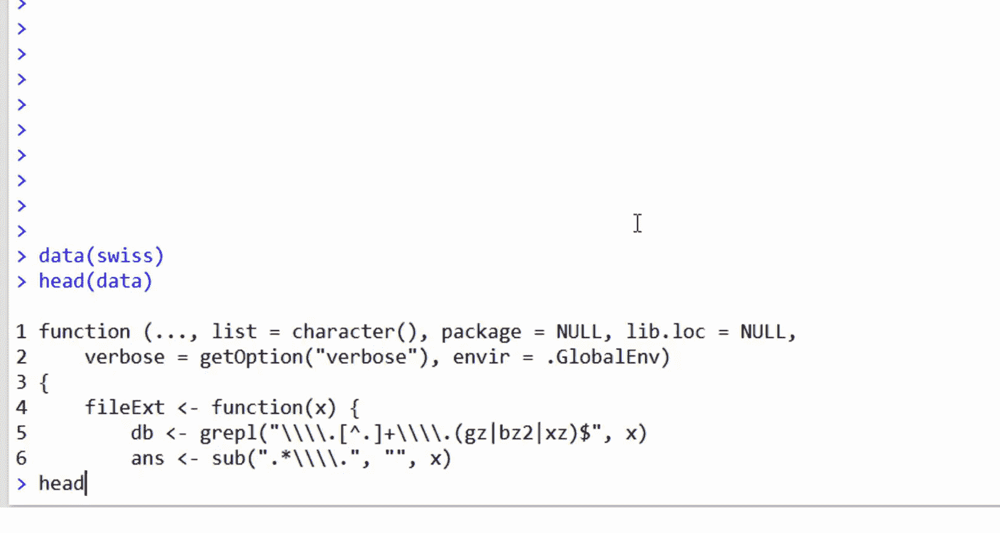

There's the data set。 We want to use fertility as an outcome and predict it using agriculture。

 examination， education， Catholic and infant mortality and an interstep。

 so let's create an X matrix that is the Swiss data set。嗯。Minus the first row。First column。

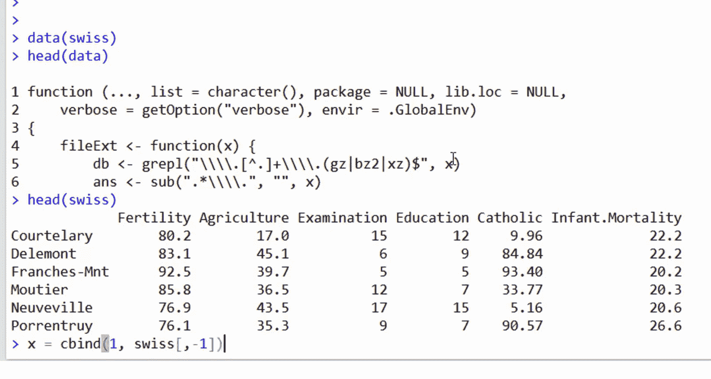

Okay， let's see X。One to 10。Okay， there we go， so it now has an intercept， agriculture， examination。

 education， Catholic and infant mental， and let's set y is equal to Swiss。

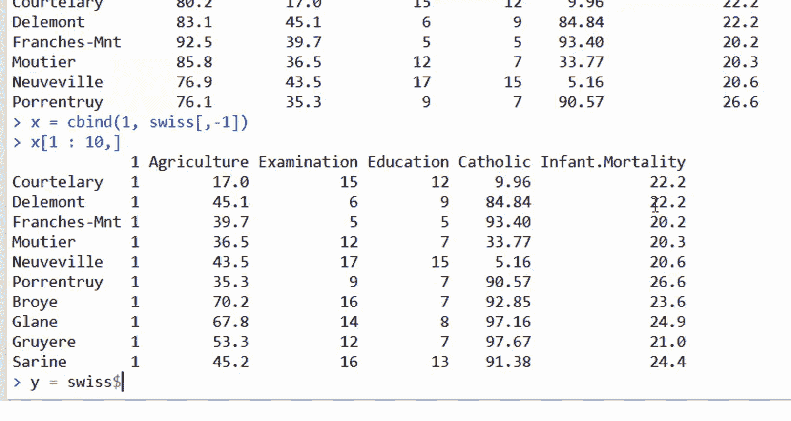

Ftality， fertility。Okay， so what we're saying is that beta hat is going to be solve x。Times。X。

Times transposeive X。Times y。

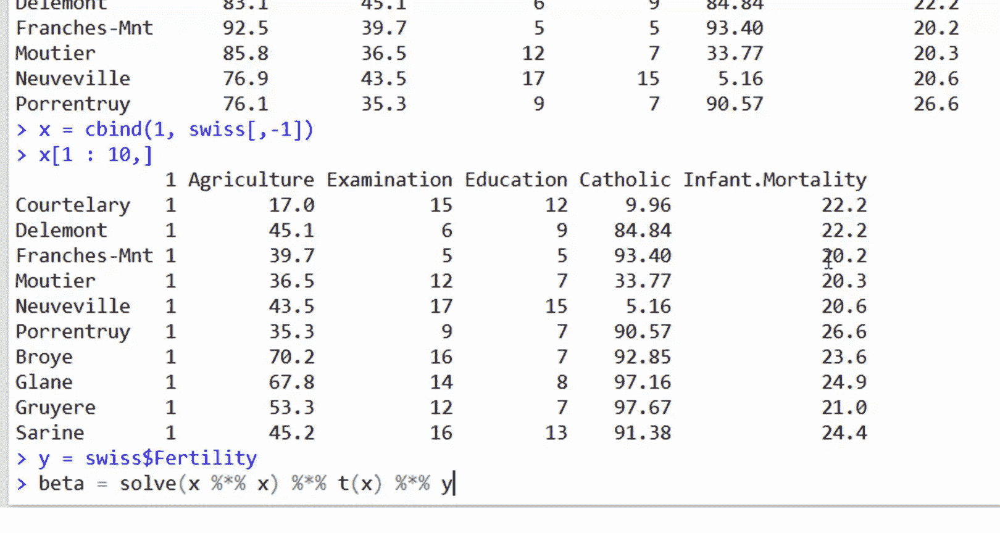

呃。oh， is that matrix。

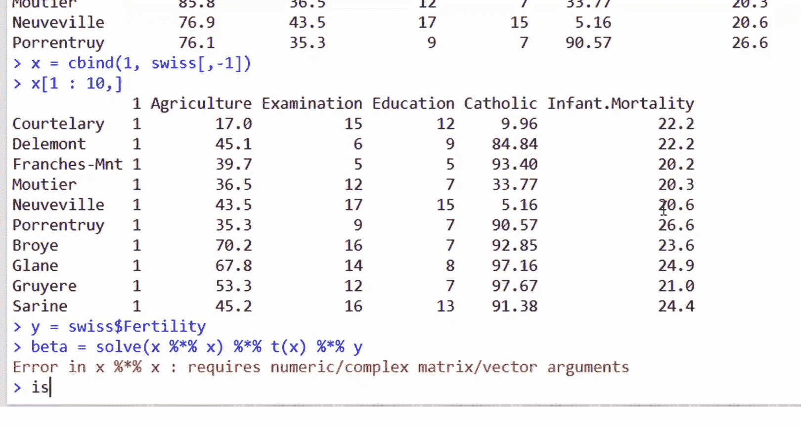

X false x equals as time。

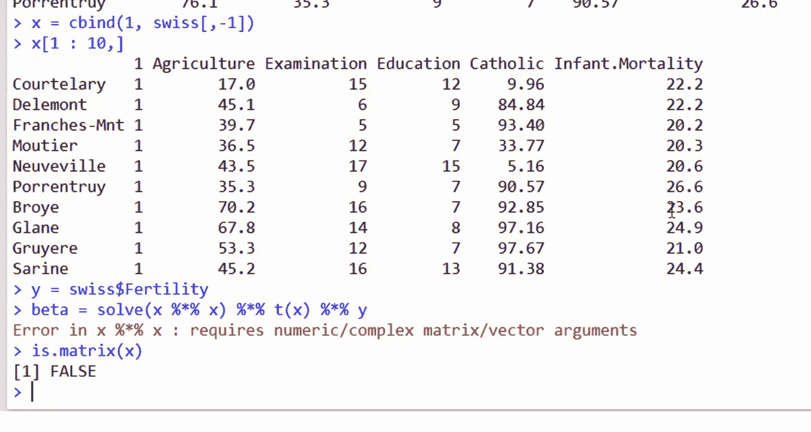

Now let's try it again。

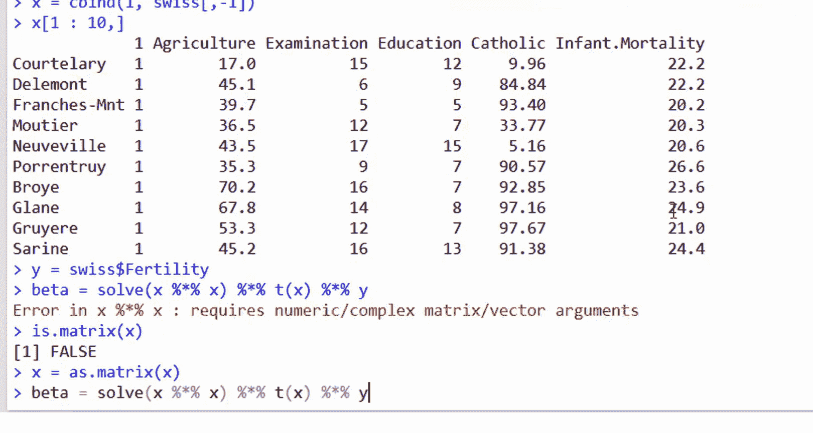

Ha up and notice one other thing。

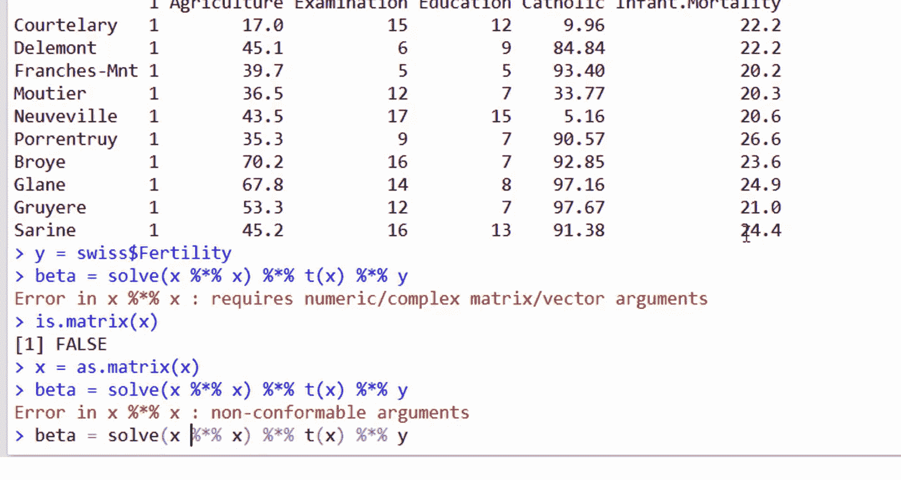

X transpose Act， so I forgot my transpose there。Okay， now let's see beta。

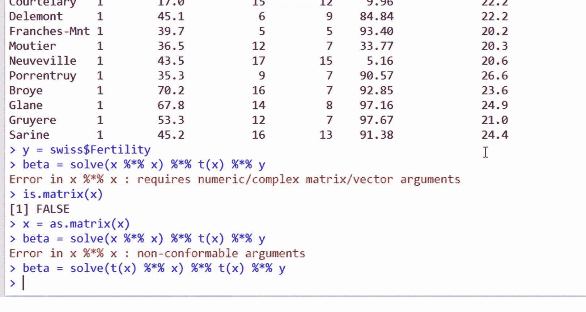

Okay，It gives you a coefficient for each of the terms， one for the intercept， one for agriculture。

 examination， education， Catholic， and infant mortality。Now。

 let's just compare it if we were to do L M， Y tilde X。

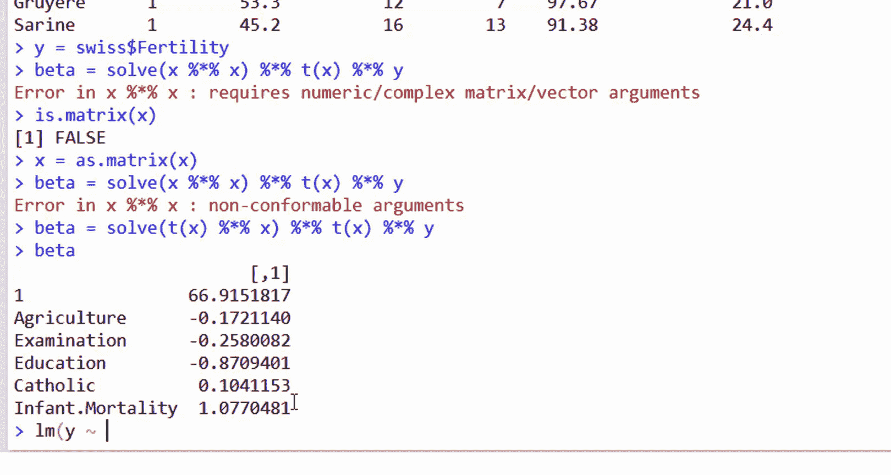

Okay， we see the same thing。 noticeice it tried to fit and intercept。Or I'm sorry。

 It can't fit our intercept term because it's including an intercept。 So obviously。

 it can't include ours intercept plus the extra intercept term。So that one。

 it just sets as in an NA if it has a redundant。Column in the X matrix。So notice that the terms are。

 of course all the same Okay， so what that's what's going on with LM behind the scenes。I would say。

 I think it's a little bit faster if you do solve。嗯。T of x。Times x and T of x。

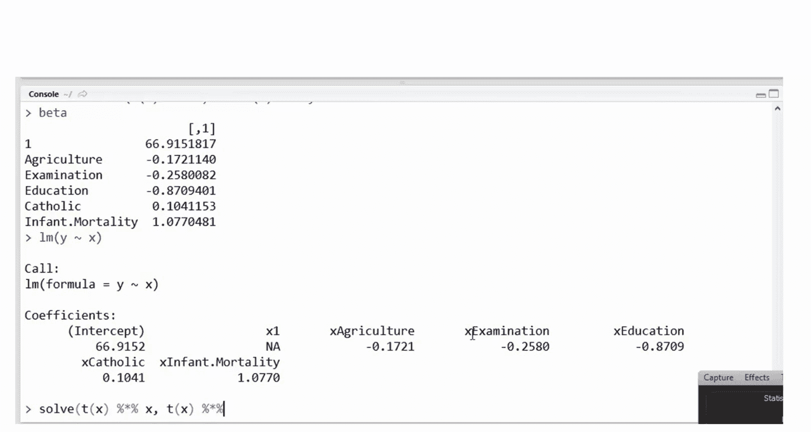

Times y if you give it the two arguments like that， giving it the equations to solve。

 I actually think that's a little bit faster way to to do the inversion numerically so if you happen to have kind of bigish matrices。

 you actually want to give the function solve the linear equations rather than actually going through the matrix manipulations。

 but of course it gives you the same thing Okay so that's under the hood what LM is accomplishing when it fits a multivariable regression。

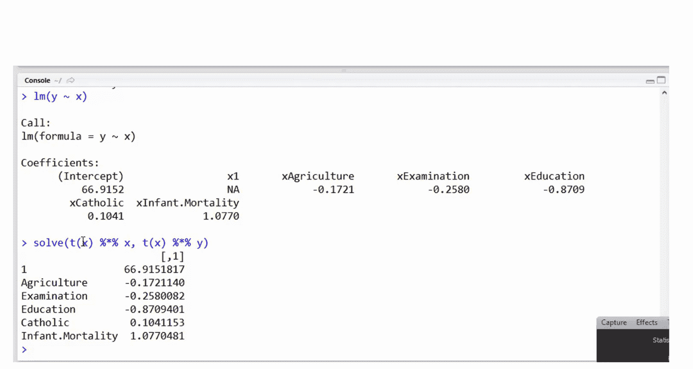