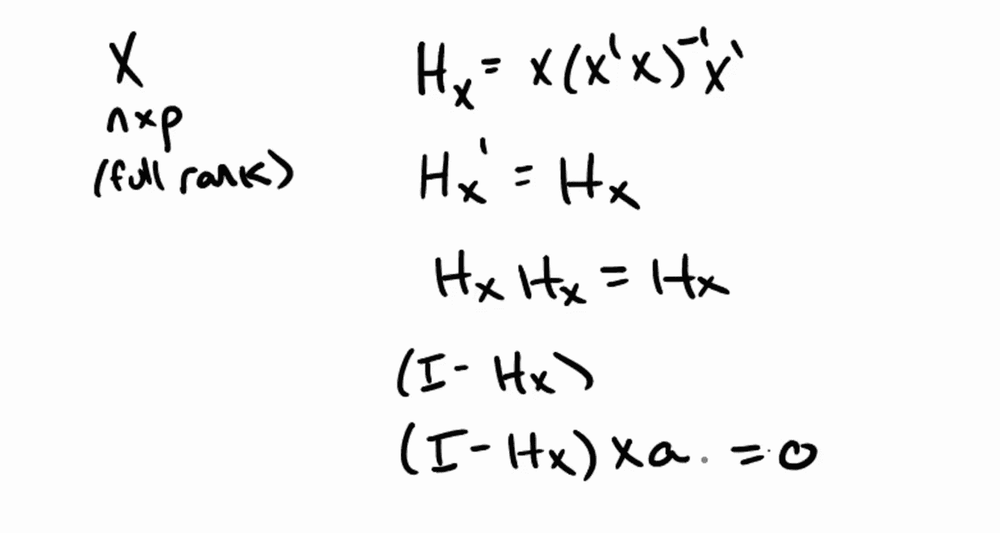
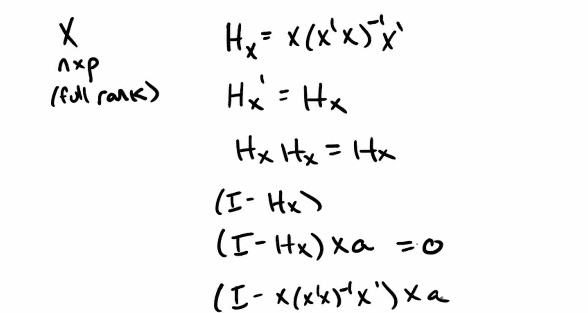
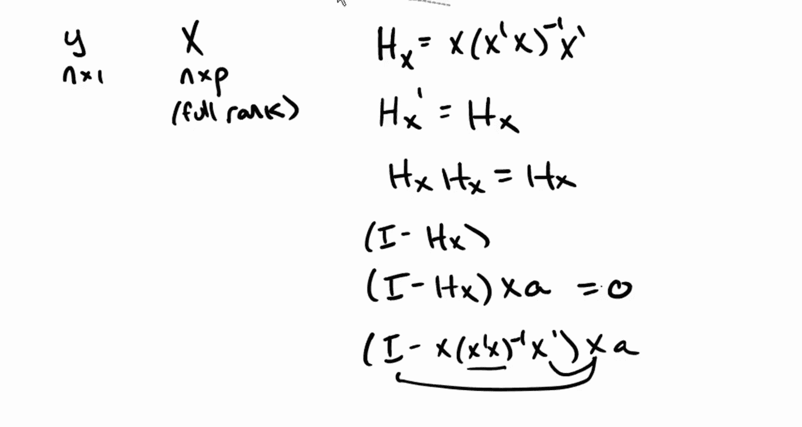
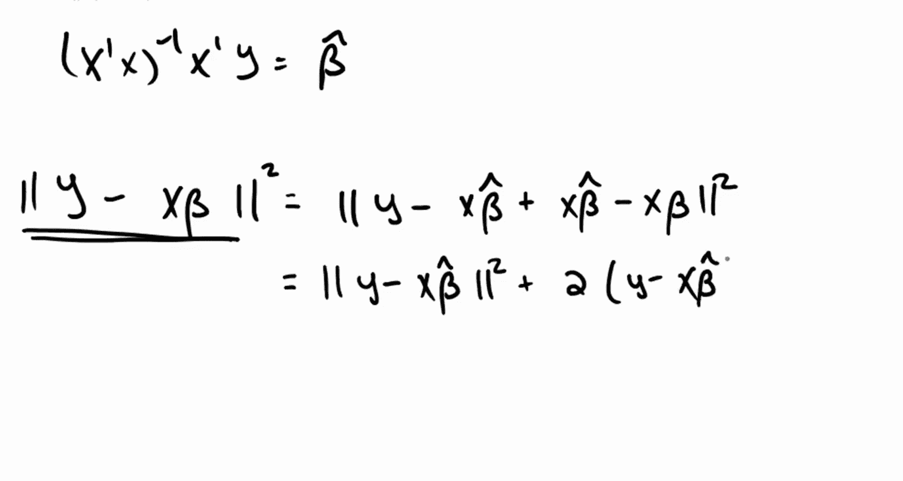
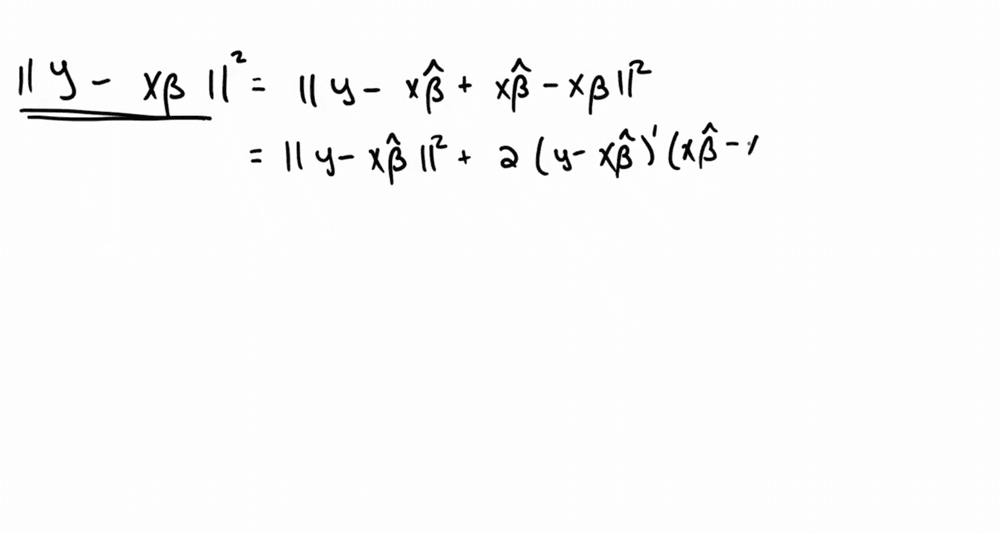
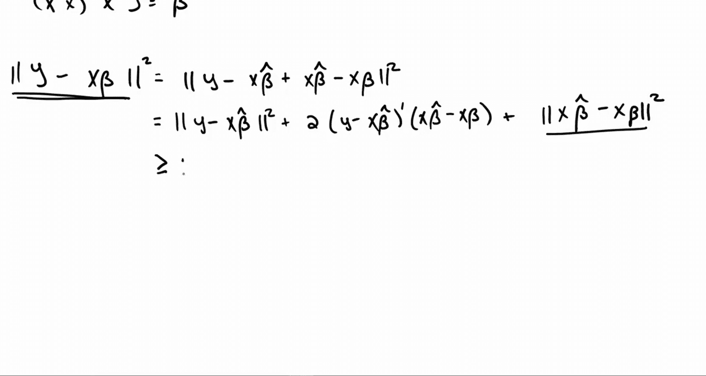
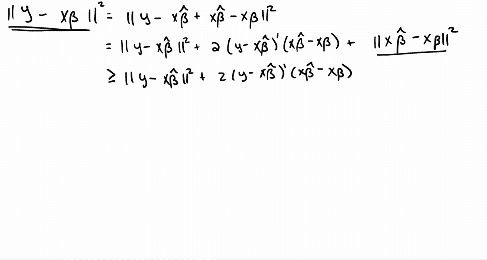
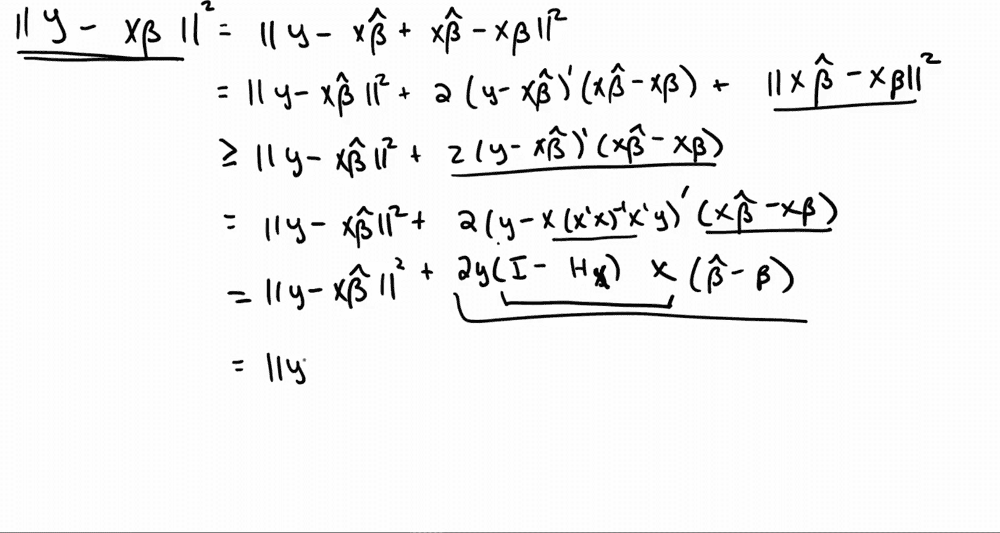
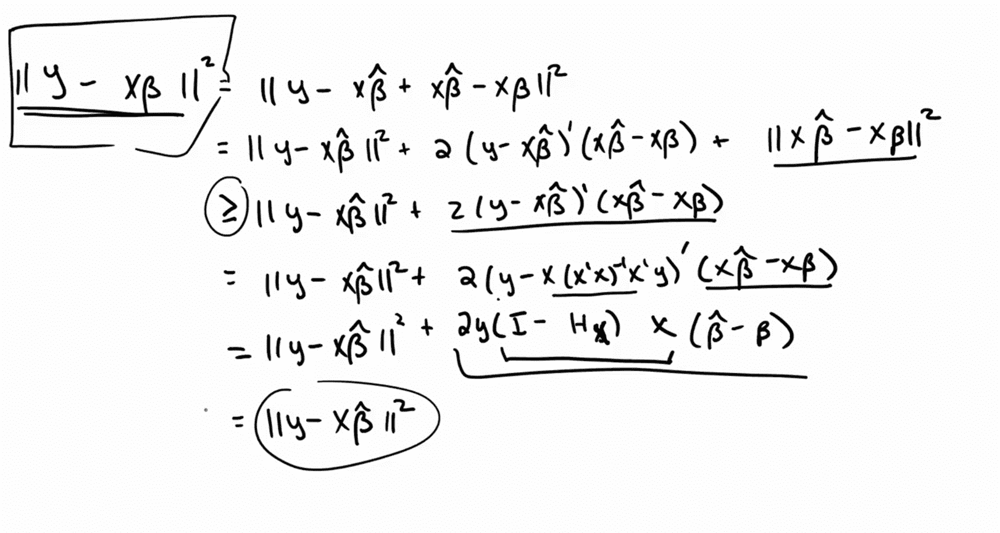

# 约翰霍普金斯大学《数据科学的高级统计｜Advanced Statistics for Data Science》中英字幕（deepseek p97 23_最小二乘法的第二推导.zh_en -BV1htPjeYEFH_p97-

Let's consider another way to prove that the least squares regression。Solution is。

X transpose x inverse x transpo y。 That's beta half。 Okay， so recall， our y was an M by one vector。

 Our x was an M by P full rank。Matrix， and we want to explain the variation in Y。

With linear combinations of the columns and X， and we're going to do that by minimizing the distance between the observed y and the fitted y。

I'm going to need some notations， So let me define H of x to be X， x transpose x inverse x transpose。

 Okay， so a couple things to note about H of x。1 is H of x is symmetric。

And then two is that it's item potent。Another interesting fact is that I minus H of x。

Notice that it is both symmetric and item potentent as well。Okay， and then finally。

 notice that I minus h of x times any linear combination of the columns of x。

 let's say x times a is0。

So it's easy to see that， I think you just take i minus x。X transpose x inverse， x transpose。

Times x times a。 If I multiply x times that x transpose， I get x transpose x。

 but there I have an x transpose x inverse。 So that's just I。

 And then when I multiply this X times I， I just get x， so I get x minus x， which is 0。 Okay。

 so we need those facts。

So I'm going to need this room。Now， I'm going to try to minimize my least squares criteria。

So let me just add and subtract。An x beta hat。That then is going to be。Equal to。The norm of y minus。

X beta hat。Squared plus 2。Y minus x beta hat transpose。

X beta hat minus x beta。

Plus。Norm。X beta hat minus x beta。Squared， this final quantity is always positive because it's a norm。

A squared norm。 So I'm only going to make it smaller by getting rid of it。

Now。Let me just look at this term right here。So that's 2 y minus x x transpose x inverse x transpose y。

Times x beta hat minus x beta。 So this quantity or oh， and that's transposed。

 This quantity right there。I can do the following。 I can pull out a y and get I minus。

 And then this quantity right here， I've been calling H of x I minus H of x。 and then transposedse。

 But remember， both I and H of x H of x， not H of Y。 H of x are both symmetric。

 So the transpose is irrelevant。 So I can write that as2 I minus H of x。 And then over here。

 looking at this term， I can pull an x out。 and I get beta hat minus beta。Okay， plus。

Y minus x beta hat。Okay， then recall， if I take I minus H of x and I multiply at times x。 I get 0。

 So this whole term right here is 0。 So I get。Norm。

Y minus x beta hat。Squared， so what we see is that。For any arbitrary beta。

 the difference between x beta hat and y is。Stricly or is greater than or equal to。The norm。

 if we plug in the specific value of beta beta hat， therefore beta hat must be the minimizer。

