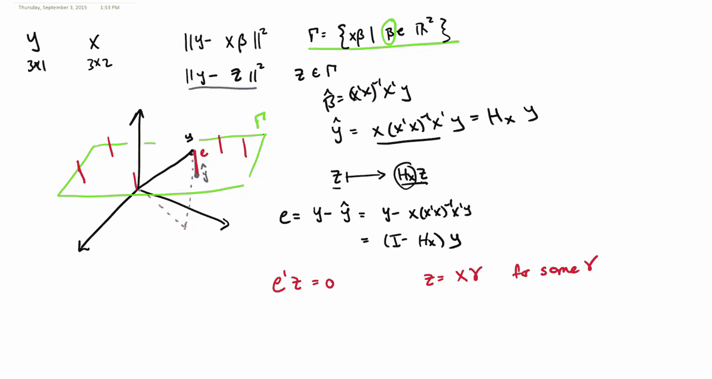
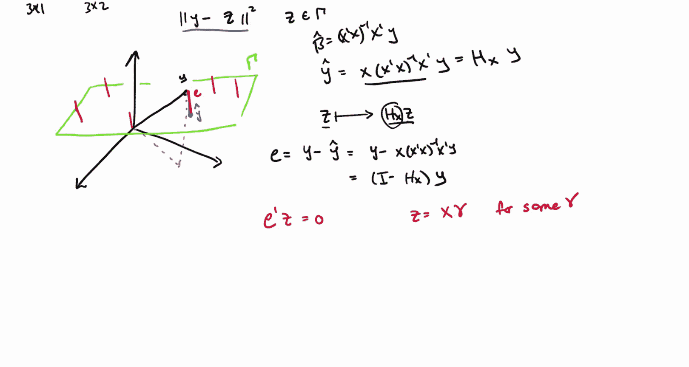
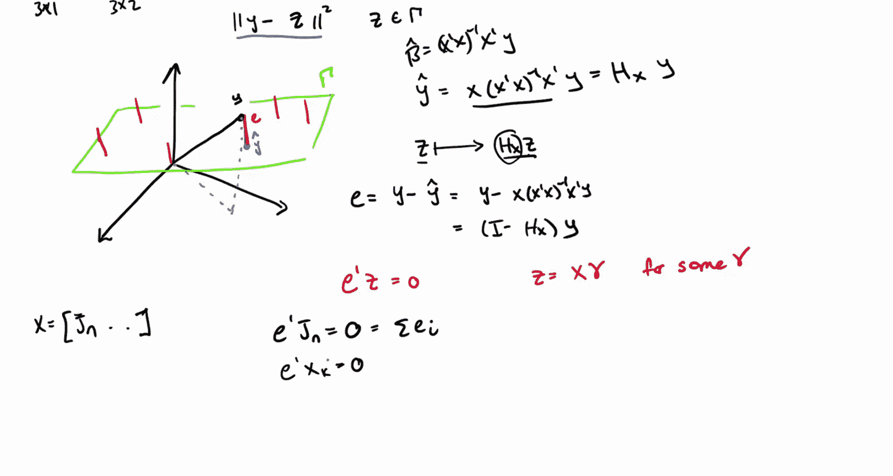

# 约翰霍普金斯大学《数据科学的高级统计｜Advanced Statistics for Data Science》中英字幕（deepseek p98 24_投影法.zh_en -BV1htPjeYEFH_p98-

I'd like to talk about a different way to think about。

Lease squares that's very useful for conceptualizing what it's doing so。Imagine。

Imagine our y is a3 by one vector， and our x is a3 by two matrix。 So we only have three data points。

 and we're going to try to explain them with two predictors。 I agree， not a terribly useful scenario。

 but because I can only draw this in three dimensions。That's the best we can do。

 but hopefully you can use this to think in use it to reorganize how you think about least squares。

 and we want to minimize y minus x beta。Squared， so let me define by gamma equal to the space of x beta such that beta is in。

Or two。So what we want to do is minimize。Yhy minus y hat。Squared。

 where over the collection of white hats that live in gamma。So let's draw a picture。

Here's our three dimensions for our three data points and our point y。Is a vector。In this space。So。

 now， think about。This space， gamma。It's indexed by a two dimensional parameter。

 So it is a two dimensional space We're drawing it in three dimensional space and it's linear。

 So it's going to be a plane。 So this looks like a plane。And that's。Gamma。So what is what is y hat。

 so actually you know let me rewrite this statement earlier statement a little bit by calling it y minus z for z in gamma and let me let y hat to be the actual minimizer of that equation。

Okay， so what is Y hat， Well， it's the point that minimizes the distance between y and points in this plane。

 So it's the point in this plane that's minimally distant to Y。

 So it's the orthoormal orthogonal projection onto the plane。 So let's draw it like that。

 Here's our orthogonal projection。 And there's Y hat。 So Y hat is the point in gamma。

That is minimum distance to y。So thinking about it this way。Really。Kind of helps us。

Think about different aspects of how we apply multivariable regression。 For one thing。

 notice that if we include a redundant column in x， if we include an extra column in x。

 say say x was the vectors， x 1， x 2。 And then the completely redundant column x1 plus x 2。Okay。

We'd see the rank of that matrix is， of course， still2。 But notice that the the space gamma。

 let's call this， I don't know。 I'll call that x prime。 Well， no。

 x prime is going to be like transpose。 Let's call that x tilde。 Okay， so the space gamma tilde。

 which is equal to。X， tilde beta。Such that beta is in R3。That space you can prove to yourself。

 though I think it's pretty easy to see， is identically equal to gamma。Because， you know， any。

If we take a linear combination of x1 and x2， and we take any the collection of all possible linear combinations of x1 x2。

 that's the same thing as the collection of all possible linear combinations of x1 x2 and x1 plus x2。

 so what we see is that we don't actually need an invertible matrix to do regression。

 we just need the space defined by a linear independent subset of the collection of columns of x。

That's an important point。So。At any rate， so it also tells you that if you have let's say。

 let me give you an example， if you have an X that includes an intercept。

And a vector that's ones for a while and then zeros for a while。And then consider another X。

That's ones for a while， and then zeros for a while， and then zeros for a while。

 and then ones for a while。And then， consider another X。Which is。Ws。And then， zeros。And then， ones。

Okay。Notice。This， these two add up to a vector of one， a vector ones。

 So all of all three of these cases are identical。 They all have the same column space。Okay。

 so in every one of these cases， the gamma， the space defined by linear combinations of the columns of these design matrices identical。

 So the Y hat defined by these design matrices will all be the same。 Okay。

 so that's an important point。Okay， so our Y hat is the projection。

Of y onto the space defined by linear combinations of the columns of x。

That also means because we know what the solution is， beta hat， which is the particular。

 which is x transpose x。Inverse x transpose y。 that is the particular vector in R2 that converts x into the correct set of its linear combinations of its columns to form the projection。

 So our y hat， our projection is X， X transpose x inverse， x transpose y。

Which I've been using H to refer to this matrix H of x。

So it is interesting to note that the linear operator that takes an of vector z and moves it to H of x times z is the operation that projects a vector in Rn。

Onto the two dimensional space span by the columns of x。 So H of x is exactly a projection vector。

 It's so projection operator。 So it's often called the projection matrix。

 Sometimes it's also called the reason I give it the letter H is it's often called the hat matrix as well。

The final thing I'd like to point out is if we consider our residuals。

That's the points E equal to y minus y hat。Okay， so that's y minus x x transpose x inverse x transpose y。

 which we can also write out as I minus the hat matrix times y。So notice our residual is exactly。

The difference between Y and Y hat。 So that's this vector right here。 That's E。So， you know， if we。

Write it over there。s that's E。 but notice that E is going to be orthogonal。To any point in gamma。

Right， so E is going to be orthogonal to any point in gamma。 And what does that mean。

 that means E transpose。Times z。Has to equal 0 whenever z is equal to。X gamma for some gamma。Okay。

And in particular， our residuals are orthogonal to any column of x。

And we'll elaborate on that point here in a minute。

But let's actually prove this mathematically。 We can see it geometrically pretty easily。

 but let's prove it mathematically。 Well， we've mentioned this some previous lectures that if I take I minus h of x and I multiply it times x。

 I get 0。 So certainly if I multiply it times x times gamma， that is also going to get0。

 So you can go through if you didn't see this in a previous lecture just actually go through it。

 it's a very easy thing to prove。 And so that's showing again。

 that the residuals are orthogonal to every point。In the space， gamma。So this means that if our x。

Contains a vector， J N， an intercept。And then other columns。

 This means that E transpose times J N has to equal 0， which means that。

The sum of our residuals has to be 0。But it's not just that the sum of the residuals have to be0。

 it's e transpose times xk for any xk column of x also has to be 0。

 or any linear combination of the columns of x also has to be0。Okay。

 so the point I wanted to get across in this lecture is that it's quite useful to think about。

Geometry and geometrically， what's occurring when you think about least squares。

 often you can this will help you logic your way through actual applied statistical problems if you can think about these problems geometrically。

