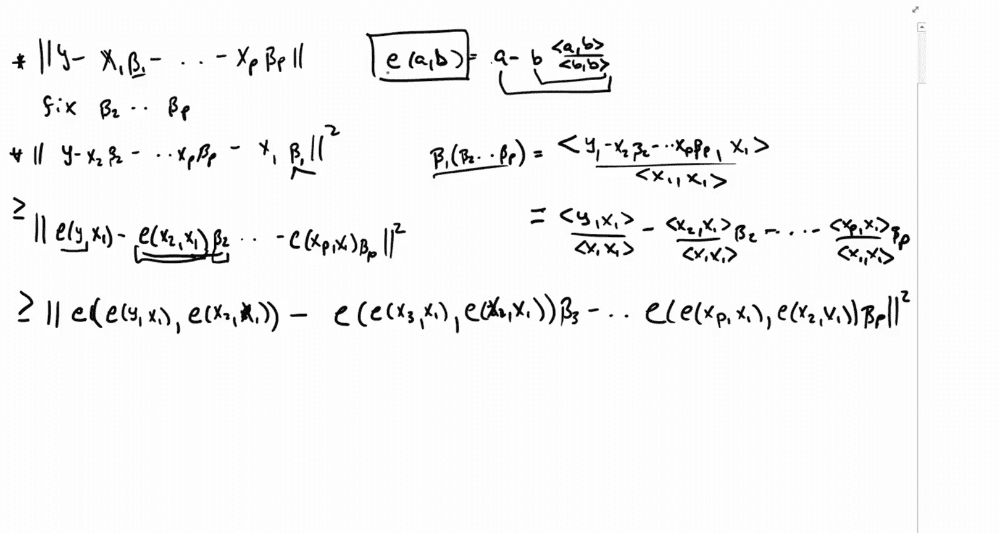
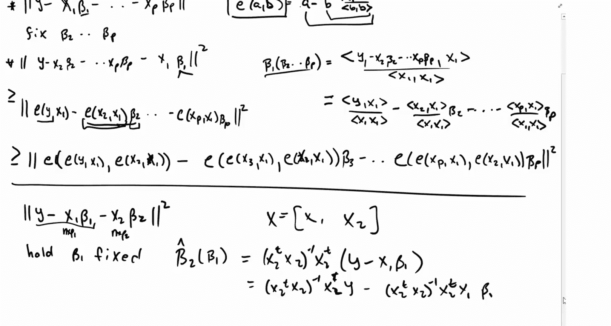
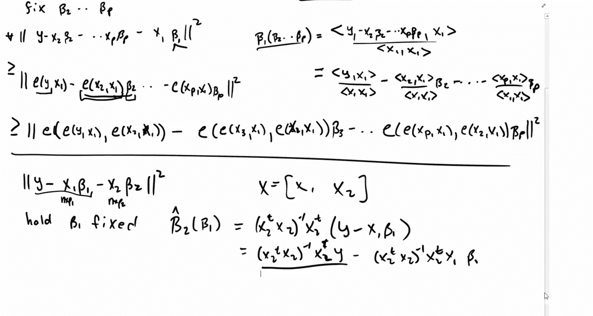
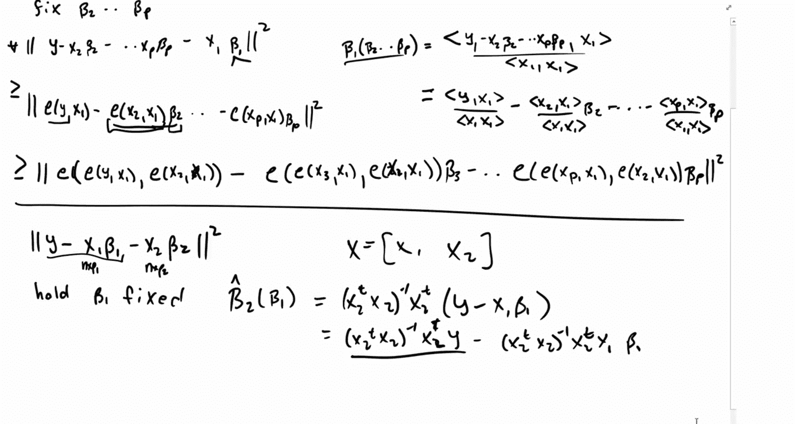
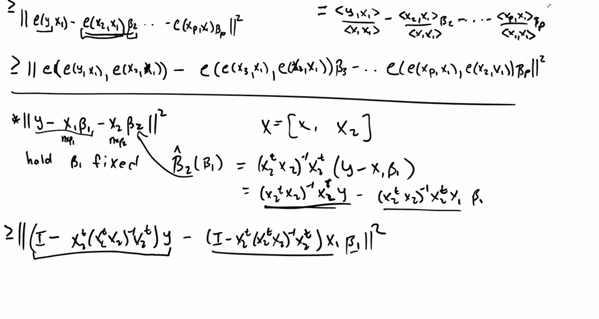

# 约翰霍普金斯大学《数据科学的高级统计｜Advanced Statistics for Data Science》中英字幕（deepseek p99 25_最小二乘法的第三推导.zh_en -BV1htPjeYEFH_p99-

Okay， let's go through yet a third derivation of least squares。

 but in this way we're going to demonstrate why least squares is thought of as sort of an adjustment mechanism。

 so I'm going to write it out a little bit differently as y minus x1 beta 1 minus up to minus xp beta P where each of these are vectors so in what sense is when I estimate the beta1 coefficient in what sense is it adjusted for the presence of all the other variables in the model。

Before we begin， let me define my residual function for two vectors as e of a comma B as a minus b times the inner product of A and B over B by itself。

And this is merely the prediction for a from B based on a regression to the origin。

 and then this is the residual if I subtract the two。Okay。

 so let's take this asterisk function right here and then let's fix。Beta 2 up to beta P。

 as if they were known。As if they were known， so then the function or the vector y minus x to beta 2 up to X P。

Beta P could be considered a single outcome， and then x1。Beta1。Could be thought of as the predictor。

So I've just simply rewritten asterisk there as a single predictor and regression to the origin。

 So we know that asterisks has to be larger than or equal to if we plug in a beta 1 where beta 1。

Where as it depends on beta 2 up to beta P。If we plug in a beta 1 that satisfies this criteria。

 it would need to be inner product。Of why。Minus。X 2， beta 2 minus up to X P beta P。We'd want。That。

Comma。An x1。All over。Norm x1 by itself。And the bookkeeping is going to get a little bit thick here。

But imagine if I were to plug this。This term。Well， before I do that， before I do that。

 notice this is equal to the inner product of y。And x1。Over x1 by itself。

Minus the inner product of x2 and x1 over the inner product of x1 by itself。

Times beta 2 minus all the way up to inner product of X P。X1。All the way up to beta P。Okay。

 now if I were to plug these into beta 1 there。Then I'd like you to churn through the calculations what you get。

Is。E of y。An x1。mininus。E of x 2， and x1。Times beta 2 all the way up to。Yi。Of x。Pi。And x1。Times。

Betape。Okay。SquareAnd we have to have gotten smaller because we'll have plugged in the optimal beta 1。

 holding the other ones fixed。So now we're back at the exact same equation。

With one fewer coefficients， instead of having P coefficients。

 now we have p minus-1 where we've gotten rid of beta 1。And now instead of Y。

 we have the residual having a regressed x1 out of Y， we have the residual for x2， having a re to x1。

 So in essence， we've simply gotten smaller by taking the linear association with x1 out of every other variable。

 every other predictor and the outcome and we've gotten smaller So we could repeat this process because notice these are all this is just the same same exact starting equation with one fewer。

One fewer regressors and our vectors now look a little bit weirder because they are these residual。

 they're the output of this residual function， but ostensibly， we're back at the same thing。

 So we know that we can get smaller if we repeat the exact same process。

 So this is going to be greater than or equal to if I simply take the residual。

The residual of the residual。Where I've now， let's suppose I've held beta 3 up to beta p。Fixed。

 and then now I'm getting rid of this， this term here， Then I would get E of x2 comma x1。

Minus E of x。啊。Yi of。Yi。Of x 3。看了吗？X 1。An E of x2 comma。Two， comma x1。

Times beta 3 and all the way up to E。Of yi。Of x。Pi。Coma x 1。Now， we're pressing out E of x 2。An x1。

 okay。Times beta P。 So now we've gotten rid of。The this regressor and this coefficient by regressing it the it out of every term。

 and then you can see as you iterate through this process。

 you regress out until you get to the beta P variable。

 you'll find that the beta P variable estimate is then a regression to the origin with just that variable。

And the outcome where we've iteratively regressed out the linear association of every regressor。

 so we took and regressed x1 out of everything， then we took those residuals and took the residual of x2 and regressed it out of all the other residuals and then we took the residual of x3 having done and took the residual of it having regressed out of and then in that sense what we'll see is that and then we get to this。

Beta P effect， which will just be the remaining regression to the origin。

 So you can see this would be actually an easy way to do linear regression。

Where all you know needed to know how to do was this residual function， no matrix inversion required。

 so that's kind of a neat result， but also a couple other things come to mind。

 the first thing that comes to mind is there's no because we did it in an arbitrary order we just picked you know working toward the last coefficient we could have also worked towards the first coefficient and we could have done it in any order so that you can see that it doesn't matter which order we take the residuals in all that matters is that we're iteratively taking residuals and I find this process really helps me understand what in what sense。

Linear regression is adjusting for these other variables because it's taking out the linear association of all the other variables from everything else。

And I should note that it's not just restricted thinking this way is not just restricted to separating everything into vector。

 So suppose， for example， I had y minus x1 beta 1 minus x2 beta 2 where now x1 is n by P1 and x2 is n by。

P2， so I've broken my x matrix， my design matrix into two parts， x1 and x2。Okay。

 and so beta 1 is a P1 by1 vector and beta 2 is a P2 by one vector。 So if I wanted， for example。

 to hold。Beta 1 fixed。Okay， so now this term y minus x1 beta 1 is a single term。

 and I know what my solution for beta 2 would have to be， beta 2 as it depends on beta 1。

 my beta 2 hat as it depends on beta 1 would simply have to be x2 transpose x2。

Inverse x2 transpose then times my outcome。 but because x1 and beta 1 are fixed。

 it'll be that which works out to be。X2 transpose x2 inverse， x2 transpose。Times y。

 which is the coefficient。And then x2 transpose x2 inverse， x2 transpose x1 times beta 1。 Okay。

 so this term is the coefficient。

Having。

LetSee if I can get some more space down here。

This term is the coefficient if I were to only have regressed x2 on y。

 and this is the collection of coefficients that I would get if I regressed every single column of x1 as an outcome in x2 as a predictor when I plug these this estimate back into here in deta 2 what do I get I get y minus。

The hat matrix x 2 for x 2， x 2。Transpose x to inverse， x to transpose y。And minus。

 And then I'm going to just write this out in a more convenient form as I。Minus that times y。

And then， minus。I minus x2 transpose x2 transpose x2 inverse， x2 transpose times。Text1。And then。

Beta1。Okay， so now what what is this， this is the residual。Of y having regressed out x2。

 and this is of course， smaller than our original equation。

 and this is the residual for having regressed x2 out of every column of x1。Okay。

 so one way to think about our estimate for beta 1。

Is first get rid of all the effect associated with x2 out of y and x1。

And then perform the regression with just those sets of residuals and again to me this really helps me understand in what sense regression is doing adjustment。

 but notice again， this is the same argument as above we are just doing it with matrices now okay so I find this way of thinking even though it's a little confusing and you would never actually program the computer to fit least squares this way。

 I find it a very useful way to think about linear regression and what it's accomplishing。Okay。

 and conversely， of course， there was nothing in particular about holding beta 1 fixed first we could have held beta 2 fixed fixed first。

 and so what we see is that every coefficient in least squares is obtained this way by having regressed all the other regressors out of both y and the predictors associated with that coefficient。

