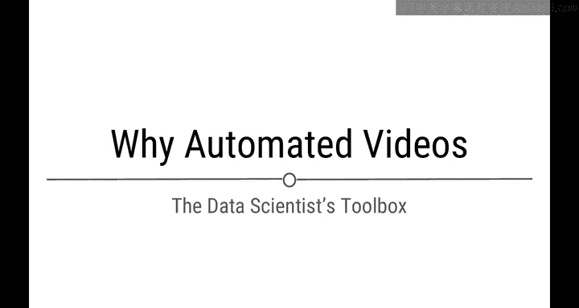
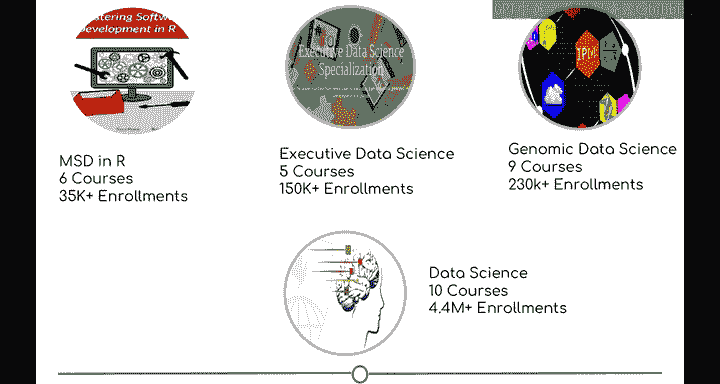
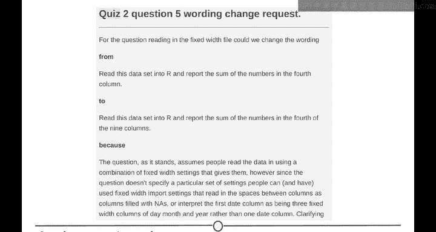
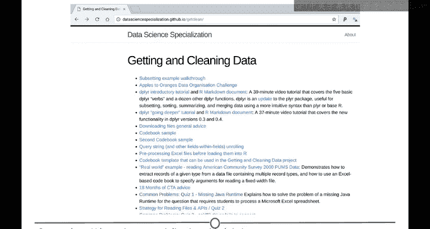
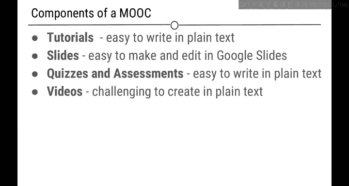
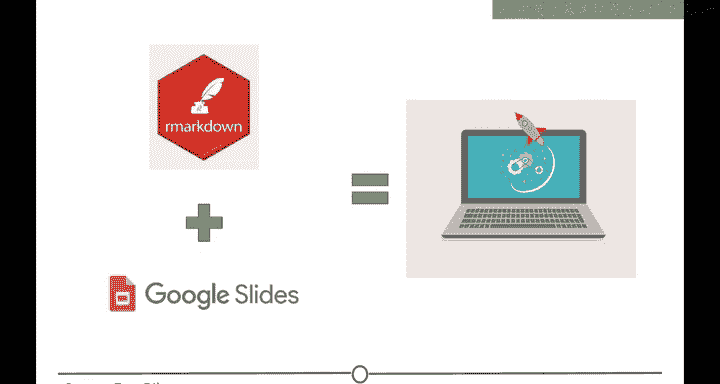
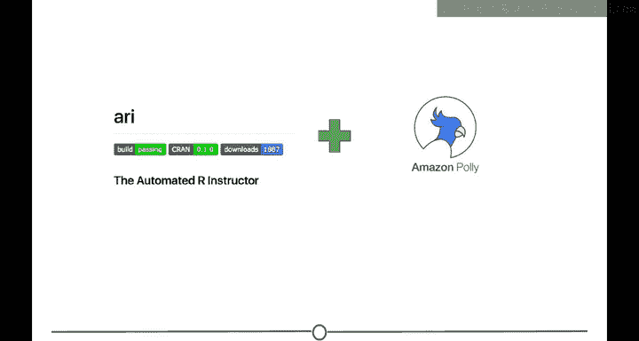
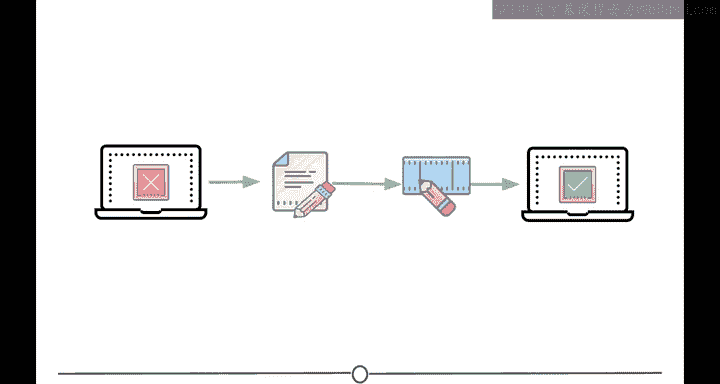

# 001：为什么使用自动化视频？ 🤖

在本节课中，我们将探讨约翰霍普金斯大学数据科学课程为何采用自动化视频制作流程，并了解其背后的技术原理与优势。

## 概述

您可能已经注意到，本课程的讲座和视频结构与许多其他大规模在线开放课程有所不同。视频内容与印刷版讲义几乎完全一致。我们制作本视频旨在解释我们做出这一改变的原因，并展示R语言与数据科学的强大能力。

## 课程维护的挑战

上一节我们介绍了课程形式的改变，本节中我们来看看促成这种改变的根本原因。

约翰霍普金斯大学数据科学实验室创建了大量大规模在线开放课程。过去五年中，我们在多个平台上创建了超过30门课程。我们的目标是为最广泛的受众提供最佳、最新的信息。然而，在线维护如此大量的材料面临重大挑战。

我们的软件包会过时，新的工作流程被发明，还有各种拼写错误。我们过去像许多其他大学一样制作课程：先创建讲座幻灯片形式的课程材料，然后录制我们讲授这些讲座的视频。

在某些方面，这很好。您能听到我们亲自讲授课程的声音。但缺点是，更新内容非常困难且耗时。我们需要预订录音室、设置特殊设备、录制讲座、编辑视频，然后将其上传到系统。结果是，我们的许多讲座内容已经过时、包含错误，或者没有包含最新、最佳的工作流程和管道。

## 寻找解决方案

面对日益增长的课程数量，保持内容更新对我们来说挑战越来越大。因此，我们开始思考如何解决这个具有挑战性的问题。

我们意识到，虽然录制和编辑视频极其耗时，但另一种类型的内容我们可以更频繁地编辑、更新和维护，那就是普通的纯文本文档。我们并非唯一想到这一点的人，像洛雷娜·巴尔巴这样的大规模在线开放课程创新者一直认为，这类课程甚至不需要视频。

## 新的课程构建流程

当我们着手开发创建和维护课程的新流程时，我们想看看是否能完全用纯文本文档制作课程。我们将大规模在线开放课程分解为基本元素。

以下是构成课程的核心组件：

1.  **教程**：我们可以轻松地用Markdown或R Markdown等纯文本格式编写。如果使用Google幻灯片等工具制作，也易于维护和分享。
2.  **评估**：在这里，我们可以使用标记语言来创建测验和其他评估。
3.  **视频**：这是难点。我们如何从纯文本文档制作视频？

## 自动化视频制作技术

一个愉快的巧合是，数据科学和人工智能社区正在为我们解决这个问题的很大一部分：改进文本到语音的合成技术。因此，我们现在可以为视频编写脚本，并使用Amazon Polly来合成我们的声音。

为了利用这项新技术，我们创建了两个新的R包：`Ari`和`Dctor`。

*   **`Ari`** 会获取一个脚本和一组Google幻灯片，并使用Amazon Polly在幻灯片上叙述脚本。它还会生成包含字幕所需的隐藏字幕文件，确保视频对听力障碍者是可访问的。
*   **`Dctor`** 自动化了从使用`Ari`创建视频到将其上传到YouTube的多个步骤。

这样，我们就可以快速修改脚本或幻灯片、重新制作视频、重新上传，从而减少维护开销以保持内容新鲜。每当我们更改文本文件或编辑幻灯片时，我们都可以在几分钟内重新创建视频。所有操作都在R中完成。

## 新流程的优势

转向这个新流程最酷的功能之一是向您展示R编程语言有多么强大。这是您在本课程中将学习的主要语言，我们希望您在完成我们的课程时，也能构建出像这个系统一样酷的东西。

我们选择这种方法，而不是单独创建课程的每个部分，原因如下：

以下是采用自动化流程的三个主要优势：

1.  **易于维护和更新**：如果您报告问题或发现课程有错误，我们只需要更改脚本或Google幻灯片并重新创建课程即可。因此，我们有了更高效的课程内容维护和更新方式。
2.  **提高可访问性**：由于视频有文字记录，而文字记录有配音，因此内容对我们中间有残疾的人来说是可访问的。对于其他人，您可以根据自己的意愿选择阅读、听或观看内容。
3.  **持续改进与扩展性**：使用文本到语音合成的一个很酷的功能是，随着语音合成软件的改进，我们的视频会不断变得更好。这意味着我们可以将声音更改为不同的声音。最终，它将允许我们使用机器学习快速、自动地将我们的课程翻译成不同的语言。

## 总结与展望

我们认为这凸显了数据科学和人工智能改善世界的不可思议的力量。如果您觉得机器人声音令人讨厌，我们理解。我们知道这项技术尚不完美。这就是为什么我们让书面讲座材料尽可能接近视频讲座，以便您可以选择如何学习我们的课程。

我们希望这一改变能让我们以最快的速度为您提供最好的内容。感谢您与我们共同参与课程开发的这个新阶段。