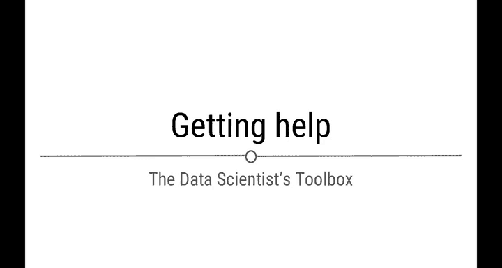
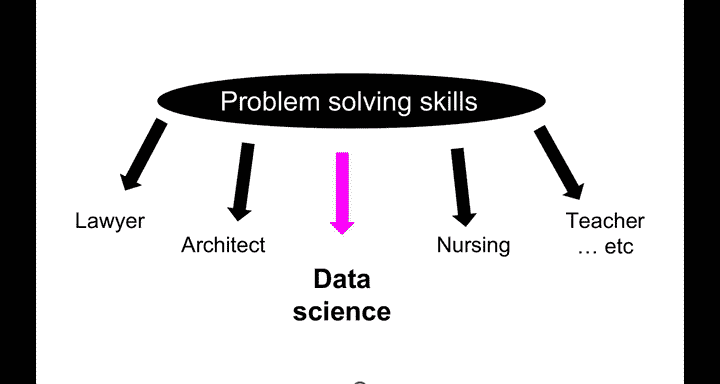
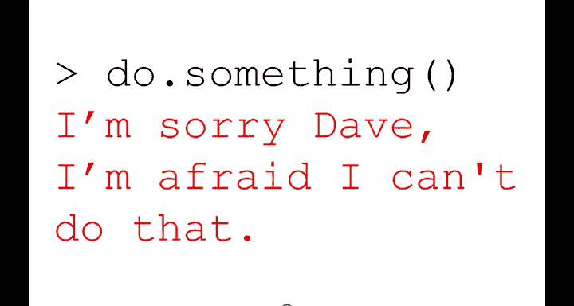
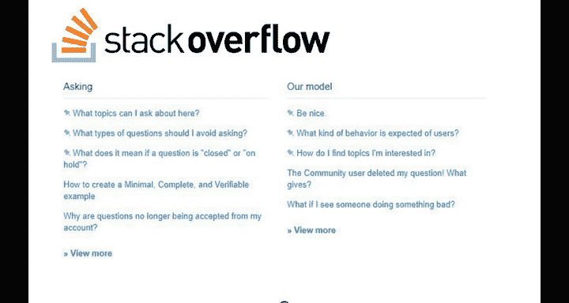
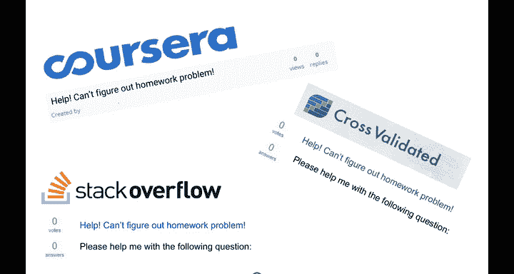
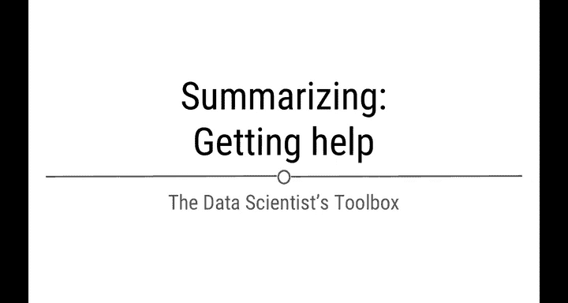

# 004：获取帮助 🆘

在本节课中，我们将学习作为一名数据科学家，当遇到问题时如何有效地寻求和获取帮助。解决问题是数据科学的核心技能之一，因此掌握高效的求助策略至关重要。

## 为什么需要学习求助技能？🤔

上一节我们介绍了课程目标，本节中我们来看看为什么掌握求助技能如此重要。

首先，本课程与传统课堂不同，可能同时有数千名学生参与，无法像小班教学那样随时获得教授的即时帮助。因此，你需要掌握在大型在线课程中自助和互助的策略。

其次，数据科学是一个新兴领域，你可能是第一个遇到某个特定问题的人。你需要具备独立解决对你乃至整个社区而言都是新问题的能力。

最后，故障排除和解决问题的能力是一项极佳的、可迁移的技能。它不仅对数据科学家的工作有益，而且任何职业都涉及大量问题解决。能够有效思考和寻求帮助，对你未来的任何职业道路都有好处。

## 自助策略：先尝试自己解决 🔍

在向他人求助之前，你可以先尝试自己解决。很多时候，最快的答案是你自己找到的。

以下是遇到数据分析问题时可以采取的初步步骤：

*   **查阅手册或帮助文件**：对于R语言问题，可以尝试输入 `?命令名` 来查看帮助。如果在论坛上提问一个手册里就有答案的问题，你很可能只会得到“去读手册”的回复。
*   **使用搜索引擎**：在谷歌上搜索相关问题。
*   **搜索相关论坛**：常见的数据科学问题论坛包括 Stack Overflow 和 Cross Validated。此外，本课程也设有课程论坛，这是一个极佳的资源。

在向任何论坛发帖提问前，请务必使用论坛的搜索功能，确认你的问题是否已经被问过并得到了解答。

在搜索时，请留意与你遇到问题的命令或程序相关的**教程、常见问题解答（FAQ）或说明文档（vignettes）**。这些是很好的资源，它们要么能告诉你下一步搜索该用什么关键词，要么直接展示如何操作。

## 处理常见的编码问题 💻

随着课程深入和使用R语言，你可能会遇到编码问题和错误。你应该准备好一些策略来应对它们。

根据我的经验，编码问题通常分为两类：
1.  命令不产生数据，而是**输出错误信息**。
2.  命令**产生了输出，但结果完全不是你想要的**。

这两类问题有不同的处理策略。

**如果你遇到了错误信息**，请先检查命令是否有拼写错误，然后仔细阅读错误信息。在绝大多数情况下，这就能解决问题。错误信息是计算机在告诉你哪里出错了，目的是帮助你。如果其他方法都失败了，你几乎可以肯定，世界上某个地方也有人遇到了同样的错误，惊慌失措，并把它发到了论坛上，答案就在那里。

**另一方面，如果你得到了一个输出**，请思考这个输出与你期望的有何不同，并分析这个命令实际上做了什么，以及它为什么会那样做而不是你想要的。大多数这类问题是因为你提供的命令指示程序做了一件事，而它也确实照做了，只是结果证明你让它做的并不是你真正想要的。这类问题往往最令人沮丧，因为你离成功很近却又很远。它们能很好地锻炼你像计算机程序一样思考。

## 寻求他人帮助：同伴与“橡皮鸭” 🦆

好了，你已经做了所有该做的来尝试自己解决问题。现在，是时候请外援了——其他人。

最简单的方法是找一位对你正在处理的问题有经验的同伴，向他们寻求帮助或指点。这通常很棒，因为解释者在教你的过程中能巩固自己的理解，而你也能亲身体验他们是如何解决问题的。在本课程中，你的同伴可以是你的同学，你们可以通过课程论坛互动。请再次确认你的问题没有被问过。

在本课程之外，你可能没有那么多懂数据科学的朋友。那该怎么办？“橡皮鸭调试法”是各地独行程序员的一个悠久而健康的传统。在《程序员修炼之道》这本书中，有一个故事讲述了束手无策的程序员如何向橡皮鸭解释他们的问题，并在解释过程中找到了解决方案。维基百科解释得很好：许多程序员都有过这样的经历：向别人（甚至可能是一个完全不懂编程的人）解释一个编程问题，然后在解释问题的过程中突然想到了解决方案。在描述代码应该做什么和观察它实际做什么的过程中，两者之间的任何不一致都会变得明显。所以，下次你被难住时，拿出你的洗澡玩具吧。

## 如何在论坛有效提问？📝

你已经尽力了，搜索了又搜索，和同伴讨论过，尝试了所有可能的方法来自行解决，但仍然卡住了。是时候把你的问题发布到相关论坛了。

在你直接发帖提问之前，你需要考虑如何最好地提问以获得有用的答案。

尝试包含以下细节：
*   一个你试图回答的**非常具体的问题**，以及你在故障排除中已经采取的步骤。
*   关于**如何重现问题**的细节，并包含供故障排除者使用的**示例数据**。
*   你的**目标和期望输出**是什么，以及你的**实际输出**的详细信息。
*   如果你收到了错误信息，一定要在帖子中提到。
*   关于你的**操作系统**或相关**软件版本**的细节也常常对潜在的问题解决者有帮助。

你帖子中最重要的细节之一是**标题**。它向他人传达了你遇到的麻烦。为帖子起标题是一门艺术。标题不具体，你就没有给潜在的帮助者提供太多线索，他们不知道问题到底是什么，以及他们是否能帮助你。相反，你需要提供一些关于你遇到问题的细节，回答“你在做什么”和“问题是什么”是两个你需要提供的关键信息。这样，论坛上的人就能确切地知道发生了什么，并且他们可能能够提供帮助。使用那些**聚焦于你试图获得帮助的非常具体的核心问题**的标题。这向人们表明你正在寻找一个非常具体的答案。问题越具体，通常得到答案的速度就越快。

## 论坛礼仪与最佳实践 ✅

遵循到目前为止提到的所有技巧，将有助于你在论坛上发帖并遵守论坛礼仪。你是在寻求帮助，希望别人抽出时间来帮助你，你需要有礼貌。

这通常表现为：提出具体问题，自己先做一些故障排除，并为潜在的问题解决者提供轻松获取所有所需信息的途径。

将这些“该做”和“不该做”的事情规范化，你就能得到一些可以遵循的准则。

**发帖前**：
*   确保你在**合适的论坛**提问，并阅读论坛的发帖指南。
*   确保你**描述了你的目标**，并在解释问题和迄今为止的解决步骤时**明确且详细**。
*   提供**描述和重现问题所需的最少信息**，不要用无关的细节拖累别人。

最后是两大原则：
1.  **要有礼貌**，这些人是在帮助你。
2.  确保**跟进你的帖子并发布解决方案**。不仅帮助过你的人值得感谢，这对以后遇到同样问题的其他人也很有帮助。

也有一些相当明确的**不该做**的准则：
*   首先，没有人愿意帮助那些认为问题的根源不是自己犯了错误，而是程序有问题的人。（剧透警告：几乎总是因为你犯了错误。）
*   同样，没有人愿意替你完成作业。他们想帮助那些真正想学习的人，而不是找捷径的人。
*   此外，对于活跃在多个论坛上的人来说，当同一个人在五个不同的论坛上发布同一个问题，或者同一个问题在同一论坛上被反复发布时，总是令人恼火。**要有耐心**，为你的目的选择最相关的论坛，发布一次，然后等待。

## 总结 📚

本节课中，我们一起学习了在遇到问题时如何有效地获取帮助。这对本课程很重要，对你作为数据科学家的未来也很重要。

我们首先看了在求助前可以使用的策略，包括阅读手册、查看帮助文件、搜索谷歌和适当的论坛。我们还介绍了一些你可能面临的常见编码问题，以及你可以自己采取的一些初步步骤，包括特别注意错误信息，以及将你的代码行为与你的目标进行比较。

一旦用尽了这些选项，我们就转向向他人求助。我们可以向同伴求助，或者向我们可靠的“橡皮鸭”（无论是真正的橡皮鸭还是不知情的同事）解释我们的问题。我们的课程论坛也是你们所有人互相交流的绝佳资源。

如果所有其他方法都失败了，我们可以在论坛上发帖，无论是在本课程中还是在像 Stack Overflow 这样的其他论坛上，提出非常具体且可重现的问题。在这样做之前，请务必温习你的论坛礼仪。礼貌待人永远不会伤害任何人，做一个我们论坛的好公民。

解决问题是一门艺术，而获得实践的唯一方法就是走出去，开始解决问题。开始行动吧！