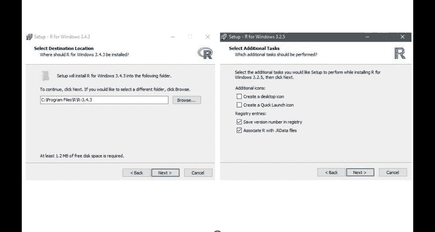
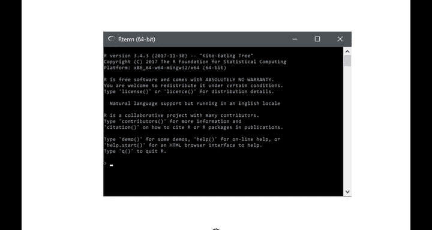

# 006：安装R 🛠️

在本节课中，我们将学习如何安装R编程语言。首先，我们会回顾R是什么以及为什么它对于数据科学如此重要。接着，我们将详细介绍在Windows和Mac操作系统上安装R的具体步骤。

## 什么是R以及为何使用它

上一节我们探讨了数据科学家的角色，现在我们来具体了解一个核心工具。R既是一种编程语言，也是一个专注于统计分析和图形绘制的环境。它将是本课程及后续课程中使用的主要工具之一。

R可以从综合R档案网络（CRAN）下载。虽然这可能是你第一次接触CRAN，但在我们后续安装各种功能包时，会反复回到这个网站，所以请多加留意。

你可能会问，为什么应该使用R？以下是几个关键原因：

*   **流行度高**：R正迅速成为统计分析的标准语言。软件越流行，新功能的开发速度就越快，软件本身也越强大，社区支持也越好。
*   **就业需求**：如下图所示，掌握R是数据科学家职位招聘中最常要求的五大技能之一。
*   **完全免费**：R的所有方面都可以免费使用，不像其他一些统计软件（例如SAS或SPSS），不存在使用成本障碍。
*   **功能广泛**：R是一种非常通用的语言。除了统计和绘图，它的用途还可以扩展到许多不同领域，例如制作网站、使用地理空间数据制作地图、进行文本分析，甚至制作教学视频。下图展示了一张用R绘制的欧洲人口密度图，每个点代表50人。无论你有什么任务，通常都能找到可以下载的R包来实现它。

R功能如此广泛的原因在于其**强大的社区**。许多人聚集在一起，开发了众多扩展R功能的软件包，并且每天都有新的包在开发。对于R初学者来说，这个社区是一个巨大的优势。由于其流行度，存在多个论坛，里面有大量页面专门解决R相关问题。我们在“获取帮助”课程中讨论过，这些论坛非常适合寻找与你遇到相同问题的人，以及发布你自己的新问题。

## 安装R：Windows系统指南

既然我们已经了解了R的优势，现在就是安装它的时候了。以下将分别介绍Windows和Mac系统的安装指南。请注意，这些是一般性指导，具体细节可能会随软件更新而变化，请将此作为安装的基本框架。

对于Windows和Mac电脑，我们都从CRAN主页开始。

如果你使用的是Windows电脑，请按照以下步骤操作：

1.  访问CRAN网站。
2.  点击“Download R for Windows”链接。
3.  如果是第一次安装R，请进入“base”分发版。
4.  点击页面顶部类似“Download R [版本号] for Windows”的链接。这将下载一个可执行的安装文件。
5.  打开可执行文件。如果出现安全警告提示，请允许它运行。
6.  在安装过程中选择你偏好的语言，并同意许可信息。
7.  接下来会提示选择目标位置。默认位置通常是`Program Files`下的一个名为`R`的子文件夹，里面还有一个对应版本号的子目录。除非你有特殊原因，否则默认位置是完美的选择。
8.  然后会提示选择要安装的组件。除非存储空间紧张，否则建议安装所有组件。
9.  接着会询问启动选项，同样，默认设置即可。
10. 之后会询问安装程序应将快捷方式放在何处。这完全取决于你：你可以允许它添加到开始菜单，也可以勾选底部的“Do not create a Start Menu link”框。
11. 最后，会询问是否需要创建桌面或快速启动图标，这由你决定。不过，不建议更改注册表项的默认设置。

完成此窗口设置后，安装将开始。安装完成后，首次打开R以测试安装是否成功。

## 安装R：Mac系统指南

如果你使用的是Mac电脑，请按照以下步骤操作：

1.  访问CRAN网站。
2.  点击“Download R for (Mac) OS X”链接。
3.  在那里你可以找到各种R版本供下载。**注意**：如果你的Mac系统版本早于OS X 10.6 (Snow Leopard)，则需要按照该页面上的说明下载与这些旧操作系统兼容的旧版本R。
4.  点击最新版本R的链接，这将下载一个`.pkg`文件。
5.  打开`.pkg`文件，并按照安装程序提供的提示进行操作。
6.  首先，在欢迎页面点击“继续”，在重要信息窗口页面再次点击“继续”。
7.  接下来会呈现软件许可协议，点击“同意”。
8.  然后可能会要求你为R选择安装目标：可供所有用户使用或安装到特定磁盘。选择你认为最适合你设置的选项。
9.  最后，你将进入标准安装页面。R会选择默认目录，如果你对该位置满意，请点击“安装”。
10. 此时，系统可能会提示你输入管理员密码。输入密码后，安装将开始。

安装完成后，前往你的“应用程序”文件夹找到R。首次打开R以测试安装是否成功。

## 总结

本节课中，我们一起学习了R是什么以及为什么我们可能想要使用它。然后，我们重点介绍了在Windows和Mac电脑上安装R的过程。在进入下一讲之前，请确保你已经正确安装并运行了R。