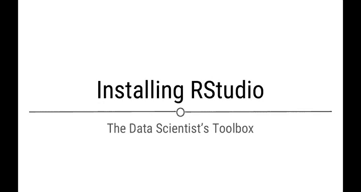
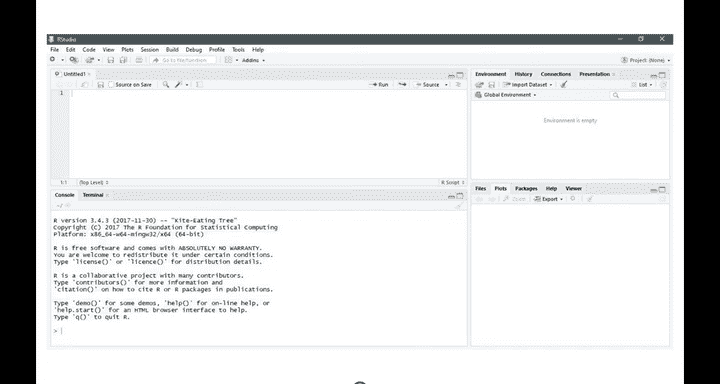
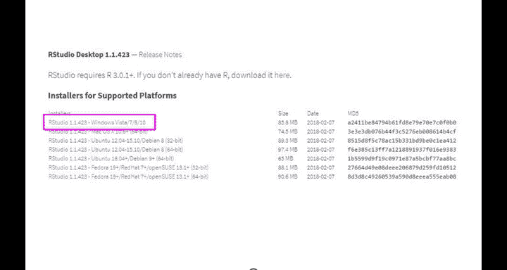
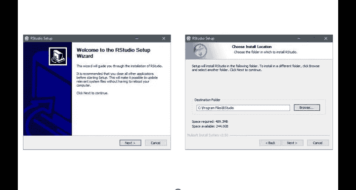
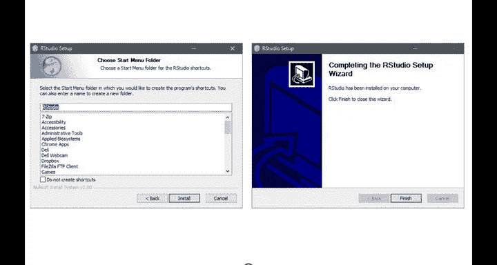
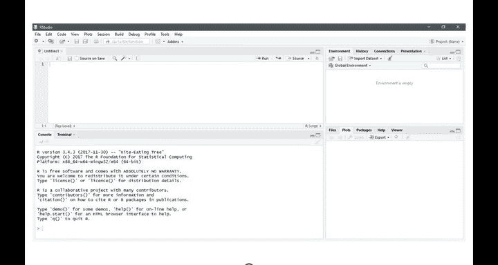
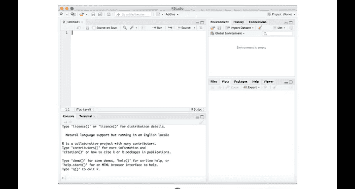
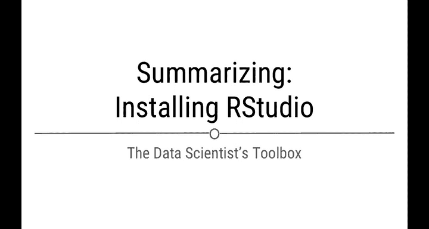

# 007：安装RStudio 🛠️

在本节课中，我们将学习如何安装RStudio。RStudio是一个强大的图形用户界面，能极大地提升使用R语言进行数据科学工作的效率和体验。

我们已经安装了R，并且可以通过R的界面输入代码。但是，还有其他与R交互的方式，其中一种就是使用RStudio。本节我们将指导你在电脑上安装RStudio。

RStudio是R的图形用户界面，它允许你编写、编辑和存储代码，生成、查看和存储图表，管理文件、对象和数据框，以及集成版本控制系统等。在后续课程中，我们将详细探索RStudio的功能。对于任何刚开始学习R编程的人来说，这个程序作为R的交互界面，其可视化特性是一个巨大的优势。

---

## 安装过程概述

RStudio的安装过程相当直接。首先，你需要访问RStudio的下载页面。我们需要下载RStudio的桌面版软件。

以下是安装步骤的简要列表：

1.  访问RStudio官网下载页面。
2.  在“RStudio Desktop”标题下，点击相应的下载链接。
3.  根据你的操作系统（Windows或Mac），选择对应的安装程序。
4.  运行下载的安装文件，并按照向导提示完成安装。

现在，让我们分别看看Windows和Mac系统的具体安装步骤。

---

## Windows系统安装步骤

对于Windows用户，请按照以下步骤操作：

1.  在下载页面的“Installers for Supported Platforms”列表中，选择适用于Windows各版本（Vista/7/8/10）的RStudio安装程序。这将开始下载过程。
2.  下载完成后，打开这个可执行文件以启动安装向导。此时你可能会看到一个安全警告，请允许它对你的计算机进行更改。
3.  安装向导打开后，在每个窗口中使用默认设置进行安装是合适的。
    *   在欢迎界面，点击“下一步”。
    *   如果你想将RStudio安装到其他位置，请浏览你的文件系统进行选择。否则，它可能会默认安装到“Program Files”文件夹，这是合适的。
    *   在此页面，点击“下一步”。
    *   在最后一页，允许RStudio创建开始菜单快捷方式，然后点击“安装”。
4.  RStudio现在正在安装。请等待此过程完成。
5.  RStudio现已安装到你的电脑上。点击“完成”。
6.  通过从开始菜单打开RStudio，检查其是否正常工作。

---

## Mac系统安装步骤

对于Mac用户，请按照以下步骤操作：

1.  在下载页面的“Installers for Supported Platforms”列表中，选择适用于Mac OS X 10.6+（64位）的RStudio安装程序。这将开始下载过程。
2.  下载完成后，点击下载的文件，它将开始安装。
3.  安装完成后，“应用程序”窗口将打开。将RStudio图标拖拽到“应用程序”目录中。
4.  通过打开你的“应用程序”文件夹并启动RStudio软件来测试安装。

---

## 总结与下一步

在本节课中，我们为Mac和Windows电脑安装了RStudio。在进入下一讲之前，请点击浏览RStudio的可用菜单，稍微探索一下这个软件。我们将会有一整节课专门介绍RStudio的界面和功能，但事先有一些熟悉度会很有帮助。