# 009：R包 📦

在本节课中，我们将要学习R语言中一个核心且强大的特性：**包**。我们将了解什么是包、如何查找、安装、加载和管理它们，以及如何利用包中的函数和文档来扩展R的基础功能。

---

## 什么是R包？

上一节我们介绍了R和RStudio的基本操作。本节中我们来看看让R如此强大的核心组件：**包**。

到目前为止，我们使用的都是**基础R**的功能。基础R是下载R时自带的系统，包含基本的统计和绘图功能，但有时功能有限。为了扩展R的功能，开发者们创建了**包**。

一个**包**是一个包含**函数**、**数据**和**代码**的集合，它以完整、便捷的格式提供给你。截至撰稿时，有超过14，300个包可供下载，每个包都有其专门的函数和代码，服务于不同的目的。

**包**不应与**库**混淆。在日常讨论中，这两个术语常被混用。**库**是包在您计算机上的存储位置。可以做一个类比：**库**就是图书馆，而**包**是图书馆里的书。

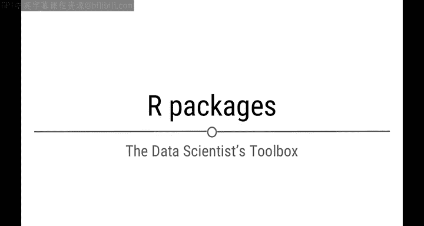

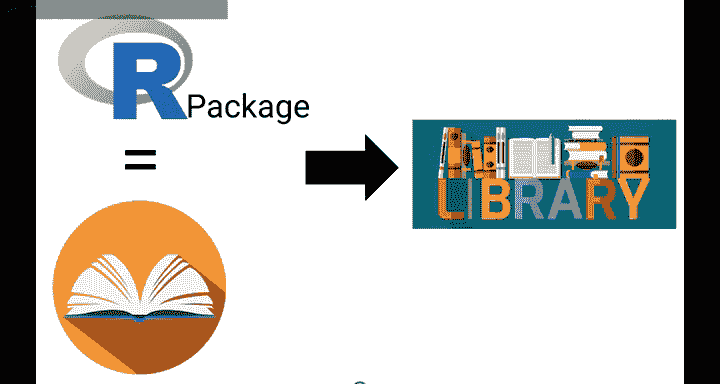


库是存放书籍（即包）的地方。

包是R独特性的体现。不仅基础R功能强大，这些包还极大地扩展了其功能。最特别的是，每个包都是由广大的R社区开发和发布，并存储在**代码仓库**中。

---

## 代码仓库

代码仓库是存放大量已开发包并可供下载的中心位置。主要有三个大型仓库：

1.  **综合R存档网络**：这是R的主要仓库，包含超过12，100个包。
2.  **Bioconductor**：主要存放生物信息学相关的包。
3.  **GitHub**：一个非常流行的开源代码托管平台，并非R专用。

现在您知道了在哪里可以找到包，但包的数量如此之多，如何找到能完成您特定任务的包呢？


---

## 如何查找包

以下是探索包的几种途径：

*   **CRAN任务视图**：CRAN将其所有包按功能主题分为35个类别，这至少可以帮助您将搜索范围缩小到与您兴趣相关的主题。
*   **R文档网站**：这是一个针对CRAN、Bioconductor和GitHub这三大仓库中包和函数的搜索引擎。如果您有明确的任务，这是搜索特定包的好方法。该网站也提供类似CRAN的任务视图，方便您按主题浏览。
*   **使用搜索引擎**：更常见的情况是，如果您有特定任务，在谷歌上搜索“任务 + R包”是一个很好的起点。然后，查看相关教程、文档和论坛中其他人是如何做的，是找到相关包的有效方式。


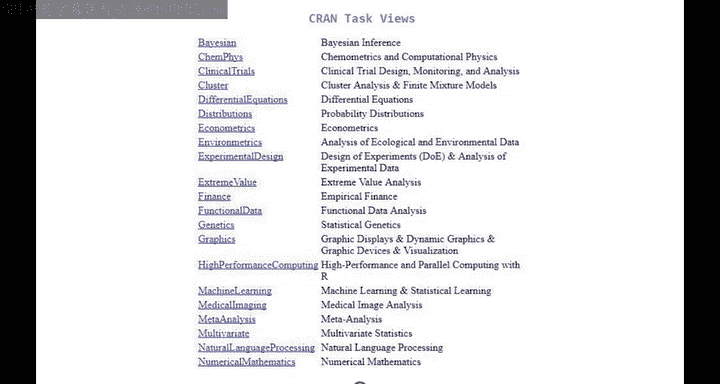
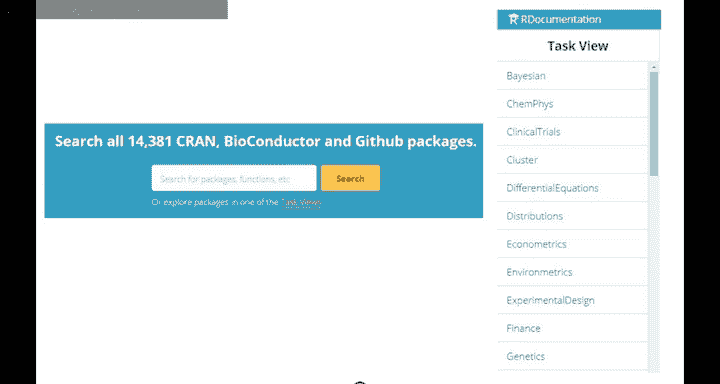


---


## 安装包

很好，您找到了想要的包，如何安装它呢？安装方法取决于包的来源。

**从CRAN安装**

使用 `install.packages()` 函数，将要安装的包名用引号括起来放在括号内。注意，单引号或双引号均可。

例如，要安装 `ggplot2` 包，您可以使用：
```r
install.packages("ggplot2")
```
此命令会从CRAN下载 `ggplot2` 包并安装到您的计算机上。

如果要一次安装多个包，可以使用字符向量，包名之间用逗号分隔，格式如下：
```r
install.packages(c("package1", "package2", "package3"))
```

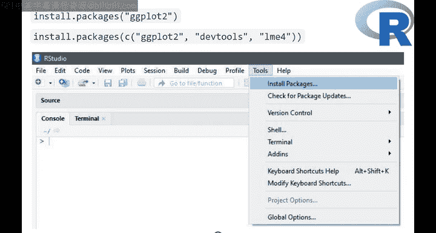

您也可以使用RStudio的图形界面安装包：转到 **工具** 菜单，第一个选项应该是 **安装包**。如果从CRAN安装，请选择它作为仓库，并在相应框中输入所需的包名。

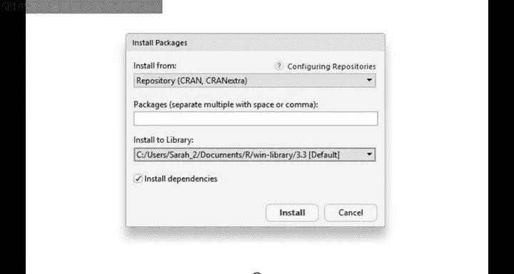


**从Bioconductor安装**

Bioconductor仓库使用自己的方法安装包。首先，需要获取安装所需的基本函数：
```r
source("https://bioconductor.org/biocLite.R")
```
这使Bioconductor的主要安装函数 `biocLite` 对您可用。然后，调用 `biocLite()` 命令，将要安装的包名用引号括起来放在括号内，如下所示（以 `GenomicRanges` 包为例）：
```r
biocLite("GenomicRanges")
```

**从GitHub安装**

从GitHub安装是更特定的情况，可能不常遇到。如果您想这样做，首先必须在GitHub上找到想要的包，并记下**包名**和**作者名**。

一般工作流程是：
1.  安装 `devtools` 包（如果您尚未安装）。
2.  使用 `library()` 函数加载 `devtools` 包。
3.  使用 `install_github()` 命令，调用作者的GitHub用户名，后跟包名。

例如：
```r
install_github("authorusername/packagename")
```

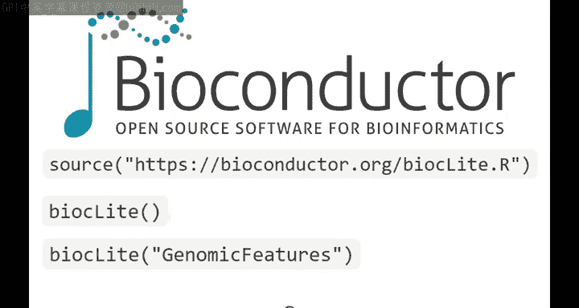


---

## 加载包

安装包并不会立即使其函数可用。首先，您必须将包**加载**到R中。使用 `library()` 函数。

可以这样理解：就像您在计算机上安装的任何其他软件一样，安装程序并不意味着它会自动运行，您必须**打开**程序。R包也是如此，您已经安装了它，但现在必须打开它。

例如，要加载 `ggplot2` 包，您将使用：
```r
library(ggplot2)
```
**注意**：与安装包时不同，`library()` 命令不接受用引号括起来的包名。

加载包是有顺序的。有些包需要先加载其他包（即依赖项）。包的帮助手册会帮助您找到这个顺序。

在RStudio界面中，右下角象限有一个名为 **包** 的标签页，列出了所有已安装包的简要描述和版本号。要加载一个包，只需点击包名旁边的复选框。

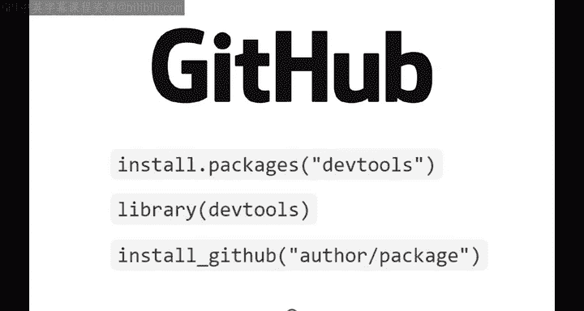

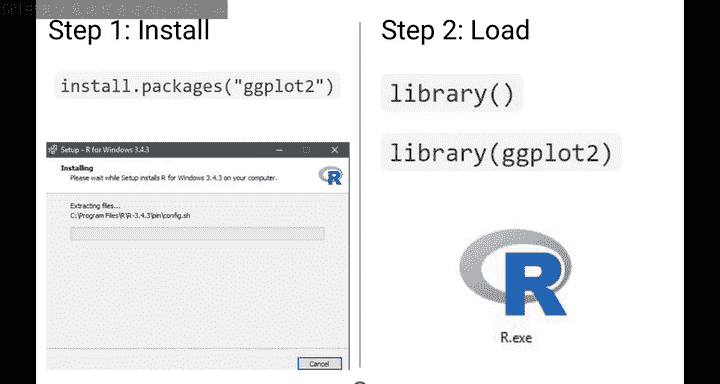


---

## 管理包

加载包后，您可能需要了解如何管理它们。

**检查已安装的包**

如果您不确定是否已安装某个包，或者想查看已安装的所有包，可以使用 `installed.packages()` 或 `library()` 函数（括号内不填任何内容）来检查。在RStudio的 **包** 标签页中查看是另一种方式。

**更新包**

您可以使用 `old.packages()` 函数检查哪些包需要更新。此函数会识别出自您安装或上次更新以来已更新的所有包。

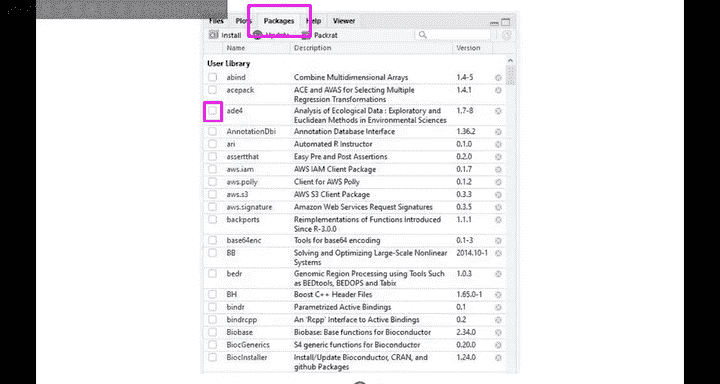

要更新所有包，请使用 `update.packages()`。如果只想更新特定包，只需再次使用 `install.packages()` 函数。

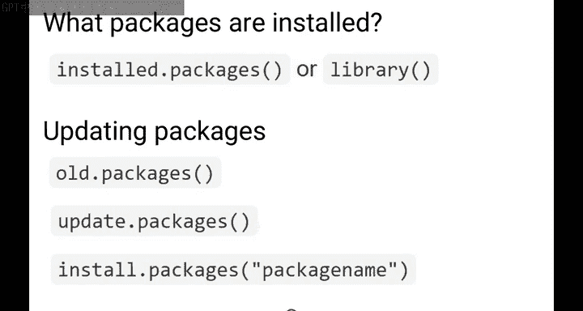

在RStudio界面中，仍然在 **包** 标签页，您可以点击 **更新**，这将列出所有未更新的包。您可以选择更新所有包或选择特定包。

您需要定期检查您的包是否已过时。但请注意，有时更新可能会改变某些函数的功能，因此如果您重新运行一些旧代码，命令可能已更改甚至完全消失，您将需要更新您的代码。

**卸载包**

有时您想在脚本运行中途**卸载**一个包。已加载的包可能与您想使用的另一个包不兼容。要卸载给定的包，可以使用 `detach()` 函数。

例如，您将键入：
```r
detach("package:ggplot2", unload = TRUE)
```
这将卸载我们之前加载的 `ggplot2` 包。

在RStudio界面的 **包** 标签页中，您只需取消选中包名旁边的复选框即可卸载包。

**删除包**

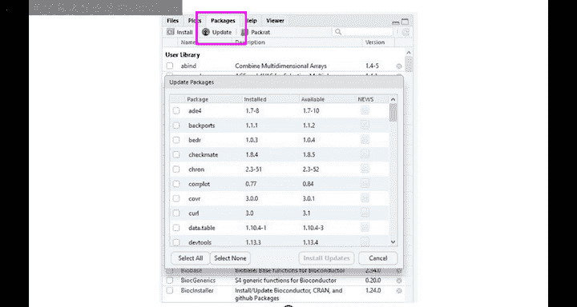

如果您不再需要某个包，可以使用 `remove.packages()` 函数简单地卸载它。

例如：
```r
remove.packages("ggplot2")
```
（尝试后请重新安装 `ggplot2` 包，它是一个非常有用的绘图包。）

在RStudio的 **包** 标签页中，点击包行末尾的 **X** 将卸载该包。


---

## 检查R版本

有时，当您查看一个可能想安装的包时，会发现它需要特定版本的R才能运行。要知道是否可以使用该包，您需要知道您正在运行的R版本。

一种方法是检查当您首次打开R或RStudio时，控制台输出的第一行信息会告诉您当前运行的R版本。如果您开始时没注意，可以在控制台中键入 `version`，它将输出有关您运行的R版本的信息。

另一个有用的命令是 `sessionInfo()`。它会告诉您正在运行的R版本，以及所有已加载包的列表。在论坛上提问时，包含此命令的输出非常有帮助，它向潜在的帮助者提供了大量关于您的操作系统、R以及您正在使用的包及其版本号的信息。

---

## 使用包中的函数

了解了这么多关于包的信息，我们还没有实际讨论如何使用包中的函数。

首先，您需要知道一个包中包含哪些函数。为此，您可以查看所有制作精良的包中包含的**帮助页面**。

在控制台中，您可以使用 `help()` 函数访问包的帮助文件。尝试使用 `help(package = "ggplot2")`，您将看到 `ggplot2` 提供的众多函数。

在RStudio界面中，您可以再次通过 **包** 标签页访问帮助文件。点击任何包名都应在同一象限的 **帮助** 标签页（位于 **包** 标签页旁边）中打开相关的帮助文件。点击这些帮助页面中的任何一个，都将带您进入该函数的帮助页面，告诉您该函数的用途以及如何使用它。

一旦您知道要使用包中的哪个函数，只需像我们在本课程中一直使用的任何其他函数一样在控制台中调用它。一旦包被加载，它就好像是基础R函数的一部分。

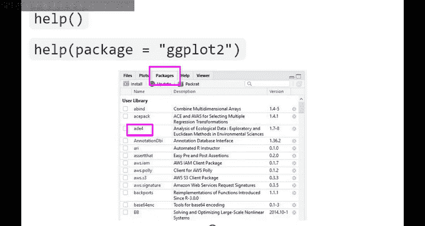


**使用小插图**

如果您对包中哪些函数适合您或如何使用它们仍有疑问，许多包都包含**小插图**。这些是扩展的帮助文件，包括包及其函数的概述，而且通常会提供详细的使用示例，用通俗易懂的语言说明，您可以跟着学习如何使用包。

要查看包中包含的小插图，您可以使用 `browseVignettes()` 函数。

例如，让我们看看 `ggplot2` 中包含的小插图：
```r
browseVignettes("ggplot2")
```
您应该会看到包含两个小插图：“Extending ggplot2”和“Aesthetic specifications”。探索“Aesthetic specifications”小插图是一个很好的例子，说明了小插图如何提供清晰的使用说明。

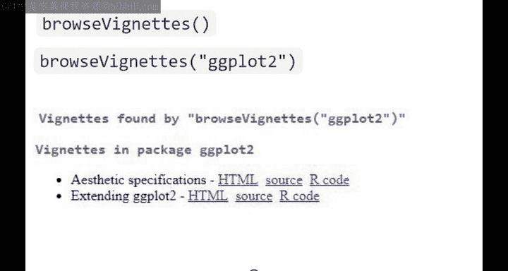

---

## 总结


在本节课中，我们深入探讨了R包。

我们研究了**包是什么**，以及它与**库**的区别；了解了**代码仓库**是什么，以及如何查找与您兴趣相关的包。

我们调查了包工作的所有方面：如何从各种仓库**安装**它们，如何**加载**它们，如何**检查**已安装的包，以及如何**更新**、**卸载**和**卸载**包。

我们稍微绕了个弯，学习了如何检查您拥有的R**版本**，这通常是安装包时需要了解的重要细节。

最后，我们花了一些时间学习如何探索**帮助文件**和**小插图**，它们通常能很好地指导您如何使用包及其所有功能。

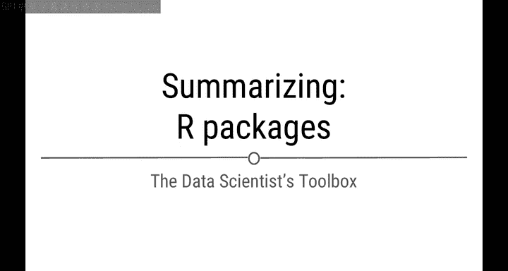

