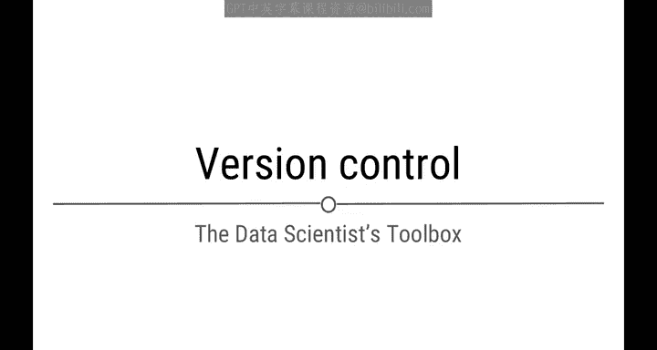
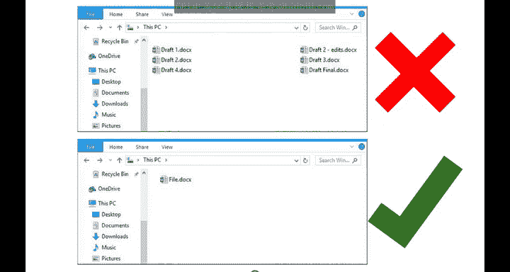
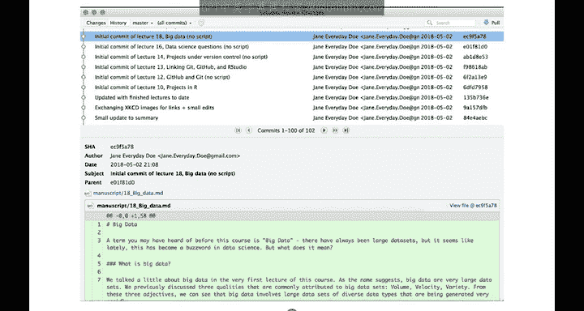
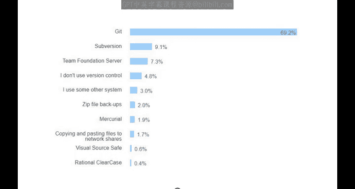
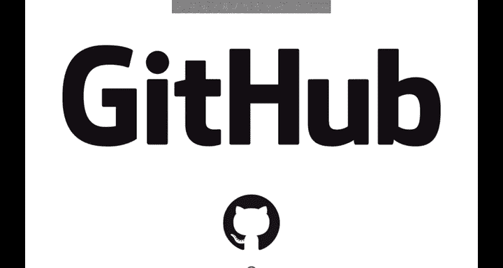
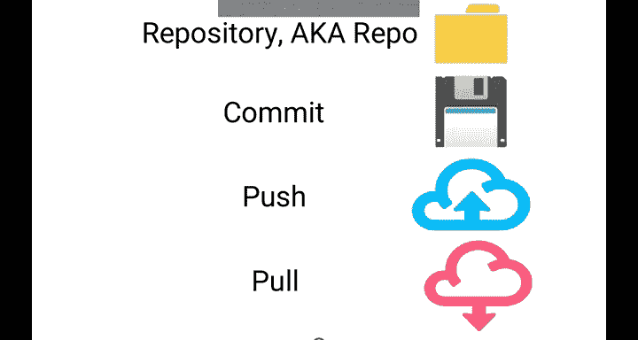
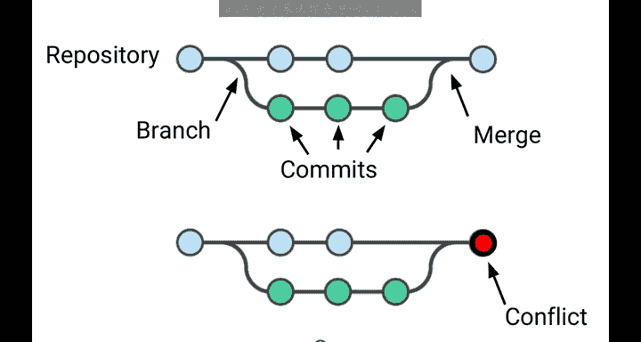
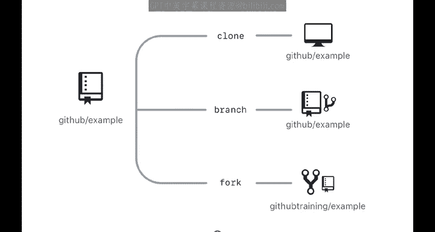
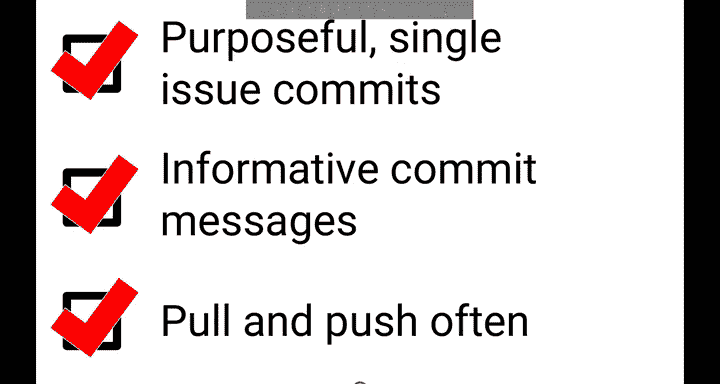
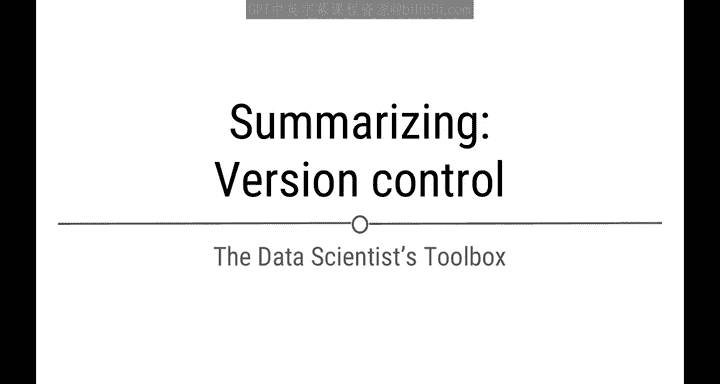

# 011：版本控制基础 🧑‍💻

在本节课中，我们将学习版本控制的基本概念，了解它是什么、为什么重要，并熟悉其核心术语和工作流程。掌握版本控制是进行高效协作和项目管理的关键技能。

---

## 什么是版本控制？

上一节我们介绍了RStudio和项目设置，本节中我们来看看版本控制。版本控制系统会记录文件或文件集随时间的变化。当你进行编辑时，该系统会为你的文件和更改创建快照并保存，以便你在需要时参考或恢复到以前的版本。

如果你使用过Microsoft Word中的“跟踪更改”功能，那么你已经见过一种初级的版本控制形式。在该功能中，文件的更改被跟踪，你可以选择保留这些编辑或恢复到原始格式。像Git这样的版本控制系统就像是更复杂的“跟踪更改”，它们功能更强大，能够细致地跟踪许多文件的连续更改，并且允许多人同时处理同一组文件。

## 版本控制的优势

希望在你掌握了版本控制软件后，“论文终稿2，实际上是终稿3.docx”这样的文件命名将成为过去。正如我们在示例中看到的，没有版本控制，你可能会保存多个非常相似的文件副本，这很危险。你可能会开始编辑错误的版本，没有意识到标记为“final”的文档已被进一步编辑为“final2”，结果你所有的新更改都应用到了错误的文件上。

版本控制系统通过为每个文件保留一个单一的最新版本，并记录所有先前版本以及版本之间确切的变化，从而帮助解决这个问题。

版本控制的另一个主要好处是，它保留了所有对文件所做更改的记录。当你与多人在同一文件上协作时，这非常有帮助。版本控制软件会跟踪是谁、在何时、以及为什么进行了这些特定的更改。这就像是“跟踪更改”的极致。这个记录在开发代码时也很有用。如果你在一段时间后意识到自己犯了错误并引入了错误，你可以找到上次编辑那段特定代码的时间，查看所做的更改，并恢复到原始未损坏的代码，同时保留在此期间所做的所有其他工作。

最后，当与一组人处理同一组文件时，版本控制有助于确保你不会对文件进行与其他更改相冲突的修改。如果你曾与他人共享文档进行编辑，你就会体会到在原始文件发送后，将他们的编辑与已发生变化的文档整合起来的挫败感。现在你有了同一原始文档的两个版本。

## Git 与 GitHub

版本控制允许多人处理同一文件，然后帮助将所有版本的文件及其编辑合并成一个有凝聚力的文件。

**Git** 是一个免费开源的版本控制软件。它于2005年开发，此后成为最常用的版本控制系统。Stack Overflow（在我们的“获取帮助”课程中应该很熟悉）调查了超过60,000名受访者关于他们使用的版本控制系统，从图表中可以看出，Git是遥遥领先的赢家。随着你对Git及其如何与项目交互越来越熟悉，你会开始明白它为何如此受欢迎。

Git的主要好处之一是它保存了你工作和修订的本地副本，你可以在离线状态下编辑，然后一旦恢复网络服务，就可以将你的工作副本与所有新编辑同步，并跟踪在线主仓库的更改。此外，由于项目的所有协作者都有自己的代码副本，每个人都可以同时处理自己的代码部分，而不会干扰公共仓库。

我们将要利用的另一个巨大好处是RStudio与Git交互的便捷性。在下一课中，我们将安装Git并将其与RStudio链接，并创建一个GitHub账户。

**GitHub** 是Git的在线界面。Git是在你本地计算机上用于记录更改的软件。GitHub是你的文件和所做更改记录的主机。你可以把它想象成类似于Dropbox：文件在你的计算机上，但它们也托管在线上，可以从任何计算机访问。GitHub的额外好处是与Git交互，跟踪你所有的文件版本和更改。

## 核心术语解析

在使用Git时涉及大量词汇，通常对一个词的理解依赖于你对另一个Git概念的理解。花些时间熟悉以下词语，并多看几遍以理解这些概念是如何关联的。

以下是版本控制中常用的核心概念：

*   **仓库**：相当于项目文件夹或目录。你所有受版本控制的文件和记录的更改都位于一个仓库中。这通常简称为 **repo**。仓库托管在GitHub上，通过这个界面，你可以将仓库设为私有并与选定的协作者共享，也可以将其公开。
*   **提交**：保存你的编辑和所做的更改。一次提交就像是你的文件的一个快照。Git将仓库中所有文件的先前版本与当前版本进行比较，并识别出自那时起发生变化的文件。对于未更改的文件，它保持先前存储的文件不变；对于已更改的文件，它会比较文件、记录更改并上传文件的新版本。我们将在下一节讨论，但当你提交文件时，通常需要附上一个简短的说明，解释你更改了什么以及为什么更改。当我们谈论版本控制系统时，提交是它们的核心。如果你发现错误，可以将文件恢复到之前的提交。如果你想查看文件随时间的变化，可以比较提交并查看消息以了解原因和作者。
*   **推送**：用你的编辑更新仓库。由于Git涉及在本地进行更改，你需要能够与公共在线仓库共享你的更改。推送就是将那些更改发送到该仓库，这样每个人都能访问你的编辑。
*   **拉取**：将你的本地仓库版本更新到当前版本。因为其他人可能在此期间进行了编辑，由于共享仓库托管在线上，你的任何协作者甚至你自己在不同的计算机上可能已经对文件进行了更改，然后将其推送到共享仓库，你的本地文件可能已经过时了。因此，你需要拉取以检查你是否与主仓库保持同步。
*   **暂存**：准备文件进行提交的行为。例如，如果自上次提交以来，你出于完全不同的原因编辑了三个文件，你不想一次性提交所有更改。因为你更改了三个文件且原因不同，关于你为何提交以及更改了什么的提交信息会变得复杂。所以，你可以只暂存其中一个文件并准备提交。提交该文件后，你可以暂存第二个文件并提交，依此类推。暂存允许你将文件更改分离到不同的提交中，这非常有帮助。

## 高级概念与最佳实践

为了总结到目前为止这些常用术语，并测试你是否掌握了要点：文件托管在一个与协作者在线共享的仓库中。你拉取仓库的内容，以便拥有可以编辑的文件的本地副本。一旦你对文件的更改感到满意，就暂存该文件然后提交。你将此提交推送到共享仓库。这将上传你的新文件和所有更改，并附有解释更改内容、原因和作者的消息。

以下是关于分支、合并和冲突的进一步说明：

*   **分支**：当同一个文件有两个同时存在的副本时，就产生了分支。当你在本地编辑文件时，你创建了一个分支，你的编辑尚未与主仓库共享。因此，文件有两个版本：每个人在仓库上都可以访问的版本，以及你本地编辑的版本。在你推送更改并将其合并回主仓库之前，你正在一个分支上工作。在分支点之后，版本历史会分成两个，并跟踪对仓库中原始文件（其他人可能正在编辑）和你的分支上更改的独立修改，然后将文件合并在一起。
*   **合并**：将同一文件的独立编辑合并成一个统一的文件。Git识别出独立的编辑，并将它们合并到一个包含两组编辑的单一文件中。但你可以看到这里存在一个潜在问题：如果两个人都对同一句子进行了编辑，导致其中一个编辑无法实现，我们就遇到了问题。Git识别出这种差异，即**冲突**，并要求用户协助选择保留哪个添加的内容。
*   **冲突**：当多人对同一文件进行更改，并且Git无法合并这些编辑时，就会发生冲突。你可以选择手动尝试合并编辑，或者保留一个编辑而放弃另一个。
*   **克隆**：克隆是复制一个现有的Git仓库。如果你刚加入一个使用版本控制跟踪的项目，你会克隆该仓库以获取并创建仓库所有文件和所有跟踪更改的本地版本。
*   **分叉**：分叉是你从他人那里获取的仓库的个人副本。如果有人正在进行一个很酷的项目，而你想尝试一下，你可以分叉他们的仓库。然后当你进行更改时，编辑会记录在你的仓库中，而不是他们的仓库中。

## 使用Git的最佳实践

使用像Git这样的版本控制软件可能需要一些时间来适应，但有几件事需要记住，以帮助建立良好的习惯，这些习惯将在未来对你有益。

以下是建立良好版本控制习惯的几个要点：

1.  **进行有目的的提交**：每次提交应该只解决一个单一问题。这样，如果你需要识别何时更改了某行代码，只需查看一个地方就能找到更改，并且可以轻松地看到如何恢复代码。
2.  **编写信息丰富的提交消息**：养成在每次提交时编写信息丰富的消息的习惯。如果每条消息都精确地说明了更改的内容，任何人都可以检查提交的文件并识别你更改的目的。此外，如果你正在寻找过去所做的特定编辑，可以轻松浏览所有提交以识别与所需编辑相关的更改。
3.  **注意你正在处理的文件版本**：经常通过拉取来检查你是否与当前仓库保持同步。此外，不要囤积已编辑的文件。一旦你提交了文件并写好了有用的消息，就应该将这些更改推送到公共仓库。如果你已经完成了一段代码的编辑，并计划转向处理一个不相关的问题，你现在就需要与协作者分享那个编辑。

---

## 总结

本节课中我们一起学习了版本控制的基础知识。我们探讨了什么是版本控制及其优势，理解了为什么我们要用整整三节课来专门介绍它。我们了解了Git和GitHub是什么，然后介绍了版本控制工作中许多常用且有时令人困惑的词汇。接着我们快速浏览了使用Git的一些最佳实践，但掌握这一切的最好方法就是去使用它。希望你现在对Git的工作原理有了更好的理解，让我们进入下一课，开始安装它。