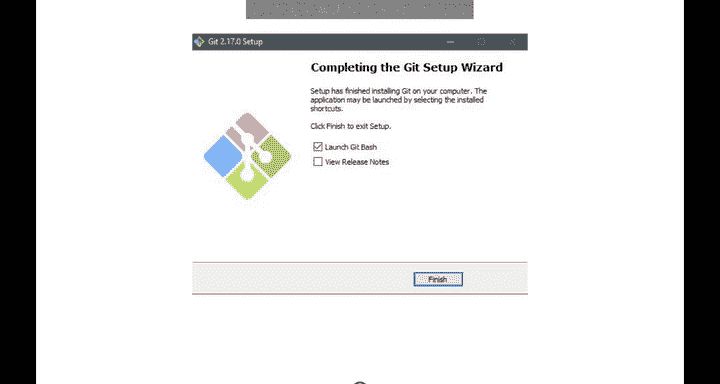
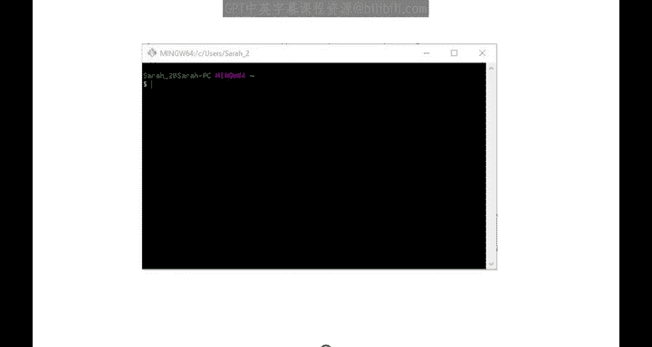
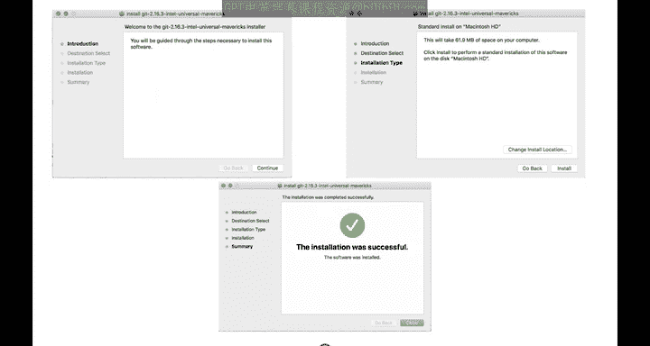
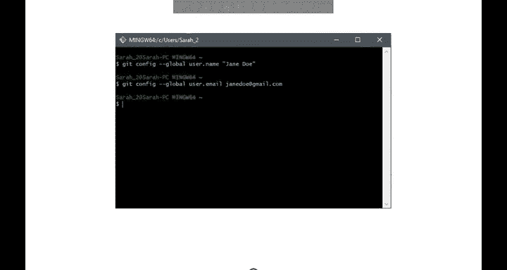
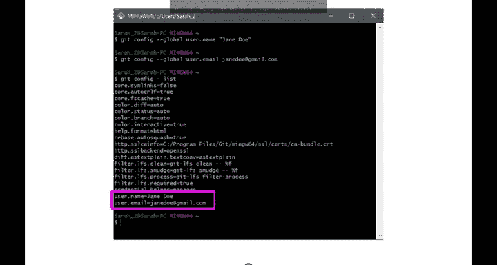
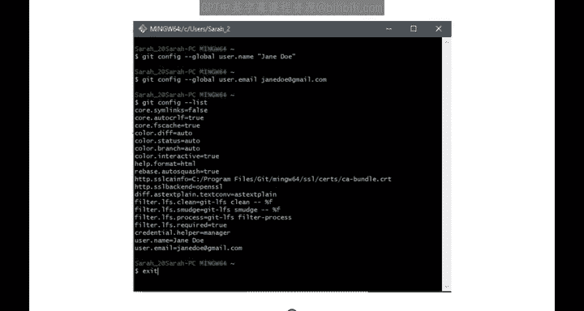

# 012：GitHub与Git入门指南 🚀

在本节课中，我们将学习如何注册GitHub账户、熟悉GitHub网站的基本功能、安装并配置Git。这些步骤是为后续将GitHub与RStudio连接做准备。

上一节我们介绍了版本控制的基本概念，本节中我们来看看如何实际操作GitHub和Git。

## 注册GitHub账户

GitHub是一个基于云的版本控制文件管理系统。类似于Dropbox，你的文件既存储在本地计算机上，也托管在线上，便于访问。其界面允许你管理版本控制，并为用户提供基于Web的界面来创建项目、共享项目、更新代码等。


以下是注册GitHub账户的步骤：

1.  访问 `www.github.com`。
2.  在主页填写信息：创建用户名、输入邮箱、选择安全密码。
3.  点击“Sign up for Github”。

注册后，你将登录到GitHub。未来登录时，只需访问Github.com。如果未自动登录，点击顶部的“Sign in”链接，在登录页面输入之前创建的用户名和密码即可。

## 熟悉GitHub界面

登录后，我们将快速浏览GitHub网站，重点关注用户设置、通知、帮助文件和GitHub指南这几个部分。

### 用户设置与个人资料

登录后，我们应完善个人资料信息并熟悉账户设置。页面右上角有一个带箭头的图标，点击可进入个人资料页。在这里你可以管理账户、查看贡献历史和代码仓库。

由于是初始阶段，你还没有任何仓库或贡献记录。现在，我们可以编辑个人资料。点击页面左侧的“Edit profile”，花些时间填写你的姓名、个人简介，并可以上传一张个人照片。完成后点击“Update profile”。

页面左侧有许多选项供你探索。点击每个菜单以熟悉可用选项。建议从“Account”页面开始，在这里你可以修改密码，如果不满意用户名也可以更改。但请注意，更改用户名可能会带来意外后果。如果你是新手且尚无任何内容，更改可能相对安全。浏览完个人设置选项后，返回个人资料页。

### 仓库与通知

当你拥有更多GitHub经验后，最终会拥有一些代码仓库。要找到它们，请在个人资料页点击“Repositories”链接。目前它可能为空，但在本讲座结束时，你可以返回此页面查看新创建的仓库。

接下来，我们查看通知菜单。在窗口顶部的菜单栏中，有一个铃铛图标代表通知。点击铃铛图标。当你更活跃于GitHub并与他人协作时，可以在这里找到你参与的所有仓库、团队和对话的消息与通知。

### 帮助系统与入门指南

每个页面的底部都有“Help”按钮。GitHub拥有完善的帮助系统，如果你对GitHub有任何疑问，这里应是首选搜索点。现在花些时间浏览各种帮助文件。

GitHub认识到这对新用户来说可能是个 overwhelming 的过程，因此开发了一个迷你教程来帮助你入门。现在请按照此指南操作，创建你的第一个仓库。完成后，你应该拥有一个类似下图的仓库。

花些时间探索仓库，查看提交历史记录。在这里，你可以找到对仓库所做的所有更改，并查看是谁、在何时、以及（如果你撰写了恰当的提交信息）为何做出了更改。

探索完仓库中的所有选项后，返回你的用户资料页。现在它看起来应该与之前略有不同。在个人资料页，你可以看到最新创建的仓库。要查看完整的仓库列表，请点击“Repositories”选项卡。在这里，你可以看到所有仓库、简要描述、最后编辑时间，以及右侧显示仓库编辑频率的活动图。

## 安装与配置Git

正如我们在上一讲中学到的，Git是免费开源的版本控制系统，GitHub正是构建于其上。使用Git系统的主要好处之一是其与RStudio的兼容性。然而，为了将两者连接起来，我们首先需要在你的计算机上下载并安装Git。

要下载Git，请访问 `git-scm.com/download`。点击适合你操作系统的下载链接，这将启动下载过程。下面我们将分别介绍Windows和Mac系统的安装步骤，请根据你的操作系统跟随相应说明。

### Windows系统安装

下载完成后，打开 `.exe` 文件以启动安装向导。如果收到安全警告，请点击“运行”或“允许”。随后，点击进入安装向导，通常接受默认选项即可，除非你有充分的理由不这样做。

点击“安装”并允许向导完成安装过程。完成后，勾选“Launch Git Bash”选项。除非你感兴趣，否则取消勾选“View release notes”框，因为目前你可能对此不感兴趣。



操作完成后，将打开一个命令行环境。如果你在安装过程中接受了默认选项，未来可以通过开始菜单的快捷方式启动Git Bash。至此，你已成功安装Git。

### Mac系统安装

我们将介绍最常见的安装过程，但将Git安装到Mac上有多种方法。你可以在 `www.atlassian.com/git/tutorials/install-git` 上按照教程寻找替代安装途径。

下载适用于Mac的相应Git版本后，你应该已下载一个 `.dmg` 文件用于安装。打开此文件，这将启动Git安装程序。一个新窗口将打开，双击其中的 `.pkg` 文件，安装向导将打开。点击通过选项，接受默认设置，然后点击“安装”。提示完成后，关闭安装向导。至此，你已成功安装Git。





### 配置Git

安装Git后，我们需要对其进行配置以便与GitHub协同使用，并为连接RStudio做准备。我们需要告诉Git你的用户名和邮箱，以便它知道每次提交来自谁。

在命令提示符（Windows是Git Bash，Mac是终端）中，键入以下命令来设置用户名：
```bash
git config --global user.name "YourUsername"
```
请将 `"YourUsername"` 替换为你想要的用户名，这将是每次提交时标记的名称。



接着，在命令提示符中键入以下命令来设置邮箱：
```bash
git config --global user.email "your-email@example.com"
```
请确保使用你注册GitHub时使用的相同邮箱地址。

此时，你应该已为下一步做好准备。但为了确认，可以通过键入以下命令来验证你的更改：
```bash
git config --list
```
执行此操作后，你应该能看到上面设置的用户名和邮箱。如果发现任何问题或想要更改这些值，只需用你期望的更改重新键入之前的配置命令即可。



一旦确认用户名和邮箱正确，可以通过键入 `exit` 并按回车键退出命令行。

## 总结




本节课中我们一起学习了如何注册GitHub账户并浏览了GitHub网站。我们创建了你的第一个仓库，并在GitHub上填写了基本的个人资料信息。随后，我们在你的计算机上安装了Git，并为其配置了与GitHub和RStudio的兼容性。至此，你已为下一讲的学习做好了全部准备。