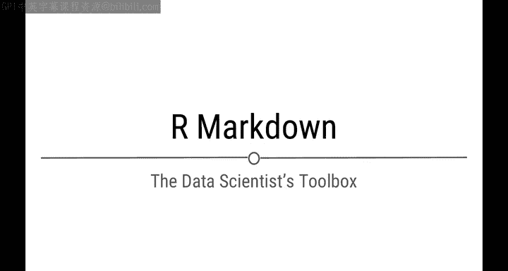
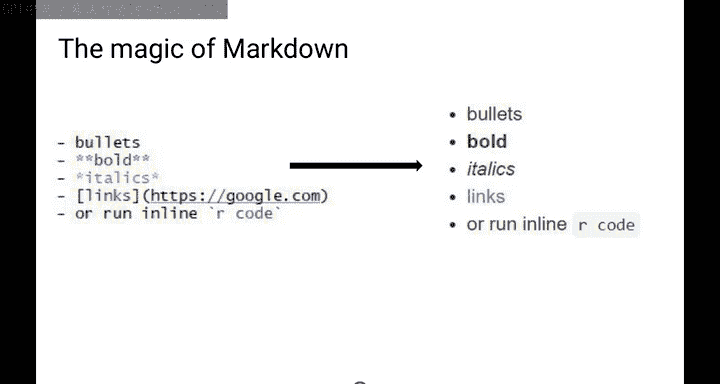
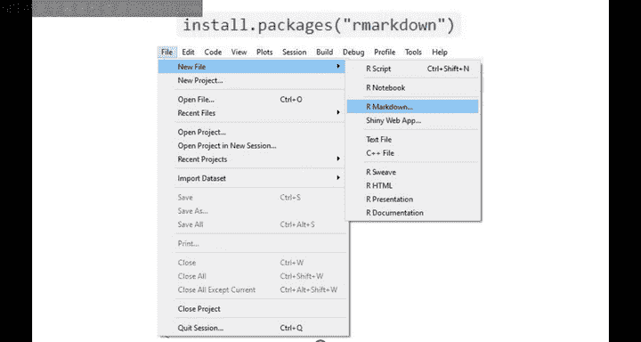
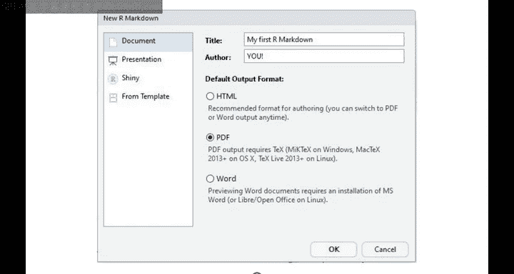
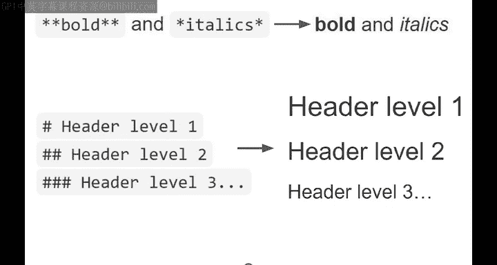
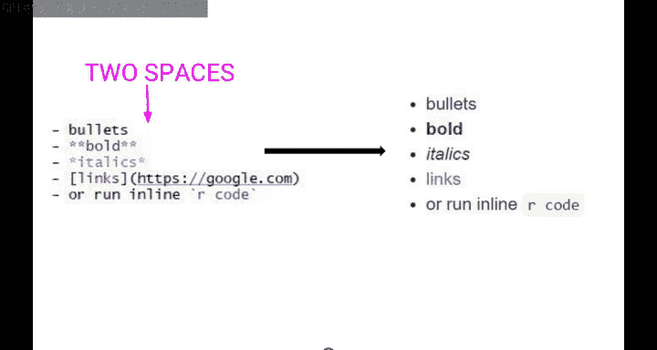
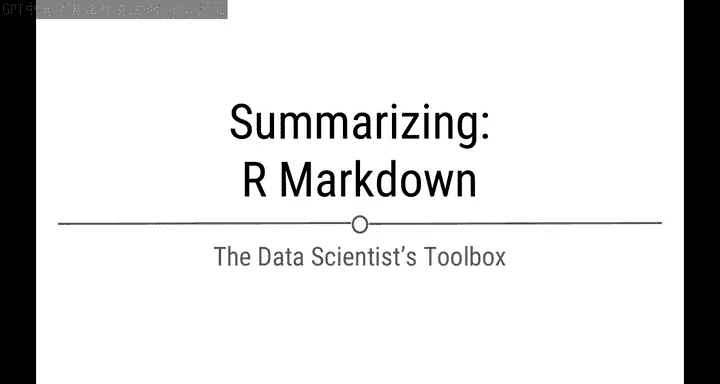

# 015：R Markdown入门教程 📝

在本节课中，我们将学习R Markdown，这是一种在R Studio中创建可重复文档的强大工具。我们将了解它的基本概念、核心优势以及如何创建和格式化你的第一个R Markdown文档。



---

我们已经花费了大量时间来学习R和R Studio的使用，掌握了项目和版本控制，你在这方面已经近乎专家。在R/R Studio的功能介绍中，还有一个重要的部分不容忽视，那就是R Markdown。

R Markdown是一种创建完全可重复文档的方式，它可以将文本和代码结合在一起。事实上，这些课程本身就是用R Markdown编写的。通过它，我们可以制作项目符号列表、加粗和斜体文本、内联链接，并运行内联的R代码。学完本课后，你也应该能够完成这些操作，甚至更多。



尽管这些文档最初都是纯文本，但你可以将它们渲染成HTML页面、PDF、Word文档或幻灯片。你用来表示格式（例如加粗或斜体）的符号，与所有这些输出格式都是兼容的。

## 为什么使用R Markdown？ 🤔

上一节我们介绍了R Markdown是什么，本节中我们来看看使用它的主要好处。

使用R Markdown的一个主要好处是它的**可重复性**。由于你可以轻松地将文本和代码块组合在一个文档中，你可以将引言、假设、运行的代码、代码运行结果以及结论全部整合在一起。分享你的工作内容、原因和结果变得非常简单。收到文档的人可以重新运行你的代码，并获得与你完全相同的结果。这就是我们所说的可重复性。

此外，有时你可能会进行一个需要数周才能完成的项目。你希望能够回顾很久以前的工作，或许还能回忆起当时这么做的确切原因。你可以看到当时运行了哪些代码以及结果。R Markdown文档允许你做到这一点。

R Markdown的另一个主要优势是，由于它是纯文本，因此与版本控制系统配合得非常好。可以轻松跟踪提交之间的字符变化。这与那些非纯文本格式不同。

例如，在某个版本的课程中，我可能忘记将某个词加粗。当我发现这个错误时，我可以修改纯文本，以表示我希望那个词被加粗。在提交记录中，你可以看到为了加粗那个词而发生的具体字符变化。

R Markdown还有一个“自私”的好处，那就是它非常易于使用。与R中的所有功能一样，这个扩展功能来自一个R包：`rmarkdown`。

## 开始使用R Markdown 🚀

了解了R Markdown的优势后，本节我们将动手实践，学习如何安装和创建你的第一个R Markdown文档。

安装它只需要运行 `install.packages("rmarkdown")`，然后你就可以开始使用了。

要在R Studio中创建R Markdown文档，请转到 `File` -> `New File` -> `R Markdown`。你将看到这个窗口。我已经填写了标题和作者，并将输出格式切换为PDF。你可以浏览左侧的选项卡，查看所有可以输出的不同格式。完成后，点击“OK”。





一个新窗口应该会打开，其中包含对R Markdown文件的简要说明。一个R Markdown文档主要有三个部分。

第一部分是顶部的**头部信息**，由三个短横线 `---` 界定。在这里，你可以指定标题、姓名、日期以及你想要的输出文档类型等详细信息。如果你之前在窗口中填写了信息，这里应该已经为你填好了。

你可以看到**文本部分**。例如，一个以 `## R Markdown` 开头的部分。我们稍后会详细讨论这意味着什么。当你生成这个文件的PDF时，这个部分将渲染为文本。你将学习的所有格式设置通常都适用于这个部分。

最后，你会看到**代码块**。它们由三个反引号 `` ``` `` 界定。这些是你可以直接从文档中运行的R代码块，当你创建PDF时，这些代码的输出将包含在其中。

了解这些部分如何运作的最简单方法就是生成PDF。当你完成一个R Markdown文档时，我们称之为“编织”你的纯文本和代码，以生成最终文档。为此，请点击源面板顶部的“Knit”按钮。点击后，它会提示你将文档保存为 `.Rmd` 文件。

你应该会看到一个像这样的文档。在这里，你可以看到头部信息的内容被渲染成了一个标题，后面跟着你的姓名和日期。文本部分生成了一个名为“R Markdown”的章节标题，后面跟着两段文本。接着，你可以看到R代码 `summary(cars)`，重要的是，后面跟着运行该代码的输出。再往下，你会看到用于生成图表的代码，然后是图表本身。这是R Markdown的巨大优势之一：将代码结果内联渲染。

回到生成这个PDF的R Markdown文件，看看你是否能看出如何表示你想要文本加粗。看看单词“knit”，看看它被什么包围着。

## 基础文本格式化 ✍️

现在我们已经创建了第一个文档，本节中我们来学习一些基础的文本格式化技巧。

此时，我希望我们已经让你相信R Markdown是一种管理代码和数据的有效方式，并为你做好了准备，让你可以尝试使用它。为了让你入门，我们将练习一些R Markdown文档固有的格式化功能。

首先，让我们看看如何加粗和斜体文本。要加粗文本，请用两个星号 `**` 包围它。类似地，要使文本变为斜体，请用一个星号 `*` 包围该单词。

从默认文档中我们还看到，你可以制作章节标题。为此，你需要放置一系列井号 `#`。井号的数量决定了标题的级别。一个井号是最高级别，将生成最大的文本；两个井号是次高级别，依此类推。尝试使用这种格式，创建一系列标题。



## 代码块与运行 💻

上一节我们介绍了文本格式化，本节中我们来看看如何插入和运行代码。

到目前为止，我们看到的另一件事是代码块。要创建一个R代码块，你可以输入三个反引号，后跟用花括号 `{}` 包围的小写字母 `r`，在新的一行放置你的代码，最后用另外三个反引号结束代码块。

幸运的是，R Studio知道你经常会这样做，并提供了快捷方式：Windows系统是 `Ctrl + Alt + I`，Mac系统是 `Cmd + Option + I`。此外，在源面板顶部还有一个“Insert”按钮，它也会生成一个空的代码块。

尝试创建一个空的代码块，在里面输入代码 `print("hello world")`。当你编织文档时，你将在该代码块的输出中看到这段代码（尽管输出很简单）。

如果你还没有准备好编织文档，但想查看代码的输出，请选择要运行的代码行，然后使用 `Ctrl + Enter`，或者点击源窗口顶部的“Run”按钮。文本“hello world”应该会输出到你的控制台窗口。

如果一个代码块中有多行代码，你想一次性全部运行，可以使用 `Ctrl + Shift + Enter` 运行整个代码块，或者点击代码块右侧的绿色箭头按钮，或者转到“Run”菜单并选择“Run Current Chunk”。

## 创建项目符号列表 📋

我们已经学习了文本和代码的格式化，最后我们来学习如何创建项目符号列表，就像本课开头的那个一样。

以下是创建项目符号列表的方法：
*   列表很容易创建，方法是在每个预期的项目符号点前加上一个短横线 `-` 和一个空格。
*   重要的是，在每个项目符号行的末尾，要加上两个空格。
*   这是R Markdown的一个特点，如果不包含这两个空格，可能会导致间距问题。

这是一个很好的起点，你还可以用R Markdown做更多事情。幸运的是，R Studio的开发者制作了一份R Markdown速查表，我们强烈建议你去查看，了解R Markdown的所有功能。可能性是无限的。

---





在本节课中，我们深入探讨了R Markdown，从它是什么以及为什么你可能想使用它开始。我们希望你通过首先安装它，然后生成并编织你的第一个R Markdown文档来入门。接着，我们研究了一些可用的各种格式化选项，并练习了在R界面内生成和运行代码。