# 017：实验设计 🧪

在本节课中，我们将学习实验设计的基本概念。作为一名数据科学家，你需要掌握如何设计合理的实验，以最佳方式回答你的数据科学问题。良好的实验设计能确保你收集到正确且充足的数据，从而清晰有效地解答疑问。

## 概述

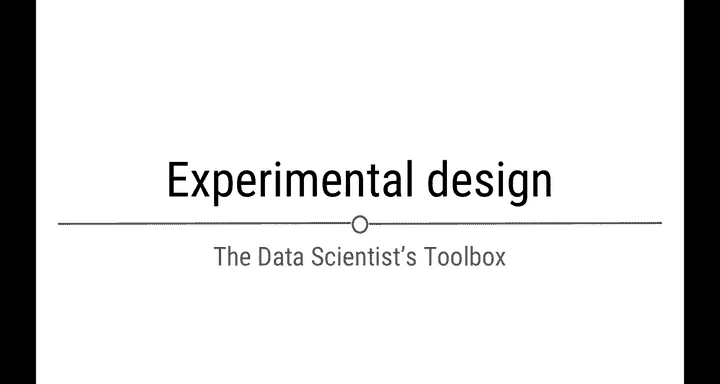

实验设计是指在任何数据收集之前，清晰地阐述问题，设计最佳的数据收集方案，识别设计中的问题或误差来源，然后才收集适当的数据进行分析。在进行分析之前，你需要提前计划好要做什么以及如何分析数据。如果分析错误，就可能得出错误的结论。

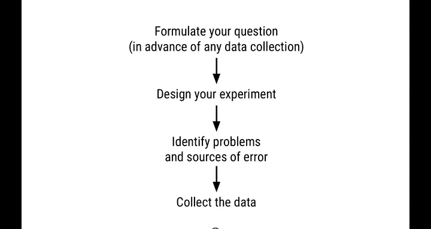

## 实验设计的重要性

我们已经在科学界看到过许多这类情况的实例。有一个名为“撤稿观察”的网站，专门识别因不良科学实践而被撤回或从文献中移除的论文。有时，这些不良实践正是源于糟糕的实验设计和分析。

偶尔，这些错误的结论会产生广泛的影响，尤其是在人类健康领域。例如，有一篇论文试图预测个人基因组对不同化疗反应的影响，以指导哪些患者应接受哪种药物来最佳治疗癌症。这篇论文在最初发表四年多后被撤回。在此期间，这些后来被证明在设置和清理上存在诸多问题的数据，被近450篇其他论文引用，这些论文可能使用了这些错误的结果来支持他们自己的研究计划。

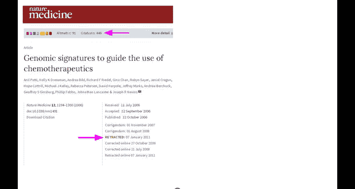

此外，这些错误分析的数据还被用于临床试验，以确定癌症患者的治疗方案。当风险如此之高时，实验设计至关重要。

## 实验设计核心概念

实验设计包含许多固有的概念和术语。现在我们来介绍其中一些。

*   **自变量**（又称**因子**）是实验者操纵的变量。它不依赖于其他被测量的变量，通常显示在X轴上。
*   **因变量**是那些预期会因自变量变化而改变的变量，通常显示在Y轴上。因此，X（自变量）的变化会影响Y（因变量）的变化。

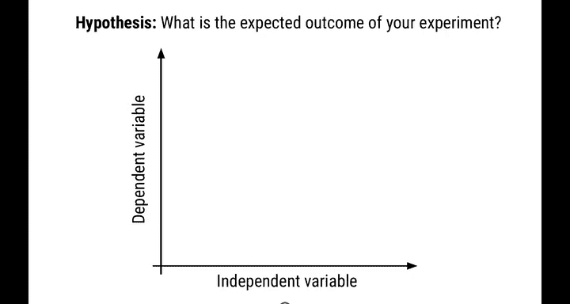

因此，在设计实验时，你必须决定要测量哪些变量，以及要操纵哪些变量来影响其他被测量变量的变化。

此外，你必须提出你的**假设**，这本质上是对你的变量与实验结果之间关系的有根据的猜测。

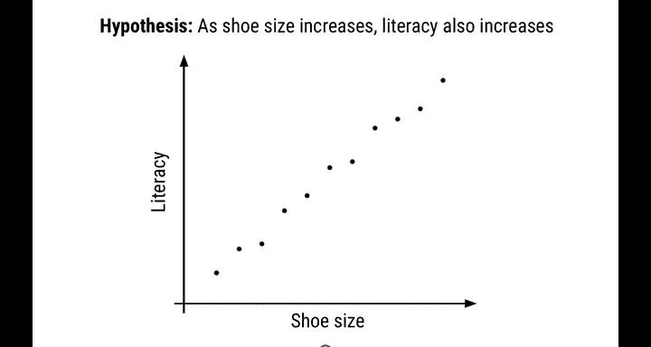

## 实验设计示例

让我们做一个示例实验。假设我有一个假设：鞋码越大，识字能力也越强。

在这种情况下，设计我的实验时，我会选择识字能力的一个衡量标准——例如，阅读流畅度——作为依赖于个人鞋码的变量。

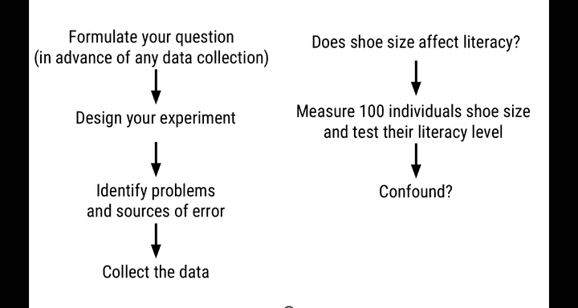

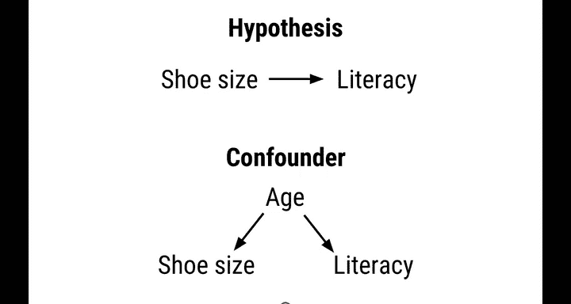

为了回答这个问题，我将设计一个实验，测量100个个体的鞋码和识字水平。**样本量**是你将在实验中包含的实验对象数量；在后续课程中，你将学习选择最佳样本量的方法。

然而，在收集数据之前，我需要考虑这个实验是否存在可能导致错误结果的问题。在这个案例中，我的实验可能因一个**混杂因素**而存在致命缺陷。

混杂因素是一个可能影响因变量和自变量之间关系的额外变量。在我们的例子中，由于年龄影响脚的大小，而识字能力受年龄影响，如果我们看到鞋码和识字能力之间存在任何关系，这种关系实际上可能是由年龄引起的。年龄混淆了我们的实验设计。

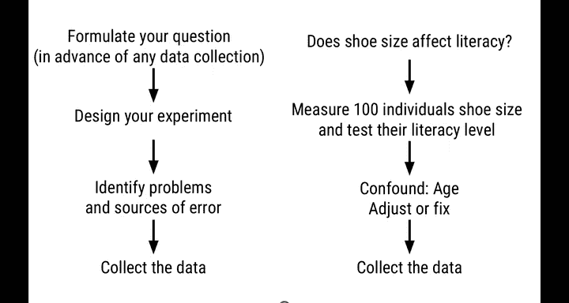

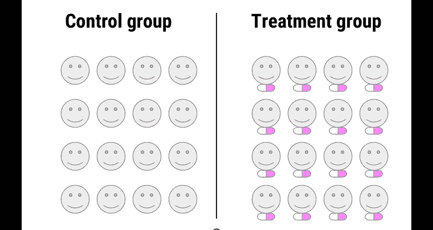

为了控制这一点，我们可以确保也测量每个个体的年龄，以便考虑年龄对识字能力的影响。控制年龄对识字能力影响的另一种方法是固定所有参与者的年龄。如果我们研究的所有人年龄都相同，那么我们就消除了年龄可能对识字能力产生的影响。

## 控制混杂因素

在其他实验设计范式中，设置**对照组**可能是合适的。这是指你有一组未被操纵的实验对象。例如，如果你在研究一种药物对生存的影响，你会有一组接受药物治疗，一组不接受治疗（对照组）。这样，你可以比较治疗组与对照组中药物的效果。

在这些研究设计中，我们还可以使用其他策略来控制混杂效应。

*   **盲法**：有时，当受试者知道自己处于治疗组（即接受实验药物）时，他们可能会感觉好转，但这并非源于药物本身，而是源于知道自己正在接受治疗。这被称为**安慰剂效应**。为了应对这种情况，通常会对参与者实施盲法，即不让他们知道自己属于哪个组。这通常是通过给对照组一个模拟治疗（例如，给他们一颗被告知是药物的糖丸）来实现的。这样，如果安慰剂效应对你的实验造成问题，两组应该会同等程度地体验到它。
*   **平衡**：这种策略是许多研究的核心，即将任何可能的混杂效应平均分布在被比较的组之间。例如，如果你认为年龄是一个可能的混杂因素，确保两组具有相似的年龄和年龄范围将有助于减轻年龄可能对你的因变量产生的任何影响。年龄的影响在你的两组之间是相等的。
*   **随机化**：这种混杂因素的平衡通常通过**随机化**来实现。通常，我们事先并不知道什么会成为混杂因素。为了帮助降低意外使一个组富含某个混杂因素的风险，你可以将个体**随机分配**到你的每个组中。这意味着任何潜在的混杂变量应该在每个组之间大致平均分布，有助于消除或减少系统误差。

## 实验的重复

在本课中，我们需要涵盖的最后一个实验设计概念是**重复**。重复基本上就是字面意思：用不同的实验对象重复进行实验。

单个实验的结果可能是偶然发生的：混杂因素在你的组间分布不均、数据收集存在系统误差、存在一些异常值等等。然而，如果你能重复实验，收集一套全新的数据，并仍然得出相同的结论，你的研究就会有力得多。

重复的核心还在于，它允许你更准确地测量数据的变异性，从而让你更好地评估你在数据中看到的任何差异是否显著。

## 数据与代码共享

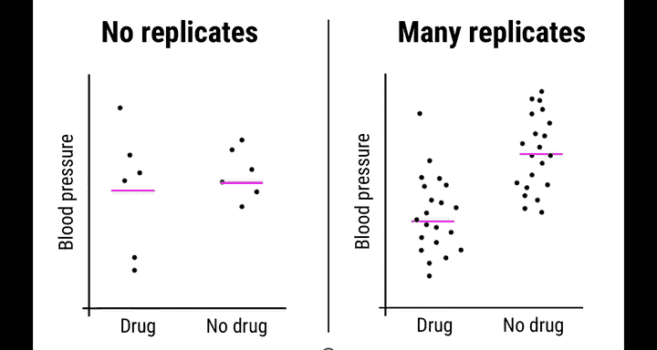

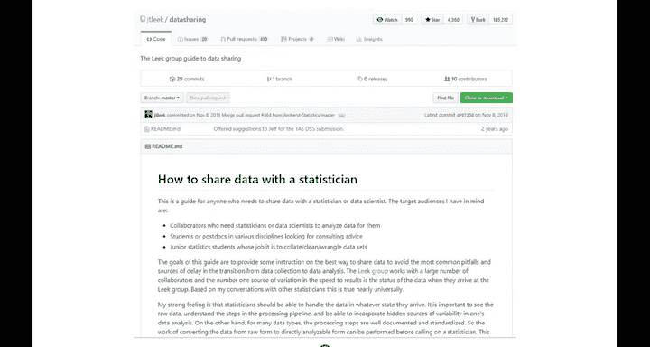

一旦你收集并分析了数据，作为一名优秀的科学公民，下一步就是分享你的数据和用于分析的代码。既然你已经有了GitHub账户，并且我们已经向你展示了如何在GitHub上保存版本控制的数据和分析，这里就是分享代码的好地方。

事实上，托管在GitHub上的“leek group”已经制定了一份指南，其中包含了关于如何最佳分享数据的绝佳建议。

## P值与P值操纵

实验中经常报告的一个值是**P值**。这个值告诉你，你的实验结果被偶然观察到的概率。这是统计学中一个非常重要的概念，我们在此不深入探讨。如果你想了解更多，请查看提供的视频链接，它更详细地解释了P值。

你需要警惕的是，当你为了自己的目的而操纵P值时。通常，当你的P值小于0.05时，换句话说，你观察到的差异有5%的几率是偶然发生的，结果被认为是**显著的**。但是，如果你进行了20次检验，你预计其中一次（即5%）会偶然显著。在大数据时代，检验20个假设是非常容易的，这就是术语**P值操纵**的由来。

P值操纵是指你详尽地搜索数据集，寻找由于你执行的检验数量巨大而显得具有统计显著性的模式和相关性。这些偶然的相关性可能被报告为显著，如果你进行足够多的检验，你总能找到一个数据集和分析来显示你想要看到的结果。

可以查看一个相关活动，在那里你可以操纵和过滤数据，并进行一系列检验，从而使数据找到你想要的任何关系。XKCD在一则漫画中讽刺了这个概念，测试果冻豆和痤疮之间的联系。显然，两者之间没有联系，但如果你测试足够多的果冻豆颜色，最终总会有一个颜色与痤疮的关联P值小于0.05。

## 总结

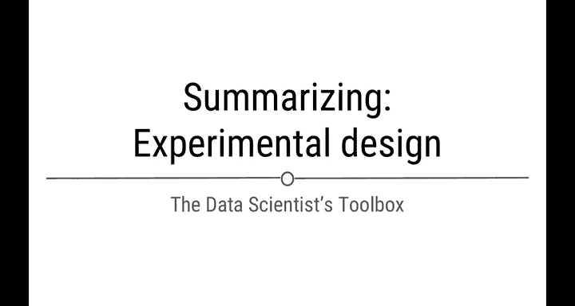

在本节课中，我们介绍了什么是实验设计以及良好实验设计的重要性。然后，我们深入探讨了实验设计的原则，并定义了一些在设计实验时需要考虑的常见术语。接着，我们稍微偏离主题，了解了应该如何分享你的数据和用于分析的代码。最后，我们探讨了P值操纵和为了达到显著性而操纵数据的危险。