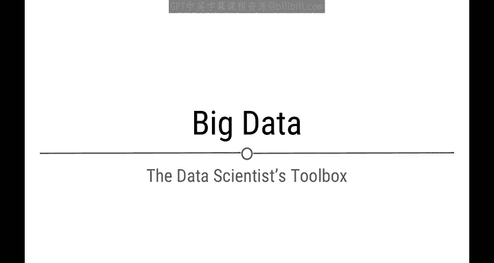
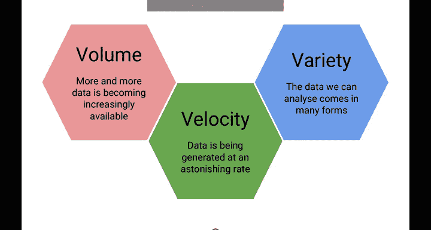
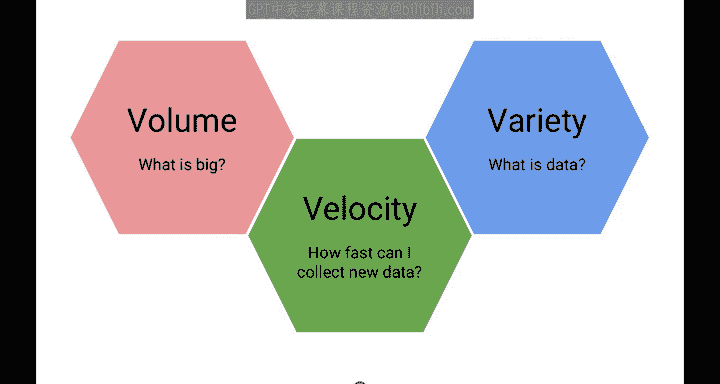
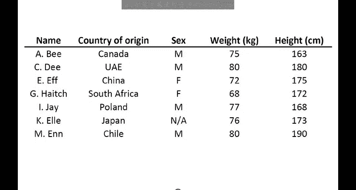
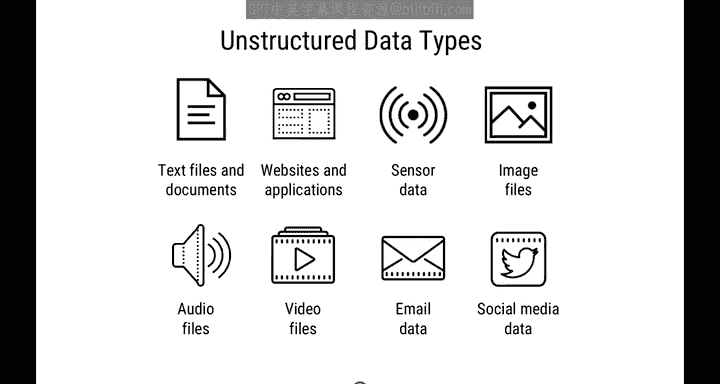
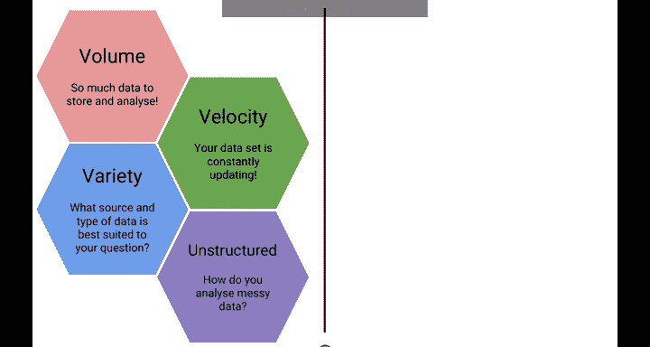
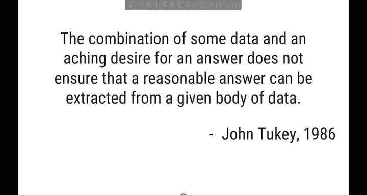
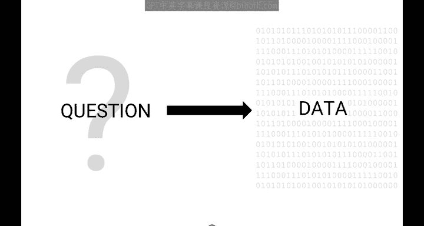
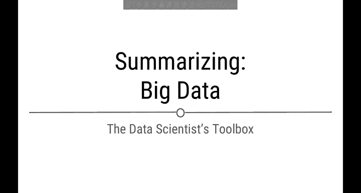

# 018：大数据

在本节课中，我们将要学习“大数据”这一概念。我们将探讨大数据的定义、其核心特征，并比较结构化数据与非结构化数据。我们还将分析处理大数据时面临的挑战与机遇，并最终理解为何数据科学始终是问题驱动的。

---

在课程开始之前，你可能已经听说过“大数据”这个术语。一直以来都存在大型数据集，但最近它似乎成了数据科学领域的一个流行词。那么，它究竟意味着什么？

## 🔍 什么是大数据？

顾名思义，大数据是指非常庞大的数据集。我们在本课程的第一讲中曾简要提及过它。通常，大数据集具备三个公认的特性：**体量**、**速度**和**多样性**。

从这三个形容词可以看出，大数据涉及的是**体量巨大**、**数据类型多样**且**生成速度极快**的数据集。然而，这些特性似乎并不新鲜。为什么大数据的概念直到最近才流行起来？

部分原因是，随着技术和数据存储能力的发展，能够容纳的数据集越来越大，“大”的定义也随之演变。同时，我们收集和记录数据的能力也随着时代进步而提升，数据收集的速度达到了前所未有的水平。最后，“数据”本身的定义也发生了变化。如今，比以往任何时候都有更多的公司认识到收集不同类型信息的好处，互联网和技术的兴起使得各种不同的数据更容易被收集并用于分析。

## 📈 从结构化数据到非结构化数据

数据科学的一个主要转变是从处理结构化数据集转向应对非结构化数据。

**结构化数据**是你传统上可能认为的数据形式：长长的表格、电子表格或数据库，其中包含行列分明的信息，你可以在这些框架内随心所欲地进行平均或分析。

然而，不幸的是，在当今时代，数据很少以这种整洁的形式呈现在你面前。我们通常遇到的数据要混乱得多。我们的工作就是从这些数据中提取所需信息，并将其整理成整洁、结构化的形式。

随着数字时代和互联网的进步，许多传统上未被收集的信息突然能够被转换成计算机可以记录、存储、搜索和分析的格式。一旦人们认识到这一点，从我们所有数字互动中收集的非结构化数据便开始激增。

以下是这些非结构化数据来源的一些例子：
*   电子邮件
*   Facebook 和其他社交媒体互动
*   短信
*   购物习惯
*   智能手机及其 GPS 定位
*   网站（你在该网站停留的时间以及浏览的内容）
*   闭路电视摄像头和其他视频源等

能够记录和传输数据的数量及各种来源已经爆炸式增长。正是由于数据在**体量**、**速度**和**多样性**上的这种爆炸式增长，大数据才成为一个如此突出的概念。这些数据集如今变得如此庞大和复杂，以至于我们需要新的工具和方法来充分利用它们。

## ⚠️ 处理大数据的挑战

正如你可以根据数据类型的多样性和来源猜测的那样，数据很少以整洁、有序的电子表格形式存储，以便应用传统的清理和分析方法。根据上述大数据的某些特性，你已经可以开始看到处理大数据可能面临的一些挑战。

以下是处理大数据时面临的主要挑战：
*   **体量巨大**：存在大量原始数据，你需要能够存储和分析它们。
*   **持续变化**：数据在不断变化和更新。当你完成分析时，又有更多的新数据可以纳入你的分析。你分析的每一秒，都是另一秒未被使用的数据。
*   **多样性令人应接不暇**：信息来源如此之多，有时很难确定哪种数据源最适合回答你的数据科学问题。
*   **数据混乱**：你没有整洁的数据表可以快速分析。在开始寻找答案之前，你需要将非结构化数据转换成可以分析的格式。

## 💡 大数据的优势

面对所有这些挑战，为什么我们不坚持分析更小、更易管理、经过整理的数据集，并以此方式得出答案呢？有时，使用这些较小的数据集最能解决问题。但许多问题受益于拥有海量数据。如果这些数据中存在一些混乱或不准确之处，其庞大的体量可以抵消这些较小错误的影响，因此即使使用这些较混乱的数据集，我们也能更接近真相。

此外，当你拥有不断更新的数据时，虽然分析起来可能是个挑战，但获取实时、最新信息的能力允许我们进行分析，使其准确反映当前状态，并做出即时、快速、有依据的预测和决策。

拥有所有这些新信息来源的好处之一是，那些以前因缺乏信息而无法回答的问题，突然有了更多获取信息的来源，现在可以建立新的联系并做出新的发现。以前无法触及的问题，现在可能有了新的、非常规的数据源，使你能够回答这些以前不可行的问题。

使用大数据的另一个好处是它可以识别隐藏的相关性。由于我们可以收集关于任何一个主题的无数特性的数据，我们可以寻找那些可能与我们的结果变量没有明显关系的特性，但大数据可以识别出其中的相关性。研究人员无需试图精确理解发动机为何故障或药物副作用为何消失，而是可以收集和分析与此类事件及其所有关联事物相关的大量信息，寻找可能有助于预测未来发生的模式。

大数据有助于回答“是什么”，而不是“为什么”，而这通常就足够了。

## 🎯 数据科学是问题驱动的

大数据现在使得从各种来源非常快速地收集大量数据成为可能，技术的进步也使得收集、存储和分析的成本更低。但问题依然存在：这次数据爆炸中，有多少对回答你关心的问题是有用的？

无论数据规模大小，你都需要正确的数据来回答问题。著名统计学家约翰·图基在1986年说过：“一些数据加上对答案的渴望，并不能确保能从给定的数据体中提取出合理的答案。”

本质上，任何给定的数据集都可能不适合你的问题，即使你非常希望它适合。大数据也不能解决这个问题。即使周围最大的数据集，如果它不是正确的数据，也可能不够“大”到能够回答你的问题。

---

## 📝 总结

本节课中，我们一起学习了：
*   定义了**大数据**，并了解了其三个核心特征：**体量**、**速度**和**多样性**。
*   比较了**结构化数据**和**非结构化数据**，并审视了一些新的非结构化数据来源。
*   探讨了处理这些大数据集所面临的**挑战**和带来的**优势**。
*   最后，我们回归到一个核心理念：数据科学是**问题驱动**的科学，即使是最大的数据集也可能不适合你的具体情况。