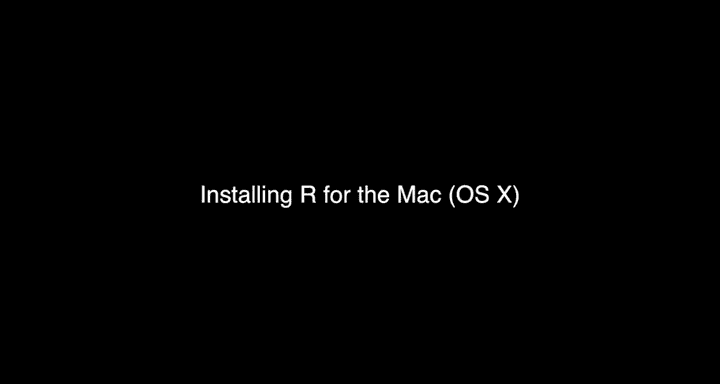
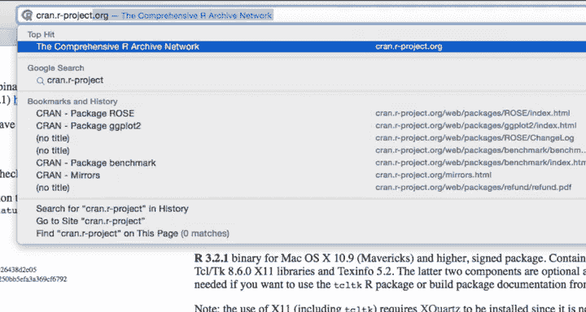
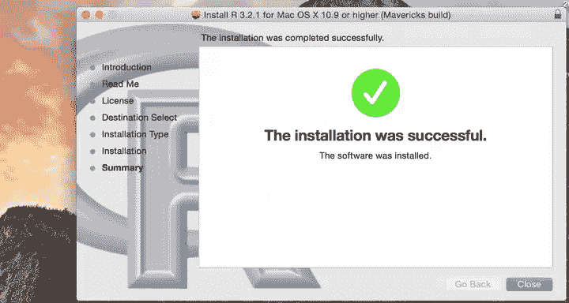

# 019：在 Mac 上安装 R 🍎

在本节课中，我们将学习如何在 Mac 电脑上安装 R 语言环境。这是一个非常简单的过程，只需要几个步骤即可完成。

## 概述

R 是一种广泛用于数据分析和统计计算的编程语言。要在 Mac 上使用它，我们首先需要从官方网站下载并安装它。整个过程直观且快速。

## 安装步骤

以下是安装 R 的具体步骤。

首先，打开你的网页浏览器。

然后，访问 CRAN（The Comprehensive R Archive Network）的官方网站。这是 R 语言的综合归档网络，你会看到为不同操作系统提供的下载选项。

我们需要下载适用于 Mac 平台的版本。点击“Download R for (Mac) OS X”链接。

接下来，点击页面上的 `.pkg` 安装包文件进行下载。下载进度条会开始运行，根据你的网速，这可能需要几分钟时间，请耐心等待。

下载完成后，在下载文件夹中找到并打开这个 `.pkg` 文件。安装程序将自动启动，并引导你完成所有安装步骤。

点击“继续”按钮。这里会显示即将安装的内容描述，你可以再次点击“继续”。

随后会出现软件许可协议，即 GNU 通用公共许可证第 2 版。在阅读后，点击“同意”。

然后点击“安装”按钮。系统可能会要求你输入管理员密码以授权安装，请输入密码并确认。

安装程序将开始将文件复制到你的电脑上。

安装完成后，点击“关闭”按钮。此时，R 已经成功安装到你的“应用程序”文件夹中。

你可以打开“访达”，进入“应用程序”文件夹。文件通常按字母顺序排列，向下滚动找到 “R” 即可看到 R 应用图标。

## 安装后操作

现在，你已经成功在电脑上安装了 R。你可以直接双击图标启动并使用基础的 R 控制台。

此外，如果你希望获得更强大的开发体验，可以选择安装一个集成开发环境（IDE），例如非常流行的 RStudio。这能提供代码编辑、项目管理、图形展示等更多便利功能。

## 总结

本节课中，我们一起学习了在 Mac 操作系统上安装 R 语言环境的完整流程。我们访问了 CRAN 官网，下载了 Mac 版的安装包，并一步步完成了安装过程。安装完成后，R 会出现在你的应用程序文件夹中，随时可以启动使用。