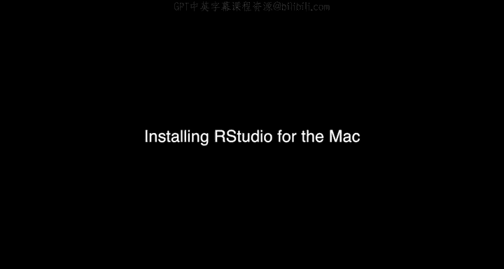
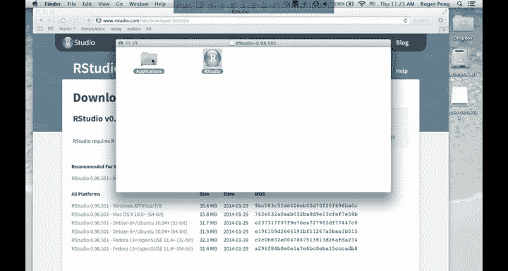

# 021：在 Mac 上安装 RStudio 🍎

在本节课中，我们将学习如何在 Mac 操作系统上安装 R 语言的集成开发环境 RStudio。这是一个非常简单的过程，仅需几个步骤即可完成。

## 概述

首先需要明确的一点是，**在安装 RStudio 之前，你必须已经安装了 R 语言本身**。一旦你完成了 R 的安装，就可以开始 RStudio 的安装流程了。

## 访问 RStudio 官网

接下来，你需要访问 RStudio 的官方网站，网址是 `Rstudio.com`。在网页的左下角，你会看到一个绿色的按钮，它会引导你下载 RStudio。

以下是可供下载的两个版本：
*   **桌面版**：这是我们将在本地电脑上使用的版本。
*   **服务器版**：本节课不会涉及此版本。

因此，你只需要下载桌面版，也就是当前显示的按钮。

## 下载与安装

网站通常会**自动检测**你正在运行的操作系统类型。例如，因为我使用的是 Mac，所以它推荐我下载 Mac OS 10 版本。点击下载按钮即可开始下载。

下载进度条会显示下载状态。下载完成后，文件通常会保存在“下载”文件夹中，并且很可能是列表中最左侧的那个文件。

点击该文件以启动安装程序。与安装其他 Mac 应用程序一样，安装 RStudio 只需要将其图标**拖拽到“应用程序”文件夹**中。

拖拽完成后，安装即告结束。现在，你可以进入“应用程序”文件夹，找到 RStudio 的图标。

## 启动 RStudio

双击 RStudio 图标来启动它。系统可能会询问你是否确定要打开此应用程序，点击“是”或“打开”。

至此，RStudio 已经成功启动并运行在你的 Mac 上了。

## 总结

本节课我们一起学习了在 Mac 上安装 RStudio 的完整流程。我们回顾了关键前提——先安装 R，然后访问官网下载正确的桌面版安装包，最后通过简单的拖拽操作完成安装。现在，你的编程环境已经准备就绪。