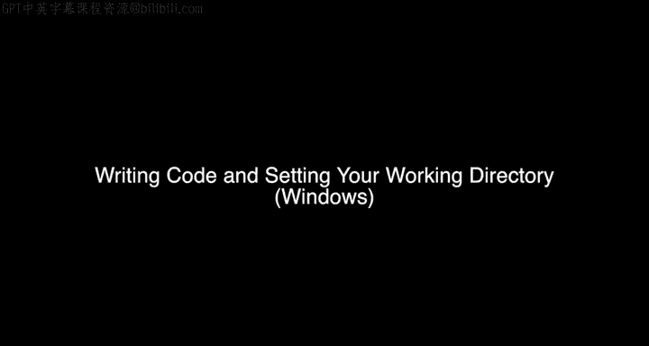
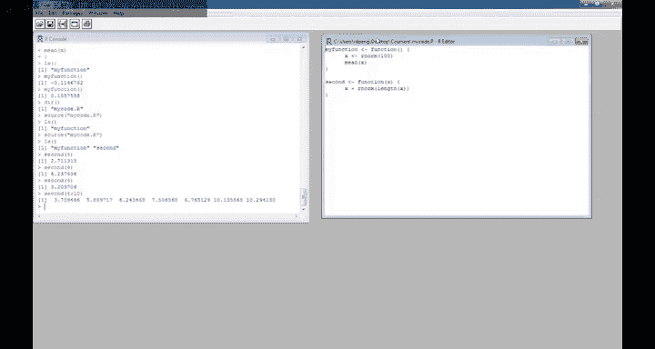

# 022：设置工作目录与编辑代码（Windows）💻



在本节课中，我们将学习如何在 Windows 系统中设置 R 的工作目录，以及如何使用 R 内置的文本编辑器来编写和运行代码。理解工作目录是管理数据文件的基础，而掌握代码编辑则是进行数据分析的关键步骤。

## 设置工作目录

上一节我们介绍了 R 的基本界面，本节中我们来看看如何设置工作目录。工作目录是 R 在计算机上查找和保存文件的默认位置。当你使用如 `read.csv` 或 `write.csv` 这类函数读取或写入数据时，R 默认会在工作目录中寻找或创建文件。

你可以使用 `getwd()` 函数来查看当前的工作目录设置。

```r
getwd()
```

执行后，你可能会看到类似 `C:/Users/YourName/Documents` 的路径。这个路径因你的 Windows 版本和硬件配置而异，但通常位于 C 盘。

了解并正确设置工作目录非常重要。例如，如果你尝试读取一个不在工作目录中的文件，R 会报错。

```r
# 假设文件不在工作目录中
read.csv("my_data.csv") # 可能会产生错误
```

为了避免此类问题，你有两个选择：将文件移动到当前工作目录，或者将工作目录更改为文件所在的文件夹。

以下是更改工作目录的步骤：
1.  在 R 的菜单栏中，点击 **File**。
2.  选择 **Change dir...**。
3.  在弹出的窗口中，导航到你希望设置为工作目录的文件夹（例如桌面上的一个文件夹）。

为了方便本课程的学习，建议你创建一个专用文件夹来存放所有课程材料。这样，你可以将工作目录永久设置为此文件夹，避免频繁切换。

## 编写与运行 R 代码

设置好工作目录后，我们需要编写 R 代码。R 自带了一个基础的文本编辑器，完全足够本课程使用。

要打开编辑器，请点击菜单栏的 **File**，然后选择 **New script**。这将打开一个空白的编辑窗口。

现在，让我们编写一个简单的函数。这个函数将生成一些随机数并计算其平均值。

```r
my_function <- function() {
  x <- rnorm(100) # 生成100个服从正态分布的随机数
  mean(x) # 计算平均值
}
```

编写完代码后，你需要将其加载到 R 控制台中才能使用。对于少量代码，你可以直接复制粘贴：
1.  在编辑器中使用 `Ctrl + A` 全选代码。
2.  使用 `Ctrl + C` 复制。
3.  切换到控制台，使用 `Ctrl + V` 粘贴。

粘贴后，代码会被执行。此时，你可以使用 `ls()` 查看工作空间，确认 `my_function` 已存在，并可以调用它。

```r
ls()
my_function()
```

对于更复杂的项目，更好的做法是将代码保存为文件。以下是操作步骤：
1.  在编辑器中，点击 **File** -> **Save As...**。
2.  导航到你的课程文件夹（例如之前创建的 `Coursera` 文件夹）。
3.  为文件命名，通常使用 `.R` 作为扩展名（例如 `mycode.R`）。
4.  点击保存。

保存后，你可以使用 `source()` 函数将整个文件中的代码加载到 R 中。

```r
source("mycode.R")
```

之后，文件中定义的所有函数和变量都将可用。如果你修改了代码文件，记得先保存，然后再次使用 `source()` 函数重新加载，才能使更改生效。

你可以创建多个 `.R` 文件来管理不同项目或作业的代码。通过 **File** -> **Open script...** 可以重新打开已保存的文件进行编辑。

## 总结



本节课中我们一起学习了两个核心技能：设置工作目录和编辑 R 代码。我们了解到工作目录是 R 存取文件的默认位置，可以使用 `getwd()` 查看，并通过图形界面更改。同时，我们学会了使用 R 内置编辑器编写代码，并通过复制粘贴或 `source()` 函数将代码加载到控制台中运行。掌握这些基础操作，将为后续的数据分析工作打下坚实的基础。