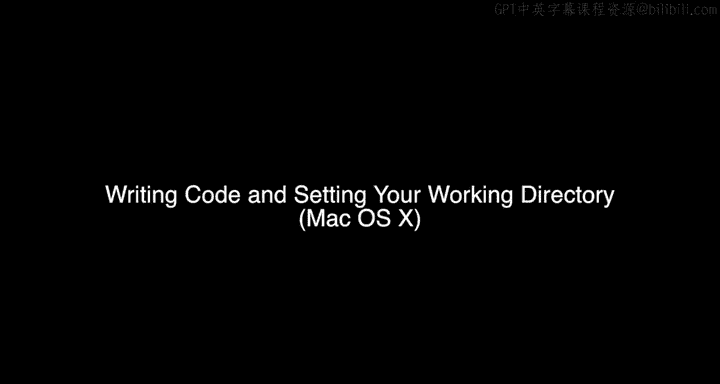
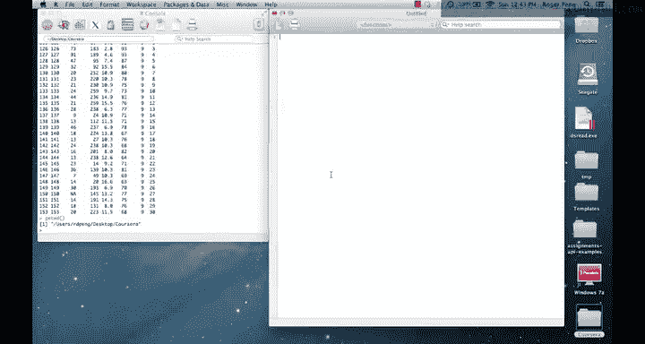
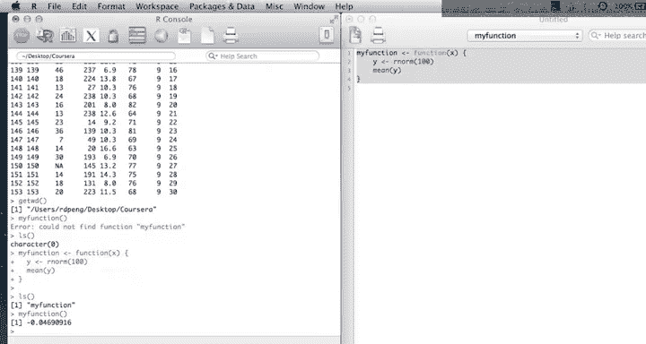
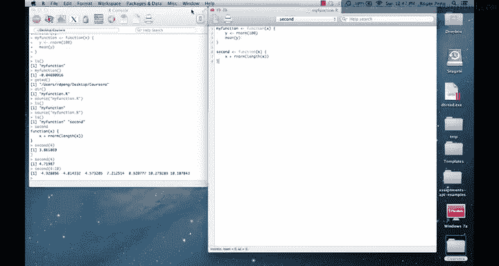

# 023：设置工作目录与使用文本编辑器（Mac）📂✏️



在本节课中，我们将学习两个核心操作：如何设置R的工作目录，以及如何使用R自带的文本编辑器来编写和编辑代码文件。掌握这些是高效使用R进行数据科学分析的基础。

## 概述

工作目录是R读取和保存文件的默认位置。如果不清楚工作目录的位置，你将难以找到保存的数据或加载外部文件。同时，编写代码是数据分析的核心，我们需要一个工具来高效地创建和编辑R脚本。本节将详细介绍在Mac系统上完成这两项任务的方法。

## 设置工作目录

上一节我们了解了工作目录的重要性，本节中我们来看看如何查看和设置它。

启动R后，你可以通过输入函数 `getwd()` 来查看当前的工作目录。

```r
getwd()
```

例如，系统可能将工作目录设置为你的个人主目录（如 `/users/yourusername`）。虽然这可以工作，但如果你将所有数据和分析文件存储在另一个特定文件夹（例如一个子目录）中，你可能需要更改工作目录。

你可以通过R的菜单来更改工作目录。点击菜单栏中的“Misc”（杂项），然后选择“Change Working Directory...”（更改工作目录），接着在弹出的窗口中选择你想要的文件夹。

在更改目录前，需要明确一点：如果你想读取一个文件，该文件必须位于你的工作目录中，否则R会报错。

例如，尝试使用 `read.csv` 读取一个不在当前工作目录中的文件 `mydata.csv`：

```r
read.csv("mydata.csv")
```

你会收到一个错误，因为R在当前目录下找不到这个文件。解决方法是，将工作目录更改到该文件所在的文件夹。

更改目录后，你可以使用 `dir()` 命令列出该目录下的所有文件，确认目标文件是否存在。

```r
dir()
```

确认文件存在后，再次使用 `read.csv` 即可成功加载数据。



为了管理方便，我建议你为本课程创建一个专属目录，并将所有相关文件存储在其中。这样你就不必频繁更改工作目录。

例如，你可以在桌面上创建一个名为“Coursera”的文件夹。然后在R中，将工作目录更改到这个新文件夹。之后，所有保存到该文件夹的文件都能被R直接访问。

## 使用R的文本编辑器编写代码

设置好工作环境后，接下来我们需要编写代码。在Mac版的R中，自带了一个简单的文本编辑器，足以满足本课程的需求。

你可以通过点击R界面工具栏上的编辑器按钮（通常显示为一张纸和一支笔的图标）来打开文本编辑器。这会打开一个新的空白编辑窗口。

在编辑器中，你可以直接开始编写R代码。例如，创建一个简单的函数：



```r
myfunction <- function() {
        x <- rnorm(100)
        mean(x)
}
```

编辑器会自动进行代码缩进，提高可读性。编写完代码后，你需要将其加载到R的工作环境中才能使用。

以下是几种将代码加载到R的方法：

1.  **复制粘贴**：对于少量代码，你可以在编辑器中选择全部代码（Command+A），复制（Command+C），然后切换到R控制台窗口粘贴（Command+V）并执行。
2.  **保存并源文件（Source）**：对于更正式或更长的代码，最好将其保存为 `.R` 文件。在编辑器菜单中点击“File” -> “Save As...”，导航到你的工作目录（例如“Coursera”文件夹），将文件命名为如 `myfunction.R` 并保存。

保存文件后，在R控制台中使用 `source()` 函数加载整个脚本：

```r
source("myfunction.R")
```

这相当于一次性执行了文件中的所有代码。之后，使用 `ls()` 命令可以查看工作环境中已加载的对象，你应该能看到 `myfunction` 这个函数。

你可以随时在编辑器中修改代码，保存文件（Command+S）后，再次使用 `source()` 命令即可更新R环境中的函数定义。



要创建新的R脚本文件，只需再次点击编辑器按钮打开一个新窗口即可。R自带的编辑器虽然简单，但具备了编写、编辑、保存和加载代码的所有基本功能，对于本课程的学习完全足够。

## 总结

本节课中我们一起学习了在Mac上使用R的两个基础技能。首先，我们了解了工作目录的概念，学会了如何使用 `getwd()` 查看、以及通过菜单或设置专属文件夹来管理它，这是组织项目和读取数据的关键。其次，我们介绍了如何使用R内置的文本编辑器来编写、保存（`.R`文件）和加载（通过复制粘贴或 `source()` 函数）R代码。掌握这些操作将为后续的数据分析工作打下坚实的基础。