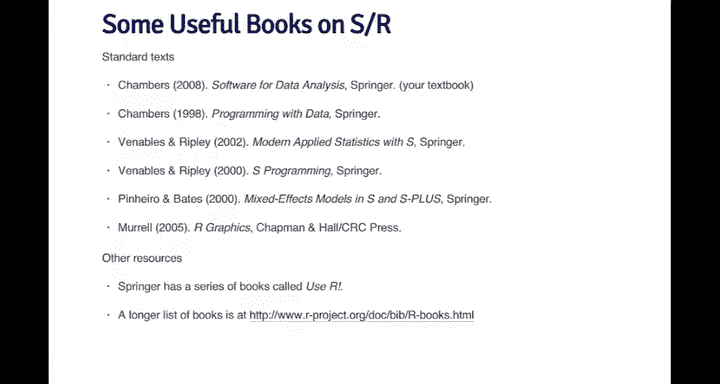

# 025：R语言概述与历史

在本节课中，我们将学习R统计编程环境的基本概念及其发展历史。我们将了解R是什么，它从何而来，以及它为何成为当今数据科学领域的重要工具。

---

## 🧐 什么是R？

R本质上是一种S语言的方言。这自然引出了下一个问题：什么是S？

S语言是由约翰·钱伯斯在现已不存在的贝尔实验室开发的。它始于1976年，最初是作为一个内部统计分析环境，供贝尔实验室的研究人员分析数据使用。

早期版本通过一系列Fortran库来实现那些需要反复执行的繁琐统计例程。直到大约第三个版本，S语言才加入了统计建模功能。

1988年，该系统用C语言重写，以提高跨平台的可移植性，并开始接近我们今天使用的系统形态。这个版本（版本3）的标志性成果是约翰·钱伯斯和特雷弗·哈斯蒂合著的《S语言中的统计模型》（有时被称为“白皮书”），它记录了该版本引入的所有统计分析功能。

S语言的第4版于1998年发布，这也是我们今天大致仍在使用的版本。本课程的参考书《用数据编程》（约翰·钱伯斯著，有时被称为“绿皮书”）详细介绍了S语言第4版。

因此，R是S语言的一个实现，而S语言最初源于贝尔实验室。

---

## 📜 S语言简史

为了更好地理解R，我们先简要回顾一下S语言的发展历程。

1993年，贝尔实验室将S语言的独家开发和销售权授予了一家名为StatSci（后更名为Insightful Corporation）的公司。2004年，Insightful以200万美元从朗讯科技（贝尔实验室的后身）完全收购了S语言。2006年，阿尔卡特收购了朗讯科技。

Insightful公司开发了一个名为S+的产品，它是S语言的一个实现，并加入了许多高级功能，例如图形用户界面等。2008年，Insightful被TIBCO公司以2500万美元收购。至今，TIBCO仍在各种商业分析产品中开发S+。

尽管经历了多次公司收购，S语言的核心基础自1998年以来并未发生根本性改变。1998年的语言形态与今天我们使用的版本在表面上非常相似。值得一提的是，S语言在1998年获得了美国计算机协会颁发的软件系统奖，这是一项非常崇高的荣誉。

---

## 🧠 S语言的设计哲学

在《S语言的演化阶段》一文中，S语言的创始人约翰·钱伯斯阐述了其设计的关键原则。

其核心理念是创造一个交互式环境，让用户无需认为自己是在“编程”即可开始使用。随着用户需求的明确和技能的增长，他们可以平滑地过渡到编程，此时语言和系统方面的知识将变得更加重要。

S语言（以及后来的R语言）的基本思想是，人们可以首先在一个交互式环境中使用它来分析数据、进行基本操作，而无需了解编程或语言的复杂细节。当他们逐渐熟悉并需要更强大的功能时，可以自然地开始学习编程，开发自己的工具。系统旨在促进用户向程序员的平稳过渡。

这就是S语言的基本哲学。

---

## 🚀 R的诞生与发展

现在，让我们回到R本身。R是一个相对较新的发展。

1991年，罗斯·伊哈卡和罗伯特·杰特曼在新西兰创建了R。他们在1996年发表于《计算与图形统计杂志》的论文中讨论了开发R的经验。1993年，R首次向公众发布。

1995年，马丁·梅奇勒说服罗斯和罗伯特使用GNU通用公共许可证（GPL）来授权R，这使R成为了我们所说的“自由软件”。1996年，建立了两个主要的邮件列表：`R-help`（用于一般问题讨论）和`R-devel`（用于R开发工作）。

1997年，成立了“R核心小组”，其中包含了许多来自S+开发团队的成员。该小组控制着R的主要源代码，只有其成员才能修改。不过，许多非核心成员的建议也经常被采纳。

---

## ✨ R的主要特性

以下是R的一些关键特性：

*   **语法类似S**：这使得当时的S+用户可以轻松过渡到R。
*   **跨平台运行**：R可以在几乎所有标准计算平台或操作系统上运行，包括Mac、Windows、Linux，甚至PlayStation 3。
*   **活跃开发**：R有年度主要版本发布，期间常有错误修复版本，开发非常活跃。
*   **模块化设计**：R的核心软件非常精简，功能被划分为模块化的包。用户可以先下载一个包含基础功能的小型核心，然后根据需要添加包。
*   **强大的图形功能**：R的图形功能非常复杂，为用户提供了对图形创建的高度控制，其能力优于大多数统计软件包。
*   **从交互到编程**：R非常适合交互式工作，同时也包含强大的编程语言，用于开发新工具，便于用户向程序员过渡。
*   **活跃的社区**：拥有非常活跃和充满活力的用户社区，如`R-help`和`R-devel`邮件列表，以及Stack Overflow上的讨论区。
*   **自由软件**：R是免费的，既指“免费啤酒”（无需付费），也指“自由言论”（遵循自由软件原则）。

---

## 🆓 自由软件原则

R遵循自由软件基金会定义的四项基本自由：

1.  **自由0**：出于任何目的运行程序的自由。
2.  **自由1**：研究程序如何工作，并为其适应自身需要而修改的自由。（可以查看和修改R的源代码）
3.  **自由2**：重新分发副本，以帮助他人的自由。（可以自由分享或出售副本）
4.  **自由3**：改进程序，并向公众发布改进版本，使整个社区受益的自由。

这些自由确保了软件的开放性、可审计性和持续的社区驱动改进。

---

## ⚠️ R的一些局限性

当然，R也存在一些局限性：

*   **基于较老的技术**：其基础源于40年前的理念，例如对动态或3D图形的内置支持较少（不过已有许多优秀的扩展包弥补）。
*   **功能依赖社区贡献**：如果某个方法没有被实现，用户需要自己或雇人来实现，没有公司客服可以投诉或要求特定功能。
*   **内存限制**：R中操作的对象必须存储在计算机的物理内存中。如果数据对象大于可用内存，则无法加载和处理。随着硬件发展和大数据技术（如`data.table`、`SparkR`等包）的出现，此问题已得到部分缓解。
*   **并非万能**：R并不适合所有场景。用户应对其能力有合理的期望。

---

## 📦 R的构成：基础系统与扩展包

我们可以将R系统分为两个概念部分：

1.  **基础R系统**：从CRAN（综合R档案网络）下载。它包含：
    *   **基础包**：运行R系统所需的底层基本函数。
    *   **其他核心包**：如`utils`、`stats`、`datasets`、`graphics`等几乎人人都会用到的基础包。
    *   **推荐包**：如`boot`（自助法）、`class`（分类）、`cluster`（聚类）等常用但不一定关键的包。

2.  **扩展包生态系统**：
    *   **CRAN用户贡献包**：目前约有数千个由全球用户和程序员开发的包，每天都有新包上传。CRAN对包有严格的质量标准（如必须包含文档、通过测试）。
    *   **Bioconductor项目**：专注于基因组学和生物数据分析的R软件包项目。
    *   **个人网站发布的包**：数量难以统计，为R提供了极其丰富的功能扩展。

---

## 📚 学习资源

在学习R的过程中，以下官方文档和经典书籍可能会有所帮助：

**官方文档（可在R官网找到）**：
*   《R导论》：介绍R基础的长篇PDF文档。
*   《编写R扩展》：适用于想要开发R包的用户。
*   《R数据导入/导出手册》：介绍将数据导入R的各种方法。
*   《R安装与管理手册》：适用于想从源代码编译R的用户。
*   《R内部结构》：非常技术性的文档，介绍R的底层设计与实现。

**经典书籍**：
*   约翰·钱伯斯：《用于数据分析的软件》、《用数据编程》。
*   比尔·维纳布尔斯 & 布莱恩·里普利：《现代应用统计学（S-PLUS）》、《S编程》。虽然书名提及S，但对R编程非常相关。
*   派 & 贝茨：《S和S-PLUS中的混合效应模型》。
*   保罗·默雷尔：《R图形》（目前已有第二版），作者是R图形系统的设计者。

**其他资源**：
*   Springer出版社的“Use R!”系列丛书，包含许多针对不同应用领域使用R的短篇书籍。
*   R官网上有更长的书籍列表。

---

## 🎯 总结

本节课中，我们一起学习了R语言的起源、发展历史、核心特性、设计哲学以及其生态系统。我们了解到R是S语言的一个自由、开源的实现，拥有强大的统计分析能力、出色的图形系统、活跃的社区以及模块化的扩展包架构。同时，我们也认识到它存在的一些局限性。

从下一个视频开始，我们将深入探讨R编程语言的细节，学习如何用它来分析数据。