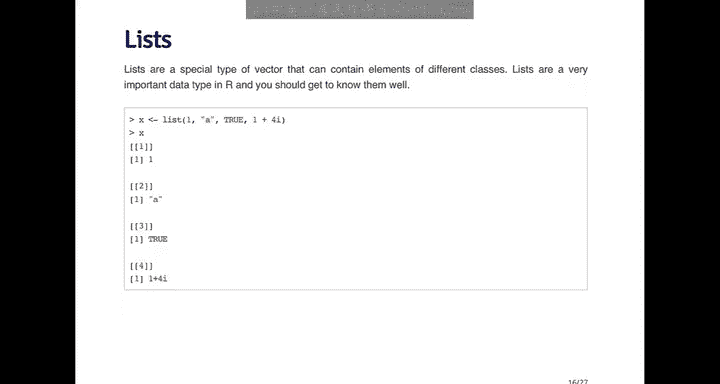

# 029：数据类型 - 向量与列表 📊

在本节课中，我们将学习 R 语言中两种重要的数据结构：向量和列表。我们将了解如何使用 `c()` 函数创建向量，探索向量中不同类型元素的混合与强制转换规则，并学习如何显式地进行类型转换。最后，我们将介绍列表，这是一种可以容纳不同数据类型元素的灵活结构。

---

## 使用 `c()` 函数创建向量

`c()` 函数是另一个可用于创建对象向量的函数。你可以将 `c` 理解为“连接”的缩写，因为它可以用来将事物连接在一起。

以下是使用 `c()` 函数创建不同类型向量的示例：

*   **数值向量**：`x <- c(0.5, 0.6)` 创建一个长度为 2 的数值向量，第一个元素是 0.5，第二个元素是 0.6。
*   **逻辑向量**：`y <- c(TRUE, FALSE)` 创建一个逻辑向量。`TRUE` 和 `FALSE` 的简写是 `T` 和 `F`（大写）。因此，`c(T, F)` 会得到相同的对象。
*   **字符向量**：`z <- c("a", "b", "c")` 通过连接一串字符来创建字符向量。
*   **整数向量**：`a <- 9:29` 使用冒号运算符创建一个序列，从而创建整数向量。
*   **复数向量**：`c <- c(1+0i, 2+4i)` 创建复数向量，其中 `i` 是一个特殊符号，表示复数的虚部。

---

## 使用 `vector()` 函数创建向量

除了 `c()` 函数，你还可以使用 `vector()` 函数创建具有特定类型和长度的向量。

例如，`x <- vector("numeric", length = 10)` 将创建一个长度为 10 的数值向量。默认情况下，它会用默认值初始化向量。对于数值向量，默认值是 0。

---

## 向量中的混合类型与强制转换

上一节我们介绍了如何创建单一类型的向量。那么，如果你创建一个向量并混合两种不同类型的对象会发生什么？

一般规则是，R 会创建一个“最小公分母”向量。它不会报错，但会发生的情况是，它会将向量强制转换为那个“最小公分母”的类。

以下是几个例子：

*   **示例 1**：`y <- c(1.7, "a")`。这里混合了数值和字符。最小公分母是字符。因此，`y` 将是一个字符向量，第一个元素是字符串 `"1.7"`，第二个元素是字母 `"a"`。
*   **示例 2**：`z <- c(TRUE, 2)`。这里混合了逻辑值和数值。最小公分母是数值。`TRUE` 将被转换为数字。在 R 的约定中，`TRUE` 表示为数字 1，`FALSE` 表示为数字 0。因此，你将得到一个向量 `c(1, 2)`。
*   **示例 3**：`w <- c("a", TRUE)`。这里混合了字符和逻辑值。最小公分母再次是字符。最终得到的向量是 `c("a", "TRUE")`。注意，这里的 `"TRUE"` 是字符串，而不是逻辑值。

当你混合向量中的不同类型元素时，需要稍微注意 R 中可能发生的类型强制转换。因为你不会收到错误，但强制转换会在幕后发生。

---

## 显式类型转换

上一节我们讨论了在幕后发生的隐式强制转换。但你也可以使用通常以 `as.` 开头的函数，显式地将对象从一个类强制转换为另一个类。

例如，如果你想将某物转换为数值，可以使用名为 `as.numeric()` 的函数。如果你想转换为字符，可以使用函数 `as.character()`。

以下是应用这些函数的示例。假设我们从一个对象 `x` 开始，它是一个从 0 到 6 的整数序列：`x <- 0:6`。

*   **转换为数值**：`as.numeric(x)`。它打印出 `0 1 2 3 4 5 6`，看起来像整数对象，但它实际上是数值型。
*   **转换为逻辑值**：`as.logical(x)`。根据约定，0 是 `FALSE`，任何大于 0 的数字都将是 `TRUE`。因此，转换后我们得到 `FALSE TRUE TRUE TRUE TRUE TRUE TRUE`。
*   **转换为字符**：`as.character(x)`。它获取所有数字并将它们转换为字符，现在我们得到字符串 `"0"`, `"1"`, `"2"` 等。
*   **转换为复数**：`as.complex(x)`。这相当简单，它表示你有一个复数，其中所有虚部都为零：`0+0i 1+0i 2+0i ...`。

---

## 强制转换失败与 `NA` 值

需要注意的是，强制转换并不总是有效。当它失败时，你会得到所谓的 `NA` 值（不可用）。无意义的强制转换将导致 `NA`。

例如：
*   `x <- c("a", "b", "c")`
*   `as.numeric(x)`：真的没有办法将字母 A、B、C 转换为数值变量，因此你将得到一个 `NA` 向量，并附带一条警告信息。
*   `as.logical(x)`：同样，你会得到一个 `NA` 向量。

---

## 列表数据结构

接下来要讨论的数据类型是列表。我在本讲座前面稍微提到了列表。其概念是，列表是一种递归向量，但列表的每个元素都可以是不同类的对象。这使得列表对于携带不同类型的数据非常方便。它们在 R 中非常有用，并且变得非常常见，特别是与我们将要学习的其他类型的函数结合使用时。

以下是创建列表的示例：
`x <- list(1, "a", TRUE, 1+4i)`

这里我使用 `list()` 函数创建了一个名为 `x` 的列表。第一个元素是数值对象 `1`，第二个元素是字符 `"a"`，第三个是逻辑值 `TRUE`，第四个是复数 `1+4i`。这对于列表来说不是问题。

当我自动打印列表时，你会看到它的打印方式略有不同。它不像向量那样打印，因为每个元素都不同。你可以看到这里有双括号，元素由双括号索引。第一个元素是向量 `[[1]] [1] 1`，第二个元素是向量 `[[2]] [1] "a"`，第三个元素是向量 `[[3]] [1] TRUE`，第四个元素是向量 `[[4]] [1] 1+4i`。

你会注意到列表的元素周围有双括号 `[[]]`，而其他向量的元素只有单括号 `[]`。这是区分列表与其他类型向量的一种方式。

---

## 总结

本节课中，我们一起学习了 R 语言中的向量和列表。我们掌握了使用 `c()` 和 `vector()` 函数创建向量的方法，理解了当向量中混合不同类型数据时，R 会进行隐式的“最小公分母”强制转换。我们还学会了使用 `as.numeric()`, `as.character()` 等函数进行显式类型转换，并知道转换失败会产生 `NA` 值。最后，我们认识了列表这种强大的数据结构，它可以容纳任意不同类型的元素，通过双括号 `[[]]` 进行索引，为组织复杂数据提供了极大的灵活性。理解这些基础数据类型是进行有效 R 编程的关键。