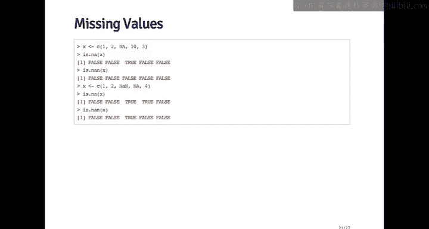

# 032：R语言中的缺失值处理 🧩


在本节课中，我们将要学习R语言中一个特殊且重要的概念——缺失值。我们将了解缺失值的两种主要类型（`NA`和`NaN`），学习如何检测它们，并理解它们之间的区别。

## 概述

在数据分析中，数据缺失是常见现象。R语言提供了专门的符号和函数来处理这些缺失值，确保分析的准确性和完整性。理解如何识别和处理缺失值是数据清洗和准备过程中的关键一步。

## 缺失值的类型

上一节我们介绍了缺失值的重要性，本节中我们来看看R语言中具体的缺失值类型。

R语言中的缺失值主要由两种符号表示：
*   **`NA`**：用于表示绝大多数情况下的缺失值。
*   **`NaN`**：特指“非数字”，通常由未定义的数学运算（如`0/0`或`Inf - Inf`）产生。

一个重要的关系是：**所有`NaN`值都被视为`NA`（即缺失），但并非所有`NA`值都是`NaN`。**

## 检测缺失值的函数

为了识别数据中的缺失值，R语言提供了专门的检测函数。

以下是两个核心的检测函数及其用途：
*   `is.na()`：用于检测对象中是否存在`NA`值（包括`NaN`）。
*   `is.nan()`：专门用于检测对象中是否存在`NaN`值。

## 实践示例：检测缺失值

让我们通过具体的代码示例来理解这些函数如何工作。

首先，我们创建一个包含普通数值和一个`NA`的数值向量。

```r
x <- c(1, 2, NA, 10, 3)
```

使用`is.na()`函数检测`x`中的缺失值。它会返回一个逻辑向量（`TRUE`/`FALSE`），指示每个元素是否缺失。

```r
is.na(x)
```
**输出**：`FALSE FALSE TRUE FALSE FALSE`
结果表示，向量`x`的第三个元素是缺失值（`NA`）。

接着，我们用`is.nan()`检测`NaN`。由于`x`中只有`NA`，没有`NaN`，所以全部返回`FALSE`。

```r
is.nan(x)
```
**输出**：`FALSE FALSE FALSE FALSE FALSE`

现在，我们创建一个同时包含`NA`和`NaN`的向量来观察区别。

```r
y <- c(1, NA, 3, NaN, 5)
```

再次使用两个函数进行检测：

```r
is.na(y)
```
**输出**：`FALSE TRUE FALSE TRUE FALSE`
函数`is.na()`将第二位的`NA`和第四位的`NaN`都识别为缺失值（`TRUE`）。

```r
is.nan(y)
```
**输出**：`FALSE FALSE FALSE TRUE FALSE`
函数`is.nan()`则只将第四位的`NaN`识别为`TRUE`，而`NA`不被认为是`NaN`。

这个例子清晰地展示了`is.na()`与`is.nan()`的不同之处。

## 缺失值的类

一个容易忽略的细节是，`NA`值本身也可以具有数据类型（类）。这意味着存在**数值型缺失值**、**字符型缺失值**、**整数型缺失值**等。尽管它们都显示为`NA`，但在内部可能属于不同的类，这在某些严格类型检查的函数中可能会有影响。



## 总结


本节课中我们一起学习了R语言中缺失值的核心知识。我们认识了两种缺失值符号`NA`和`NaN`，掌握了使用`is.na()`和`is.nan()`函数来检测它们的方法，并理解了`NaN`是`NA`的子集这一重要关系。正确处理缺失值是进行可靠数据分析的基础，在后续的数据清洗和计算步骤中务必留意它们的存在。