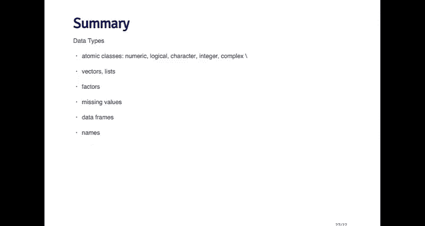

# 035：数据类型总结 📊

在本节课中，我们将系统性地总结R语言中的基本数据类型。我们将回顾原子向量、列表、因子、缺失值、数据框以及对象命名等核心概念，帮助你构建一个清晰的数据类型知识框架。


上一节我们介绍了R语言中各种数据结构的操作，本节中我们来看看如何系统地总结这些基本数据类型。

## 原子向量类

R语言中最基本的数据结构是原子向量，它要求所有元素必须属于同一类别。以下是主要的原子向量类别：

*   **数值型（numeric）**：用于存储实数，例如 `c(1.5, 2.8, 3.14)`。
*   **字符型（character）**：用于存储文本字符串，例如 `c("apple", "banana", "cherry")`。
*   **整型（integer）**：用于存储整数，通常通过在数字后加`L`来指定，例如 `c(1L, 2L, 3L)`。
*   **复数型（complex）**：用于存储复数，例如 `c(1+2i, 3-4i)`。

## 列表

列表是原子向量的一个重要例外，它允许包含不同类别的元素。你可以使用`list()`函数来创建列表。

```r
my_list <- list(1, "a", TRUE, 1+4i)
```

## 因子

因子是一种特殊的数据类型，专门用于编码分类数据，无论是有序数据还是无序数据。`factor()`函数用于创建因子。

```r
# 无序因子
gender <- factor(c("male", "female", "female", "male"))
# 有序因子
status <- factor(c("low", "medium", "high"), ordered = TRUE, levels = c("low", "medium", "high"))
```

## 缺失值

在R中，缺失值主要由`NA`（Not Available）表示。对于数值计算中产生的未定义结果（如0除以0），则用`NaN`（Not a Number）表示。

```r
x <- c(1, 2, NA, 4, NaN, 6)
is.na(x) # 检测NA和NaN
is.nan(x) # 仅检测NaN
```

## 数据框

数据框是用于存储表格数据的核心结构，其特点是每一列都可以是不同的数据类型。你可以使用`data.frame()`函数来创建数据框。

```r
df <- data.frame(
  name = c("Alice", "Bob", "Charlie"),
  age = c(25, 30, 35),
  score = c(85.5, 90.0, 77.3)
)
```

## 对象命名

为R对象（如向量的元素、列表的成员、数据框的行列）赋予名称，可以创建自描述性数据，使代码更易读。`names()`函数用于设置或获取名称。



```r
# 为向量元素命名
grades <- c(90, 85, 88)
names(grades) <- c("Math", "Science", "History")
```

本节课中我们一起学习了R语言基本数据类型的全景图。我们回顾了要求元素类型统一的原子向量（数值、字符、整型、复数），以及可以容纳混合类型的列表。我们还探讨了用于分类数据的因子、表示缺失信息的`NA`与`NaN`、存储表格的万能工具数据框，以及通过命名增强数据可读性的方法。掌握这些基础是高效使用R进行数据分析的关键。