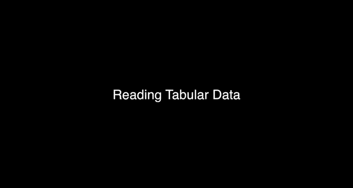
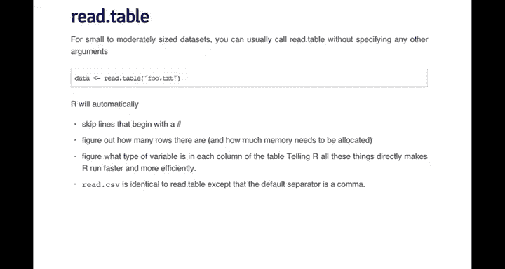

# 036：📊 读取表格数据

在本节课中，我们将要学习如何在 R 语言中读取和写入数据。R 提供了多种函数来处理不同类型的数据文件，我们将重点介绍其中最常用的一些函数，特别是用于读取表格数据的函数。

## 读取数据的主要函数

R 中有几个核心函数用于将数据读入工作环境。以下是其中最重要的几个：

*   **`read.table` 和 `read.csv`**：这两个函数用于读取表格数据，是 R 中最常用的数据读取函数。它们读取以行和列格式存储数据的文本文件，并返回一个 R 数据框。
*   **`readLines`**：此函数用于读取文本文件的各行。实际上，它可以读取任何类型的文件，并将内容以字符向量的形式返回给 R。
*   **`source`**：这个函数对于读取 R 代码文件非常重要。例如，如果你有保存到文件中的函数或其他 R 代码，`source` 函数会将这些代码全部读入 R 环境。
*   **`dget`**：此函数也用于读取 R 代码文件，但专门用于读取那些已被“反解析”为文本文件的 R 对象。我们稍后会对此进行更多讨论。
*   **`load` 和 `unserialize`**：这两个函数用于将二进制对象读入 R。

## 写入数据的对应函数

与读取函数相对应，用于写入数据的主要函数有：`write.table`、`writeLines`、`dump`、`dput`、`save` 和 `serialize`。它们的功能与各自的读取函数配对。

上一节我们介绍了数据读写的基本函数，本节中我们来看看最核心的 `read.table` 函数。

## 详解 `read.table` 函数

`read.table` 函数是将数据读入 R 最常用的函数。了解其参数的工作原理和含义至关重要。

以下是 `read.table` 函数的主要参数：

*   **`file`**：第一个参数很明显，是文件名或连接名（我们稍后会讨论连接）。通常，你需要提供一个字符串形式的文件名，即计算机中某个文件的路径。
*   **`header`**：这是一个逻辑标志，指示第一行是否为标题行。例如，如果第一行包含所有变量名，那么它实际上不是数据，而是标签行。你需要告诉 `read.table` 函数第一行是否包含变量名，或者第一行是否直接就是数据。
*   **`sep`**：代表“分隔符”。它是一个字符串，指示各列是如何分隔的。例如，如果文件由逗号分隔，那么分隔符就是逗号。有时文件可能由分号、制表符或空格分隔，你需要告诉 `read.table` 分隔符是什么。
*   **`colClasses`**：这是一个字符向量，其长度与数据中的列数相同。该向量指示数据中每一列的类别。例如，第一列是数值型，第二列是逻辑型，第三列是因子型等。`colClasses` 是一个向量，虽然不是必需的，但它可以告诉 `read.table` 每列数据的类别。
*   **`nrows`**：数据中的行数。此参数不是必需的，但可以使用。
*   **`comment.char`**：这是一个字符串，指示注释字符是什么。默认值是井号 `#`，该符号右侧的所有内容都会被忽略。你可以指定其他字符作为注释字符，以该注释字符开头的文件行将被忽略。
*   **`skip`**：从开头跳过的行数。有时文件开头可能有一些标题信息或非数据区域，你想直接跳过这些部分。你可以告诉 `read.table` 函数跳过前 10 行或前 100 行，然后从那里开始读取数据。
*   **`stringsAsFactors`**：此参数默认为 `TRUE`。其核心问题是：你是否希望将字符变量编码为因子？默认情况下，每当 `read.table` 遇到看起来是字符变量的数据列时，它会假定你希望将其作为因子变量读入。如果你不希望将其作为因子变量读入，可以将 `stringsAsFactors` 设置为 `FALSE`。

对于小型和中等规模的数据集（随着计算机性能日益提升，“小型”和“中等”的定义也在不断扩大），你通常可以只使用文件名而不指定其他任何参数来调用 `read.table`。例如，你可以写 `read.table("food.txt")`，它会自动处理不同列的数据类型、行数等问题。这将返回一个名为 `data` 的对象，它是一个数据框。它会自动跳过任何以注释符号开头的行，并确定行数和每列变量的类型。当然，你也可以指定所有这些参数，这样做的好处是使程序运行得更快、更高效。但对于中小型数据集来说，这样做优势不大，因为默认方式已经相当快速高效了。

## `read.csv` 函数

`read.csv` 函数与 `read.table` 完全相同，关键区别在于：`read.csv` 的默认分隔符是逗号 `,`，而 `read.table` 的默认分隔符是空格。`read.csv` 对于读取 CSV 文件非常有用。CSV 通常代表“逗号分隔值”，通常是从 Microsoft Excel 等电子表格程序中获取的文件格式。CSV 是一种非常常见的格式，大多数电子表格类程序都能理解。`read.csv` 指定的另一件事是，它总是将 `header` 参数设置为 `TRUE`。

---

本节课中我们一起学习了在 R 中读取和写入数据的基础知识。我们重点介绍了 `read.table` 和 `read.csv` 这两个最常用的表格数据读取函数，详细解释了 `read.table` 的关键参数及其作用，并了解了 `read.csv` 作为其特化版本的便利之处。掌握这些函数是进行数据科学分析的第一步。