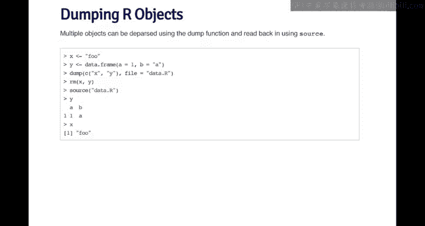

# 038：R语言中的文本数据格式 📄


在本节课中，我们将要学习R语言中除CSV和普通文本文件之外的两种文本数据格式。这些格式同样以文本形式存储数据，但包含了更多元数据信息，有助于更完整地保存和重建R对象。

上一节我们介绍了常见的表格数据格式，本节中我们来看看两种特殊的文本格式：`dput`/`dget` 和 `dump`/`source`。

## 文本格式的优势与劣势

这些格式的核心思想是：它们虽然是文本格式，但不像表格那样规整，因为它们包含了更多**元数据**。例如，如果你用 `dput` 或 `dump` 输出一个数据框，输出结果会包含数据框每一列的类别信息。这样，当你再次读取数据时，就无需重新指定这些信息。

使用这类机制存储或读取数据的主要优势在于：
*   它仍然是文本格式，便于查看和编辑。
*   它包含了元数据，避免了数据在传输或长期保存过程中元信息丢失的风险。

以下是文本格式的普遍优点：
*   **可编辑性**：虽然为了可重复性，通常不建议手动编辑，但在数据损坏时，你可以查看文件并尝试修复。
*   **长期保存**：文本格式的生命周期可能更长，有助于避免潜在的损坏问题。
*   **版本控制友好**：如果你使用像Subversion或Git这样的版本控制程序来跟踪文档变更，这些程序对文本数据的处理远比二进制数据更有用，能更有意义地追踪变化。

文本格式遵循了Unix哲学的一般原则，即倾向于将所有类型的数据存储为文本。然而，文本格式的一个缺点是**空间效率不高**，它们往往占用较多空间，因此通常需要进行压缩。

## 使用 `dput` 和 `dget` 处理单个对象

`dput` 函数可以接受任意R对象（除了一些特殊的对象类型），并生成一段R代码，这段代码本质上可以在R中重建该对象。

例如，我们创建一个简单的数据框：
```r
y <- data.frame(a = 1, b = "a")
```
然后，我们使用 `dput` 输出这个数据框。如果直接在控制台调用 `dput`，它会将结果显示在控制台：
```r
dput(y)
```
输出结果类似于一段R代码，它创建了一个包含两个元素的列表，每个元素都包含了数据、列名、行名以及对象的类别（这里是“data.frame”）。所有的元数据（如行名、列名和类别）都包含在输出中。

当然，通常你不会希望只打印到控制台，而是希望保存到文件中：
```r
dput(y, file = "y.R")
```
之后，你可以使用 `dget` 函数将这个文件读回R：
```r
new.y <- dget("y.R")
```
这样，你就重建了之前的数据框对象。`dput` 函数本质上就是编写了用于重建R对象的R代码。

## 使用 `dump` 和 `source` 处理多个对象

`dump` 函数与 `dget` 很相似，但关键区别在于：`dget` 只能用于单个R对象，而 `dump` 可以用于多个R对象。

使用 `dump` 时，你需要传递一个包含对象名称的字符向量。例如，我们创建两个对象：
```r
x <- "foo"
y <- data.frame(a = 1, b = "a")
```
然后，我们使用 `dump` 将这两个对象保存到文件中。参数 `c("x", "y")` 就是这两个对象的名称：
```r
dump(c("x", "y"), file = "data.R")
```
之后，我们可以选择移除这些对象。当需要将它们读回R时，我们可以对那个文件调用 `source` 函数：
```r
source("data.R")
```
执行后，你会发现 `x` 和 `y` 对象都已被重建。

## 总结



本节课中我们一起学习了R语言中两种用于保存和读取数据的文本格式。我们了解了 `dput`/`dget` 适用于处理单个R对象，它能生成重建该对象的R代码；而 `dump`/`source` 则适用于同时处理多个R对象。这两种格式的优势在于它们以文本形式保留了数据的结构元信息，便于长期保存、版本控制和在必要时进行人工检查，尽管它们可能不如二进制格式节省空间。掌握这些工具能让你更灵活地管理R工作环境中的数据。