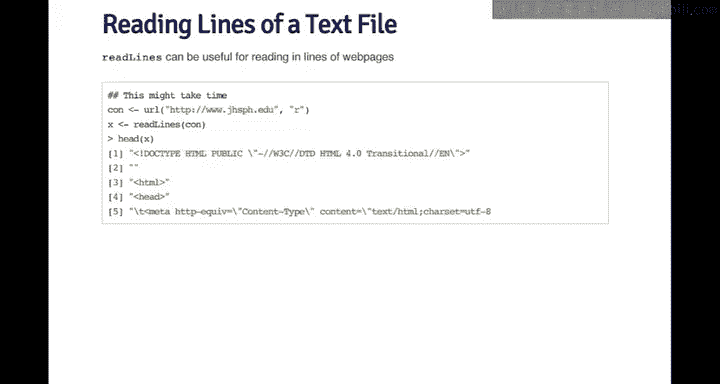
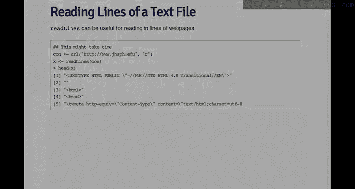

# 039：R语言与外部世界的连接接口 🖇️


在本节课中，我们将要学习R语言如何与外部世界进行数据交互，特别是通过“连接接口”来读取和写入文件、网页等外部资源。我们将了解不同类型的连接，并学习如何使用它们来灵活地处理数据。

## 概述

R语言提供了多种方式与外部世界进行接口交互。通常，有一些函数用于打开所谓的“连接”，以访问R外部的对象。最常见的连接类型是文件连接。

## 文件连接

上一节我们介绍了连接接口的基本概念，本节中我们来看看最常用的文件连接。`file` 函数用于打开一个到标准未压缩文件的连接。这对于读取文本文件非常有用。

`file` 函数有几个参数：
*   `description` 参数是文件的名称。
*   `open` 参数是一个标志，你需要知道其代码的含义：
    *   `"r"` 用于读取。
    *   `"w"` 用于写入。
    *   `"a"` 用于追加。
    *   `"rb"`、`"wb"`、`"ab"` 用于二进制文件的读、写、追加。

## 压缩文件连接

除了标准文件，R也能处理压缩文件。`gzfile` 和 `bzfile` 函数用于打开到压缩数据文件的连接。

*   `gzfile` 用于打开使用Gzip算法压缩的文件（通常扩展名为 `.gz`）。
*   `bzfile` 用于打开使用Bzip2算法压缩的文件（通常扩展名为 `.bz2`）。

## 连接接口的用途

连接功能非常强大，它允许你以比一次性读取整个文件更复杂的方式来导航文件和其他外部对象。

在多数情况下，你无需直接处理连接接口。例如，当你调用 `read.table` 并传入文件名时，它在后台会自动为你打开一个到该文件的连接，然后从该连接读取数据。

然而，有时直接使用连接会很有用，例如当你只想读取文件的一部分时。

以下是使用连接读取文件部分内容的示例：

```r
# 打开一个到压缩字典文件的连接
con <- gzfile("words.gz")
# 读取该连接的前10行
readLines(con, 10)
```

类似地，`writeLines` 函数可用于将文本行写入文件。你传入一个字符向量，该向量的每个元素将成为文本文件中的一行。

## 网页连接

连接不仅可以用于文件，也可以用于其他对象，例如网页。`url` 函数可用于创建到网页的连接。

以下是使用连接从网页读取数据的示例：

```r
# 创建一个到网站的连接
con <- url("http://www.jhsph.edu", "r")
# 从该连接读取文本行
x <- readLines(con)
# 查看前几行内容
head(x)
```

`url` 函数对于创建到非文件对象的连接很有用，然后使用 `readLines` 从该连接读取文本。这是除了使用 `read.table` 或 `read.csv` 等函数之外，另一种读取数据的方式。

## 总结





本节课中我们一起学习了R语言中连接接口的使用。我们了解到，连接抽象了与R外部各种对象（无论是文件、网页还是其他资源）的交互机制。我们学习了如何创建到普通文件、压缩文件以及网页的连接，并掌握了如何使用 `readLines` 和 `writeLines` 等函数通过连接进行数据的读取和写入。掌握连接接口能让你更灵活、更高效地处理外部数据。