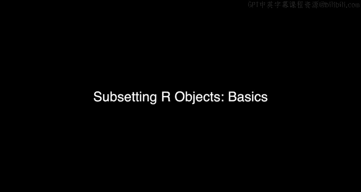
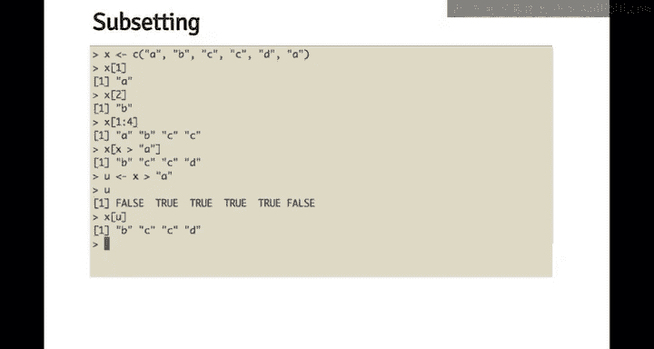

# 040：R语言子集操作基础 🧩



在本节课中，我们将学习R语言中一个非常核心的操作：如何从向量、列表等对象中提取或选择特定的元素。这个过程被称为“子集化”。掌握子集操作是高效处理和分析数据的基础。

上一节我们介绍了R语言的基本数据类型，本节中我们来看看如何从这些数据对象中提取我们需要的部分。

---

## 子集操作符简介

R语言提供了三种主要的操作符来提取对象的子集：
*   **单方括号 `[ ]`**
*   **双方括号 `[[ ]]`**
*   **美元符号 `$`**

理解它们之间的区别至关重要。

### 单方括号 `[ ]`

单方括号操作符的核心原则是：**它总是返回一个与原始对象类别相同的对象**。

*   如果你对一个向量使用 `[ ]`，返回的还是一个向量。
*   如果你对一个列表使用 `[ ]`，返回的还是一个列表。
*   此外，单方括号操作符**可以用于选择多个元素**。

### 双方括号 `[[ ]]` 与美元符号 `$`

双方括号操作符主要用于提取**列表或数据框中的单个元素**。

*   由于列表中的元素可以是不同类别（例如，第一个是数值向量，第二个是数据框），因此使用 `[[ ]]` 提取出的对象的类别**不一定**是列表，它可能是任何其他类别。
*   美元符号 `$` 用于按**名称**提取列表或数据框中的元素。它的语义与双方括号类似，提取出的元素类别也可能与原始对象不同。

---

## 向量的子集化

让我们通过具体的例子来理解如何对向量进行子集操作。我们将使用两种主要的索引方式：数值索引和逻辑索引。

### 使用数值索引

数值索引是指通过元素在向量中的位置（1， 2， 3...）来提取它们。

以下是使用数值索引的例子：
*   `x[1]` 提取第一个元素。
*   `x[2]` 提取第二个元素。
*   `x[1:4]` 提取第1到第4个元素。

```r
x <- c("a", "b", "c", "c", "d", "a")  # 创建一个字符向量
x[1]    # 返回 "a"
x[2]    # 返回 "b"
x[1:4]  # 返回 c("a", "b", "c", "c")
```

### 使用逻辑索引

逻辑索引是指通过一个与原始向量等长的逻辑值（`TRUE`/`FALSE`）向量来提取元素。只有对应位置为 `TRUE` 的元素会被选中。

以下是使用逻辑索引的例子。我们想提取所有大于字母“a”的元素。字母在R中有字典顺序。

```r
x <- c("a", "b", "c", "c", "d", "a")
x > "a"  # 返回逻辑向量：FALSE, TRUE, TRUE, TRUE, TRUE, FALSE

# 直接使用逻辑比较进行子集化
x[x > "a"]  # 返回 c("b", "c", "c", "d")

# 或者，先创建逻辑向量，再用它来子集化
u <- x > "a"
x[u]        # 同样返回 c("b", "c", "c", "d")
```

---

## 总结

本节课中我们一起学习了R语言子集操作的基础知识。

我们介绍了三种子集操作符：`[ ]`、`[[ ]]` 和 `$`，并重点讲解了它们的不同用途。我们通过大量示例练习了如何对向量使用**数值索引**和**逻辑索引**来提取需要的元素。理解并熟练运用这些子集化技巧，是后续进行数据筛选、清洗和分析的关键第一步。



在接下来的课程中，我们将把这些概念应用到更复杂的结构，如列表和数据框上。