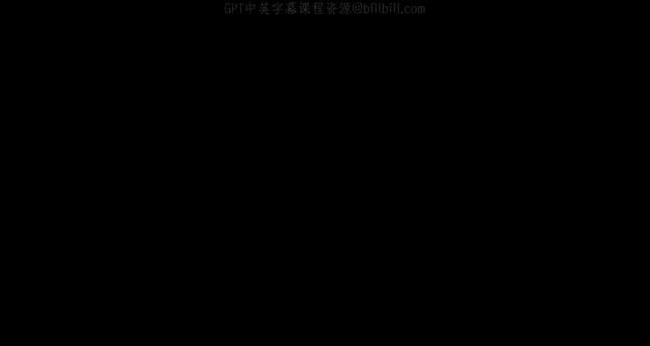

# 046：Swirl入门指南 🚀

在本节课中，我们将学习一个名为Swirl的交互式R语言学习工具。Swirl由约翰霍普金斯大学生物统计学系的Nick Carchedi开发，旨在帮助用户以自主节奏、互动方式掌握R语言。我们将了解它的基本功能、使用方法以及在本课程中的定位。

---

## 概述 📋

Swirl全称为“Statistics with Interactive R Learning”，是一个在R控制台内运行的交互式学习系统。它通过一系列循序渐进的课程，引导用户实践R语言的各个方面。与传统的“观看讲座后完成作业”模式不同，Swirl允许你在指导下一步步操作，从而更直观地学习和练习。

---

## Swirl的核心特点 ✨

上一节我们介绍了Swirl的基本概念，本节中我们来看看它的核心特点。

Swirl的设计目标是让R语言学习变得更加互动和高效。以下是它的几个关键特性：

*   **交互式学习**：在R控制台内直接输入指令并得到即时反馈。
*   **自主节奏**：你可以根据自己的理解和时间安排学习进度。
*   **引导式实践**：系统提供明确的步骤指导，无需完全自行摸索。
*   **课程模块化**：包含多个针对R语言不同方面的独立课程。

---

## 如何使用Swirl 🛠️

了解了Swirl的特点后，接下来我们看看如何开始使用它。使用Swirl主要涉及安装、加载课程和开始学习几个步骤。

以下是启动Swirl的基本流程：

1.  **安装Swirl包**：在R控制台中运行 `install.packages("swirl")`。
2.  **加载Swirl库**：安装后，通过 `library(swirl)` 命令加载。
3.  **启动Swirl**：输入 `swirl()` 并按回车，即可进入交互学习界面。
4.  **选择课程**：根据提示，从课程列表中选择你想要学习的内容。
5.  **跟随指导学习**：按照屏幕上的指令，在 `>` 提示符后输入你的答案或代码。

---

## Swirl在本课程中的角色 🎓

我们已经知道了如何使用Swirl，现在来明确一下它在整个《数据科学R语言基础》课程中的定位。

Swirl模块是本课程提供的一个**实验性补充功能**。它完全**可选**，不作为强制要求。你可以选择不完成这些模块，依然能够顺利学习课程并取得好成绩。

然而，完成Swirl模块可以带来额外益处：
*   **获得额外学分**：完成Swirl课程可在编程作业部分获得少量额外加分。
*   **强化学习效果**：通过互动练习加深对R语言概念的理解。
*   **增加学习乐趣**：以一种有趣、动手操作的方式巩固知识。

---

## 总结与鼓励 🌟

本节课中，我们一起学习了Swirl这个强大的交互式R语言学习工具。我们了解了它的起源、核心互动学习方式、基本使用方法以及它在本课程中作为可选补充资源的定位。

尽管Swirl模块不是必修内容，但我强烈鼓励你尝试使用它。我相信这个过程会充满乐趣，并能有效提升你的R语言实践能力。现在，你可以打开R控制台，输入 `install.packages("swirl")`，开始你的互动学习之旅了。