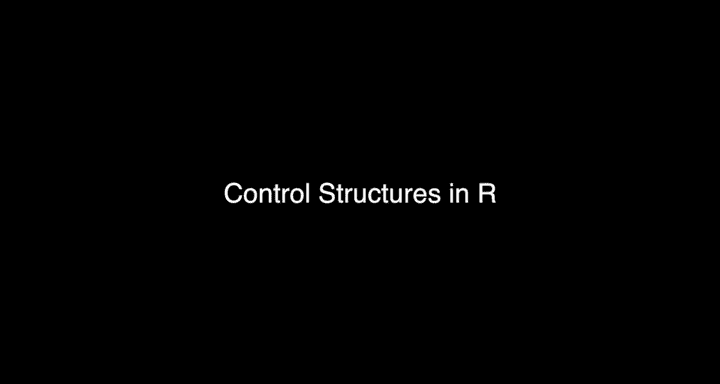
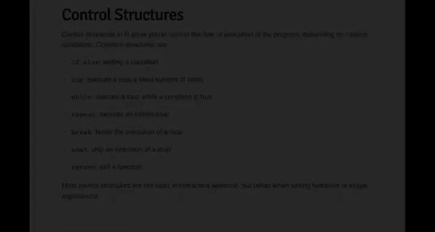
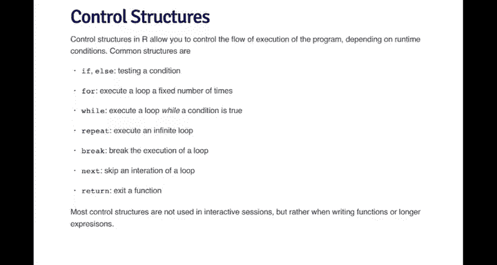

# 047：R语言控制结构介绍 🧭

在本节课中，我们将学习R语言中的控制结构。控制结构允许你控制R程序的执行流程，其基本概念与其他编程语言中的控制结构非常相似。

## 概述

控制结构是编程中用于控制代码执行顺序和逻辑的核心工具。在R语言中，它们主要用于编写函数或程序，而非交互式会话。

## 基本控制结构

以下是R语言中几种基本的控制结构：

*   **`if`-`else`**：用于测试逻辑条件，并根据条件真假执行不同的代码块。
*   **`for`**：用于执行固定次数的循环。
*   **`while`**：只要给定条件为真，就重复执行一个循环。
*   **`repeat`**：用于创建一个无限循环，通常需要配合`break`语句来退出。
*   **`break`**：用于立即退出任何类型的循环（如`for`、`while`、`repeat`）。
*   **`next`**：用于跳过当前循环的剩余部分，直接进入下一次迭代。
*   **`return`**：用于从函数中退出并返回一个值。

## 使用场景

上一节我们介绍了各种控制结构，本节中我们来看看它们的主要使用场景。这些结构通常不用于交互式会话（例如在R命令行中直接输入），而是更多地应用于以下情况：

*   编写R脚本或程序。
*   在自定义函数中实现复杂的逻辑。

## 总结

本节课中我们一起学习了R语言的控制结构。我们了解了`if`-`else`、`for`、`while`、`repeat`、`break`、`next`和`return`等基本结构及其用途。掌握这些结构对于编写高效、逻辑清晰的R程序至关重要。