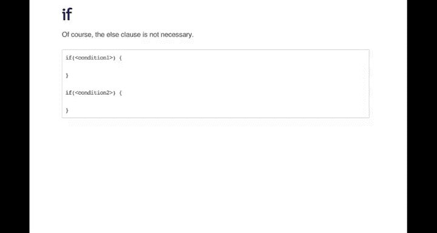

# 048：控制结构if-else 🧠


在本节课中，我们将要学习R语言中一个非常基础且重要的控制结构：`if-else`语句。它允许我们根据特定条件是否为真，来决定执行哪一段代码。这对于编写能够根据不同情况做出决策的程序至关重要。

## 什么是if-else结构？ 🤔

上一节我们介绍了控制结构的基本概念，本节中我们来看看`if-else`的具体形式。

第一个结构是`if`。`if`与`else`结合，允许你测试逻辑条件，并根据该条件是`TRUE`（真）还是`FALSE`（假），让R程序执行不同的操作。

所以，如果条件为真，你就执行一些操作；否则（`else`），你就执行另一些操作。这是一种典型的结构。

`else`部分是可选的。因此，你可以只有一个`if`语句，在条件为真时执行某些操作。但如果你希望有替代方案，也可以包含`else`部分。

如果你需要测试的条件不止一种，你可以使用`if`、`else if`，最后是`else`。在类似的结构中，可以有任意数量的`else if`条件，而`else`必须放在最后。

## 在R中编写if-else的几种方式 ✍️

R语言中编写`if-else`结构有几种不同的方式，这与其他语言略有不同。

以下是第一种标准方式：
```r
if (x > 3) {
  y <- 10
} else {
  y <- 0
}
```
如果符号`x`大于3，那么你将`y`设置为10。如果它不大于3，那么你将`y`设置为0。

在这个`if-else`结构内部，根据`x`的值，将`y`赋值为一个特定的值。

然而，在R中，你可以用另一种方式实现：
```r
y <- if (x > 3) {
  10
} else {
  0
}
```
你可以说`y`等于整个`if-else`结构的结果。如果`x`大于3，`y`就是10，否则就是0。这也是一种有效的写法。

有时，这种写法很有用，因为它让你意识到整个`if-else`结构都是为了给`y`赋值。

## 关于else子句和多个条件 📝

正如前面所说，`else`子句并非绝对必要。

你可以只测试条件并执行某些操作，如果条件恰好为假，就什么也不做。如果你愿意，也可以连续测试多个条件。

以下是关键点总结：
*   `else`部分是可选的。
*   你可以使用`else if`来测试一系列条件。
*   你可以只有`if`而没有`else`。

---



本节课中我们一起学习了R语言中的`if-else`控制结构。我们了解了它的基本语法、两种不同的赋值写法，以及`else`子句的可选性。掌握`if-else`是编写具有条件判断功能的R程序的基础。